# tick-tack-done — TTD-AUD-75 a 79: calendario, composer único, racha y puntuación, Foco y Tokens/MCP (escritorio y móvil)

- **Aplicación:** https://todo.reflexionia.com
- **Repositorio:** https://github.com/povedica/tick-tack-done
- **Base del análisis:** rama `codex/ttd-audit-remaining` = **PR #73** (borrador, abierta, sin fusionar), commit `ab21786` (21/10/2026 18:53, hora de Madrid). **No** se parte de `main` (`eb5971c`), porque #73 contiene todo lo acumulado: TTD-AUD-74, iconos del rail y lo de #71 integrado (`e60c84b`).
- **Fecha:** 21/10/2026 (hora de Madrid)
- **Origen:** revisión de Pablo del 21/10/2026 por la tarde, con sus capturas, más capturas de referencia de TickTick (solo lectura) y de ttd tomadas el mismo día.
- **Documento autónomo:** contiene todo lo necesario para implementar estos cinco hallazgos sin la especificación general.
- **Rutas de código:** `web/` = `apps/web/src/`, `api/` = `apps/api/src/`, `domain/` = `packages/domain/src/`, `sdk/` = `packages/sdk/src/`. Las líneas son de `ab21786`; si se han desplazado, localiza el código por el símbolo.
- **Puntos de corte usados en este documento:** **escritorio** ≥ 1024 px (`@media (min-width: 1024px)`, `shell/shell.css:695`); **móvil** ≤ 768 px, con referencia 390×844. Entre 769 y 1023 px la app ya usa el diseño estrecho (`useNarrow()` = `(max-width: 1023px)`, `shell/AppShell.tsx:329`): ahí se aplica lo de móvil salvo cuando se diga otra cosa.

## 0. Instrucciones para Codex

1. **Objetivo:** corregir lo que Pablo ha visto mal en la rama de #73 y acercar a TickTick cinco áreas: **75** Calendario, **76** composer único de «Añadir tarea», **77** racha y puntuación, **78** Foco/Pomodoro y **79** Tokens y MCP.
2. **Rama:** trabaja **sobre `codex/ttd-audit-remaining`** (PR #73) o sobre una rama nueva creada desde ella. No partas de `main`.
3. **Una sola PR**, con **un commit por punto** (y subcommits si hace falta dentro de 75):
   - `fix(TTD-AUD-75): calendar sidebar filters, no detail pane, header fold, chip time, drag & drop and task peek`, con subcommits recomendados para lo último de Pablo:
     - `fix(TTD-AUD-75.7): filled circular today mark across calendar views and pickers`
     - `fix(TTD-AUD-75.8-9): compact TickTick-like calendar header and left-only secondary sidebar`
     - `fix(TTD-AUD-75.10): compact all-day chips with +N overflow and expandable band`
     - `refactor(TTD-AUD-75.11): shared PeriodNavigator for calendar and weekly report`
   - `feat(TTD-AUD-76): single TaskCard composer for global and calendar add`
   - `fix(TTD-AUD-77): move streak/score into avatar menu`
   - `feat(TTD-AUD-78): TickTick-like Pomodoro screen with overview and focus record`
   - `feat(TTD-AUD-79): tokens & MCP list, connected apps and expiry`
     Título de la PR: `fix(TTD-AUD-75..79): calendar, composer, streak, focus and tokens polish`.
4. **Reglas (las de siempre):**
   - **Solo tokens** de `web/styles/tokens.css`. Nada de colores fijos ni valores mágicos nuevos; si falta un token, se crea en **tema claro y oscuro** (sección 3 y la tabla de tokens de 75.7-75.11). Las medidas en px de este documento son el objetivo visual: exprésalas con tokens existentes (`--sp-*`, `--fs-*`, `--radius-*`) o con los nuevos.
   - **i18n:** ningún texto en el código; cada clave nueva en `es` y `en` (`web/i18n/es.ts`, `en.ts`, `extra.ts`). Las claves propuestas están en cada punto.
   - **Accesibilidad:** roles, `aria-*`, foco visible (`--focus-ring`), uso completo con teclado y táctil con objetivos de **44 px** en móvil (`--tap: 2.75rem`).
   - **Tests primero:** cada punto lleva al menos un test que falla antes y pasa después (unitario, de componente y Playwright con viewport de escritorio **1280×800** y de móvil **390×844**).
   - `pnpm -r lint`, `pnpm -r typecheck`, `pnpm -r test` y los e2e afectados en verde.
   - No toques datos de producción. Solo cambia el contrato de la API donde este documento lo dice (78 y 79), con OpenAPI y SDK regenerados.
   - Anota el estado de 75–79 en `docs/audit/ESTADO.md`.
5. **Verificación final:** recorre los criterios de aceptación uno a uno e indica en la PR cuáles has comprobado, cómo y en qué viewport. Adjunta capturas de escritorio y móvil, en claro y oscuro, de cada pantalla tocada.

## 1. Punto de partida: qué hay en la PR #73 y qué ve Pablo

### 1.1 Estado de la PR #73 (comprobado el 21/10/2026 a las 20:20, hora de Madrid)

- **Título:** «fix(audit): calendar quick add, rail states and audit recovery».
- **Estado:** **abierta, en borrador, sin fusionar** (`draft: true`, `merged: false`, `mergeable_state: clean`). Rama `codex/ttd-audit-remaining` → `main`. Última actualización: 21/10 18:53.
- **13 commits sobre `main`**, entre ellos:
  - `0ff1fd5` (18:11) `fix(calendar): add slot quick capture with range selection`: **TTD-AUD-74**. Crea `web/features/capture/components/QuickAddPopover.tsx`, `quick-add-popover.css`, `web/features/capture/calendar-slot.ts`, añade `@floating-ui/react` 0.27.20, el modo `calendar` de `web/features/tasks/TaskComposer.tsx`, `onCreateAt` y fantasma en `HourGrid.tsx` y `DayGrid` (`Places.tsx`), y `apps/web/e2e/calendar-quick-add.spec.ts`.
  - `ab21786` (18:53) `style(nav): TickTick-like active/inactive rail icons`: anexo de los iconos del rail (`web/shell/RailSectionLink.tsx`, tokens `--rail-icon-*`).
  - `e60c84b` (18:47) integra `main` (#71) en la rama.
  - `97ec616` `fix(tokens): paginate activity with recoverable loading errors` (actividad de tokens con cursor).
  - Otros: cuentas atrás (TTD-AUD-21 a 24), contraste (25), i18n, motivos de Control.
- **70 ficheros** cambiados respecto a `main` (+4419 / −421).

### 1.2 Dos fuentes que no coinciden (importante para verificar)

| Fuente                                                                                                                                     | Qué se ve                                                                                                                                                                                            | Qué código es                                                                                                                                                                                                                                      |
| ------------------------------------------------------------------------------------------------------------------------------------------ | ---------------------------------------------------------------------------------------------------------------------------------------------------------------------------------------------------- | -------------------------------------------------------------------------------------------------------------------------------------------------------------------------------------------------------------------------------------------------- |
| **Capturas de Pablo** (`TTD-AUD-75_a` a `75_e`, `76_a`, `77_a/_b`, `78_a/_b`, `79_a`)                                                      | Popover de creación al hacer clic en el calendario, minicalendario en el sidebar del calendario, widget «🔥 14/100» en el rail, Foco con anillo SVG y tarjetas, Tokens agrupados («Tokens manuales») | **Entorno local de Pablo con la rama de #73** (confirmado por Pablo el 21/10 a las 20:27). Coincide con `QuickAddPopover`, `CalendarSidebar`, `ControlChip compact`, `.focus-timer-ring` y `groupTokens`. **Son las evidencias del estado actual** |
| **https://todo.reflexionia.com** (capturas `TTD-PROD_r75_*`, tomadas desde la caja con la sesión de Pablo a las ~20:20). **Solo contexto** | Clic en un hueco **no** abre popover; clic en una tarea **navega** a `/list/…?task=` con el panel derecho; el rail muestra «1 día · 18 Atrasado»; Foco sin anillo grande                             | **Anterior a #71.** El bundle público (`/assets/index-BqdjccDp.js`, `last-modified` 21/10 10:42 hora de Madrid) **no contiene** `calendar-quick-add`, `hour-ghost`, `focus-timer`, `calendar-mini` ni `token-group-title`                          |

**Conclusión:** producción no tiene desplegado ni #71 ni #73 (es un `main` antiguo). Pablo revisa su entorno local con la rama de #73. **Este documento parte del código de #73**, y las capturas `TTD-PROD_r75_*` solo se citan como contexto. Antes de dar por buena cualquier verificación en `todo.reflexionia.com`, confirma qué commit está desplegado.

### 1.3 Resumen de lo que hay en #73 para cada punto

| ID    | Punto                                                                                                    | En #73                                                                                                                                                                                                                                                                                                                                                     | Estado                                                            |
| ----- | -------------------------------------------------------------------------------------------------------- | ---------------------------------------------------------------------------------------------------------------------------------------------------------------------------------------------------------------------------------------------------------------------------------------------------------------------------------------------------------- | ----------------------------------------------------------------- |
| 75.1  | Filtros del calendario en el sidebar secundario (All, Listas, Filtros, Etiquetas, Calendarios suscritos) | `CalendarSidebar` solo tiene el minicalendario (`web/shell/CalendarSidebar.tsx`; su propio comentario dice «Source checkboxes can move here … in a later pass»). El filtro de lista es un `<select>` en la barra (`Places.tsx:CalendarPage`, `:499-522`) y las fuentes están en el menú «⋯» (`CalendarVisibility`, `:1620`)                                | **No implementado**                                               |
| 75.2  | Sin panel de detalle en Calendario                                                                       | `sectionShowsDetailPane` devuelve `true` para `calendar`, `focus`, `matrix`, `search` y `stats` (`web/shell/section-of.ts`)                                                                                                                                                                                                                                | **No implementado** (al revés)                                    |
| 75.3  | Botón de plegar el sidebar arriba, junto al título                                                       | Solo existe `.rail-toggle` abajo del rail (`web/shell/IconRail.tsx:127-136`)                                                                                                                                                                                                                                                                               | **No implementado**                                               |
| 75.4  | Chip con la hora aparte y estética de bloques                                                            | `chipLabel` concatena «hora + título» en un solo texto (`Places.tsx:1540-1547`), usado en `DayGrid` (`:1115-1130`)                                                                                                                                                                                                                                         | **A medias** (en `HourGrid` la hora ya va en `<small>`)           |
| 75.5  | Arrastrar y soltar (mover y redimensionar)                                                               | Solo hay arrastre para **seleccionar un rango** al crear (`HourGrid.tsx`, `dragging`, `:52-83` y `:355-400`). Ninguna tarea es arrastrable                                                                                                                                                                                                                 | **No implementado**                                               |
| 75.6  | Modal flotante de detalle de tarea y popover de evento externo                                           | Las tareas son `<Link to={taskQueryHref(…)}>` que abren el panel derecho (`HourGrid.tsx:474`, `Places.tsx:1115`). Los eventos externos ya abren `ExternalEventPopover` (`web/features/calendar/ExternalEvent.tsx:18`), centrado y sin anclar                                                                                                               | **Tarea: no implementado. Evento: a medias**                      |
| 75.7  | Día actual en círculo exacto y relleno (cabecera, selector, minicalendario, Mes, Año)                    | Cabecera: píldora sin `width` (`ui.css:2461-2472`); selector «Seleccionar semana»: aro (`weekly.css:380-383`); minicalendario: tinte (`shell.css:926`); número con `--ink-inverse` (negro en oscuro)                                                                                                                                                       | **A medias / mal**                                                |
| 75.8  | Cabecera compacta tipo TickTick                                                                          | `calendar-toolbar` con «‹ Hoy ›», `<select>` «Lista», título-botón en medio, segmentado y «+» relleno (`Places.tsx:469-635`); tres filas en móvil                                                                                                                                                                                                          | **No implementado**                                               |
| 75.9  | Sidebar secundario a la izquierda, nada a la derecha                                                     | `CalendarSidebar` ya está a la izquierda pero vacío; la columna derecha `DetailEmpty` es la que se ve como «sidebar» (`section-of.ts`)                                                                                                                                                                                                                     | **No implementado** (depende de 75.1 y 75.2)                      |
| 75.10 | Pastillas de todo el día compactas con «+N más»                                                          | Sin límite en `HourGrid.tsx:178-240`; pastillas de 28 px, casilla 22×24, título en dos líneas (`calendar.css:146-150`, `:610-628`); en Mes hay «+N» pero no ligado al alto real                                                                                                                                                                            | **No implementado** (Mes: a medias)                               |
| 75.11 | Navegador de periodo compartido (patrón del Reporte semanal)                                             | `WeekPicker.tsx` existe (también en producción) pero es del Reporte: modal, 44 px, divisores, `weekStart` fijo, textos fuera de i18n; el calendario usa `CalendarPeriod`/`CalendarJump`                                                                                                                                                                    | **No implementado** (hay base reutilizable)                       |
| 76    | Un único composer, fino y coherente                                                                      | `TaskComposer` tiene dos variantes visuales: la normal (dentro de `CaptureSheet`, con `<h1>` «Nueva tarea» y botón «Cancelar») y la de calendario (`calendar`), con pie de botones grises de 36 px (`TaskComposer.tsx:451-487`, `quick-add-popover.css:58-85`) y `textarea` con borde                                                                      | **A medias** (mismo componente, dos looks, ninguno como TickTick) |
| 77    | Racha y puntuación fuera del rail y del sidebar                                                          | `ControlChip` en el rail plegado (`IconRail.tsx:82`), en el sidebar (`Sidebar.tsx:197`) y en la barra móvil (`AppShell.tsx:188-192`). `AccountMenu` no lo incluye                                                                                                                                                                                          | **No implementado**                                               |
| 78    | Pantalla de Foco tipo TickTick                                                                           | `FocusPage` (`web/features/product/ProductPages.tsx:46-244`): anillo sin progreso hasta empezar, reloj descentrado, texto técnico, tarjetas `garden-card`, sin Pomo/Cronómetro, sin Resumen ni Registro, con panel de detalle                                                                                                                              | **A medias** (solo el anillo de TTD-AUD-20)                       |
| 79    | Tokens y MCP como en la propuesta                                                                        | Agrupación por cliente, «Caducado», «Gestionar», errores y secreto (35-46) sí. **Faltan**: lista compacta con filas plegables, vista de **aplicaciones conectadas** con «Revocar acceso» (sin API), **caducidad al crear** (sin API), actividad por aplicación (sin API), marca ⚠ en las filas, selector de cliente con estilo e instrucciones por cliente | **A medias** (ver 79)                                             |

## 2. Comparación TickTick frente a ttd (#73), elemento por elemento

Referencias: TickTick observado el 21/10/2026 en solo lectura (viewport 1280×800; capturas `REF-TICKTICK_r75_*` y `REF-TICKTICK_22/24/14/29/80-82`). ttd: capturas de Pablo en su entorno local con #73 (`TTD-AUD-75_a` a `79_a`).

| Elemento                          | TickTick                                                                                                                                                                                                                                                              | ttd (#73)                                                                                                                                                                                                      | Punto                     |
| --------------------------------- | --------------------------------------------------------------------------------------------------------------------------------------------------------------------------------------------------------------------------------------------------------------------- | -------------------------------------------------------------------------------------------------------------------------------------------------------------------------------------------------------------- | ------------------------- |
| Sidebar secundario del calendario | Minicalendario + **All ✓**, **Lists**, **Filters**, **Tags**, **Subscribed Calendars** (con las cuentas de Google), casilla a la derecha, filas de ~21 px                                                                                                             | Solo el minicalendario; el resto del sidebar, vacío                                                                                                                                                            | 75.1                      |
| Filtro de lista                   | En el sidebar (casillas)                                                                                                                                                                                                                                              | `<select>` «Lista: Todas las listas» en la barra superior                                                                                                                                                      | 75.1                      |
| Fuentes (calendarios externos)    | Sección «Subscribed Calendars» del sidebar                                                                                                                                                                                                                            | Menú «⋯» → `CalendarVisibility`                                                                                                                                                                                | 75.1                      |
| Panel derecho en Calendario       | **No existe**                                                                                                                                                                                                                                                         | «Sin tarea seleccionada» (`DetailEmpty`) ocupa ~440 px                                                                                                                                                         | 75.2                      |
| Botón de plegar el sidebar        | Icono de panel de 16 px **a la izquierda del título del mes**; con el sidebar plegado se queda en el mismo sitio (x≈56)                                                                                                                                               | `PanelLeft` abajo del todo del rail                                                                                                                                                                            | 75.3                      |
| Cabecera                          | Botón plegar · «October 2026» negrita ~15-16 px · a la derecha: «+», selector «Week ˅», «‹ Today ›», «⋯»                                                                                                                                                              | «‹ Hoy ›» · «Lista [select]» · «octubre de 2026 ˅» · segmentado Día/Semana/Mes/Agenda/Más · «+» azul relleno · «⋯»                                                                                             | 75.1, 75.3                |
| Selector de vista                 | Desplegable «Week ˅» (~126 px): Day D/1, Week W/2, Month M/3, Year Y/4, Agenda A/5, Multi-Day, Multi-Week, con atajo a la derecha                                                                                                                                     | Segmentado de 5 botones + «Más»                                                                                                                                                                                | 75.3 (opcional, ver 75.3) |
| Chip con hora en Mes              | Título con **hora a la derecha**, en gris y más pequeña; pill de 13-14 px de alto                                                                                                                                                                                     | «14:30 esto es una prueba» y «21:00 Pagar asistenta»: la hora va **dentro** del texto, en el mismo color                                                                                                       | 75.4                      |
| Bloque de tarea en Día/Semana     | Fondo suave del color de la lista, borde izquierdo de 2 px, título en 12 px y hora en 11 px gris debajo                                                                                                                                                               | Similar en `HourGrid`, pero con casilla, enlace subrayado y sin truncar bien                                                                                                                                   | 75.4                      |
| Arrastrar y soltar                | Mover entre días y horas, y estirar el borde inferior para cambiar la duración                                                                                                                                                                                        | No existe                                                                                                                                                                                                      | 75.5                      |
| Clic en una tarea                 | **Modal flotante** de ~266×200 px junto a la tarea (casilla, fecha en rojo si vence, bandera, título negrita, descripción, etiquetas, pie con lista y A / comentario / ⋯)                                                                                             | Abre el panel derecho de detalle; en producción incluso navega a `/list/…`                                                                                                                                     | 75.6                      |
| Clic en un evento externo         | Popover de lectura ~265×370 px: título, fecha y hora, aviso, repetición, invitados, ubicación, descripción, pie con el calendario                                                                                                                                     | `ExternalEventPopover` sin anclar, con menos datos                                                                                                                                                             | 75.6                      |
| Popover de creación (Calendario)  | Cabecera: icono y fecha (azul; rojo si es pasado) y bandera. Título «What would you like to do?», descripción **sin caja**, etiquetas, **pie solo con la lista y «⋯»**. Sin botón «Add»                                                                               | Fecha y bandera arriba, pero `textarea` **con borde** y un pie de 4 **botones grises de 36 px** («Bandeja», «🏷 +», «…», «Añadir»)                                                                              | 76                        |
| Día actual                        | Círculo azul **relleno**, número blanco, igual en cabecera, minicalendario y Mes                                                                                                                                                                                      | Píldora más ancha que alta en la cabecera; **aro** sin relleno en «Seleccionar semana»; tinte suave en el minicalendario                                                                                       | 75.7                      |
| Navegación entre periodos         | «‹ Today ›» a la derecha; el minicalendario del sidebar hace de selector                                                                                                                                                                                              | «‹ Hoy ›» a la izquierda + título-botón con desplegable de mes; el Reporte semanal tiene otro selector («‹ 19 oct – 25 oct ›» + modal)                                                                         | 75.8, 75.11               |
| Pastillas de todo el día          | Una línea, ~13-14 px de alto a 1280×800, sin borde, icono pequeño a la izquierda; la franja no crece (desbordamiento oculto)                                                                                                                                          | 28 px, casilla de 22×24, borde azul, títulos en dos líneas; la franja crece con cada tarea                                                                                                                     | 75.10                     |
| Lado del sidebar secundario       | Izquierda, con los filtros; nada a la derecha                                                                                                                                                                                                                         | Izquierda (solo minicalendario) **y** panel vacío a la derecha, que es el que se percibe como sidebar                                                                                                          | 75.9                      |
| Añadir rápido en Tareas           | Caja de una línea (~26 px de alto) con borde de acento al enfocar; chip de fecha a la derecha y chevron                                                                                                                                                               | Composer en línea con `+` y avión de papel (sin cambios en esta ronda)                                                                                                                                         | 76                        |
| «+» global                        | Popover/tarjeta con el mismo contenido que el del calendario                                                                                                                                                                                                          | `CaptureSheet`: velo oscuro, `<h1>` «Nueva tarea», tarjeta y botón «Cancelar»                                                                                                                                  | 76                        |
| Racha y puntuación                | **No están en el rail**; las estadísticas cuelgan del avatar (Settings, Statistics, Premium, Sign Out)                                                                                                                                                                | Caja blanca «🔥 14/100» que desborda el rail; tarjeta «2 días · 14/100 Atrasado» arriba del sidebar                                                                                                            | 77                        |
| Pantalla de Pomodoro              | Título «Pomodoro»; segmentado **Pomo / Stopwatch**; «Focus ›»; anillo de ~240 px con trazo de 3 px; «25:00» de ~38 px fino y centrado; botón «Start» pill de 113×32; **panel derecho Overview** (4 tarjetas) **y Focus Record** (lista por fecha con línea de tiempo) | Título «Foco», párrafo técnico, «Histórico completo», anillo gris de 8 px sin progreso, «15:00» descentrado, botones 15/25/50, tres `garden-card` sin estilo, «Empezar» suelto y **panel de detalle de tarea** | 78                        |
| Tokens y MCP                      | (No hay equivalente en TickTick: se sigue la propuesta v2 y sus bocetos)                                                                                                                                                                                              | Tarjetas grises, «Tokens manuales», tabla plana de 13 ámbitos con «lectura+escritura», «Actividad» y «Revocar» (rojo relleno)                                                                                  | 79                        |

## 3. Tokens nuevos (definir en `web/styles/tokens.css`, en `:root` y en `[data-theme='dark']`)

Siempre que se pueda, los tokens nuevos se derivan de los existentes con `color-mix`, de modo que heredan el acento elegido (`[data-accent=…]`) y el tema.

| Token                                                                             | Claro                                                                       | Oscuro                                               | Uso                                                                              |
| --------------------------------------------------------------------------------- | --------------------------------------------------------------------------- | ---------------------------------------------------- | -------------------------------------------------------------------------------- |
| `--cal-sidebar-row-h`                                                             | `1.75rem` (28 px)                                                           | igual                                                | Filas de All/Listas/Filtros/Etiquetas/Calendarios (75.1). En móvil: `var(--tap)` |
| `--cal-sidebar-section-gap`                                                       | `var(--sp-3)` (12 px)                                                       | igual                                                | Separación entre secciones (75.1)                                                |
| `--check-size`                                                                    | `1rem` (16 px)                                                              | igual                                                | Casillas del sidebar del calendario y del modal (75.1, 75.6)                     |
| `--cal-chip-h`                                                                    | `1.25rem` (20 px)                                                           | igual                                                | Alto de chip en Mes (75.4)                                                       |
| `--cal-chip-time-ink`                                                             | `var(--ink-3)`                                                              | `var(--ink-3)`                                       | Hora del chip (75.4)                                                             |
| `--cal-block-border-w`                                                            | `2px`                                                                       | igual                                                | Borde izquierdo de bloques (75.4)                                                |
| `--drag-ghost-bg`                                                                 | `color-mix(in srgb, var(--accent) 18%, transparent)`                        | `color-mix(in srgb, var(--accent) 30%, transparent)` | Sombra de destino al arrastrar (75.5)                                            |
| `--drag-ghost-border`                                                             | `var(--accent)`                                                             | `var(--accent)`                                      | Borde de la sombra (75.5)                                                        |
| `--today-mark-bg` / `--today-mark-ink` / `--today-mark-size`                      | `color-mix(in srgb, var(--accent) 88%, black)` / `var(--on-accent)` / 28 px | igual (blanco, nunca `--ink-inverse`)                | Día actual relleno (75.7)                                                        |
| `--cal-header-h` / `--cal-header-h-mobile` / `--cal-control-h` / `--cal-title-fs` | 48 px / 52 px / 28 px / 18 px                                               | igual                                                | Cabecera compacta (75.8)                                                         |
| `--cal-chip-check` / `--cal-allday-gap`                                           | 12 px (14 px en Día móvil) / 2 px                                           | igual                                                | Pastillas de todo el día (75.10)                                                 |
| `--period-pop-w` / `--period-cell`                                                | 264 px / 32 px                                                              | igual                                                | Selector de periodo (75.11)                                                      |
| `--drag-lift-shadow`                                                              | `var(--shadow-md)`                                                          | `var(--shadow-md)`                                   | Bloque «levantado» (75.5)                                                        |
| `--resize-handle-h`                                                               | `0.375rem` (6 px)                                                           | igual                                                | Asa de redimensionar (75.5)                                                      |
| `--peek-w`                                                                        | `22rem` (352 px)                                                            | igual                                                | Modal flotante de tarea (75.6)                                                   |
| `--peek-max-h`                                                                    | `min(70dvh, 32rem)`                                                         | igual                                                | Ídem                                                                             |
| `--composer-card-w`                                                               | `var(--calendar-quick-width)` (19rem, 304 px)                               | igual                                                | Composer anclado (76)                                                            |
| `--composer-card-w-global`                                                        | `34rem` (544 px)                                                            | igual                                                | Composer global centrado (76)                                                    |
| `--icon-btn`                                                                      | `1.75rem` (28 px)                                                           | igual                                                | Botones de icono del composer/modal (76, 75.6)                                   |
| `--icon-glyph`                                                                    | `1rem` (16 px)                                                              | igual                                                | Tamaño del glifo; stroke 1.75                                                    |
| `--icon-ink`                                                                      | `var(--ink-3)`                                                              | `var(--ink-3)`                                       | Icono en reposo                                                                  |
| `--icon-ink-hover`                                                                | `var(--ink)`                                                                | `var(--ink)`                                         | Icono en hover/foco                                                              |
| `--icon-hover-bg`                                                                 | `var(--surface-2)`                                                          | `var(--surface-2)`                                   | Fondo en hover                                                                   |
| `--tag-chip-h`                                                                    | `1.25rem` (20 px)                                                           | igual                                                | Chips de etiqueta (75.6, 76)                                                     |
| `--focus-ring-size`                                                               | `15rem` (240 px)                                                            | igual                                                | Anillo del Pomodoro, escritorio (78). Móvil: `min(70vw, 16rem)`                  |
| `--focus-ring-stroke`                                                             | `3px` (track)                                                               | igual                                                | Grosor del anillo                                                                |
| `--focus-ring-progress-stroke`                                                    | `4px`                                                                       | igual                                                | Grosor del progreso                                                              |
| `--focus-ring-track`                                                              | `color-mix(in srgb, var(--ink) 10%, transparent)`                           | `color-mix(in srgb, var(--ink) 16%, transparent)`    | Pista del anillo                                                                 |
| `--focus-ring-progress`                                                           | `var(--accent)`                                                             | `var(--accent)`                                      | Progreso                                                                         |
| `--focus-ring-break`                                                              | `var(--success)`                                                            | `var(--success)`                                     | Progreso en descanso                                                             |
| `--focus-clock-fs`                                                                | `2.5rem` (40 px)                                                            | igual                                                | Reloj (móvil: `3rem`)                                                            |
| `--focus-panel-w`                                                                 | `clamp(320px, 38vw, 480px)`                                                 | igual                                                | Panel Resumen/Registro (78)                                                      |
| `--stat-card-bg`                                                                  | `var(--surface-2)`                                                          | `var(--surface-2)`                                   | Tarjetas de Resumen (78)                                                         |
| `--list-row-divider`                                                              | `var(--border)`                                                             | `var(--border)`                                      | Separadores finos de Tokens (79)                                                 |
| `--status-dot`                                                                    | `0.5rem` (8 px)                                                             | igual                                                | Punto de estado de Tokens (79)                                                   |

**No crear** colores fijos: todos los ejemplos «rojo», «gris», «azul» del documento se mapean a `--danger`, `--ink-3` y `--accent`.

**Corrección menor relacionada:** `.rail-badge` usa `#e13e39` y `#fff` fijos (`shell/shell.css:861-868`). Cámbialo a `var(--prio-high)` y `var(--on-accent)` en el commit de 77.

## TTD-AUD-75 — Calendario: filtros en el sidebar izquierdo, sin panel de detalle, cabecera compacta con botón de plegar, chips con la hora aparte, arrastrar y soltar, modal flotante de detalle, día actual relleno, pastillas de todo el día compactas y navegador de periodos compartido

- **Severidad:** Alta · **Área:** Calendario
- **Pantalla/URL:** `/calendar/day`, `/calendar/week`, `/calendar/multi-day`, `/calendar/month`, `/calendar/multi-week` (Agenda, Año y Trimestre solo en lo que se indica)
- **Depende de:** TTD-AUD-74 (ya en #73). Comparte con 76 el composer y con 78 la regla de paneles por sección.
- **Evidencia actual (Pablo, local con #73):**

<div class="pair"><figure>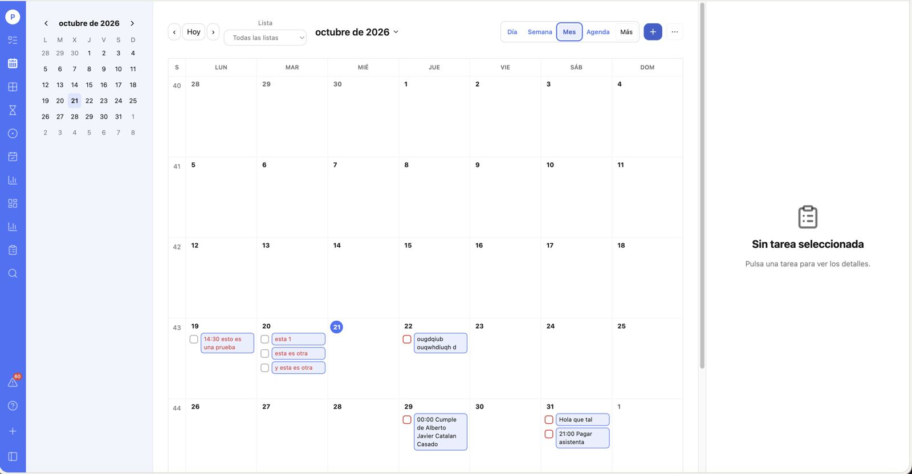<figcaption>ttd #73 — Mes: sidebar solo con minicalendario, «Lista: Todas las listas» arriba, panel «Sin tarea seleccionada», chips «14:30 esto es una prueba» y «21:00 Pagar asistenta»</figcaption></figure><figure>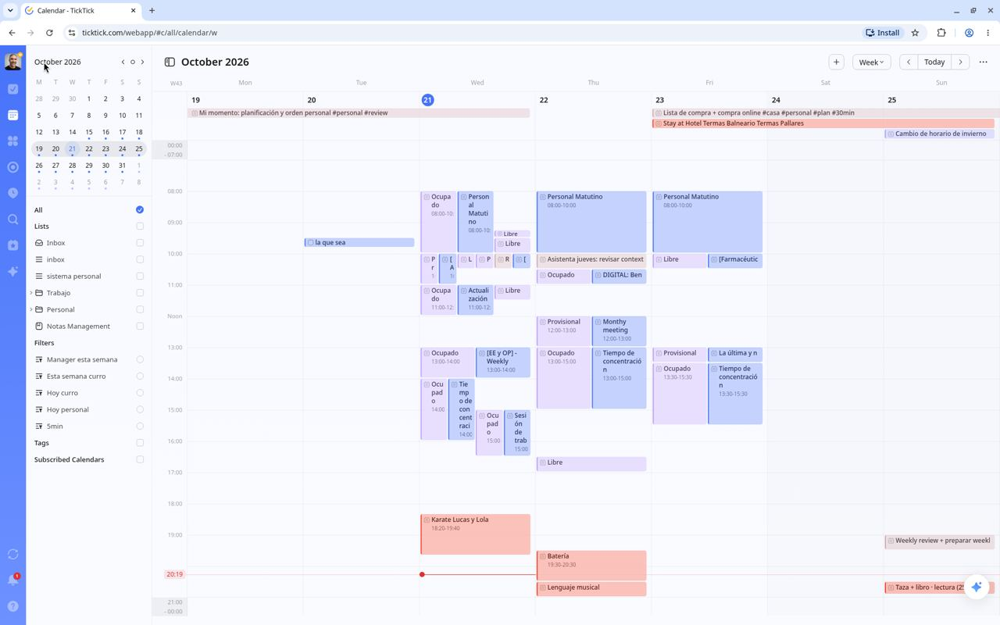<figcaption>TickTick — Semana: sidebar con minicalendario, All, Lists, Filters, Tags y Subscribed Calendars; sin panel derecho</figcaption></figure></div>

<div class="pair"><figure>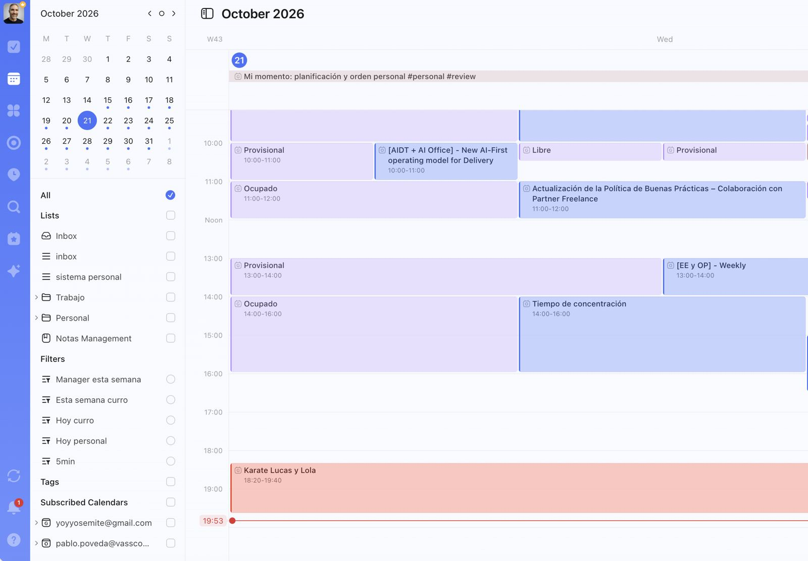<figcaption>TickTick (captura de Pablo) — Día: secciones del sidebar con casillas y las dos cuentas de Google en «Subscribed Calendars»</figcaption></figure><figure>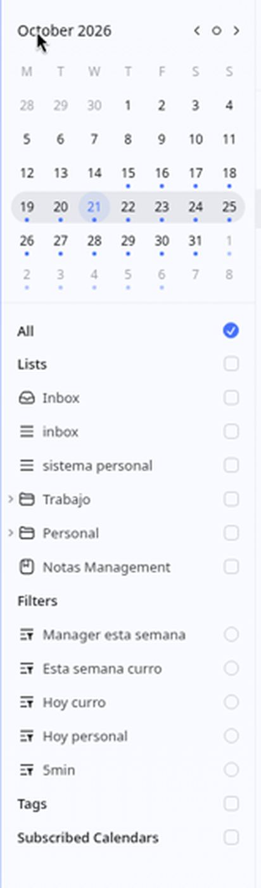<figcaption>TickTick — zoom del panel: títulos de sección en negrita gris, filas de ~21 px, casilla a la derecha</figcaption></figure></div>

<div class="pair"><figure>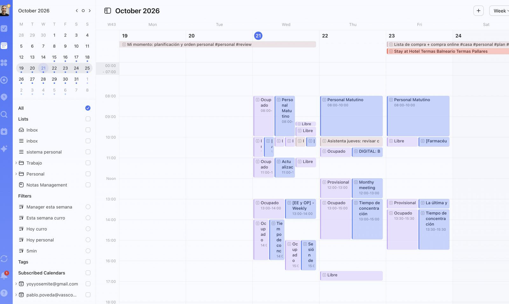<figcaption>TickTick (captura de Pablo) — Semana: solapes en columnas, semana actual resaltada en el minicalendario</figcaption></figure><figure>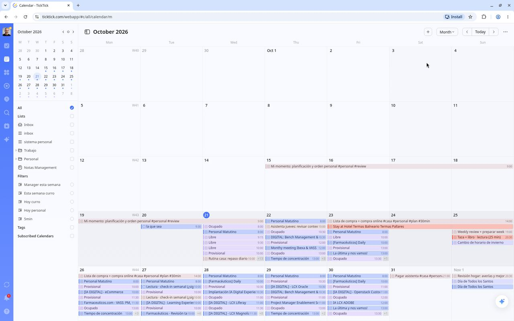<figcaption>TickTick — Mes con sidebar: pills con hora a la derecha, «+N» de desbordamiento</figcaption></figure></div>

- **Contexto (producción, `main` antiguo):** `TTD-PROD_r75_01_calendar_month_full`, `_02_calendar_week_full`, `_03_…_no_popover` y `_04_calendar_task_click_navigates_to_list_with_right_panel` (en el zip). No reflejan #73.

### 75.1 Filtros y fuentes en el sidebar secundario

#### Estado actual en #73 y causa

- `web/shell/CalendarSidebar.tsx:CalendarSidebar` solo pinta `.calendar-mini` (navegación del mes y rejilla de días que enlazan a `/calendar/day?date=`). No hay secciones. El comentario de cabecera deja las casillas «for a later pass».
- El filtro de lista vive en la barra: `web/features/places/Places.tsx:CalendarPage`, `<label className="calendar-range">` con `<select aria-label={messages.calendarQuickContext}>` (`:499-522`). Escribe `?project_id=` y es **de una sola lista**: no permite varias, ni filtros guardados ni etiquetas.
- La visibilidad de tareas y de calendarios externos está en el menú «⋯»: `CalendarMenu className="calendar-options"` → `CalendarVisibility` (`:607-633` y `:1620-1674`), con `showTasks` como **estado local** (`useState(true)`, `:425`) que se pierde al navegar.
- El filtrado se hace en `dated` (`:437-447`) solo por `contextProject`.
- El minicalendario no marca la semana ni el día visibles, ni pone puntos en los días con tareas (TickTick sí).

#### Especificación — escritorio (≥ 1024 px)

- **Estructura del sidebar** (`CalendarSidebar`, ancho `--sidebar-w` = 240 px, fondo `--sidebar-bg`, padding `var(--sp-3) var(--sp-3) var(--sp-4)`, scroll vertical propio con `overflow-y: auto` y `scrollbar-gutter: stable`):
  1. **Minicalendario** (ya existe), con estos cambios:
     - cabecera: mes y año en `--fs-sm` (13 px) peso 600, `--ink`; flechas `ChevronLeft/Right` de 14 px en botones de `--icon-btn` (28 px) con `aria-label` `calPrev`/`calNext`; en medio, un botón «●» («Hoy», `calToday`) de 28 px como en TickTick;
     - días: celdas de 28×24 px, `--fs-xs` (12 px), `--ink`; fuera del mes `--ink-faint`; **hoy**: círculo de 22 px `--accent` con texto `--on-accent` y peso 600;
     - **rango visible** (semana en Semana, día en Día, mes completo en Mes no se resalta): fondo `--sidebar-active-bg` con `border-radius: var(--radius-full)` en toda la fila de la semana (TickTick lo hace así);
     - **punto de 4 px** `--accent` bajo los días con al menos una tarea o evento visible según los filtros activos (`dayMarks` ya existe en `Places.tsx:1296`: reutilízalo);
     - clic en un día: navega a la vista actual con `?date=` (no fuerza `day`); mantiene `project_id`/filtros;
     - separación con la lista: `margin-bottom: var(--cal-sidebar-section-gap)` y línea `1px solid var(--border)`.
  2. **«Todo» (All)**: fila con casilla a la derecha. Marcada = sin filtros (todas las listas, todas las etiquetas y todos los calendarios visibles). Al marcar «Todo» se desmarca el resto; al marcar cualquier otro elemento, «Todo» se desmarca. Si se desmarca todo, vuelve «Todo» automáticamente.
  3. **Listas**: título de sección `calendarSidebarLists` («Listas»/«Lists»), carpetas plegables con `ChevronRight` de 12 px (giro de 90° en `--dur-fast`), y listas con su icono (Bandeja con `Inbox`, listas con `List`/`Folder`) y su color. Excluye las cerradas y las de notas (como el `<select>` actual).
  4. **Filtros** (filtros guardados, `api.listFilters()`, ya usado en `Sidebar.tsx:88`): icono `ListFilter` de 14 px. **Selección única** (radio) como en TickTick (círculo): un filtro excluye a los demás filtros, pero se puede combinar con listas (intersección).
  5. **Etiquetas**: título «Etiquetas»/«Tags»; lista plegable con las etiquetas del usuario (`api.listTags`), con el punto de color de la etiqueta. Si hay más de 8, se muestran 8 y «Ver todas (N)».
  6. **Calendarios suscritos** (`calendarSidebarSubscribed`, «Calendarios suscritos»/«Subscribed calendars»): agrupados por cuenta (correo de la cuenta Google, plegable) y, dentro, cada calendario con su color (`listCalendarSubscriptions()`, ya cargado en `CalendarPage`, `:421-424`). La casilla llama a `api.updateCalendarSubscription(id, { visible })` (lo que hace hoy `CalendarVisibility`). La cabecera de cuenta marca o desmarca todos sus calendarios.
  7. Al final, enlace discreto «Ajustes del calendario» (`settingsCalendar`) a `/settings/calendar`, `--fs-xs`, `--ink-3`.
- **Fila tipo:** alto `--cal-sidebar-row-h` (28 px); padding `0 var(--sp-2)`; gap 8 px; icono 14 px `--ink-3`; texto `--fs-sm` (13 px) peso 400 `--ink`, con elipsis; casilla a la derecha.
  - Títulos de sección: `--fs-xs` (12 px), peso 600, `--ink-3`, alto 24 px, `margin-top: var(--cal-sidebar-section-gap)`.
  - **Casilla** (`--check-size` 16 px): cuadrada `--radius-sm` para Listas, Etiquetas y Calendarios; circular para Filtros; borde `1.5px solid var(--border-strong)`; marcada: fondo `--accent` y check blanco `--on-accent` de 10 px; en calendarios externos, el fondo marcado es **el color del calendario** (como TickTick) y el check `--on-accent`.
  - Estados: hover fondo `--sidebar-hover-bg`, `--radius-sm`; foco: `outline: 2px solid var(--focus-ring)` con `outline-offset: -2px`; deshabilitada (sin conexión): opacidad 0.5 y `aria-disabled`; cargando: 3 filas `ui-skeleton` de 28 px por sección; error: línea `loadFailed` + botón «Reintentar» (`retry`) en `--fs-xs` dentro de la sección; vacío: sección oculta (no se pinta «Etiquetas» si no hay etiquetas), salvo «Listas», que siempre tiene Bandeja.
- **Quitar de la barra** el `<label className="calendar-range">` con el `<select>` de lista y, del menú «⋯», `CalendarVisibility`. En «⋯» quedan «Semana laboral» (`calWorkweek`), «Mostrar tareas completadas» si existe y «Ajustes del calendario».
- **Estado y URL:** un `useCalendarFilters()` (zustand con `persist` en `localStorage`, clave `tick-tack-done.calendar-filters`, versión 1) con `{ all: boolean; projectIds: string[]; filterId: string | null; tagIds: string[]; showTasks: boolean }`. Se refleja en la URL para poder compartirla: `?lists=id1,id2&filter=id&tags=t1,t2`. **Compatibilidad:** `?project_id=` y `?list=` siguen funcionando (se traducen a `lists=`).
- **Aplicación del filtro (`dated`):**
  - Listas: `task.project_id ∈ projectIds`.
  - Etiquetas: la tarea tiene **alguna** de las etiquetas (`OR`).
  - Filtro guardado: se piden las tareas con `api.filterTasks(id, { dueAfter, dueBefore, status: 'active' })` (`web/features/tasks/collect.ts:75`) y se intersecan por id.
  - Las tres dimensiones se combinan con `AND`. Los eventos externos solo dependen de la sección «Calendarios suscritos».
  - **Lista de contexto del quick-add (74):** si hay exactamente una lista marcada, es la lista por defecto; si no, Bandeja. Sustituye a `contextProject` (`:352`).
- **i18n nuevas:** `calendarSidebarAll` («Todo»/«All»), `calendarSidebarLists` («Listas»/«Lists»), `calendarSidebarFilters` («Filtros»/«Filters»), `calendarSidebarTags` («Etiquetas»/«Tags»), `calendarSidebarSubscribed` («Calendarios suscritos»/«Subscribed calendars»), `calendarSidebarSeeAll` («Ver todas ({n})»/«See all ({n})»), `calendarSidebarAccount` («Cuenta {email}»/«Account {email}»), `calendarSidebarFiltersRegion` («Filtros del calendario»/«Calendar filters»).
- **Accesibilidad:** cada sección es un `role="group"` con `aria-labelledby` a su título; las casillas son `<input type="checkbox">` reales (radio en Filtros, `name="calendar-filter"`) con su `<label>`; la carpeta plegable es un `button` con `aria-expanded`; el minicalendario es `role="grid"` con `aria-current="date"` en hoy y `aria-selected` en el rango visible. Navegación con flechas dentro de la rejilla (Arriba/Abajo ±7 días, Izquierda/Derecha ±1, Inicio/Fin de semana), Enter abre el día.

#### Especificación — móvil (≤ 768 px)

- El sidebar es el **cajón** que ya existe (`AppShell`: `concealed={narrow ? !drawer : …}`), a ancho `min(85vw, 20rem)`, deslizándose desde la izquierda en `--dur-base` con `--ease`, con velo `.scrim`.
- Mismo contenido que en escritorio, con filas de `var(--tap)` (44 px), casillas de 20 px y texto `--fs-base` (14 px).
- Abrir: botón de plegar de la cabecera (75.3) o deslizar desde el borde izquierdo (zona de 16 px). Cerrar: velo, botón «Cerrar» de 44 px arriba a la derecha del cajón (`closeMenu`), Escape o deslizar a la izquierda.
- **Los cambios se aplican al momento** (sin botón «Aplicar») y el cajón **no** se cierra al marcar una casilla; sí se cierra al pulsar un día del minicalendario.
- Si hay filtros activos, el botón de plegar de la cabecera muestra un punto de 6 px `--accent` (y `aria-label` «Filtros activos»).

#### Casos límite

- Una lista borrada o cerrada que estaba en `projectIds`: se quita en silencio al cargar las listas.
- Un filtro guardado borrado: se vuelve a «Todo».
- Un calendario externo sin color: `--accent`.
- Sin Google conectado: «Calendarios suscritos» muestra «Conecta Google en Integraciones» (`calendarSidebarConnect`) con enlace.
- Sin conexión: las casillas de calendarios externos se deshabilitan (hoy `CalendarVisibility` simplemente no hace nada si `!navigator.onLine`, `:1655-1657`).

### 75.2 Sin panel de detalle en Calendario (y en el resto de secciones que no sean Tareas)

#### Estado actual en #73 y causa

- `web/shell/section-of.ts:sectionShowsDetailPane` devuelve `true` para `tasks`, `calendar`, `matrix`, `search`, `focus` y `stats`. `AppShell` (`:44-46`) calcula `detailOpen = showDetailPane || taskId !== null` y pinta `DetailEmpty` («Sin tarea seleccionada») cuando no hay `?task=` (`:205-219`).
- Por eso Calendario y Foco muestran el panel vacío de ~440 px (`--detail-w: clamp(340px, 30vw, 440px)`).
- En TickTick el panel derecho solo existe en **Tareas** (capturas `REF-TICKTICK_r75_08a/08b`). En Calendario la tarea se abre en un modal flotante (75.6) y en Pomodoro el panel derecho es Resumen/Registro (78).

#### Especificación

- `sectionShowsDetailPane(section)` → `section === 'tasks'` (y `'matrix'` y `'search'` solo si Pablo lo pide; por defecto, **solo `tasks`**, como TickTick). Actualiza su test (`web/shell/section-of.spec.ts`).
- En secciones sin panel, `?task=<id>`:
  - en **Calendario**, abre el modal flotante (75.6) anclado al bloque de la tarea si está visible, o centrado si no;
  - en **Matriz, Búsqueda, Estadísticas y Foco**, abre el mismo modal centrado (`TaskPeek` sin ancla).
  - `use-open-task.ts:taskQueryHref` no cambia: el `?task=` sigue siendo el enlace profundo.
- La columna central ocupa todo el ancho liberado. La rejilla del calendario recalcula columnas (no hay que recargar).
- **Móvil:** ya no hay panel fijo; `?task=` abre la hoja del detalle completo (`TaskDetail` como hoja, como hoy en `AppShell` con `data-detail='open'` en estrecho), salvo en Calendario, donde se abre el modal en forma de hoja inferior (75.6).

### 75.3 Botón de plegar el sidebar en la cabecera, junto al título

#### Estado actual en #73 y causa

- El único botón es `.rail-toggle` (`PanelLeft` de 20 px) al final del rail (`web/shell/IconRail.tsx:127-136`), lejos del contenido.
- La barra del calendario (`Places.tsx:452-635`) empieza con «‹ Hoy ›».

#### Especificación — escritorio

- Nuevo componente `web/shell/SidebarFoldButton.tsx`: botón `--icon-btn` (28×28 px), icono `PanelLeft` (Lucide) de 18 px, stroke 1.75, color `--icon-ink`; hover `--icon-ink-hover` sobre `--icon-hover-bg` con `--radius-sm`; foco `--focus-ring`; transición `--dur-fast`.
- `aria-controls` = id del sidebar, `aria-expanded`, `aria-label` `collapseSidebar`/`expandSidebar` (ya existen) y tooltip con el atajo (el de `isSidebarShortcut`, `shortcuts.ts`).
- Se coloca **a la izquierda del título** del periodo en la cabecera del calendario y, por coherencia, en la cabecera de las vistas de Tareas (`ViewHeader`, TTD-AUD-59/66), con la misma posición **tanto abierto como plegado**.
- **Orden y medidas definitivas de la cabecera: ver 75.8** (feedback posterior de Pablo; sustituye a la lista que había aquí). Resumen: izquierda botón de plegar · título del mes · «S43»; derecha «+» · selector de vista · navegador de periodo (75.11) · «Hoy» · «⋯».
  - **Selector de vista:** sustituir el segmentado por un desplegable «Semana ˅» (ancho mín. 96 px) con Día (D/1), Semana (W/2), Mes (M/3), Año (Y/4), Agenda (A/5), Varios días, Varias semanas, Trimestre, con atajo en `--ink-3` a la derecha y check `--accent` en la activa (`REF-TICKTICK_r75_04c`). Es `role="menu"` con `menuitemradio`. Los atajos de teclado D/W/M/Y/A y 1-5 funcionan con el foco en el calendario (no en campos de texto, `isTypingTarget`).
- **El botón del rail se elimina** (o se deja solo como atajo invisible, sin icono). Los atajos actuales siguen funcionando.

#### Especificación — móvil

- _(La fila de cabecera móvil definitiva está en 75.8; lo de abajo se mantiene en lo que no contradiga.)_
- El mismo botón (44×44 px, icono 20 px) abre y cierra el **cajón** de 75.1. En la cabecera móvil (alto 52 px + `safe-area-inset-top`): botón de plegar · título del periodo (`--fs-md` 16 px peso 700, con elipsis) · a la derecha «Hoy» y el selector de vista (que ya es `.calendar-mobile-view`, `Places.tsx:584-600`; dale el estilo del desplegable de escritorio en forma de hoja).
- El «+» va en el FAB/BottomBar como hoy (no en la cabecera).

### 75.4 Chips y bloques: la hora aparte del título y estética

#### Estado actual en #73 y causa

- **Mes y Varias semanas:** `Places.tsx:chipLabel` (`:1540-1547`) devuelve `` `${formatDueTime(…)} ${title}` ``, una sola cadena. `DayGrid` la pinta dentro del `Link` y en su `title` (`:1115-1130`). Por eso se ve «14:30 esto es una prueba» y «21:00 Pagar asistenta» como si la hora fuera parte del título.
  - **El dato está bien guardado:** «Pagar asistenta» tiene `due_date` 19:00Z (21:00 en Madrid), `is_all_day: false`, y su título no contiene la hora (comprobado por MCP en solo lectura). Es un problema de presentación.
  - Además, `calendarTaskLabel` (`web/features/places/month.ts:196-204`) solo quita una **fecha** inicial del título; si un usuario escribió de verdad «14:30 …» y el parser no lo interpretó, la hora se queda en el título. Comprueba en `domain/nlp` que «14:30 texto» (hora sin día) se interpreta como hoy a las 14:30 en `parseQuickAdd`; si no, añádelo (el test existente solo cubre «mañana 18:00», `domain/nlp/parse.spec.ts:26`).
- **Día y Semana:** `HourGrid` ya pinta la hora en `<small>` (`HourGrid.tsx:474-482`), pero el `Link` hereda el subrayado y el color de enlace, y la casilla `CalendarTaskMark` ocupa espacio en bloques de 15-30 min.

#### Especificación — escritorio

- **Chip de Mes (`.cal-chip`):**
  - alto `--cal-chip-h` (20 px), `--radius-sm`, padding `0 var(--sp-1) 0 6px`, gap 4 px, `--fs-xs` (12 px) `line-height: 20px`;
  - fondo: color de la lista al 16 % (`color-mix(in srgb, <color> 16%, var(--surface))`), borde izquierdo `--cal-block-border-w` del color de la lista (sin borde alrededor, que es lo que hoy da el aspecto «botón»);
  - estructura: `[casilla 12 px] [título con elipsis, flex 1] [hora]`; la hora es `<time dateTime=…>` en `--cal-chip-time-ink`, `font-variant-numeric: tabular-nums`, sin peso extra, **a la derecha** (TickTick);
  - tareas de día completo: sin hora; eventos externos: icono `CalendarDays` de 12 px + título + hora;
  - **vencida:** título en `--danger` y casilla con borde `--danger` (no todo el chip en rojo); **completada:** título tachado y `--ink-faint`;
  - hover: fondo al 24 %; foco: `--focus-ring`; arrastrando: ver 75.5;
  - desbordamiento: muestra tantos chips como quepan (con `ResizeObserver` sobre la celda) y luego «+N» (`calendarOverflow`, ya existe como `.calendar-overflow`, `:1157`) en `--fs-xs` `--ink-3`; clic en «+N» abre el popover del día (`DaySheet`) anclado a la celda.
  - Sin subrayado de enlace nunca (`text-decoration: none`), también en `:visited`.
- **Bloque de Día/Semana (`.hour-block`):**
  - `--radius-sm`, borde izquierdo `--cal-block-border-w`, padding `2px 6px`, fondo como el chip;
  - título `--fs-xs` (12 px) peso 500 `--ink`, hasta 2 líneas con `-webkit-line-clamp`; hora debajo «09:00–10:00» en 11 px (`calc(var(--fs-xs) - 1px)`, o nuevo token `--fs-2xs: 0.6875rem`) `--ink-3`;
  - si el bloque mide menos de 32 px (≤ 30 min), título y hora en **una línea**: «Título · 09:00»; si mide menos de 20 px (15 min), solo el título;
  - **solapes:** `layoutHourItems` (`hour.ts:36`) ya reparte columnas; añade 2 px de separación entre columnas y un ancho mínimo de 24 px; a partir de 4 solapes, los demás se agrupan en «+N» (clic → popover con la lista);
  - la casilla de completar solo aparece si el bloque mide ≥ 32 px de alto y ≥ 64 px de ancho; si no, se completa desde el modal (75.6).
- **Fila «Todo el día»:** mismo chip de 20 px que Mes; límite N por vista, «+K más» y despliegue: ver **75.10**.

#### Especificación — móvil

- Mes: celdas con **puntos** de color (hasta 3, de 6 px) en lugar de chips si la celda mide < 56 px de ancho; tocar el día abre el resumen del día (`DaySheet`, ya existe) como hoja inferior con la lista de tareas (hora a la derecha, `--fs-sm`).
- Día/Semana: igual que en escritorio, con el título en `--fs-xs` y una línea si el bloque mide < 40 px.

#### i18n

- `calendarChipAria`: «{title}, {time}, {list}» / «{title}, {time}, {list}» (para el `aria-label` del chip, que ya no concatena la hora en el texto visible).
- `calendarOverflowMore`: «+{n} más» / «+{n} more» (si no existe con ese formato).

### 75.5 Arrastrar y soltar en el calendario

#### Estado actual en #73 y causa

- No hay ningún manejador de arrastre sobre tareas. `HourGrid` solo usa `onPointerDown` en la columna para **crear** con selección de rango (`HourGrid.tsx:355-400`, ref `dragging`) e ignora los bloques.
- `DayGrid` no tiene arrastre. No hay librería de DnD en `apps/web/package.json` (la matriz usa su propia lógica).

#### Especificación — comportamiento común

- Implementación con **Pointer Events** propios (sin librería nueva), en un hook `web/features/places/use-calendar-drag.ts`, compartido por `HourGrid` y `DayGrid`, que reutiliza la conversión de `calendar-slot.ts` (`slotFromPoint`, `snapToSlot`).
- **Qué se puede arrastrar:** solo tareas (`kind === 'task'`) **no completadas**. **Los eventos externos de Google son de solo lectura**: el cursor es `default`, no se levantan, y si se intenta (pulsación larga en móvil) se muestra un aviso «Los eventos de Google se editan en Google Calendar» (`calendarExternalReadonly`). Tampoco se arrastran tareas de listas compartidas sin permiso de escritura (si existe ese permiso en el DTO).
- **Umbral:** el arrastre empieza tras moverse 4 px con el botón pulsado (para no robar el clic que abre el modal).
- **Mover en Día/Semana/Varios días:** el bloque se «levanta» (opacidad 0.9, `--drag-lift-shadow`, `cursor: grabbing`) y aparece una **sombra de destino** (`--drag-ghost-bg`, borde 1.5 px discontinuo `--drag-ghost-border`, `--radius-sm`) con la etiqueta de la nueva franja («10:15–11:15», `--fs-xs`, `--accent-ink`).
  - Ajuste a **15 min** al mover y redimensionar (constante `DRAG_SNAP_MINUTES = 15`); la creación (74) sigue en 30 min. Con **Alt** pulsado, ajuste a 5 min.
  - Se puede cambiar de día moviendo en horizontal; la duración se conserva.
  - Soltar sobre la fila «Todo el día» convierte la tarea en de día completo (`is_all_day: true`, sin hora, `duration_minutes: null`).
  - Arrastrar una tarea de día completo a la rejilla horaria le pone hora de inicio en el punto soltado y **60 min** de duración.
- **Redimensionar (Día/Semana):** asa invisible de `--resize-handle-h` (6 px) en el borde inferior del bloque, `cursor: ns-resize`; aparece una línea de 2 px `--accent` al pasar por encima. Duración mínima 15 min; no se puede estirar más allá de las 24:00 del día (el bloque se limita).
- **Mes y Varias semanas:** arrastrar un chip a otra celda cambia el **día** y conserva la hora (o sigue siendo de día completo). La celda destino se resalta con `--drag-ghost-bg` y borde `inset 0 0 0 2px var(--drag-ghost-border)`.
- **Agenda, Año, Trimestre:** sin arrastre.
- **Auto-scroll:** al acercarse a 48 px del borde superior o inferior de `.hour-scroll`, se desplaza a 8 px por frame; en Semana, a 48 px del borde lateral, no cambia de semana (solo en una segunda fase con un retardo de 600 ms; opcional).
- **Cancelar:** Escape durante el arrastre devuelve el bloque a su sitio sin guardar.
- **Guardar:** al soltar, actualización **optimista** en la caché de `['calendar-tasks', …]` y `api.patchTask(id, body)` (`sdk/resources.ts:410`) con:
  - con hora: `{ start_date, due_date, duration_minutes, is_all_day: false, time_zone }`, donde `start_date` es el nuevo inicio en la zona del usuario, `due_date` = inicio + duración y `duration_minutes` la duración (sin recalcularla en el servidor, TTD-AUD-56);
  - día completo: `{ due_date: <medianoche local>, start_date: null, is_all_day: true, duration_minutes: null, time_zone }`.
  - **Sin cambios en la API.** Si la API rechaza la combinación, documenta el caso en `ESTADO.md`.
  - Si falla: se revierte el bloque y se muestra el aviso de error estándar (`runAction`, TTD-AUD-28) con «Reintentar».
  - Tras guardar, aviso con **Deshacer** (`UndoToast`, ya existe en `web/components/UndoToast.tsx`) durante 5 s: «Movida a jue 22 oct, 10:15» (`calendarMovedTo`).
- **Tareas recurrentes:** en ttd cada repetición es una fila propia (`repeat_rule` en cada instancia, generada por la automatización). Mover o redimensionar cambia **solo esa repetición** y no toca la regla (`repeat_rule`). El aviso lo dice: «Solo se ha movido esta repetición» (`calendarMovedOccurrence`). No se ofrece «toda la serie» en esta PR.
- **Zona horaria y cambio de hora:** todos los cálculos con la zona de la cuenta (`account.data.time_zone`, `Places.tsx:345`) y `zonedWallTime`; nunca `new Date('YYYY-MM-DD')`. El **domingo 25/10/2026** en Europe/Madrid el día tiene 25 horas (02:00–03:00 se repite): una tarea movida a «02:30» de ese día se guarda en la **primera** ocurrencia (CEST, 00:30Z) y la rejilla pinta ese día con la hora repetida (la etiqueta de la sombra muestra «02:30 (CEST)» y «02:30 (CET)» para distinguir). La duración en minutos se respeta aunque cruce el cambio.

#### Teclado (escritorio)

- Con el foco en un bloque o chip: **Espacio** lo «levanta» (anuncio `aria-live`: «Moviendo {título}. Usa las flechas y pulsa Espacio para soltar o Escape para cancelar», `calendarDragKeyboardStart`).
  - Flechas Arriba/Abajo: ±15 min (Mayús: ±60 min); Izquierda/Derecha: ±1 día. En Mes, flechas = ±1 día / ±7 días.
  - **Mayús + Arriba/Abajo** con el bloque levantado en Día/Semana: cambia la **duración** ±15 min (alternativa al asa de redimensionar).
  - Espacio o Enter suelta y guarda; Escape cancela.
- Atributos: el bloque tiene `aria-roledescription="bloque arrastrable"` (`calendarDraggableRole`), `aria-describedby` a una ayuda oculta con las instrucciones (`calendarDragHelp`) y, mientras se mueve, `aria-grabbed` no (obsoleto): se usa solo `aria-live`.

#### Móvil y táctil

- **Pulsación larga de 400 ms** sobre un bloque o chip lo levanta (vibración `navigator.vibrate?.(10)` si existe); un toque corto abre el modal (75.6).
- Mientras se arrastra, se bloquea el scroll de la página (ya hay `touchmove` con `passive: false` en `HourGrid.tsx:78-83`: reutilízalo) y se hace auto-scroll en los bordes.
- **Redimensionar en móvil:** el asa inferior crece a 16 px de alto (zona táctil de 44 px con `::after`), solo visible en el bloque levantado.
- Si el usuario suelta fuera de la rejilla, se cancela.
- Accesibilidad táctil: el modal de la tarea (75.6) ofrece también cambiar fecha y hora, como alternativa al gesto.

### 75.6 Modal flotante de detalle de tarea y popover de evento externo

#### Estado actual en #73 y causa

- En `HourGrid` (`:474`) y en `DayGrid` (`:1115`) la tarea es un `<Link to={taskQueryHref(location.pathname, location.search, task.id)}>`, que pone `?task=` y abre `TaskDetail` en el panel derecho (`AppShell.tsx:205-219`). En producción (main antiguo) incluso navega a `/list/…` (`TTD-PROD_r75_04`).
- El evento externo abre `ExternalEventPopover` (`web/features/calendar/ExternalEvent.tsx:18`), un `div.menu-card` sin anclar ni `@floating-ui`, con título, hora, «Solo lectura» (`googleReadonly`) y «Cerrar».

<div class="pair"><figure>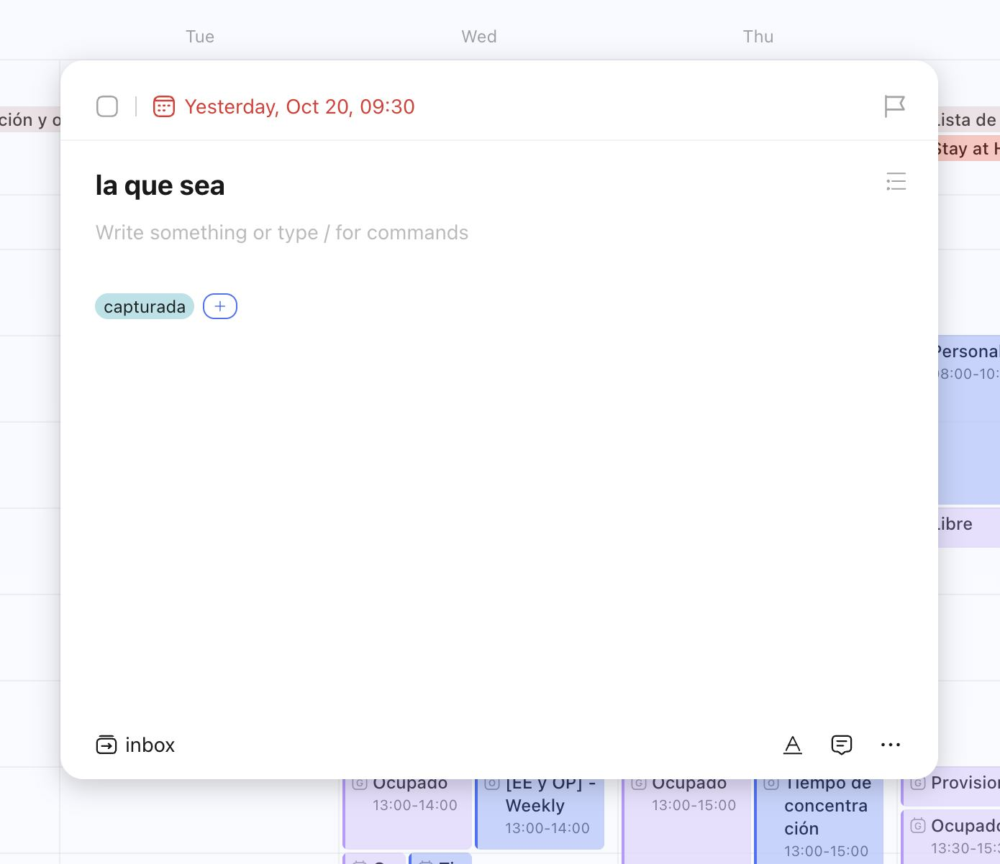<figcaption>TickTick (captura de Pablo) — modal flotante de la tarea: casilla, fecha roja vencida, bandera, título, descripción, etiqueta, pie con lista y A / comentario / ⋯</figcaption></figure><figure>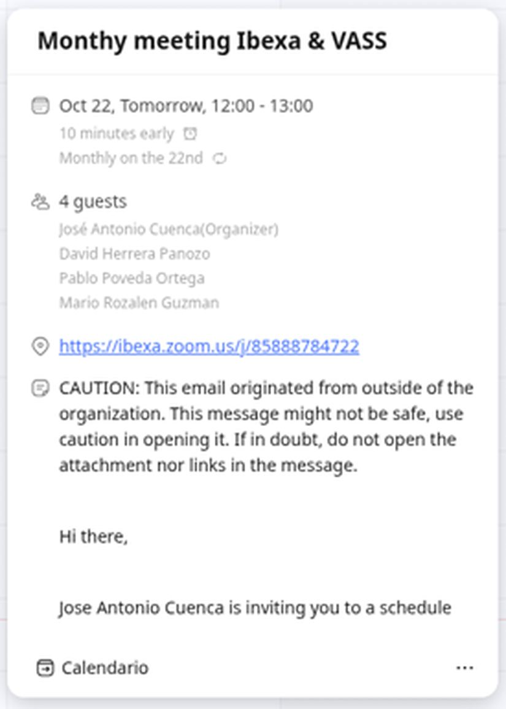<figcaption>TickTick — popover de evento externo (solo lectura): fecha y hora, aviso, repetición, invitados, ubicación, descripción y calendario</figcaption></figure></div>

#### Especificación — modal de tarea (`TaskPeek`), escritorio

- Nuevo `web/features/tasks/components/TaskPeek.tsx`, posicionado con `@floating-ui/react` (ya instalado) junto al bloque o chip: `placement: 'right-start'`, `offset(8)`, `flip({ fallbackPlacements: ['left-start', 'bottom', 'top'] })`, `shift({ padding: 8 })`, `size()` para limitar a la altura disponible, `autoUpdate`.
- **Tamaño:** ancho `--peek-w` (352 px); alto automático entre 200 px y `--peek-max-h`; `--radius-lg` (12 px), `--shadow-lg`, borde `1px solid var(--border)`, fondo `--surface`.
- **Contenido** (reutiliza los hooks y mutaciones de `TaskDetail`, sin duplicar lógica; extrae `useTaskEditor(taskId)` si hace falta):
  1. **Cabecera** (alto 44 px, padding `0 var(--sp-4)`, separador inferior `1px solid var(--border)`): casilla de completar (`PriorityCheck`, 16 px, color de prioridad) · separador vertical de 1×16 px `--border-strong` · chip de fecha (icono `CalendarDays` 14 px + texto `--fs-sm` peso 500; `--accent` normal, **`--danger` si vencida**, `--ink-3` sin fecha → «Fecha», abre `DatePopover` con pestañas Fecha/Duración) · a la derecha, bandera de prioridad (`Flag` 16 px; contorno `--ink-3` sin prioridad; relleno `--prio-*` con prioridad) que abre `PriorityMenu`.
  2. **Título:** `textarea` autoajustable sin borde, `--fs-md` (16 px) peso 700, `--ink`, padding `var(--sp-3) var(--sp-4) 0`; a la derecha, icono `ListChecks` 16 px `--icon-ink` que convierte en checklist (como TickTick).
  3. **Descripción:** editor sin borde, `--fs-sm` (13 px) `--ink-2`, placeholder `taskPeekDescription` («Escribe algo o usa / para comandos» / «Write something or type / for commands») en `--ink-faint`, mínimo 2 líneas, máximo 8 con scroll.
  4. **Etiquetas:** chips de `--tag-chip-h` (20 px), `--radius-full`, padding `0 8px`, `--fs-xs`, fondo del color de la etiqueta al 24 % y texto `--ink`; botón «+» circular de 20 px con borde `1px solid var(--accent)` e icono 12 px `--accent` (abre `TagPicker`).
  5. **Pie** (alto 40 px, padding `0 var(--sp-3) 0 var(--sp-4)`): a la izquierda, selector de lista (icono de la lista 14 px + nombre `--fs-sm` `--ink-2`, abre el menú de listas); a la derecha, botones de icono `--icon-btn`: «A» (formato de texto, opcional si no hay editor rico: ocúltalo), «Comentarios» (`MessageSquare`, abre la pestaña de comentarios del detalle completo) y «⋯» (menú: «Abrir en detalle completo», «Duplicar», «Iniciar foco», «Convertir en nota», «Eliminar»).
- **Guardado:** como en `TaskDetail` (autoguardado con _debounce_ de 600 ms y estado «Guardado» en `aria-live`, TTD-AUD que ya existe). Errores en línea con «Reintentar».
- **Estados:** cargando (esqueleto de 3 líneas dentro del modal, la cabecera ya visible con los datos del bloque); error al cargar (mensaje `loadFailed` + «Reintentar»); tarea borrada (mensaje `taskGone` y cierre en 2 s); **vencida** (fecha `--danger`); completada (casilla marcada, título `--ink-faint` tachado, «Reabrir» en «⋯»); recurrente (icono `Repeat` 12 px junto a la fecha y la repetición en el `DatePopover`); de día completo (fecha sin hora); sin conexión (campos de solo lectura y aviso `offline`).
- **Cierre:** Escape, clic fuera (siempre guarda lo escrito: no hay borrador que perder), o el mismo bloque. Al cerrar, el foco vuelve al bloque. Se quita `?task=` de la URL con `replace`.
- **URL:** abrir el modal pone `?task=<id>` (enlace profundo). Al cargar `/calendar/week?task=<id>`, se abre el modal anclado al bloque si está en el rango visible; si no, centrado.
- **Accesibilidad:** `role="dialog"`, `aria-modal="false"`, `aria-labelledby` al título; trampa de foco ligera (Tab cicla dentro); foco inicial en el título; anuncio al completar «Tarea completada» (`taskCompletedToast`).

#### Especificación — popover de evento externo (`ExternalEventPopover`), escritorio

- Mismo contenedor y posicionamiento que `TaskPeek` (anclado al bloque), ancho `--peek-w`.
- Contenido, todo de **solo lectura** (no hay campos editables):
  - título `--fs-md` peso 700 con el punto de color del calendario (8 px);
  - fila de fecha y hora con icono `CalendarDays` 14 px: «jue 22 oct · 12:00–13:00» (día completo: «jue 22 oct · Todo el día»; varios días: «22–24 oct»);
  - aviso (`Bell` 14 px, «10 minutos antes») si la API lo da; repetición (`Repeat`, «Cada mes, el día 22») si la API lo da;
  - invitados (`Users`, «4 invitados», plegable con la lista en `--fs-xs`); ubicación (`MapPin`) con enlace si es URL (`rel="noopener noreferrer"`, `target="_blank"`); descripción (`AlignLeft`) truncada a 6 líneas con «Ver más»;
  - pie: icono del calendario y nombre del calendario (`--fs-sm` `--ink-3`), y «⋯» con «Abrir en Google Calendar» (si hay `html_link`) y «Ocultar este calendario» (desmarca en 75.1).
  - Banda inferior discreta `googleReadonly` («Evento de Google: solo lectura», `--fs-xs` `--ink-3`).
- Cada fila solo aparece si hay dato. **API:** `ExternalEventView` (`web/features/calendar/ExternalEvent.tsx:4-16`) ya trae `location`, `description`, `summary` y `provider`, pero **no** `attendees_count`, `reminder_minutes`, `recurrence_text` ni `html_link`. Añádelos al DTO de `GET /api/v1/calendar/events` (lectura de los campos que Google ya devuelve; sin escritura), con su test de contrato y OpenAPI/SDK regenerados. Si no se puede en esta PR, pinta solo lo que ya llega y deja el resto anotado en `ESTADO.md`.

#### Especificación — móvil

- Tanto `TaskPeek` como el popover de evento se abren como **hoja inferior**: ancho 100 %, `--radius-xl` arriba, asa de 36×4 px `--border-strong` centrada, alto inicial 60 dvh y arrastrable a 92 dvh; `padding-bottom: calc(var(--sp-4) + env(safe-area-inset-bottom))`; velo `.scrim`.
- Deslizar hacia abajo más de 80 px o tocar el velo la cierra. El botón «⋯» incluye «Abrir en detalle completo».
- Botones del pie de 44×44 px; texto del título `--fs-lg` (20 px).

#### i18n

- `taskPeekTitle` («Detalle de la tarea»/«Task details», para lectores), `taskPeekDescription` (arriba), `taskPeekOpenFull` («Abrir en detalle completo»/«Open full details»), `taskPeekComments` («Comentarios»/«Comments»), `taskPeekMore` («Más acciones»/«More actions»), `calendarExternalReadonly`, `externalEventGuests` («{n} invitados»/«{n} guests»), `externalEventOpenGoogle` («Abrir en Google Calendar»/«Open in Google Calendar»), `externalEventHideCalendar` («Ocultar este calendario»/«Hide this calendar»), `externalEventAllDay` («Todo el día»/«All day»), `calendarMovedTo` («Movida a {when}»/«Moved to {when}»), `calendarMovedOccurrence` («Solo se ha movido esta repetición»/«Only this occurrence was moved»), `calendarDragKeyboardStart`, `calendarDragHelp`, `calendarDraggableRole`.

### 75.7 a 75.11 — Feedback de Pablo del 21/10 (tarde): día actual, cabecera, sidebar a la izquierda, pastillas de todo el día y navegación por periodos

<div class="pair"><figure>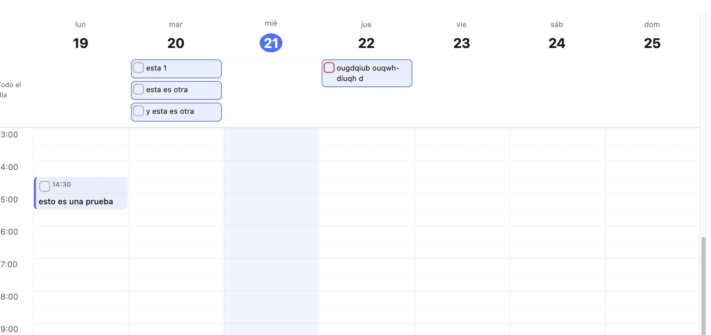<figcaption>ttd #73 (local de Pablo) — Semana: «21» en una píldora más ancha que alta; pastillas de «Todo el día» de ~28 px con casilla de 22×24, borde azul alrededor y títulos partidos en dos líneas</figcaption></figure><figure>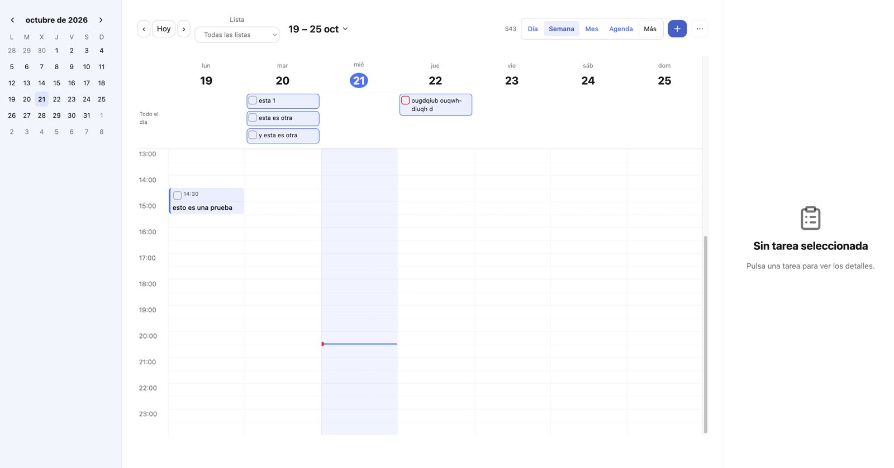<figcaption>ttd #73 (local de Pablo) — cabecera «‹ Hoy › · Lista [select] · 19 – 25 oct ˅ · S43 · Día/Semana/Mes/Agenda/Más · + · ⋯» y panel «Sin tarea seleccionada» a la derecha</figcaption></figure></div>

<div class="pair"><figure>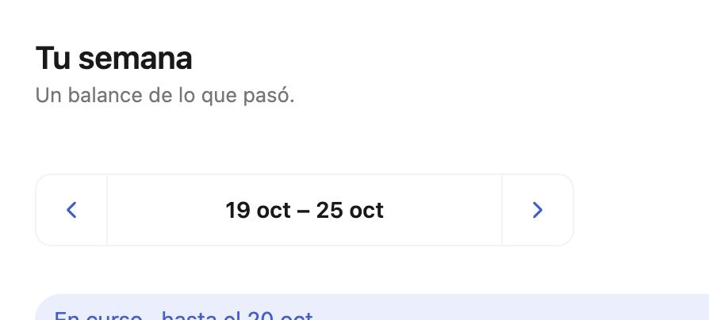<figcaption>ttd (producción y #73) — Reporte semanal «Tu semana»: navegador «‹ 19 oct – 25 oct ›» de 44 px con divisores verticales</figcaption></figure><figure>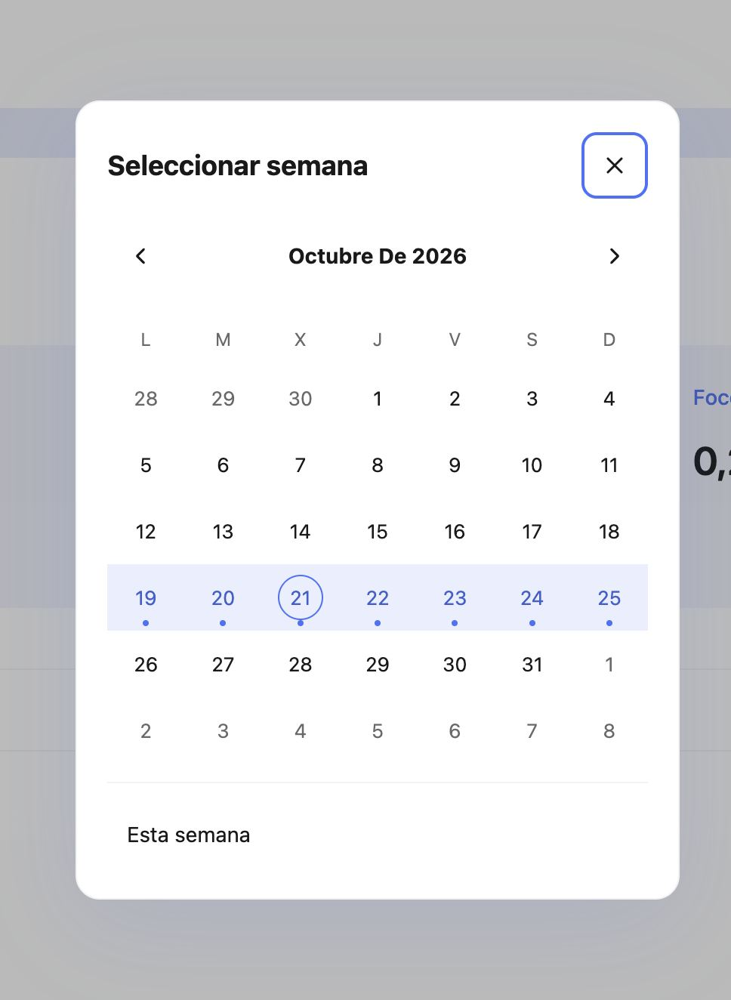<figcaption>ttd (producción y #73) — modal «Seleccionar semana»: hoy (21) es un aro sin relleno, el mes sale «Octubre De 2026», celdas de 44 px y botón «Esta semana» tras una línea</figcaption></figure></div>

<div class="pair"><figure><figcaption>TickTick — Semana: «21» en círculo azul relleno; pastillas de todo el día de una línea (~13-14 px de alto a 1280×800), sin borde y con el icono a la izquierda; cabecera «▯ October 2026 … + · Week ˅ · ‹ Today › · ⋯»</figcaption></figure><figure><figcaption>TickTick — Mes: pastillas de una línea con la hora a la derecha y «+N» al final de la celda (no crece la celda)</figcaption></figure></div>

<div class="pair"><figure>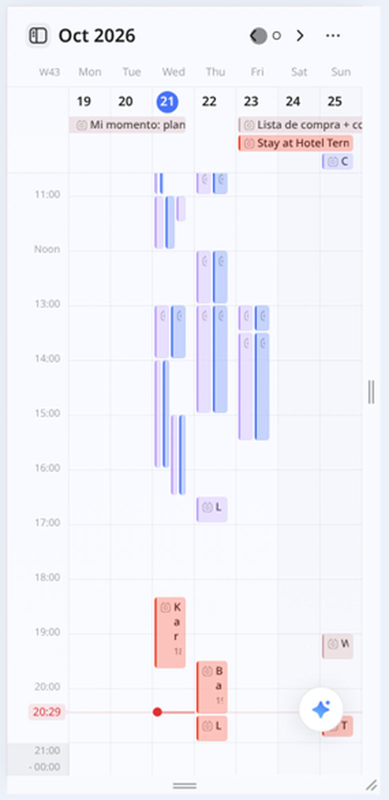<figcaption>TickTick móvil — cabecera «▯ Oct 2026 · ‹ ○ › · ⋯», hoy relleno, pastillas de todo el día truncadas a una línea</figcaption></figure><figure>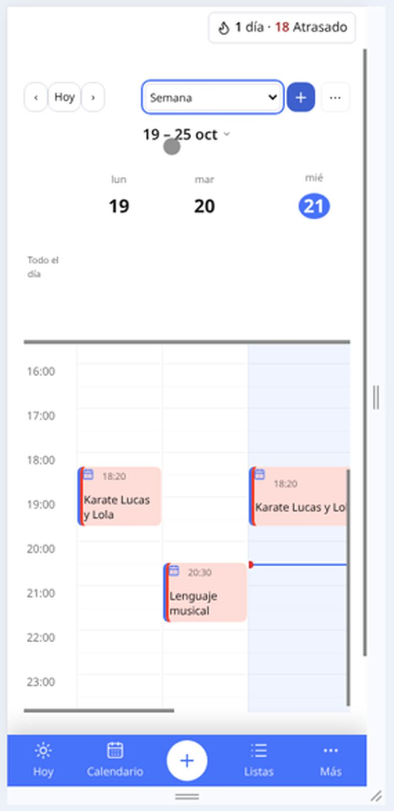<figcaption>ttd móvil (producción, contexto; #73 se comporta igual en la cabecera) — «‹ Hoy ›», desplegable nativo «Semana», «+», «⋯» y el rango debajo: tres filas de controles</figcaption></figure></div>

[CAPTURA TICKTICK PENDIENTE: popover del título del mes de TickTick (selector de mes/semana) a 1280×800, para comparar con el selector compacto de 75.11.]

#### 75.7 Indicador del día actual: círculo exacto y relleno, en todas partes

**Estado actual en #73 y causa**

- Cabecera de Día/Semana/Varios días: `HourGrid.tsx:172` pone `className="is-today"` al `<h2>` y el número va en un `<span>`. El CSS (`web/components/ui.css:2461-2472`, `.hour-headers h2.is-today span`) usa `min-height: 1.75rem; padding: 0 6px; border-radius: 999px; line-height: 1.5rem` **sin `width`**: el ancho depende del número («21» ≈ 32 px por 28 px de alto), así que sale una **píldora**, no un círculo. Además el color del número es `--ink-inverse`, que en oscuro vale `#191919` (`tokens.css:157`): en tema oscuro el número sale **negro** sobre azul.
- Selector «Seleccionar semana»: `web/features/product/weekly.css:380-383`, `.week-calendar-grid button[aria-current='date'] span { outline: 1px solid var(--accent) }` → **aro sin relleno**.
- Minicalendario del sidebar: `web/shell/shell.css:926-929`, `.calendar-mini-day.is-today { background: var(--accent-soft) }` → tinte suave, tampoco relleno.
- Mes (`ui.css:2362`, `.cal-cell.is-today strong`, 24 px) y Año (`ui.css:698`, `.year-num`, 21.6 px) sí son círculos, pero con `--ink-inverse` (mismo fallo en oscuro).
- Cada sitio tiene su propia regla: no hay un único estilo de «hoy».

**Especificación (todas las vistas, escritorio y móvil)**

- Un único estilo compartido, clase `.today-mark` en `web/components/ui.css` (y `data-today="true"` en el elemento para los tests), aplicado al **número** del día:
  - `display: inline-grid; place-items: center; inline-size: var(--today-mark-size); block-size: var(--today-mark-size); padding: 0; border-radius: 50%; aspect-ratio: 1;`
  - `background: var(--today-mark-bg); color: var(--today-mark-ink); font-weight: 700; font-variant-numeric: tabular-nums; line-height: 1;`
  - Nunca `min-width`, `padding` horizontal ni `border-radius: 999px` (para que no vuelva a ser píldora con números de dos cifras).
- **Tamaños** (la variable `--today-mark-size` se sobreescribe en cada contexto):

| Contexto                                             | Escritorio | Móvil         | Número                    |
| ---------------------------------------------------- | ---------- | ------------- | ------------------------- |
| Cabecera de Día/Semana/Varios días (`.hour-headers`) | 28 px      | 26 px         | 16 px / 15 px, peso 700   |
| Celda de Mes / Varias semanas (`.cal-cell`)          | 22 px      | 20 px         | `--fs-xs` 12 px, peso 700 |
| Minicalendario del sidebar (75.1)                    | 22 px      | 28 px (cajón) | 12 px / 13 px             |
| Selector de periodo (75.11)                          | 24 px      | 32 px (hoja)  | 12 px / 14 px             |
| Año / Trimestre (`.year-num`)                        | 20 px      | 20 px         | 11 px                     |

- **Colores:** `--today-mark-bg` = `color-mix(in srgb, var(--accent) 88%, black)` y `--today-mark-ink` = `var(--on-accent)` (blanco) en claro y en oscuro. Motivo: `#4772fa` sobre blanco da ~4,2:1 y el número (12-16 px) no es «texto grande»; al 88 % sube a ~5,1:1 (AA) y a la vista sigue siendo el azul de acento. Se aplica igual con `[data-accent=violet|teal|amber|rose|slate]` (todas pasan con blanco).
- **El nombre del día** encima (lun, mar…) en `--accent` peso 600 cuando es hoy (ya lo hace `.hour-headers h2.is-today`), sin fondo.
- **Estados:**
  - hoy fuera del rango visible: no aparece;
  - hoy y además día seleccionado (vista Día, o día pulsado en el selector): relleno (manda «hoy»);
  - día seleccionado que no es hoy: círculo del mismo tamaño con `--accent-soft` y número `--accent-ink`;
  - hover (cuando el número es enlace a la vista Día): fondo `color-mix(in srgb, var(--today-mark-bg) 90%, white)`; en no-hoy, `--surface-2`;
  - foco: `outline: 2px solid var(--focus-ring); outline-offset: 2px` (el anillo rodea el círculo, no lo sustituye);
  - dentro de la semana seleccionada del selector (fondo `--accent-soft`), hoy sigue relleno.
- **Accesibilidad:** `aria-current="date"` en el elemento de hoy en todas las vistas (hoy solo lo tienen el selector y el minicalendario). No se transmite «hoy» solo con color: el `aria-label` de la cabecera incluye «hoy» (`calendarTodayLabel`: «{date}, hoy» / «{date}, today»).
- **Hora de Madrid:** «hoy» se calcula con la zona de la cuenta (`zonedWallTime`), no con la del navegador; a las 00:00 Madrid pasa al día siguiente sin recargar (temporizador al siguiente medianoche local, recalculado tras el cambio de hora del 25/10).

#### 75.8 Cabecera del calendario compacta y alineada (como TickTick)

**Estado actual en #73 y causa**

- `Places.tsx:CalendarPage`, `<header className="calendar-toolbar">` (`:469-635`): «‹ Hoy ›» (`.calendar-nav`) · `<label>` «Lista» con `<select>` (`:499-522`, con la etiqueta encima, lo que la hace más alta que el resto) · `CalendarPeriod` «19 – 25 oct ˅» (`:524`) · «S43» (`:555`) · segmentado Día/Semana/Mes/Agenda/Más · «+» azul relleno · «⋯». Controles de alturas distintas (28-36 px), sin agrupar y con el título del periodo en medio. En móvil se convierte en tres filas (`.calendar-mobile-view` es un `<select>` nativo, `:584-600`).
- 75.3 ya pedía el botón de plegar a la izquierda; **este punto fija el orden y las medidas definitivas y sustituye a la lista de 75.3**.

**Especificación — escritorio (≥ 1024 px)**

- Alto `--cal-header-h` (48 px), `padding: 0 var(--sp-4)`, `display: flex; align-items: center; gap: var(--sp-2)`, sin borde inferior (la rejilla ya separa), fondo `--surface`. Todos los controles miden `--cal-control-h` (28 px) y se centran en el eje vertical (la diferencia de centros entre controles ≤ 1 px).
- **Izquierda:**
  1. `SidebarFoldButton` (75.3): 28×28, icono `PanelLeft` 18 px.
  2. **Título** `<h1>`: mes y año del periodo visible, «Octubre 2026» (`--cal-title-fs` 18 px, peso 700, `--ink`, `letter-spacing: -0.01em`). Solo la primera letra en mayúscula (no `text-transform: capitalize`). Si la semana cruza meses: «Oct – nov 2026»; si cruza años: «Dic 2026 – ene 2027». En Día: «Miércoles, 21 oct 2026» abreviado a «21 oct 2026» por debajo de 1200 px. El título **no** es botón (el selector va en el navegador de 75.11).
  3. Número de semana «S43» en `--fs-xs` `--ink-3` con `aria-label` «Semana 43» (`calendarWeekNumber`), solo en Semana y Varios días y solo si `weekStart` es lunes (semana ISO); la semana 53 de 2026 (28/12–3/1) se muestra como «S53».
- **Derecha** (`margin-inline-start: auto`, mismo `gap`), en este orden (TickTick: «+ · Week ˅ · ‹ Today › · ⋯»):
  1. **«+»**: botón de icono 28×28, `Plus` 16 px, fondo `--surface`, borde `1px solid var(--border-strong)`, `--radius-sm`, `--icon-ink`; hover `--icon-hover-bg`; abre el composer único (76) anclado bajo el botón. **No** azul relleno.
  2. **Selector de vista** «Semana ˅» (75.3): botón 28 px, `min-inline-size: 96px`, `padding: 0 8px 0 10px`, `--fs-sm` peso 500, `ChevronDown` 14 px, mismo borde que «+»; menú `role="menu"` de 160 px con `menuitemradio`.
  3. **Navegador de periodo** (75.11): «‹ 19 – 25 oct ›» de 28 px.
  4. **«Hoy»**: botón de texto 28 px, `padding: 0 10px`, `--fs-sm`, mismo borde; `aria-disabled="true"` y `--ink-faint` si hoy ya está en el periodo visible (sigue pudiendo recibir foco). Atajo T si no hay campo enfocado.
  5. **«⋯»** 28×28 (menú de 75.1: semana laboral, completadas, ajustes).
- Se eliminan de la barra: el `<label>/<select>` «Lista» (va al sidebar, 75.1), el segmentado de vistas y `CalendarPeriod` como título-botón.
- **Responsive** (ancho de la zona central, con _container queries_ sobre `.calendar-page`): < 1100 px el rango se abrevia («19–25 oct»); < 900 px el rango se oculta y el navegador queda en «‹ ›» con el selector abierto desde el título (que entonces sí es botón con `ChevronDown` 14 px); nunca hay scroll horizontal ni saltos de línea en la cabecera.
- **Estados comunes de los controles:** hover `--icon-hover-bg`; activo (menú abierto) `--sidebar-active-bg` y `aria-expanded="true"`; foco `--focus-ring`; deshabilitado `opacity: .5` (sin conexión, solo «+»: el composer guarda en cola si existe; si no, deshabilitado con `title` «Sin conexión»); cargando: los controles no cambian de tamaño (el indicador de carga va en la rejilla, no en la cabecera).

**Especificación — móvil (≤ 768 px)**

- Una sola fila de `--cal-header-h-mobile` (52 px) + `env(safe-area-inset-top)` (TickTick móvil: «▯ Oct 2026 · ‹ ○ › · ⋯»):
  - izquierda: botón de plegar 44×44 (abre el cajón, 75.1/75.9) · título «Oct 2026» `--fs-md` 16 px peso 700 con elipsis, que **es botón** y abre el selector de periodo (75.11) como hoja;
  - derecha: «‹» y «›» de 36 px visibles (zona táctil de 44 con `::after`), entre ellos «○» (hoy, 36 px, `aria-label` «Hoy»), y «⋯» 44×44 con «Vista» (Día/3 días/Semana/Mes/Agenda), «Semana laboral» y «Ajustes».
  - El «+» se queda en la barra inferior (FAB), no en la cabecera.
- El rango («19 – 25 oct») no se muestra en móvil; sí se anuncia al cambiar (`aria-live="polite"` en el título).

#### 75.9 El sidebar secundario va a la izquierda, y no hay columna a la derecha

**Estado actual en #73 y causa**

- En la captura de Pablo (`TTD-AUD-75_c`) hay **dos** paneles laterales: a la izquierda `CalendarSidebar` (solo minicalendario, columna 2 de `.shell`, `shell.css:19`: `var(--sidebar-rail) var(--sidebar-w) minmax(0, 1fr) var(--detail-w)`) y a la derecha `DetailEmpty` (columna 4, ~440 px). El de la derecha es el que se lee como «el sidebar», porque es el grande y el único con contenido; y los filtros siguen arriba (`<select>`).
- La causa de la columna derecha es `sectionShowsDetailPane('calendar') === true` (75.2).

**Especificación**

- En `/calendar/*` hay **un único** panel secundario, a la **izquierda** (columna 2, `--sidebar-w` 240 px), entre el rail y la rejilla, con el contenido de 75.1 (minicalendario, Todo, Listas, Filtros, Etiquetas, Calendarios suscritos). La columna 4 vale 0 (75.2).
- Plegado: la columna 2 pasa a 0 con transición `grid-template-columns` en `--dur-base` `--ease` (sin animación si `prefers-reduced-motion`); el botón de plegar (75.3/75.8) no se mueve de su sitio relativo al título.
- Ancho: fijo a 240 px en ≥ 1280; 220 px entre 1024 y 1279 (`--sidebar-w` ya es variable). Redimensionable **no** en esta PR.
- En **RTL** (no hay locales RTL hoy) se usan propiedades lógicas (`inset-inline-start`, `border-inline-end`) para que el panel quede en el lado de inicio.
- **Móvil:** cajón desde la **izquierda** (`inset-inline-start: 0`, `translateX(-100%)` → 0), como 75.1. Nada se abre desde la derecha en Calendario.
- **Comprobación automática:** el `boundingBox` del sidebar termina antes de que empiece `.calendar-page` (`sidebar.x + sidebar.width ≤ main.x + 1`) y no hay ningún elemento visible a la derecha de la rejilla.

#### 75.10 Pastillas de «Todo el día» compactas y con «+N más» (todas las vistas)

**Estado actual en #73 y causa**

- `HourGrid.tsx:178-240` pinta en `.hour-allday-cell` **todas** las tareas de día completo, sin límite: la franja crece con cada tarea (en la captura, tres tareas el martes ya ocupan ~95 px).
- Medidas que la inflan (`web/features/calendar/calendar.css`):
  - `.calendar-task-mark .task-check-hit` 22×24 px (`:146-150`) → la casilla se ve de ~16 px dentro de un hueco de 22;
  - `.calendar-page .hour-allday .cal-pill { padding: 4px; overflow-wrap: break-word; hyphens: auto }` y `min-height: 28px` (`:620-628`) → pastillas de 28 px que **parten el título en dos líneas** («ougdqiub ouqwh- / diuqh d»);
  - la casilla va con `float: left` (`:615`) y la pastilla lleva borde de acento alrededor, lo que le da aspecto de botón.
- En Mes ya hay desbordamiento (`.calendar-overflow`, `Places.tsx:1155-1159`, «+N más» con `calendarMoreViews`), pero el número de pastillas visibles no depende del alto real de la celda, y al pulsar abre `DaySheet` (`setPicked`, `:750`) centrado.
- La pastilla base `.cal-pill` (`ui.css:561`) es de 11 px y `line-height: 1.3`, distinta de la de la franja de todo el día: hay dos estilos.

**Especificación — chip compacto único (`.cal-chip`, el mismo de 75.4)**

- Una sola pastilla para Mes, Varias semanas, franja de todo el día de Día/Semana/Varios días y popover «+N»:
  - alto `--cal-chip-h` (20 px en escritorio; 22 px en móvil), `display: flex; align-items: center; gap: 4px; padding: 0 6px 0 4px; border-radius: 4px;`
  - **una línea**: `white-space: nowrap; overflow: hidden; text-overflow: ellipsis` (se elimina `overflow-wrap: break-word`, `hyphens` y `min-height: 28px`);
  - texto `--fs-xs` (12 px), peso 500, `line-height: 20px`, `--ink`;
  - **casilla** `--cal-chip-check` (12 px) con borde 1.5 px del color de prioridad (`--prio-*`; sin prioridad `--border-strong`), `border-radius: 3px`; zona de clic de 20×20 (pseudo-elemento) sin ensanchar el chip; sin `float`;
  - fondo del color de la lista al 16 % (75.4), **sin borde alrededor**; en día completo no hay hora; evento de Google: icono `CalendarDays` 12 px `--ink-3` en lugar de casilla (solo lectura);
  - separación vertical entre chips `--cal-allday-gap` (2 px).
- **Estados:** hover fondo al 24 %; foco `--focus-ring` con `outline-offset: -1px`; vencida (día anterior a hoy y sin completar): título `--danger`, casilla con borde `--danger`; completada: tachado y `--ink-faint` (y fuera si «Mostrar completadas» está desactivado); arrastrando: 75.5; sin conexión: casilla `aria-disabled`.
- `title` y `aria-label` con el título completo (`calendarChipAria`), ya que se trunca.

**Límite N y «+K más»**

- Regla: si hay **≤ N** elementos en el día, se pintan todos; si hay **> N**, se pintan **N − 1** y un chip «+K más» con K = total − (N − 1). Así la franja nunca supera N filas. El chip «+K más» mide lo mismo que una pastilla, `--fs-xs` peso 600 `--ink-3`, fondo transparente, hover `--surface-2`.
- **N propuesto por vista:**

| Vista                      | Escritorio                                                                     | Móvil (390 px)                                       | Motivo                                                        |
| -------------------------- | ------------------------------------------------------------------------------ | ---------------------------------------------------- | ------------------------------------------------------------- |
| Día                        | 4                                                                              | 3                                                    | Una columna ancha: cabe más sin robar altura a la rejilla     |
| Varios días (3-4 columnas) | 3                                                                              | 2                                                    |                                                               |
| Semana (7 columnas)        | 3                                                                              | 2                                                    | Franja máxima = 3 × 20 + 2 × 2 + 8 = 72 px (hoy ~95 px con 3) |
| Mes / Varias semanas       | Calculado: `floor((alto de celda − 24 px de número − 4 px) / 22 px)`, mínimo 2 | Puntos (75.4) si la celda < 56 px de ancho; si no, 2 | Con celdas de 138 px salen 5, como TickTick                   |

- En móvil Semana (columnas de ~42 px) el chip no lleva casilla (se completa desde la hoja, 75.6), el texto baja a `--fs-2xs` (11 px, mínimo legible) y «+K más» se acorta a «+K» con `aria-label` «{K} más» completo.
- **Desplegar (Día/Semana/Varios días):** clic en cualquier «+K más» **o** en el botón de la etiqueta «Todo el día» (chevron `ChevronDown` 12 px junto al texto, `aria-expanded`, `aria-controls` = la franja) expande **toda la franja** (todas las columnas a la vez, para que las filas sigan alineadas). Expandida: altura hasta el día con más elementos, con tope `max-block-size: 40%` del alto del tablero y scroll interno (`overscroll-behavior: contain`); el chevron gira 180° y la etiqueta dice «Contraer» (`calendarAllDayCollapse`). Otro clic o Escape (con el foco dentro) la contrae. El estado dura la sesión de la página (no se guarda en `localStorage`). Transición de altura en `--dur-fast` salvo `prefers-reduced-motion`.
- **Mes / Varias semanas:** la celda **no crece**: «+K más» abre un **popover** anclado a la celda (`@floating-ui`, `placement: 'bottom-start'`, ancho 264 px, `--radius-lg`, `--shadow-md`): cabecera con el día («mié 21 oct», `--fs-sm` peso 600; hoy con `.today-mark`), lista de chips de 22 px con hora a la derecha, `max-block-size: 320px` con scroll, y pie «Abrir día» (enlace a `/calendar/day?date=`). En móvil, ese mismo contenido como hoja inferior (`DaySheet`, que ya existe).
- **Teclado:** «+K más» es un `<button>` con `aria-expanded`; Tab recorre los chips visibles y luego «+K más»; tras expandir, el foco va al primer chip que estaba oculto.
- **Casos límite:**
  - eventos de Google de varios días (todo el día): ocupan la misma fila en cada día que cubren y cuentan para N en todos ellos;
  - arrastrar una tarea sobre la franja contraída con desbordamiento (75.5): tras 400 ms encima, la franja se expande sola;
  - tareas recurrentes: cada repetición es un chip;
  - días con 0 elementos: la franja mantiene su alto mínimo de una fila (24 px) para poder hacer clic y crear (74);
  - el 25/10/2026 (25 h): la franja no cambia (no depende de horas).

#### 75.11 Navegación por periodos: reutilizar el selector del Reporte semanal como componente compartido y compacto

**Estado actual en #73 y causa**

- El patrón que quiere Pablo existe (también en producción): `web/features/product/WeekPicker.tsx:WeekPicker` (commit `06e411b`, 20/10/2026 20:18, hora de Madrid), usado en `WeeklyPages.tsx:85`. Pinta `.week-navigation` («‹ | 19 oct – 25 oct | ›») y abre un `<dialog>` **modal** (`showModal()`) «Seleccionar semana» con mes, rejilla de 6×7, puntos `has-report` y «Esta semana».
- Está ligado al Reporte semanal: textos en `weekly-text.ts` (ternarios `english ? … : …`, fuera de `i18n`), `monday()` propia que **ignora `weekStart`** de preferencias, y estilos en `weekly.css:280-400`: botones de 44 px de alto, `border-inline: 1px solid var(--border)` entre segmentos (los «divisores gruesos»), diálogo con `padding: 20px`, `--radius` 16 px, título de 18 px y botón de cerrar grande, celdas de 44 px y el mes con `text-transform: capitalize` (`weekly.css:341`), que produce «Octubre **De** 2026».
- El calendario tiene su propio selector: `web/features/calendar/CalendarControls.tsx:CalendarPeriod` + `CalendarJump` (desplegable de mes, sin modo semana ni día marcados).

**Especificación — componente compartido**

- Mover y generalizar a `web/components/period/`:
  - `period.ts` (lógica pura): `periodRange(mode, anchor, { weekStart, days })`, `shiftPeriod(mode, anchor, ±1, opts)`, `periodLabel(mode, range, locale)` (con `Intl.DateTimeFormat.prototype.formatRange`), `containsToday(range, today)`. Trabaja con claves `YYYY-MM-DD` (`shiftDayKey`) y la zona de la cuenta; nunca `new Date('YYYY-MM-DD')` en local.
  - `PeriodNavigator.tsx`: `{ mode: 'day' | 'week' | 'month'; value: string; today: string; weekStart: 0 | 1; days?: number; marks?: readonly string[]; onChange(value: string): void; size?: 'compact' | 'regular' }`.
  - `PeriodPicker.tsx`: el contenido del popover (rejilla de días para `day`/`week`, rejilla de meses para `month`).
  - `WeekPicker` se elimina y `WeeklyPages` pasa a `<PeriodNavigator mode="week" weekStart={1} marks={available} size="regular" />` (el reporte es semanal ISO, siempre lunes). Los textos pasan a `i18n` (`es.ts`/`en.ts`/`extra.ts`).
- **Modos y qué hace cada vista del calendario:**

| Vista           | `mode`                      | ‹ / ›             | Etiqueta           | Selector                                          |
| --------------- | --------------------------- | ----------------- | ------------------ | ------------------------------------------------- |
| Día             | `day`                       | ±1 día            | «mié, 21 oct»      | Día (hoy relleno, día visible en `--accent-soft`) |
| Varios días (N) | `day` + `days=N`            | ±N días           | «21 – 24 oct»      | Día; se resaltan los N días como una banda        |
| Semana          | `week`                      | ±7 días           | «19 – 25 oct»      | Semana (fila completa resaltada)                  |
| Varias semanas  | `week` + `days=14…`         | ±N semanas        | «19 oct – 1 nov»   | Semana; banda de N filas                          |
| Mes             | `month`                     | ±1 mes            | «Octubre 2026»     | Mes (rejilla 4×3 con año ‹ › )                    |
| Agenda          | `day`                       | ±7 días           | «Desde 21 oct»     | Día (elige desde qué día)                         |
| Año / Trimestre | `month` en granularidad año | ±1 año / ±3 meses | «2026» / «T4 2026» | Rejilla de meses                                  |

- Etiquetas: mismo año omitido; cruce de mes «26 oct – 1 nov»; cruce de año «28 dic 2026 – 3 ene 2027». El Reporte semanal usará la misma salida («19 – 25 oct», en lugar de «19 oct – 25 oct»).
- Cambiar de periodo actualiza `?date=` (primer día del periodo) con `replace: false` (el botón atrás del navegador vuelve al periodo anterior) y conserva `lists`, `filter`, `tags` y la vista.
- **Navegador — `size="compact"` (calendario, escritorio):**
  - un grupo de 28 px (`--cal-control-h`), `--radius-sm`, borde `1px solid var(--border-strong)`, fondo `--surface`, **sin divisores internos** (se quitan los `border-inline`);
  - «‹» y «›» de 28×28 con `ChevronLeft/Right` 16 px `--icon-ink`; la etiqueta es un botón con `padding: 0 8px`, `--fs-sm` (13 px) peso 600, `--ink`, `font-variant-numeric: tabular-nums`, ancho mínimo 112 px (para que las flechas no salten al cambiar de «1 – 7 nov» a «26 oct – 1 nov»: `min-inline-size` calculado para la etiqueta más larga del modo);
  - hover de cada parte: `--icon-hover-bg` solo en esa parte (con `border-radius` interior de 4 px); activo (popover abierto): etiqueta con `--sidebar-active-bg` y `aria-expanded="true"`; foco `--focus-ring` con `outline-offset: -2px`; deshabilitado: nunca (siempre se puede navegar, también sin conexión).
  - `size="regular"` (Reporte semanal) usa 36 px de alto (no 44) y las mismas reglas, para que ambos se vean de la misma familia.
- **Popover del selector (escritorio):**
  - **No modal**: `@floating-ui/react` anclado a la etiqueta, `placement: 'bottom'` (`bottom-end` si no cabe), `offset(6)`, `flip`, `shift({ padding: 8 })`; sin velo; `role="dialog"`, `aria-modal="false"`, `aria-label` «Seleccionar día / semana / mes» (`periodSelectDay/Week/Month`). Se cierra con Escape, clic fuera o al elegir, y el foco vuelve a la etiqueta.
  - Caja `--period-pop-w` (264 px), `padding: var(--sp-3)` (12 px), `--radius-lg`, `--shadow-md`, borde `1px solid var(--border)`, fondo `--surface`. **Sin título grande ni botón de cerrar** (el título es solo `aria-label`; en móvil sí hay asa y «Cerrar»).
  - Cabecera de 28 px: «Octubre 2026» (`--fs-sm` peso 600, primera letra en mayúscula con `::first-letter`, **no** `capitalize`) centrado, con «‹» «›» de 24×24 (`ChevronLeft/Right` 14 px) a los lados; `aria-live="polite"` en el mes.
  - Fila de días de la semana: alto 20 px, `--fs-2xs` (11 px) `--ink-3`, empezando por `weekStart` (L M X J V S D o D L M…).
  - Rejilla 6×7 (`role="grid"`): celdas `--period-cell` (32 px de ancho × 28 px de alto); número `--fs-xs` (12 px) en un círculo de 24 px; fuera de mes `--ink-faint`; con `marks` (días con tareas en el calendario; semanas con reporte en el Reporte semanal), punto de 4 px `--accent` 2 px por debajo del círculo; **hoy** `.today-mark` (24 px, relleno, blanco); en modo `week`, hover de toda la fila `--surface-2` y fila seleccionada `--accent-soft` con `border-radius: var(--radius-full)` en sus extremos (como el minicalendario de TickTick), números `--accent-ink`; en modo `day`, día seleccionado `--accent-soft`.
  - Modo `month`: cabecera con el año y ‹ ›; rejilla 4×3 de botones de 56×28 px («ene», «feb»…), `--fs-xs`; mes actual relleno (`--today-mark-bg`, texto blanco, `--radius-sm`), mes seleccionado `--accent-soft`.
  - Pie: **sin línea gruesa**: `margin-top: var(--sp-2); padding-top: var(--sp-2); border-top: 1px solid var(--border)`; un botón de texto de 28 px «Hoy» / «Esta semana» / «Este mes» (`periodToday`, `periodThisWeek`, `periodThisMonth`) en `--fs-sm` `--accent`, alineado a la izquierda; deshabilitado si ya es el periodo actual.
  - Alto total aproximado en modo semana: 12 + 28 + 20 + 6 × 28 + 8 + 28 + 12 = **276 px** (hoy el diálogo mide ~820 px de alto en la captura de Pablo).
- **Teclado (rejilla):** flechas ±1 día / ±7 días; Re Pág / Av Pág ±1 mes (Mayús: ±1 año); Inicio / Fin = primer / último día de la semana; Enter o Espacio elige (en modo `week` elige la semana del día enfocado); Escape cierra. _Roving tabindex_: un único `tabindex="0"`, en el día seleccionado (o en hoy). `aria-selected` en los días del periodo elegido, `aria-current="date"` en hoy, `aria-label` de cada celda con la fecha completa («miércoles, 21 de octubre de 2026»). Fuera de la rejilla, en el calendario (sin campo de texto enfocado, `isTypingTarget`): Alt + ← / → = periodo anterior / siguiente (si ya existen atajos de navegación en `shortcuts.ts`, se mantienen los existentes y se documentan en la ayuda de atajos).
- **Móvil (≤ 768 px):** el selector se abre desde el título (75.8) como **hoja inferior** (`--radius-xl` arriba, asa 36×4, `padding-bottom: calc(var(--sp-4) + env(safe-area-inset-bottom))`, velo `.scrim`), con celdas de 44 × 40 px, círculo de 32 px, cabecera con «Cerrar» 44×44 y el mismo pie. En el Reporte semanal móvil, el navegador `regular` ocupa el ancho completo con 44 px de alto (táctil).
- **Casos límite:**
  - semana del 19 al 25/10/2026 (cambio de hora): 7 días, etiqueta «19 – 25 oct», y la rejilla horaria pinta el domingo con 25 h (75.5);
  - semana del 23 al 29/03/2026 (día de 23 h): igual;
  - semana ISO 53 (28/12/2026 – 3/1/2027): etiqueta «28 dic 2026 – 3 ene 2027», «S53»;
  - `weekStart` domingo: la semana del 21/10 es «18 – 24 oct» en el calendario; el Reporte semanal sigue en lunes;
  - `?date=` inválida o vacía: se usa hoy (Madrid) sin romper;
  - meses con 6 filas (p. ej. agosto 2026 con lunes): la rejilla siempre tiene 6 filas para que el popover no cambie de alto.

#### Tokens nuevos de 75.7-75.11 (claro / oscuro)

| Token                                      | Claro                                           | Oscuro                                              | Uso                                           |
| ------------------------------------------ | ----------------------------------------------- | --------------------------------------------------- | --------------------------------------------- |
| `--today-mark-bg`                          | `color-mix(in srgb, var(--accent) 88%, black)`  | igual                                               | Círculo de hoy (75.7, 75.11)                  |
| `--today-mark-ink`                         | `var(--on-accent)`                              | `var(--on-accent)` (blanco; **no** `--ink-inverse`) | Número de hoy                                 |
| `--today-mark-size`                        | `1.75rem` (28 px; se sobreescribe por contexto) | igual                                               | 75.7                                          |
| `--cal-header-h` / `--cal-header-h-mobile` | `3rem` (48 px) / `3.25rem` (52 px)              | igual                                               | 75.8                                          |
| `--cal-control-h`                          | `1.75rem` (28 px)                               | igual                                               | Controles de la cabecera y navegador compacto |
| `--cal-title-fs`                           | `1.125rem` (18 px)                              | igual                                               | Título del mes                                |
| `--cal-chip-check`                         | `0.75rem` (12 px); móvil Día `0.875rem` (14 px) | igual                                               | Casilla de los chips (75.10)                  |
| `--cal-allday-gap`                         | `2px`                                           | igual                                               | Separación entre chips                        |
| `--period-pop-w`                           | `16.5rem` (264 px)                              | igual                                               | Popover del selector (75.11)                  |
| `--period-cell`                            | `2rem` (32 px)                                  | igual                                               | Ancho de celda del selector                   |

#### i18n nuevas (75.7-75.11)

- `calendarTodayLabel` («{date}, hoy» / «{date}, today»), `calendarWeekNumber` («Semana {n}» / «Week {n}»).
- `periodPrevious` / `periodNext` con variantes por modo: `periodPrevDay` («Día anterior» / «Previous day»), `periodNextDay`, `periodPrevWeek` («Semana anterior»), `periodNextWeek`, `periodPrevMonth` («Mes anterior»), `periodNextMonth`, `periodPrevYear`, `periodNextYear`.
- `periodSelectDay` («Seleccionar día» / «Select day»), `periodSelectWeek` («Seleccionar semana» / «Select week»), `periodSelectMonth` («Seleccionar mes» / «Select month»), `periodToday` («Hoy» / «Today»), `periodThisWeek` («Esta semana» / «This week»), `periodThisMonth` («Este mes» / «This month»), `periodClose` («Cerrar» / «Close»).
- `calendarAllDayMore` («+{n} más» / «+{n} more»), `calendarAllDayMoreShort` («+{n}»), `calendarAllDayExpand` («Mostrar todas las de todo el día» / «Show all all-day items»), `calendarAllDayCollapse` («Contraer» / «Collapse»), `calendarDayOpen` («Abrir día» / «Open day»).
- Se borran de `weekly-text.ts` `selectWeek`, `previousWeek`, `nextWeek`, `previousMonth`, `nextMonth`, `thisWeek` (pasan a las claves `period*`).

### Criterios de aceptación (75)

- **75.1** En escritorio, el sidebar del calendario muestra minicalendario, Todo, Listas, Filtros, Etiquetas y Calendarios suscritos; ya no hay `<select>` de lista en la barra ni casillas de calendarios en «⋯».
  - Marcar «casa» y «trabajo» muestra solo sus tareas; añadir la etiqueta «personal» deja las de esas listas **y** con esa etiqueta; marcar un filtro guardado interseca.
  - Desmarcar un calendario de Google oculta sus eventos y persiste tras recargar (servidor). Los filtros de listas y etiquetas persisten tras recargar (`localStorage`) y están en la URL.
  - En 390×844, el cajón tiene filas de 44 px y no se cierra al marcar.
- **75.2** En `/calendar/*` y `/focus` no aparece «Sin tarea seleccionada» ni la columna derecha; en `/today` sí. `?task=` en Calendario abre el modal.
- **75.3** El botón de plegar está a la izquierda del título del mes, abierto y plegado, con `aria-expanded` correcto; el del rail ha desaparecido. En móvil abre el cajón.
- **75.4** En Mes, «Pagar asistenta» se ve con el título y «21:00» aparte, a la derecha y en gris. Un chip vencido tiene el título en rojo y no todo el chip. En Semana, un bloque de 30 min muestra «Título · 09:00» en una línea.
- **75.5** Arrastrar una tarea de Semana del martes 10:00 al jueves 11:15 envía `start_date` = jue 11:15 Madrid, `due_date` = inicio + duración y la misma `duration_minutes`, y se ve en el sitio sin recargar; Deshacer la devuelve.
  - Estirar el borde inferior de 60 a 90 min envía `duration_minutes: 90`.
  - Un evento de Google no se puede arrastrar y muestra el aviso.
  - Soltar en «Todo el día» la convierte en tarea de día completo.
  - Teclado: Espacio, flechas y Espacio mueven la tarea; Escape cancela.
  - En 390×844, pulsación larga + arrastre la mueve; un toque abre la hoja.
  - El 25/10/2026, mover a 02:30 guarda 00:30Z.
- **75.6** Clic en una tarea abre `TaskPeek` junto a ella (sin navegar ni panel derecho), con casilla, fecha (roja si vence), bandera, título, descripción, etiquetas y pie. Editar el título y cerrar guarda. Clic en un evento de Google abre su popover de solo lectura anclado. En móvil ambos son hoja inferior.
- **75.7** En Semana, Día, Varios días, Mes, Año, minicalendario y selector de periodo, el número de hoy mide lo mismo de ancho que de alto (±0,5 px), tiene `border-radius: 50%`, fondo `--today-mark-bg` y número blanco, en claro y en oscuro y con los seis acentos; contraste ≥ 4,5:1. Lleva `aria-current="date"`. En el selector ya no es un aro.
- **75.8** La cabecera de escritorio mide 48 px y contiene, de izquierda a derecha: plegar · «Octubre 2026» · «S43» … «+» · «Semana ˅» · «‹ 19 – 25 oct ›» · «Hoy» · «⋯»; todos los controles miden 28 px y sus centros verticales difieren ≤ 1 px; no hay `<select>` ni segmentado; a 1024, 1280 y 1440 px no hay salto de línea ni scroll horizontal. En 390×844 es una sola fila de 52 px.
- **75.9** En `/calendar/*` el único panel secundario está a la izquierda de la rejilla (borde derecho del sidebar ≤ borde izquierdo de la rejilla) y no hay nada a la derecha; en móvil el cajón entra por la izquierda.
- **75.10** Con 6 tareas de día completo el martes, en Semana se ven 2 chips + «+4 más» y la franja mide ≤ 72 px; cada chip mide 20 px de alto, casilla de 12 px, texto de 12 px en una línea con elipsis. Clic en «+4 más» expande la franja entera (todas las columnas), con `aria-expanded="true"`; «Contraer» la recoge. En Mes, «+K más» abre un popover anclado y la celda no cambia de alto. En 390×844 Semana: 1 chip + «+5», sin casilla, texto ≥ 11 px.
- **75.11** El navegador «‹ 19 – 25 oct ›» del calendario y el del Reporte semanal son el mismo componente (`PeriodNavigator`); `WeekPicker.tsx` ya no existe. En Semana, clic en la etiqueta abre un popover no modal de ~264×276 px con la semana actual resaltada y hoy relleno; elegir el 2/11 lleva a «2 – 8 nov» (`?date=2026-11-02`) y «Esta semana» vuelve. En Día el selector elige días y en Mes, meses. Funciona solo con teclado. El mes del selector se lee «Octubre 2026», no «Octubre De 2026». El Reporte semanal sigue funcionando (sus tests pasan) con el navegador de 36 px.

### Tests (75)

- **Unitarios (`web`, Vitest):**
  - `features/places/calendar-filters.spec.ts`: combinación listas `AND` etiquetas `OR` `AND` filtro; «Todo» exclusivo; migración de `?project_id=` a `lists=`; lista borrada se ignora.
  - `features/places/use-calendar-drag.spec.ts`: `dragToPatch()` para mover (mismo día, otro día), redimensionar (mínimo 15 min, tope 24:00), a «Todo el día» y de «Todo el día» a hora (60 min); snap a 15 y a 5 con Alt; **DST 25/10/2026** (02:30 → 00:30Z) y **29/03/2026** (02:30 inexistente → 03:30 CEST); evento externo → `null`.
  - `features/places/month.spec.ts` (ampliar): `chipParts(task)` devuelve `{ title, time }` separados; día completo sin hora; título que empieza por hora.
  - `shell/section-of.spec.ts`: `sectionShowsDetailPane` solo `tasks`.
  - `domain/nlp/parse.spec.ts`: «14:30 esto es una prueba» → hoy 14:30 Madrid y título «esto es una prueba».
- **Componente (Testing Library):**
  - `shell/CalendarSidebar.spec.tsx`: secciones, casillas con `role` correcto, carpeta con `aria-expanded`, estados cargando/error/vacío, teclado en el minicalendario.
  - `shell/SidebarFoldButton.spec.tsx`: `aria-expanded` y `aria-controls`.
  - `features/tasks/components/TaskPeek.spec.tsx`: render, fecha vencida con clase de peligro, completar, cerrar con Escape devuelve el foco, `?task=` se limpia.
  - `features/calendar/ExternalEvent.spec.tsx`: filas solo con datos, sin campos editables, enlace con `rel`.
- **Playwright** (`apps/web/e2e/calendar-r75.spec.ts`, con proyectos `desktop` 1280×800 y `mobile` 390×844, API interceptada):
  - `sidebar filters narrow tasks and persist` (desktop y mobile);
  - `calendar has no detail pane` (desktop);
  - `fold button toggles sidebar from header` (desktop y mobile);
  - `month chip shows time apart` (desktop);
  - `drag task to another day and hour` y `resize task duration` (desktop, con `page.mouse`), `long-press drag on mobile` (mobile, con `touchscreen`), `keyboard move`, `external event is not draggable`, `drop on all-day row`, `undo move`;
  - `task click opens peek modal` (desktop) / `opens bottom sheet` (mobile), `external event popover is read-only`;
  - `DST day 2026-10-25 move to 02:30` (comprueba el cuerpo enviado).
  - Captura visual (`toHaveScreenshot`) de Semana con sidebar, en claro y oscuro, desktop y mobile.
- **Tests de 75.7-75.11:**
  - Unitarios: `components/period/period.spec.ts` — `periodRange`/`shiftPeriod`/`periodLabel` para `day`, `week` (con `weekStart` 0 y 1), `month`, varios días y varias semanas; etiquetas es/en con cruce de mes y de año; semana del 19-25/10/2026 (7 claves, DST) y del 23-29/03/2026; semana ISO 53 de 2026; `?date=` inválida → hoy Madrid. `features/places/allday-overflow.spec.ts` — `allDayOverflow(items, n)`: total ≤ N → todos; total > N → N − 1 visibles y K; eventos de varios días cuentan en cada día; `monthChipCapacity(cellHeight)` con mínimo 2.
  - Componente: `components/period/PeriodNavigator.spec.tsx` — etiquetas `aria-label` por modo, «Hoy» con `aria-disabled` en el periodo actual, el popover se abre/cierra (Escape devuelve el foco a la etiqueta), _roving tabindex_ y flechas/Re Pág/Av Pág/Inicio/Fin, `aria-current="date"` en hoy y `aria-selected` en la semana; `marks` pinta puntos. `features/product/WeeklyPages.spec.tsx` — regresión con el navegador nuevo. `features/places/HourGrid.allday.spec.tsx` — N por vista, «+K más» con `aria-expanded`, expandir/contraer, foco al primer chip oculto. `shell/AppShell.calendar.spec.tsx` — en `calendar` no se pinta la columna de detalle y `CalendarSidebar` va antes de `main` en el DOM.
  - Playwright (`apps/web/e2e/calendar-r75.spec.ts`, proyectos `desktop` 1280×800 y `mobile` 390×844, más `desktop-1024` 1024×768 y `desktop-1440` 1440×900 para la cabecera):
    - `today mark is a filled circle` — `getComputedStyle` del `[aria-current="date"]` en Semana, Mes, minicalendario y selector: `width === height`, `border-radius` 50 %, `background-color` = `--today-mark-bg` resuelto, `color` `rgb(255, 255, 255)`; repetir con `data-theme="dark"` y `data-accent="amber"`; reloj fijado con `page.clock.setFixedTime('2026-10-21T18:00:00+02:00')`.
    - `calendar header is compact and aligned` — orden por `boundingBox().x`, alto 28 ± 1 de cada control y centros alineados ± 1 px, `scrollWidth <= clientWidth` en 1024/1280/1440 y 390.
    - `secondary sidebar is on the left` — `sidebar.x + sidebar.width <= grid.x + 1` y ningún elemento visible con `x > grid.x + grid.width`; en móvil el cajón aparece con `x = 0`.
    - `all-day chips are compact with overflow` — API interceptada con 6 tareas de día completo el 20/10: alto de chip 20 ± 1, casilla 12 ± 1, `font-size` 12px, una línea; texto «+4 más»; clic expande (alto de la franja crece y `aria-expanded="true"`) y «Contraer» recoge; en Mes, «+K más» abre el popover y el alto de la celda no cambia; en móvil «+5» y sin casilla.
    - `period navigator week/day/month` — en Semana: etiqueta «19 – 25 oct», clic → popover (alto ≤ 300 px), elegir 2/11 → `?date=2026-11-02` y «2 – 8 nov», «Esta semana» → «19 – 25 oct»; ‹ › y atrás del navegador; lo mismo en Día («mié, 21 oct» → «jue, 22 oct») y Mes («Octubre 2026» → «Noviembre 2026»); en móvil, la hoja desde el título.
    - `weekly report uses shared navigator` — se amplía `apps/web/e2e/weekly.spec.ts`: el navegador mide 36 px, sin divisores internos, abre el popover y elige semana con reporte.
    - Capturas visuales (`toHaveScreenshot`) de la cabecera, la franja de todo el día (contraída y expandida) y el popover, en claro y oscuro, escritorio y móvil.

## TTD-AUD-76 — Un único composer de «Añadir tarea», fino y coherente, para el «+» global y para el calendario

- **Severidad:** Media · **Área:** Captura / composer
- **Pantalla/URL:** «+» del rail, atajo global de captura, «+» de la cabecera del calendario y clic en un hueco del calendario (74)
- **Depende de:** 74 (en #73). 75.6 comparte botones de icono y chips.

<div class="pair"><figure>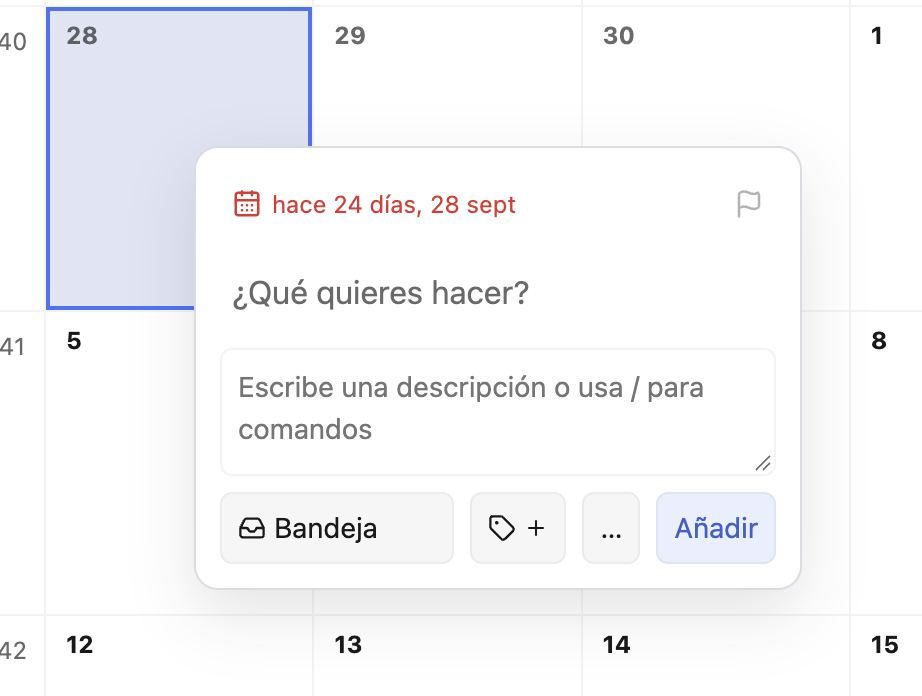<figcaption>ttd #73 — popover de creación en Mes: descripción con caja y redimensionable, pie con botones grises gruesos «Bandeja», «🏷 +», «…» y «Añadir»</figcaption></figure><figure>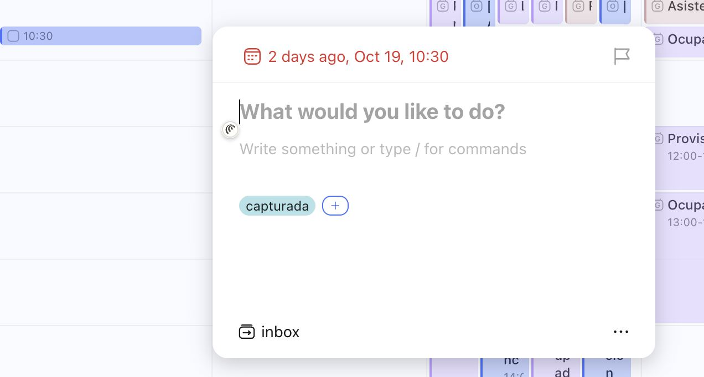<figcaption>TickTick (captura de Pablo) — popover de creación: fecha y bandera arriba, título grande, descripción sin caja, etiqueta, pie solo con «inbox» y «⋯»</figcaption></figure></div>

<div class="pair"><figure>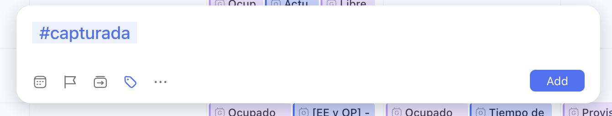<figcaption>TickTick (captura de Pablo) — caja de añadir con barra de iconos finos (fecha, bandera, lista, etiqueta, ⋯) y botón «Add» pequeño</figcaption></figure><figure><figcaption>TickTick — iconos de contorno de ~16-18 px; activo (etiqueta) en color de acento</figcaption></figure></div>

<div class="pair"><figure>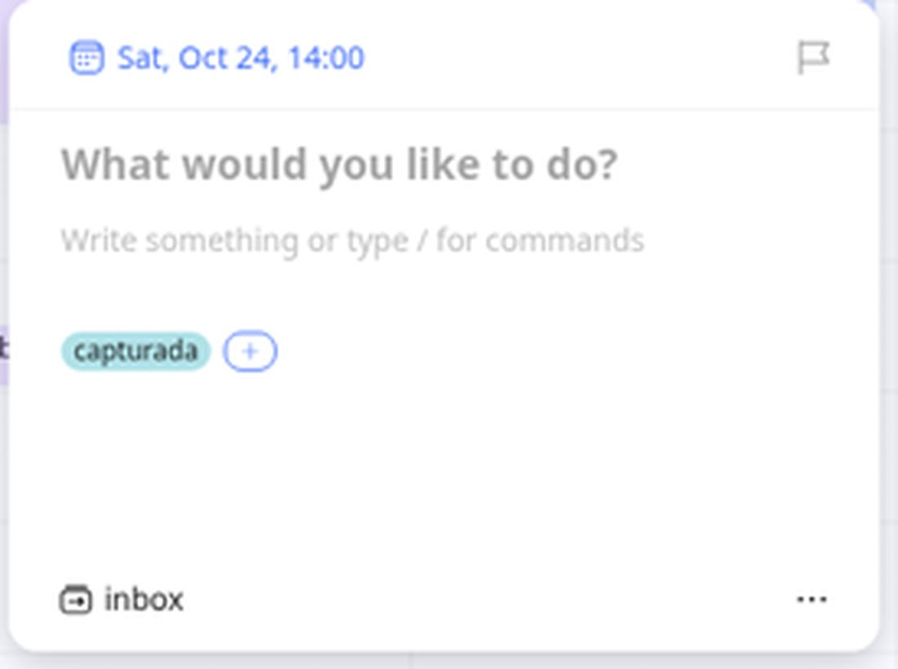<figcaption>TickTick — Semana: popover de creación (zoom)</figcaption></figure><figure>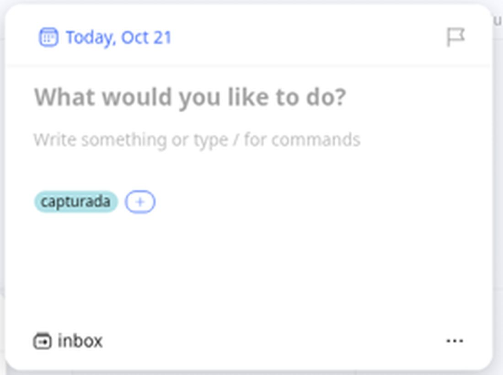<figcaption>TickTick — «+» del calendario: el mismo popover, anclado bajo el botón</figcaption></figure></div>

- **Contexto (producción, `main` antiguo):** `TTD-PROD_r75_05_calendar_plus_new_task_overlay_full` y `_05b` (velo oscuro, «Nueva tarea», caja, «Cancelar»).

### Estado actual en #73 y causa

- **Un componente, dos aspectos:** `web/features/tasks/TaskComposer.tsx:TaskComposer` tiene la prop `calendar` (`:41`, `:302`).
  - **Modo normal** (lo usa `web/features/capture/components/CaptureSheet.tsx:CaptureSheet` para el «+» global): fila `composer-main` con `Plus`, input, chip de fecha, chevron y botón enviar (`Send`), dentro de `.capture-card` con `<h1>` `captureTitle` («Nueva tarea») y un botón «Cancelar» (`CaptureSheet.tsx:37-49`), sobre un velo `.sheet`.
  - **Modo calendario** (lo usa `QuickAddPopover`): fecha y bandera arriba, `textarea.composer-content` (`:399-417`) y pie `composer-calendar-footer` (`:451-487`) con 4 `<button>`.
- **Por qué se ve grueso:** `quick-add-popover.css:58-85` da a los botones del pie `min-height: 36px`, fondo `--surface-2`, borde `1px solid var(--border)`, padding `var(--sp-1) var(--sp-2)` y el primero `flex: 1`; el de enviar va con `--accent-soft`. La descripción conserva el borde y el asa de `textarea` (`.is-calendar .composer-content { min-height: 64px }`, `:51-55`). El contenedor `.calendar-quick-add` tiene `border: 1px solid var(--border-strong)` y `padding: var(--sp-3)` (`:1-12`).
- El «…» es el carácter de texto, no un icono; la etiqueta es `Tag` + `Plus`; la lista usa siempre `Inbox` aunque la lista sea otra.

### Especificación — componente único `TaskCard`

- Renombra la variante visual a **una sola**: `TaskComposer variant="card"` (o un `TaskCardComposer` que envuelve la lógica actual de `TaskComposer`: estado, parser, `quickAddRequest`, `slotToTaskBody`, envío). **Se usa en los tres sitios:**
  1. `QuickAddPopover` (clic en hueco, 74) — anclado;
  2. «+» de la cabecera del calendario — anclado bajo el botón, con fecha «Hoy» (TickTick `05b`);
  3. «+» global del rail, atajo de captura y `openTaskComposer()` desde cualquier vista — **centrado**, con el mismo aspecto.
     El composer en línea de las listas de Tareas («Añadir tarea a "Bandeja"») **se queda como está** (es otro patrón, de una línea, también en TickTick).
- `CaptureSheet` pasa a ser solo el contenedor del caso 3: **sin** `<h1>` visible (queda `sr-only`), **sin** botón «Cancelar», sin velo oscuro: velo `color-mix(in srgb, var(--ink) 12%, transparent)` en claro y `rgb(0 0 0 / 0.4)` en oscuro (nuevo token `--scrim-light`).

#### Escritorio (≥ 1024 px)

- **Contenedor** `.task-card`:
  - ancho: anclado `--composer-card-w` (304 px); centrado `--composer-card-w-global` (544 px), a 18 vh del borde superior;
  - `--radius-lg` (12 px), `--shadow-lg`, borde `1px solid var(--border)` (no `--border-strong`), fondo `--surface`, **sin padding general** (cada zona tiene el suyo).
- **Cabecera** (alto 40 px, padding `0 var(--sp-2) 0 var(--sp-4)`, separador inferior `1px solid var(--border)`):
  - chip de fecha: botón sin borde ni fondo, icono `CalendarDays` 14 px + texto `--fs-sm` (13 px) peso 500; color `--accent` con fecha, **`--danger` si es pasada** («hace 24 días, 28 sept»), `--ink-3` sin fecha («Fecha»); hover: fondo `--icon-hover-bg`, `--radius-sm`; abre `DatePopover` (Fecha/Duración);
  - a la derecha, bandera: botón `--icon-btn` (28 px), `Flag` de `--icon-glyph` (16 px), stroke 1.75; sin prioridad `--icon-ink`; con prioridad, relleno y trazo `--prio-high/medium/low`. Abre el menú de prioridad (4 banderas).
- **Título:** `input` sin borde, `--fs-md` (16 px) peso 600, `--ink`, padding `var(--sp-3) var(--sp-4) var(--sp-1)`; placeholder `calendarQuickTitle` en `--ink-faint` peso 600. Resaltado del parser (`quick-add-mirror`): `mark` con fondo `--accent-soft`, texto `--accent-ink`, `--radius-sm`, sin padding horizontal que desplace el texto (los dos textos, el del `input` y el del espejo, deben medir lo mismo: mismo `font`, `letter-spacing` y `padding`).
- **Descripción:** `textarea` **sin borde, sin fondo y sin asa** (`resize: none`), autoajustable de 1 a 6 líneas, `--fs-sm` (13 px) `--ink-2`, padding `0 var(--sp-4)`, placeholder `calendarQuickDescription` en `--ink-faint`. Mayús+Enter: salto de línea; Enter: guarda.
- **Etiquetas:** fila de chips `--tag-chip-h` (20 px) con `--radius-full`, padding `0 8px`, `--fs-xs` (12 px), fondo color de la etiqueta al 24 % (o `--accent-soft`), y el botón «+» circular de 20 px con borde `1px solid var(--accent)`; padding de la fila `var(--sp-2) var(--sp-4)`; se oculta si no hay etiquetas por defecto ni elegidas.
- **Pie** (alto 40 px, padding `0 var(--sp-2) 0 var(--sp-3)`, sin separador; `margin-top: var(--sp-2)`):
  - **Variante anclada (calendario), como TickTick:** a la izquierda, selector de lista (botón sin borde: icono de la lista 14 px + nombre `--fs-sm` `--ink-2`, elipsis a 160 px; hover `--icon-hover-bg`); a la derecha, botón `--icon-btn` con `MoreHorizontal` 16 px (`calendarQuickMore`), que abre el menú «⋯»: Etiquetas, Adjuntar, Añadir desde plantilla, Convertir en nota, **Más opciones** (abre la tarjeta centrada con el borrador, no un modal distinto). **Sin botón «Añadir»**: Enter guarda (como TickTick).
  - **Variante centrada (global), como la captura `REF-TICKTICK_r75_quickadd_global`:** a la izquierda, **barra de iconos**: fecha (`CalendarDays`), prioridad (`Flag`), lista (`ArrowRightToLine`/icono de lista), etiqueta (`Tag`), y «⋯» (`MoreHorizontal`); cada uno `--icon-btn` (28 px) con glifo 16 px stroke 1.75, `gap: 2px`; en reposo `--icon-ink`; **activo (valor puesto)** `--accent`; hover `--icon-ink-hover` + `--icon-hover-bg` + `--radius-sm`; foco `--focus-ring` 2 px con `outline-offset: 1px`; deshabilitado opacidad 0.4. A la derecha, **botón «Añadir»** pequeño: alto 28 px, padding `0 var(--sp-3)`, `--radius-sm`, `--fs-sm` peso 500, fondo `--accent`, texto `--on-accent`; hover `--accent-hover`; activo `--accent-active`; deshabilitado (título vacío) opacidad 0.5 y `aria-disabled`. Cuando la fecha está en la barra de iconos, **no** se repite el chip de la cabecera: la cabecera solo aparece en la variante anclada.
  - Tooltips oscuros (los del rail: `--rail-tooltip-bg`/`--rail-tooltip-ink`, `--fs-xs`, `--radius-sm`) con el nombre de cada icono.
- **Estados:** enviando (botón «Añadir» con `aria-busy` y spinner de 14 px; campos `disabled`; el popover no se cierra); error (línea `role="alert"` bajo el título, `--fs-xs` `--danger`, y el borrador se conserva); avisos del parser (`warningText`, `CaptureSheet.tsx:52`) en `--fs-xs` `--ink-3` bajo las etiquetas; sin conexión (se encola con `runOrQueue` y aviso «Se guardará al recuperar la conexión»); fecha pasada en rojo.
- **Teclado:** foco inicial en el título; Enter guarda; Mayús+Enter en la descripción, salto; Escape cierra (si hay texto, pide confirmación en línea: «¿Descartar el borrador?» con «Descartar» / «Seguir editando»; ver 74); Tab recorre título → descripción → chips → iconos/pie → «Añadir»; Ctrl/Cmd+Enter guarda desde cualquier campo.
- **Clic fuera:** vacío → cierra; con texto → conserva (como ya hace `QuickAddPopover` con `keepDraft`).

#### Móvil (≤ 768 px)

- Las dos variantes se abren como **hoja inferior** (como ya hace `.calendar-quick-add` a ≤ 639 px, `quick-add-popover.css:111-126`, extendido a ≤ 768 px): ancho 100 %, `--radius-xl` arriba, asa de 36×4 px, `max-height: 85dvh`, `padding-bottom: calc(var(--sp-3) + env(safe-area-inset-bottom))`; se coloca **encima del teclado** usando `visualViewport` (`height` y `offsetTop`) para que el pie no quede tapado.
- Título `--fs-lg` (20 px); descripción `--fs-base` (14 px); botones de icono de **44×44 px** con glifo de 20 px; «Añadir» de 36 px de alto (el objetivo táctil se amplía a 44 px con `::after`).
- La barra de iconos se usa también en la hoja del calendario (en móvil no hay «⋯» flotante cómodo): fecha, prioridad, lista, etiqueta, «⋯» y «Añadir».
- Deslizar hacia abajo cierra (con la misma regla de borrador).

#### i18n

- Reutiliza `calendarQuickTitle`, `calendarQuickDescription`, `calendarQuickAdd`, `calendarQuickMore`, `calendarQuickExpand`, `kindDate`, `kindPriority`, `kindList`, `kindTag`.
- Nuevas: `composerDiscardTitle` («¿Descartar el borrador?»/«Discard draft?»), `composerDiscard` («Descartar»/«Discard»), `composerKeepEditing` («Seguir editando»/«Keep editing»), `composerQueuedOffline` («Se guardará al recuperar la conexión»/«Will be saved when you're back online»), `composerDateEmpty` («Fecha»/«Date»).
- En `en`, `calendarQuickDescription` debe ser «Write something or type / for commands» (hoy «Write a description or type / for commands», `en.ts:131`), como TickTick.

#### Accesibilidad

- Contenedor `role="dialog"` (`aria-modal="false"` anclado; `true` centrado y en móvil), `aria-labelledby` al título oculto `calendarQuickTitle`/`captureTitle`.
- Cada botón de icono con `aria-label` y, si abre menú, `aria-haspopup="menu"` y `aria-expanded`. Los iconos con valor puesto llevan el valor en el `aria-label` («Prioridad: alta»).
- El resaltado del parser tiene una descripción accesible: `aria-describedby` a un resumen oculto («Etiqueta trabajo, prioridad alta, lista casa, mañana 10:00»).

### Criterios de aceptación (76)

- El «+» global, el «+» del calendario y el clic en un hueco abren **el mismo componente** (mismo `data-testid="task-card"`), con las dos variantes de pie descritas.
- No hay `textarea` con borde ni asa; no hay botones grises de 36 px; los iconos miden 16 px dentro de botones de 28 px en escritorio y 20/44 px en móvil.
- La fecha pasada sale en rojo; la prioridad pinta la bandera; la lista muestra su icono real.
- `CaptureSheet` ya no tiene `<h1>` visible ni botón «Cancelar».
- En 390×844, la hoja queda por encima del teclado y el botón «Añadir» es visible.
- Claro y oscuro con contraste AA (texto ≥ 4.5:1, iconos ≥ 3:1).

### Tests (76)

- **Componente:** `features/tasks/TaskCardComposer.spec.tsx`: variante anclada (sin botón «Añadir», Enter guarda), variante centrada (barra de iconos, «Añadir» deshabilitado sin título), fecha pasada con clase `is-past`, Escape con borrador pide confirmación, Mayús+Enter añade línea, foco inicial y orden de Tab.
- **Unitarios:** se mantienen `capture/quick-add.spec.ts` y `capture/calendar-slot.spec.ts` sin cambios de comportamiento.
- **Playwright** (`apps/web/e2e/composer-r75.spec.ts`, desktop 1280×800 y mobile 390×844): `global plus opens task card`, `calendar plus opens same card anchored`, `slot click opens same card` (desktop); `bottom sheet above keyboard` (mobile, con `page.setViewportSize` y `visualViewport` simulado); captura visual de las dos variantes en claro y oscuro.
- **Regresión:** `apps/web/e2e/calendar-quick-add.spec.ts` de 74 sigue en verde (ajusta solo los selectores del pie).

## TTD-AUD-77 — Racha y puntuación: fuera del rail y del sidebar, dentro del menú del avatar

- **Severidad:** Media · **Área:** Shell / Estadísticas
- **Pantalla/URL:** todas (rail, sidebar de Tareas y barra móvil)

<div class="pair"><figure>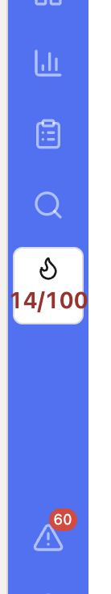<figcaption>ttd #73 — rail plegado: caja blanca «🔥 14/100» que desborda el rail, número en rojo</figcaption></figure><figure>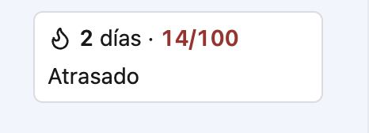<figcaption>ttd #73 — sidebar: tarjeta «🔥 2 días · 14/100 Atrasado»</figcaption></figure></div>

<div class="pair"><figure>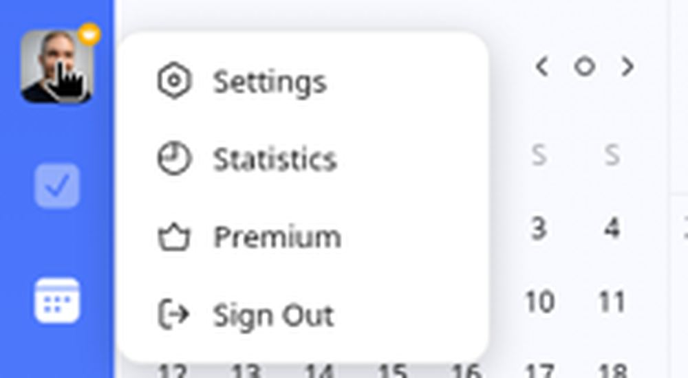<figcaption>TickTick — menú del avatar: Settings, Statistics, Premium, Sign Out</figcaption></figure><figure>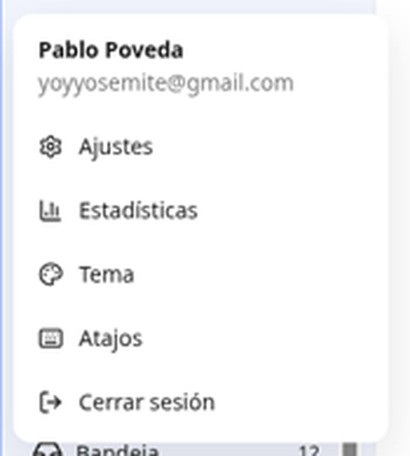<figcaption>ttd (producción, solo contexto) — menú del avatar actual: nombre, correo, Ajustes, Estadísticas, Tema, Atajos, Cerrar sesión</figcaption></figure></div>

### Estado actual en #73 y causa

- `web/features/statistics/ControlSummary.tsx:ControlChip` (`:98-170`) se pinta en **tres sitios**:
  - `web/shell/IconRail.tsx:82` — `{collapsed ? <ControlChip compact /> : null}`: con el sidebar plegado (siempre en Foco, Hábitos, etc., porque `sectionShowsSidebar` es falso) aparece en el rail;
  - `web/shell/Sidebar.tsx:197` — arriba del sidebar de Tareas;
  - `web/shell/AppShell.tsx:188-192` — `.mobile-control-bar` en estrecho.
- **Por qué se desmaqueta en el rail:** `.control-chip` (`web/features/statistics/control.css:1-19`) es un botón con `background: var(--surface)`, borde `--border-strong`, `padding: 6px 8px`, `font-size: var(--fs-base)` y `flex-wrap: wrap`, pensado para el sidebar. Dentro del rail de ~48 px no cabe: «14/100» se parte y desborda, y `--control-score-color` con `data-state='behind'` lo pinta en `--danger` mezclado.
- `web/shell/AccountMenu.tsx:AccountMenu` es un `<details>` con «Ajustes, Estadísticas, Tema, Atajos, Cerrar sesión» y no muestra racha ni puntuación.

### Especificación

- **Quitar** `ControlChip` del rail, del sidebar y de `.mobile-control-bar` (y la propia barra si se queda vacía).
- **Añadirlo al menú del avatar** como bloque de cabecera «Tu progreso», sustituyendo el `<details>` por un menú accesible:
  - **Escritorio:** menú flotante anclado a la derecha del avatar (`@floating-ui`, `placement: 'right-start'`, `offset(8)`), ancho 256 px, `--radius-lg`, `--shadow-lg`, borde `--border`, fondo `--surface`, padding `var(--sp-2) 0`.
    1. **Cabecera de cuenta** (padding `var(--sp-2) var(--sp-3)`): avatar 32 px, nombre `--fs-sm` peso 600 y correo `--fs-xs` `--ink-3` con elipsis.
    2. **Tarjeta de progreso** (margen `0 var(--sp-2)`, padding `var(--sp-3)`, `--radius-md`, fondo `--surface-2`): dos columnas iguales con `gap: var(--sp-3)`:
       - **Racha:** icono `Flame` 16 px en `--warning`, número `--fs-lg` (20 px) peso 700 `--ink` y debajo `countDays` en `--fs-xs` `--ink-3` («2 días»);
       - **Control:** número «14» `--fs-lg` peso 700 y «/100» `--fs-xs` `--ink-3`, con una barra de progreso de 4 px (`--radius-full`, pista `--surface-3`, relleno según estado: `--success` ≥ 75, `--warning` 50–74, `--danger` < 50) y la etiqueta (`controlGood`/`controlFair`/`controlBehind`) en `--fs-xs` y el color del estado **solo en el texto de la etiqueta**, no en el número.
       - Clic en la tarjeta: abre el popover de detalle de Control que ya existe (`control-popover`) o navega a `/statistics` (`navStatistics`).
       - Estados: cargando (esqueleto de 2 bloques de 40 px); sin datos (`noControl`, «—»); error (`loadFailed` + «Reintentar» en `--fs-xs`).
    3. Separador `1px solid var(--border)` y la lista de siempre: Ajustes, Estadísticas, Tema, Atajos, Cerrar sesión. Filas de 32 px, padding `0 var(--sp-3)`, icono 16 px `--icon-ink`, texto `--fs-sm`; hover `--sidebar-hover-bg`; «Cerrar sesión» en `--danger` al pasar el ratón.
  - **Avatar en el rail:** 28 px con la inicial; si la racha está activa hoy, un **punto** de 8 px `--warning` arriba a la derecha (como el punto de premium de TickTick) con `aria-label` «Racha activa: 2 días» (`streakActiveDot`). Nada más en el rail.
  - **Móvil:** el avatar está en la cabecera de «Más» (`sidebar-account-identity`, `Sidebar.tsx:187-195`) y en la BottomBar si existe; el menú se abre como **hoja inferior** con el mismo contenido (filas de 44 px, tarjeta de progreso de ancho completo). No hay barra de Control fija arriba.
- **Accesibilidad:** el botón del avatar es `button` con `aria-haspopup="menu"`, `aria-expanded` y `aria-controls`; el menú `role="menu"` con `menuitem` (la tarjeta de progreso es un `menuitem` con `aria-label` completo: «Racha 2 días. Control 14 de 100, atrasado»). Flechas Arriba/Abajo, Inicio/Fin, Escape devuelve el foco al avatar; Tab cierra el menú.
- **i18n nuevas:** `accountProgress` («Tu progreso»/«Your progress»), `streakActiveDot` («Racha activa: {days}»/«Active streak: {days}»), `controlScoreOf` («{score} de 100»/«{score} out of 100»).
- **Limpieza:** `.sidebar > .control-chip` y `.mobile-control-bar` en CSS; `.rail-badge` con tokens (sección 3).

### Criterios de aceptación (77)

- En ninguna sección aparece «🔥 14/100» en el rail ni la tarjeta en el sidebar; en móvil no hay barra de Control arriba.
- Al abrir el menú del avatar se ve la tarjeta con racha y Control, con estados de carga, vacío y error, en claro y oscuro.
- El menú se maneja entero con teclado y en móvil es una hoja.

### Tests (77)

- **Componente:** `shell/AccountMenu.spec.tsx`: la tarjeta aparece con datos, «—» sin datos, «Reintentar» con error; roles `menu`/`menuitem`; Escape devuelve el foco. `shell/IconRail.spec.tsx`: no renderiza `.control-chip` ni plegado ni desplegado.
- **Playwright** (`apps/web/e2e/shell-r75.spec.ts`): `no control chip in rail or sidebar` (desktop y mobile), `avatar menu shows streak and score` (desktop), `avatar menu is bottom sheet` (mobile).

## TTD-AUD-78 — Foco/Pomodoro: pantalla tipo TickTick (Pomo/Cronómetro, anillo con progreso, Resumen y Registro) y sin panel de detalle

- **Severidad:** Alta · **Área:** Foco
- **Pantalla/URL:** `/focus`
- **Depende de:** 75.2 (regla de paneles por sección).

<div class="pair"><figure>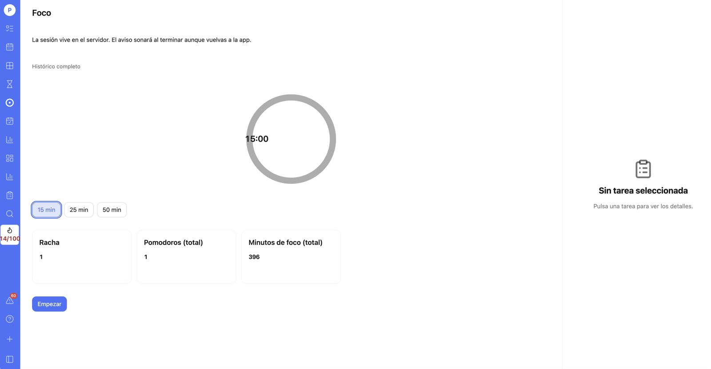<figcaption>ttd #73 — Foco con el panel «Sin tarea seleccionada», texto técnico, anillo gris sin progreso, «15:00» descentrado, tarjetas sin estilo y «Empezar» suelto</figcaption></figure><figure>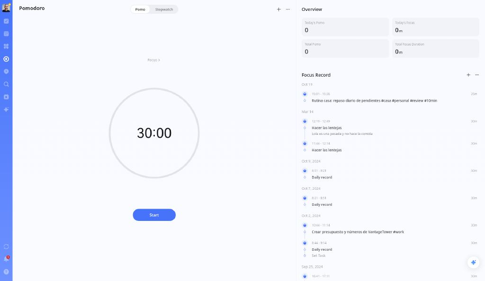<figcaption>TickTick — Pomodoro: Pomo/Stopwatch, anillo, tiempo grande centrado, «Start» bajo el anillo; a la derecha Overview y Focus Record</figcaption></figure></div>

<div class="pair"><figure>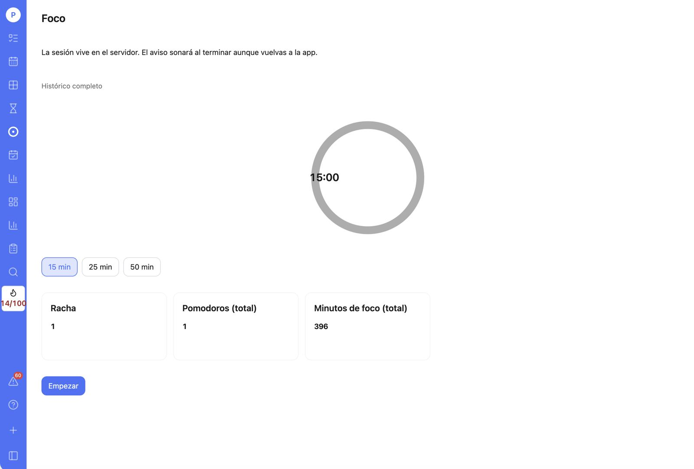<figcaption>ttd #73 — Foco con el sidebar plegado (y el widget 14/100 en el rail, 77)</figcaption></figure><figure>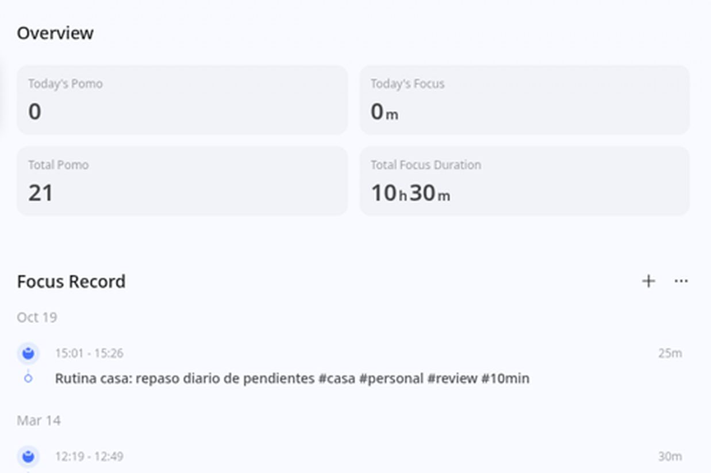<figcaption>TickTick — Overview (4 tarjetas) y Focus Record por fecha con línea de tiempo y duración</figcaption></figure></div>

<div class="pair"><figure>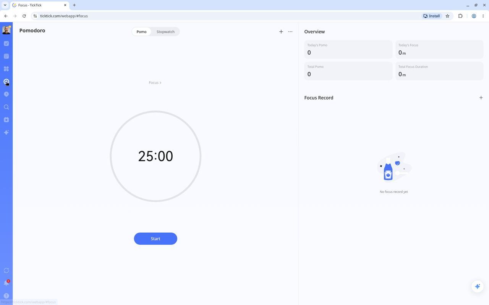<figcaption>TickTick — estado vacío: datos a 0 e ilustración «No focus record yet»</figcaption></figure><figure>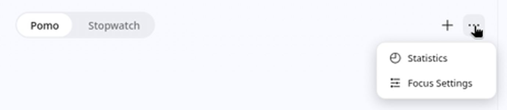<figcaption>TickTick — menú «⋯» de la cabecera: Statistics, Focus Settings</figcaption></figure></div>

- **Contexto (producción, `main` antiguo):** `TTD-PROD_r75_06_focus_screen_full` (sin anillo; «25:00» en 15 px).

### Estado actual en #73 y causa

- `web/features/product/ProductPages.tsx:FocusPage` (`:46-244`):
  - `<p>{messages.focusHint}</p>` («La sesión vive en el servidor…», `i18n/extra.ts:243`) y `<p className="ui-muted">{messages.focusLifetime}</p>` («Histórico completo») como texto suelto (`:136-137`);
  - **anillo** `.focus-timer-ring` (`:145-159`; CSS `shell/shell.css:823-857`): pista `color-mix(in srgb, var(--ink-3) 55%, transparent)` con `stroke-width: 8` (gris grueso); el progreso es 0 hasta que hay sesión (`progress = started === null ? 0 : …`, `:101-104`), así que en reposo solo se ve el gris;
  - **reloj descentrado:** `<p className="focus-timer-clock detail-title">` hereda de `.detail-title` (`components/ui.css:830-838`) `width: 100%` y alineación a la izquierda dentro de la rejilla centrada, y `font-size: 20px`; por eso «15:00» aparece a la izquierda del círculo y pequeño;
  - **presets 15/25/50** como `Button` en `.page-toolbar` (`:160-176`), que además **escriben en los ajustes** (`updateFocusSettings`), no solo en la sesión;
  - **tarjetas** `ul.widget-grid.focus-stats > li.widget.garden-card` (`:179-192`) reutilizadas del jardín, sin estilo de Foco; solo totales (racha, pomodoros, minutos), **sin «hoy»**;
  - «Empezar»/«Terminar»/«Abandonar» en otra `.page-toolbar` al final (`:193-243`);
  - no hay modo **Cronómetro**, ni **pausa**, ni **registro** de sesiones, ni forma de **asociar una tarea** desde esta pantalla (solo desde el menú de Hoy, `features/today/TodayPage.tsx:869`).
- **Panel de detalle:** `section-of.ts:sectionShowsDetailPane` incluye `'focus'` (ver 75.2).
- **API** (`api/modules/focus/focus.controller.ts`):
  - `StartDto.type` admite `focus | short_break | long_break` (`:37-52`); no hay cronómetro ni pausa;
  - `GET /focus/sessions` devuelve `task_id` pero no el título de la tarea (`json()`, `:353-378`) y admite `from`/`to` (`:170-202`);
  - `GET /focus/stats` llama a `focusStats(rows)` **sin desplazamiento de zona** (`:204-231`; `domain/focus/cycle.ts:104`, `timeZoneOffsetMinutes = 0`), así que los días de la racha se cuentan en UTC (una sesión a las 00:30 de Madrid cuenta para el día anterior).

### Especificación — escritorio (≥ 1024 px)

- **Disposición:** dos columnas a pantalla completa (sin sidebar secundario ni panel de detalle): columna principal `flex: 1` y **panel derecho** de `--focus-panel-w` (clamp 320–480 px) con `border-left: 1px solid var(--border)`, fondo `--bg`, scroll propio.
- **Cabecera de la columna principal** (alto 48 px, padding `0 var(--sp-6)`):
  - izquierda: título `focusTitle` («Pomodoro»/«Pomodoro»; o «Foco»/«Focus» si Pablo lo prefiere) en `--fs-lg` (20 px) peso 700;
  - centro: **segmentado Pomo / Cronómetro** (`role="tablist"`): contenedor alto 28 px, `--radius-full`, fondo `--surface-2`, padding 2 px; pestañas de 24 px de alto, padding `0 var(--sp-3)`, `--fs-sm` (13 px); activa: fondo `--surface`, `--shadow-sm`, peso 600, `--ink`; inactiva `--ink-3`; hover `--ink`; foco `--focus-ring`;
  - derecha: «+» (`--icon-btn`, «Añadir registro manual», ver API) y «⋯» (menú: «Estadísticas» → `/statistics#focus`, «Ajustes de foco» → `/settings/focus` o un diálogo con las duraciones; incluye ahí los presets 15/25/50 y la duración de los descansos).
- **Bloque del temporizador** (centrado vertical y horizontalmente en la columna, `gap: var(--sp-6)`):
  1. **Tarea asociada** (encima del anillo): botón de texto `--fs-sm` `--ink-3` «Foco ›» (`focusPickTask`, como «Focus ›» de TickTick) que abre un buscador de tareas (popover de 320 px con `search` y las tareas de hoy); con tarea: título de la tarea en `--ink-2` con elipsis a 280 px y «×» para quitarla. Durante una sesión no se puede cambiar.
  2. **Anillo** SVG de `--focus-ring-size` (240 px): pista `--focus-ring-track`, trazo `--focus-ring-stroke` (3 px); progreso `--focus-ring-progress` (o `--focus-ring-break` en descanso), trazo `--focus-ring-progress-stroke` (4 px), `stroke-linecap: round`, empezando arriba (rotación −90°) y en sentido horario; **en reposo el progreso es 0 y solo se ve la pista fina** (como TickTick); animación `stroke-dashoffset` lineal de 1 s por tick (sin `ease`, para que no «salte»).
  3. **Reloj** centrado **dentro** del anillo con posicionamiento absoluto (`inset: 0; display: grid; place-items: center`; **sin** la clase `detail-title`): `--focus-clock-fs` (40 px), peso 300, `--ink`, `font-variant-numeric: tabular-nums`, `letter-spacing: -0.01em`; bajo el reloj, en `--fs-xs` `--ink-3`, la fase: «Foco», «Descanso corto», «Descanso largo» o, en cronómetro, «Cronómetro».
  4. **Botones** bajo el anillo:
     - reposo: «Empezar» (`focusStart`): pill de 112×32 px, `--radius-full`, fondo `--accent`, texto `--on-accent` `--fs-sm` peso 500; hover `--accent-hover`, activo `--accent-active`, foco `--focus-ring` con `outline-offset: 2px`;
     - en curso: «Pausa» (pill de 112×32, borde `1px solid var(--accent)`, texto `--accent`, fondo transparente) y «Terminar» (botón de texto `--fs-sm` `--ink-3`); en pausa: «Continuar» (relleno) y «Terminar»;
     - «Abandonar» en el menú «⋯» del temporizador durante la sesión (pide confirmación en línea: `focusAbortConfirm`);
     - al terminar un foco: «Empezar descanso» (relleno `--focus-ring-break`) y «Saltar descanso» (texto).
- **Panel derecho:**
  - **Resumen** (`focusOverview`, «Resumen»/«Overview»): título `--fs-md` peso 600, padding `var(--sp-4) var(--sp-4) var(--sp-2)`; rejilla 2×2, `gap: var(--sp-2)`; cada tarjeta: alto 64 px, padding `var(--sp-2) var(--sp-3)`, `--radius-md`, fondo `--stat-card-bg`, sin borde; etiqueta `--fs-xs` `--ink-3`; valor `--fs-lg` (20 px) peso 600 `--ink` con unidades en `--fs-xs` («10 h 30 min» con «h» y «min» pequeños, como TickTick):
    - «Pomos de hoy» (`focusTodayPomo`), «Foco de hoy» (`focusTodayFocus`), «Pomos totales» (`focusTotalPomo`), «Tiempo total de foco» (`focusTotalDuration`). La **racha** va en el menú del avatar (77) y en Estadísticas, no aquí (TickTick no la pone).
  - **Registro de foco** (`focusRecord`, «Registro de foco»/«Focus record»): cabecera con título `--fs-md` peso 600, «+» (añadir registro manual) y «⋯» (Ver todo → `/statistics#focus`).
    - Agrupado por día local (Europe/Madrid): cabecera de grupo `--fs-xs` `--ink-3` («Hoy», «Ayer», «19 oct», «14 mar 2025» si es de otro año).
    - Cada sesión: fila con **línea de tiempo** a la izquierda (icono de tomate/`Timer` 16 px en un círculo de 20 px `--accent-soft` con glifo `--accent`, unido al siguiente por una línea vertical de 1 px `--border-strong`), franja «15:01–15:26» `--fs-xs` `--ink-3`, título de la tarea (o «Sin tarea», `focusNoTask`) `--fs-sm` `--ink` con elipsis a 1 línea, nota si existe en `--fs-xs` `--ink-3`, y la duración a la derecha «25 min» `--fs-xs` `--ink-3`. Abandonadas: icono en `--ink-faint` y duración tachada; cronómetro: icono `Timer`; descansos: no se listan.
    - Clic en la fila: abre la tarea en `TaskPeek` (75.6).
    - Carga incremental: 30 sesiones y «Cargar más» (`loadMore`) con `next_cursor`.
  - Estados del panel: cargando (esqueleto: 4 tarjetas grises de 64 px y 5 filas de 40 px); vacío (ilustración simple con un icono `Timer` de 48 px en `--ink-faint` y «Aún no hay registros de foco», `focusRecordEmpty`); error («No se ha podido cargar el registro» + «Reintentar»).
- **Quitar** `focusHint` y `focusLifetime` de la pantalla. El aviso de que la sesión sigue en el servidor se muestra **solo** como texto de ayuda en «⋯ → Ajustes de foco» o como `title` del reloj.
- **Título de la pestaña:** durante la sesión `document.title = "14:32 · Foco"` (ya existe `FocusTitle` en `AppShell.tsx:240`); al terminar, notificación y sonido (ya existen).

### Especificación — móvil (≤ 768 px)

- **Una columna**; el panel derecho pasa **debajo** del temporizador como dos secciones plegables («Resumen» abierto, «Registro de foco» cerrado), o como pestañas «Temporizador · Registro» bajo la cabecera (elige una y documéntala; recomendación: secciones debajo).
- Cabecera de 52 px: título `--fs-md` peso 700 a la izquierda, «⋯» a la derecha (44×44); el segmentado Pomo/Cronómetro va **debajo**, centrado, a ancho completo hasta 280 px, con pestañas de 36 px de alto.
- Anillo `min(70vw, 16rem)`; reloj `3rem` (48 px) peso 300; botones de 160×44 px; Resumen en rejilla 2×2 con tarjetas de 72 px.
- **Mientras hay sesión**, la pantalla puede bloquear la suspensión (`navigator.wakeLock` si está disponible, con un interruptor en Ajustes de foco) y la BottomBar muestra el mini reloj (ya existe `focusMini`).
- Gestos: deslizar el anillo no hace nada (sin gestos ocultos). Todos los objetivos de 44 px.

### Cambios de API (en esta misma PR, con OpenAPI y SDK regenerados)

1. **Cronómetro:** añadir `stopwatch` a `enum FocusSessionType` (`apps/api/prisma/schema.prisma:144-148`) con migración aditiva. `POST /api/v1/focus/sessions { type: 'stopwatch', task_id? }` crea la sesión con `planned_minutes: 0`; `remaining_seconds` es `null` en ese tipo; `finish` guarda `actual_seconds` = tiempo transcurrido menos pausas. Validación: `type` ∈ {`focus`, `short_break`, `long_break`, `stopwatch`} (si no, 400 `validation_failed`).
2. **Pausa:** `POST /api/v1/focus/sessions/:id/pause` y `/resume` (scope `focus:write`). Columnas nuevas `paused_at timestamptz null` y `paused_seconds int not null default 0`. `remaining_seconds` y `actual_seconds` descuentan las pausas. 409 `focus_not_running` si se pausa una sesión terminada o ya pausada.
3. **Duración por sesión:** `StartDto.planned_minutes?: number` (entero 1–180) para que los presets 15/25/50 **no** cambien los ajustes globales; si no llega, se usan los ajustes.
4. **Título de la tarea en el registro:** `GET /focus/sessions` incluye `task: { id, title } | null` (con `select` de `title`), sin exponer más campos; y admite `cursor`/`limit` (por defecto 30, máx. 100) además de `from`/`to`. Hoy toma 100 fijas (`take: 100`, `:192`).
5. **Resumen de hoy y zona:** `GET /focus/stats` acepta `tz` (IANA, por defecto la zona de la cuenta) y devuelve además `today_pomodoros` y `today_focus_seconds`, calculados con el día local; `focusStats` recibe la zona (no un desplazamiento fijo, para que el **25/10/2026**, que dura 25 h en Madrid, se cuente bien). Test con una sesión a las 00:30 de Madrid (22:30Z del día anterior) que debe contar para «hoy».
6. **Registro manual** («+»): `POST /api/v1/focus/sessions/manual { started_at, ended_at, task_id?, note? }` crea una sesión `completed: true` con `actual_seconds = ended_at − started_at` (máx. 12 h; `ended_at > started_at`; no en el futuro). Opcional en esta PR; si se deja fuera, oculta el «+».

### i18n (78)

- Nuevas: `focusModePomo` («Pomo»/«Pomo»), `focusModeStopwatch` («Cronómetro»/«Stopwatch»), `focusPickTask` («Foco ›»/«Focus ›»), `focusNoTask` («Sin tarea»/«No task»), `focusPause` («Pausa»/«Pause»), `focusResume` («Continuar»/«Resume»), `focusStartBreak` («Empezar descanso»/«Start break»), `focusSkipBreak` («Saltar descanso»/«Skip break»), `focusPhaseFocus` («Foco»/«Focus»), `focusPhaseShortBreak` («Descanso corto»/«Short break»), `focusPhaseLongBreak` («Descanso largo»/«Long break»), `focusOverview` («Resumen»/«Overview»), `focusTodayPomo` («Pomos de hoy»/«Today's pomos»), `focusTodayFocus` («Foco de hoy»/«Today's focus»), `focusTotalPomo` («Pomos totales»/«Total pomos»), `focusTotalDuration` («Tiempo total de foco»/«Total focus time»), `focusRecord` («Registro de foco»/«Focus record»), `focusRecordEmpty` («Aún no hay registros de foco»/«No focus records yet»), `focusAddRecord` («Añadir registro»/«Add record»), `focusSettings` («Ajustes de foco»/«Focus settings»), `focusAbortConfirm` («¿Abandonar la sesión? No contará como pomodoro.»/«Abandon this session? It won't count as a pomo.»), `focusHours` («h»/«h»), `focusMinutesShort` («min»/«m»).
- Se dejan de usar en la pantalla: `focusHint`, `focusLifetime`, `focusPomodoros`, `focusMinutes` (no las borres si se usan en otro sitio).

### Accesibilidad (78)

- El segmentado es `tablist` con `tab` y `aria-selected`, flechas Izquierda/Derecha.
- El reloj es un `role="timer"` con `aria-live="off"` (no anunciar cada segundo) y un anuncio `aria-live="polite"` solo en los cambios: «Sesión iniciada: 25 minutos», «Pausada», «Quedan 5 minutos», «Sesión terminada».
- El anillo es decorativo (`aria-hidden`), pero hay un `progressbar` oculto con `aria-valuenow` en porcentaje.
- Atajos: Espacio empieza o pausa con el foco en la pantalla (no en campos), `F` alterna Pomo/Cronómetro. Documéntalos en `/settings/shortcuts`.

### Casos límite (78)

- Recargar la página con una sesión en curso o en pausa: el estado se reconstruye desde el servidor (`started_at`, `paused_at`, `paused_seconds`).
- Sesión que cruza la medianoche: cuenta para el día en que **empezó** (como TickTick); el registro la muestra en ese día.
- Cambio de hora del 25/10: una sesión de 01:50 a 02:20 (CEST→CET, con la hora repetida) dura 30 min reales (se calcula con instantes, no con horas de reloj).
- Tarea asociada borrada o completada: el registro muestra el título guardado o «Tarea eliminada» (`focusTaskGone`).
- Dos pestañas abiertas: las dos muestran la misma sesión (consulta cada 15 s y al recuperar el foco de la ventana).

### Criterios de aceptación (78)

- En `/focus` no hay panel de detalle ni sidebar; hay columna del temporizador y panel Resumen/Registro (escritorio) o secciones debajo (móvil).
- En reposo el anillo es una pista fina y «25:00» está **centrado** dentro del anillo, a 40 px (48 px en móvil).
- Empezar muestra el progreso en el color de acento; Pausa detiene el reloj y el progreso; Continuar sigue; Terminar guarda y aparece en el Registro con su franja y duración.
- Cronómetro cuenta hacia arriba y se guarda con su duración.
- Elegir 15 min para una sesión **no** cambia los ajustes globales.
- Resumen muestra Pomos de hoy, Foco de hoy, Pomos totales y Tiempo total, correctos en Europe/Madrid (sesión a las 00:30 cuenta hoy).
- Sin texto técnico en la pantalla. Claro y oscuro AA.

### Tests (78)

- **Dominio:** `domain/focus/cycle.spec.ts`: `focusStats` con zona `Europe/Madrid` (00:30 local cuenta hoy; día de 25 h del 25/10/2026; día de 23 h del 29/03/2026); `today_*`; cronómetro y pausas en `actual_seconds`.
- **API (e2e, `apps/api/test/focus-r75.e2e-spec.ts`):** `stopwatch` crea con `planned_minutes` 0; `pause`/`resume` y 409; `planned_minutes` por sesión no toca los ajustes; `GET sessions` con `task.title` y cursor; `GET stats?tz=Europe/Madrid` con `today_*`; validación de `type` y de `planned_minutes`.
- **Componente:** `features/focus/FocusPage.spec.tsx` (mueve `FocusPage` a `web/features/focus/` si hace falta): reposo, en curso, en pausa, descanso, cronómetro; reloj centrado (sin clase `detail-title`); Resumen con cargando/vacío/error; Registro agrupado por día; `role="timer"` y `tablist`.
- **Playwright** (`apps/web/e2e/focus-r75.spec.ts`, desktop 1280×800 y mobile 390×844, reloj simulado con `page.clock`): `focus has no detail pane`, `start pause resume finish appears in record`, `stopwatch mode`, `preset does not change settings`, `mobile layout stacks overview`; capturas visuales en claro y oscuro.

## TTD-AUD-79 — Tokens y MCP: lo que pidió la propuesta y no llegó en #71/#73

- **Severidad:** Media · **Área:** Ajustes → Tokens y MCP (`/settings/tokens`)
- **Referencias:** `revision-propuesta-tokens-mcp.md` (propuesta v2 y sus bocetos `PROPUESTA_boceto-1/2/3` del zip del documento grande) y hallazgos TTD-AUD-35 a 46 de `ttd-codex-especificacion-unica.md`.

<div class="pair"><figure>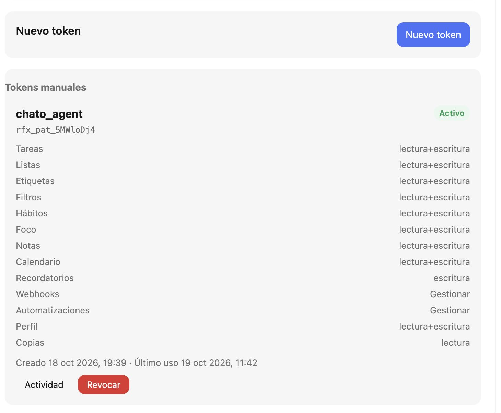<figcaption>ttd #73 — «Tokens manuales»: tarjetas grises, tabla plana de 13 ámbitos con «lectura+escritura», «Actividad» y «Revocar» rojo relleno</figcaption></figure><figure>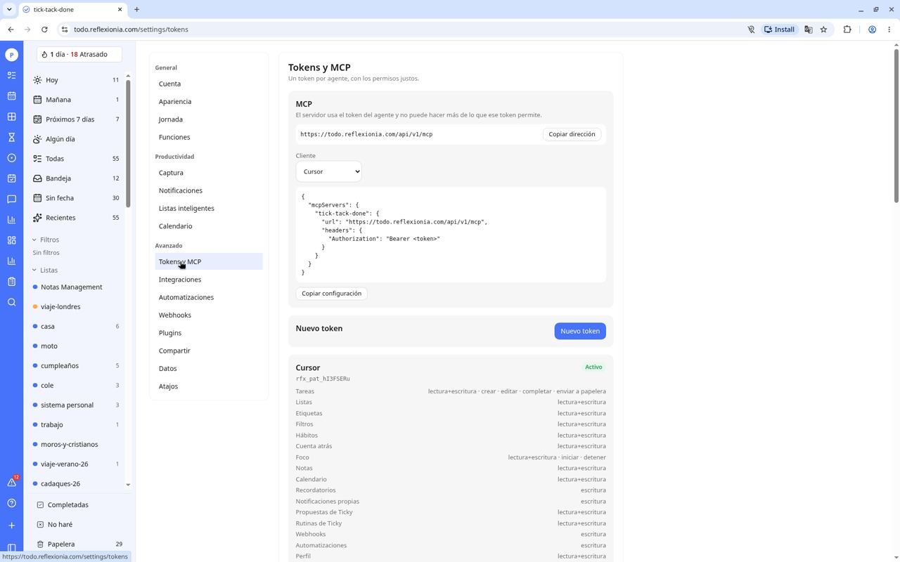<figcaption>ttd (producción, solo contexto) — Tokens y MCP en `main` antiguo</figcaption></figure></div>

### Qué se implementó de verdad (verificado en el código de #73)

| ID        | Pedido                                                                                                                                        | En #73 (fichero:símbolo)                                                                                                                                                                       | Veredicto                                                                                     |
| --------- | --------------------------------------------------------------------------------------------------------------------------------------------- | ---------------------------------------------------------------------------------------------------------------------------------------------------------------------------------------------- | --------------------------------------------------------------------------------------------- |
| 35        | Paginar la lista y agrupar las aplicaciones OAuth                                                                                             | `web/features/tokens/components/TokensPage.tsx:TokensPage` usa `useInfiniteQuery` con `next_cursor` (`:30-46`); `web/features/tokens/token-groups.ts:groupTokens` agrupa por `oauth_client_id` | **Hecho**                                                                                     |
| 36        | «Caducado»                                                                                                                                    | `token-groups.ts:tokenExpired` y la píldora (`TokensPage.tsx:378-384`); `expires_at` en el DTO (`api/auth/tokens.service.ts`)                                                                  | **Hecho**                                                                                     |
| 37        | Reautorizar OAuth sin choque de nombres                                                                                                       | PR #62                                                                                                                                                                                         | **Hecho** (no verificado en producción)                                                       |
| 38        | Actividad legible y paginada                                                                                                                  | `activityLine`, `actionLabel`, `entityLabel` con `oauth_token` (`TokensPage.tsx:643-709`); `97ec616` pagina por cursor                                                                         | **Hecho** por token. **Falta** la actividad **por aplicación** (filtro por cliente en la API) |
| 39        | Errores de revocar en la fila y 409 específico                                                                                                | banda `token-confirm` con error                                                                                                                                                                | **Hecho**                                                                                     |
| 40        | Secreto: `aria-live` sin el secreto y cierre explícito                                                                                        | `.token-secret` con `sr-only aria-live` (`:205-247`) y confirmación                                                                                                                            | **Hecho**                                                                                     |
| 41        | «Gestionar», «Cuenta atrás» y ⚠ en sensibles                                                                                                  | `scopes.ts:groupedScopes` con `manage` (`:110-153`); grupo de cuenta atrás en `GROUPS`; `isSensitiveScope` **solo en el formulario** (`TokensPage.tsx:315`)                                    | **A medias:** la tabla de cada fila no marca los sensibles                                    |
| 42        | Consentimiento OAuth con estilo y sensibles desmarcados                                                                                       | PR #64; `ConsentPage.tsx` usa `isSensitiveScope`                                                                                                                                               | **Hecho**                                                                                     |
| 46        | «Revocados» con estilo y origen                                                                                                               | `details.token-revoked` con `token-revoked-row` y origen (`:555-590`)                                                                                                                          | **Hecho** (sin «ver todos» ni motivo de revocación)                                           |
| Propuesta | Lista con **separadores finos y filas plegables** en lugar de tarjetas; estado con **punto + texto**                                          | Sigue con `.token-panel` (tarjeta gris) y `.token-row` con **toda la tabla de ámbitos desplegada** (`:386-393`); píldora de fondo verde                                                        | **No hecho** (es lo que ve Pablo)                                                             |
| Propuesta | Vista **«Aplicaciones conectadas»** por cliente (autorizada el, último uso, renovación vigente) y **«Revocar acceso»** a la aplicación entera | Solo agrupación visual de filas; no hay `GET /me/oauth/grants` ni `POST /me/oauth/grants/{clientId}/revoke` (no existen en `api/auth/`)                                                        | **No hecho** (falta API)                                                                      |
| Propuesta | **Caducidad al crear** («Caduca en 30/90 días / nunca»)                                                                                       | `POST /me/tokens` sigue aceptando solo nombre y permisos (`tokens.service.ts`, sin `expires_in_days`)                                                                                          | **No hecho** (falta API)                                                                      |
| Propuesta | Motivo y recuento real de revocados (`revoked_reason`, rotaciones agrupadas)                                                                  | No existe `revoked_reason`                                                                                                                                                                     | **No hecho** (falta API)                                                                      |
| Propuesta | Instrucciones por cliente (Cursor _bearer_; ChatGPT y Claude OAuth) y selector con estilo                                                     | `<select>` nativo de cliente (`TokensPage.tsx:174-185`), el JSON solo para _bearer_                                                                                                            | **A medias** (sin estilo, Claude sin instrucciones propias)                                   |
| Propuesta | Restricción por listas (`listRestricted`, `listIds`)                                                                                          | En el modelo, no en la UI                                                                                                                                                                      | **No hecho** (mejora, opcional)                                                               |

**Conclusión:** #71 y #73 resolvieron la **lógica** de 35–46, pero **no el rediseño visual ni las funciones nuevas** de la propuesta. Por eso Pablo «no ve cambios»: la pantalla sigue siendo tarjetas con la tabla completa de ámbitos.

### Especificación — escritorio (≥ 1024 px)

- **Estructura de la página** (ancho máximo `--content-max` = 46rem, centrada en el área de Ajustes):
  1. **Conectar un cliente MCP** (bloque superior, sin tarjeta gris: fondo `--surface`, borde `1px solid var(--border)`, `--radius-lg`, padding `var(--sp-4)`):
     - URL del MCP en `code` `--font-mono` `--fs-sm` con botón «Copiar dirección» (`--icon-btn` + texto);
     - **segmentado de cliente** (no `<select>`): Cursor · Claude · ChatGPT · Otro, alto 28 px, como el de 78; según el cliente:
       - Cursor/Otro (_bearer_): el JSON de configuración (`mcpSnippet`, `:594`) en un bloque `--surface-2`, `--radius-md`, `--fs-xs` mono, `white-space: pre-wrap`, con «Copiar configuración» y un paso «Crea un token abajo y pégalo en `Authorization`»;
       - ChatGPT y Claude (OAuth): tres pasos numerados (`mcpOAuthStep1-3`): «Añade el conector con esta URL», «Inicia sesión en ttd cuando te lo pida», «La aplicación aparecerá en _Aplicaciones conectadas_». Sin JSON.
  2. **Aplicaciones conectadas** (`tokenAppsTitle`): una fila por **cliente OAuth** (no por token):
     - fila de 56 px, separador `1px solid var(--list-row-divider)`, padding `var(--sp-2) 0`;
     - izquierda: inicial o icono de la aplicación en un cuadrado de 32 px `--radius-md` `--surface-2`; nombre `--fs-sm` peso 600 y debajo, `--fs-xs` `--ink-3`: «Autorizada el 18 oct · Último uso hace 2 h» y la nota «Nombre declarado por la aplicación»;
     - derecha: estado con **punto** de `--status-dot` (8 px) + texto `--fs-xs`: «Conectada» (`--success`), «Caducada» (`--ink-faint`, si no hay _refresh_ vivo); y botón «Revocar acceso» (botón de texto `--fs-sm` `--danger`, **no** relleno rojo);
     - clic en la fila: se despliega (animación de altura en `--dur-base`) con los **permisos agrupados** (ver abajo), la **actividad de la aplicación** (agregada por cliente) y «n renovaciones automáticas» en `--ink-3`;
     - vacío: «Ninguna aplicación conectada todavía» (`tokenAppsEmpty`).
  3. **Tokens personales** (`tokenManualGroup`, «Tokens personales»/«Personal tokens»; hoy «Tokens manuales»):
     - cabecera con el botón «Nuevo token» (alto 32 px, `--radius-md`, `--accent`/`--on-accent`, `--fs-sm` peso 500) a la derecha;
     - **formulario de creación** desplegable bajo la cabecera: nombre (input de 36 px, `--radius-md`, borde `--border-strong`; foco borde `--accent` + `--focus-ring`), **caducidad** (segmentado: 30 días · 90 días · 1 año · Sin caducidad; por defecto 90 días), permisos por grupo (la rejilla actual `.token-resources`, con los sensibles marcados con `AlertTriangle` 12 px `--warning` y texto de ayuda) y «Crear» / «Cancelar»;
     - **fila de token** (52 px plegada, separadores finos, sin tarjeta): nombre `--fs-sm` peso 600; debajo, `--fs-xs` `--ink-3`: prefijo `rfx_pat_5MWloDj4` en mono · «Creado el 18 oct · Último uso hace 1 día · Caduca el 16 ene» (o «Sin caducidad»); a la derecha, punto + estado («Activo» `--success`, «Caducado» `--ink-faint`, «Revocado» `--ink-faint`) y botón de icono «⋯» con «Actividad», «Revocar»;
     - **resumen de permisos plegado:** en lugar de la tabla de 13 filas, una línea «13 permisos · 2 sensibles» con chips de 20 px de los grupos con escritura o gestión (máx. 4 + «+N»); al desplegar la fila, la tabla agrupada actual (`groupedScopes`) en dos columnas, con «Lectura», «Lectura y escritura», «Gestionar» (sin «lectura+escritura» en minúsculas pegadas) y ⚠ en los sensibles (`webhooks:manage`, `automations:manage`, `profile:write`);
     - **Revocar:** confirmación en línea dentro de la fila (la actual `token-confirm`), con el botón de confirmación relleno `--danger` y «Cancelar» de texto; el resto del tiempo «Revocar» es de texto.
  4. **Revocados** (plegable cerrado por defecto): tabla compacta (nombre, origen «Personal» / «OAuth · ChatGPT», fecha, motivo «Revocado por ti» / «Renovación automática») con 10 filas y «Ver todos (N)». Las renovaciones automáticas se agrupan en una línea por aplicación: «ChatGPT · 23 renovaciones».
- **Banda del secreto recién creado** (ya funciona): mantener su lógica; estilo: fondo `--accent-soft`, borde `1px solid var(--accent)`, `--radius-md`, secreto en input de solo lectura mono `--fs-sm` con «Copiar».
- **Estados de toda la página:** cargando (esqueletos de filas de 52 px); error de carga (línea con «Reintentar», ya existe); vacío por sección; sin conexión (botones de crear y revocar deshabilitados con `title`).

### Especificación — móvil (≤ 768 px)

- Una columna a ancho completo con padding `var(--sp-4)`; las filas pasan a 64 px con el estado bajo el nombre; acciones en «⋯» de 44×44 abriendo una **hoja inferior** («Actividad», «Revocar»).
- El JSON de configuración se parte en líneas (`pre-wrap`, ya está) y el botón «Copiar configuración» ocupa todo el ancho (44 px).
- El formulario de nuevo token se abre como pantalla completa en hoja (92 dvh) con «Crear» fijo abajo (`safe-area-inset-bottom`).
- Los permisos en el formulario se muestran por grupo en acordeón (un grupo abierto a la vez).

### Cambios de API (79)

1. **`GET /api/v1/me/oauth/grants`** (scope `account:admin` y sesión de navegador, como el resto de `/me/tokens`): lista por cliente `{ client_id, client_name, authorized_at, last_used_at, active_access_tokens, active_refresh_families, scopes[] }`, agregando `PersonalAccessToken` con `oauthClientId` y `OauthRefreshToken` vivos (`revokedAt IS NULL AND expiresAt > now()`). Orden por `last_used_at desc`.
2. **`POST /api/v1/me/oauth/grants/{clientId}/revoke`**: en una transacción, revoca **todos** los _access tokens_ y familias de _refresh_ del par usuario+cliente; verifica que el cliente tiene tokens del usuario (si no, 404 `not_found`); registra `oauth_token` `deleted` en el ciclo de vida. Idempotente (204 aunque ya estén revocados).
3. **`POST /api/v1/me/tokens`**: acepta `expires_in_days?: 30 | 90 | 365 | null` (validación `IsIn`); `null` o ausente = sin caducidad; guarda `expiresAt`. 400 `validation_failed` para otros valores.
4. **`GET /api/v1/me/tokens`**: añade `revoked_reason: 'user' | 'rotated' | 'reuse' | null` (derivado: `rotated` si existe un `OauthRefreshToken` con `accessTokenId` = esta fila y `rotatedAt` no nulo; `reuse` si se revocó por reutilización detectada; si no, `user`) y acepta `status=active|revoked` y `kind=personal|oauth`.
5. **Actividad por aplicación:** `GET /api/v1/me/activity?client_id=…` (o `GET /me/oauth/grants/{clientId}/activity`) con cursor, uniendo la actividad de todos los tokens del cliente.

- Tests de integración para cada uno (propietario, transacción, idempotencia, validación) y OpenAPI/SDK regenerados. **No** se añade columna `origin` ni sección «Otros accesos» (ver la revisión, fila 29).

### i18n (79)

- Nuevas: `tokenAppsTitle` («Aplicaciones conectadas»/«Connected apps»), `tokenAppsEmpty` («Ninguna aplicación conectada todavía»/«No connected apps yet»), `tokenAppAuthorizedOn` («Autorizada el {date}»/«Authorized on {date}»), `tokenAppDeclaredName` («Nombre declarado por la aplicación»/«Name declared by the app»), `tokenAppRevoke` («Revocar acceso»/«Revoke access»), `tokenAppRevokeBody` («{name} perderá el acceso al momento y tendrá que volver a conectarse.»/«{name} will lose access immediately and will need to reconnect.»), `tokenAppRenewals` («{n} renovaciones automáticas»/«{n} automatic renewals»), `tokenExpiresIn` («Caducidad»/«Expiration»), `tokenExpires30` / `90` / `365` / `Never` («30 días», «90 días», «1 año», «Sin caducidad» / «30 days», «90 days», «1 year», «No expiration»), `tokenExpiresOn` («Caduca el {date}»/«Expires on {date}»), `tokenScopesSummary` («{n} permisos · {s} sensibles»/«{n} permissions · {s} sensitive»), `tokenRevokedReasonUser` («Revocado por ti»/«Revoked by you»), `tokenRevokedReasonRotated` («Renovación automática»/«Automatic renewal»), `tokenRevokedReasonReuse` («Reutilización detectada»/«Reuse detected»), `mcpOAuthStep1-3`, `mcpClientOther` («Otro»/«Other»).
- Cambiar `tokenManualGroup` a «Tokens personales»/«Personal tokens» y `tokenAccessReadWrite` a «Lectura y escritura»/«Read & write» (hoy se ve «lectura+escritura»).

### Accesibilidad (79)

- Cada fila plegable es un `button` con `aria-expanded` y `aria-controls`; el estado lleva texto (no solo el punto de color).
- El segmentado de cliente es `tablist`; el de caducidad, `radiogroup`.
- La confirmación de revocar es `role="alertdialog"` en línea con foco en «Cancelar» y Escape cierra.
- El ⚠ de permiso sensible tiene texto alternativo «Permiso sensible» (`scopeSensitive`).

### Criterios de aceptación (79)

- La página tiene tres bloques: conectar cliente (segmentado con instrucciones por cliente), Aplicaciones conectadas (una fila por cliente con «Revocar acceso») y Tokens personales (filas finas plegadas, permisos resumidos).
- Crear un token con «30 días» muestra «Caduca el …» y la API guarda `expires_at`.
- «Revocar acceso» a ChatGPT revoca todos sus tokens y familias; al recargar, la aplicación ya no está y ChatGPT pierde el acceso.
- «Revocados» agrupa las renovaciones automáticas y muestra el motivo.
- Los permisos sensibles llevan ⚠ también en las filas.
- No hay botones rojos rellenos salvo en la confirmación. Claro y oscuro AA. En 390×844, sin scroll horizontal.

### Tests (79)

- **API (`apps/api/test/tokens-r75.e2e-spec.ts`):** `grants` lista por cliente y no muestra clientes de otros usuarios; `revoke` en transacción, idempotente, 404 ajeno; `expires_in_days` válido e inválido; `revoked_reason` (`user`, `rotated`); actividad por cliente con cursor.
- **Unitarios web:** `features/tokens/scopes.spec.ts` (resumen «n permisos · s sensibles», etiqueta «Lectura y escritura»), `token-groups.spec.ts` (agrupación de renovaciones).
- **Componente:** `features/tokens/TokensPage.spec.tsx`: filas plegadas por defecto, desplegar con teclado, segmentado de cliente cambia instrucciones, caducidad en el formulario, «Revocar acceso» con confirmación y error en la fila.
- **Playwright** (`apps/web/e2e/tokens-r75.spec.ts`, desktop y mobile, API interceptada): `connected apps list and revoke`, `create token with expiry`, `rows are collapsed and expand`, `no horizontal scroll on mobile`; capturas visuales en claro y oscuro.

## Prompt para Codex (listo para pegar)

```text
Implementa los hallazgos TTD-AUD-75 a 79 de tick-tack-done siguiendo docs/audit/ttd-codex-r75.md (copia en docs/audit/evidencias/ las capturas del zip si aún no están).

Base: rama codex/ttd-audit-remaining (PR #73) o una rama nueva creada desde ella. NO partas de main.

Resumen por punto:
- 75 Calendario:
  - 75.1 sidebar secundario IZQUIERDO con minicalendario, Todo, Listas, Filtros, Etiquetas y Calendarios suscritos (quita el <select> «Lista» de la barra y las casillas de «⋯»), estado en zustand+localStorage y en la URL;
  - 75.2 sin panel de detalle fuera de Tareas (sectionShowsDetailPane solo 'tasks');
  - 75.3/75.8 cabecera compacta de 48 px: izquierda plegar · «Octubre 2026» · S43; derecha «+» (con borde, no relleno) · selector de vista desplegable · navegador «‹ 19 – 25 oct ›» · «Hoy» · «⋯»; controles de 28 px alineados; una fila de 52 px en móvil;
  - 75.4 chips con la hora aparte y a la derecha;
  - 75.5 arrastrar y soltar (mover, redimensionar, a/desde «Todo el día», teclado, táctil, DST 25/10) con patchTask optimista y Deshacer;
  - 75.6 TaskPeek flotante y popover de evento externo anclados (hoja inferior en móvil);
  - 75.7 número de hoy en círculo exacto y RELLENO (.today-mark, width=height, 50 %, --today-mark-bg, número blanco con --on-accent) en cabecera, Mes, Año, minicalendario y selector;
  - 75.9 un único panel secundario a la izquierda y nada a la derecha;
  - 75.10 pastillas de todo el día de 20 px, casilla 12 px, texto 12 px en una línea; N por vista (Día 4, Varios días 3, Semana 3, Mes según alto; móvil 3/2/2) con «+K más» que expande toda la franja (o popover anclado en Mes);
  - 75.11 PeriodNavigator/PeriodPicker compartidos en apps/web/src/components/period/ (modos day/week/month, popover no modal de 264 px, respeta weekStart) que sustituyen a WeekPicker en el Reporte semanal y a CalendarPeriod en el calendario.
- 76 Un único composer (TaskCard) para el «+» global y el calendario, fino y coherente con TickTick.
- 77 Racha y puntuación fuera del rail y del sidebar, dentro del menú del avatar.
- 78 Pantalla de Foco tipo TickTick (Pomo/Cronómetro, anillo con progreso, Resumen y Registro), sin panel de detalle; cambios de API de focus indicados en el documento.
- 79 Tokens y MCP: filas plegables, aplicaciones conectadas con «Revocar acceso», caducidad al crear y actividad por aplicación; cambios de API indicados en el documento.

Reglas: solo tokens de apps/web/src/styles/tokens.css (los nuevos en claro y oscuro), textos solo en i18n (es/en), accesibilidad completa (teclado, aria, foco visible, 44 px en móvil), zona Europe/Madrid en todos los cálculos de fecha. Tests primero: unitarios, de componente y Playwright 1280×800 y 390×844 (más 1024 y 1440 para la cabecera), con capturas en claro y oscuro.

Una sola PR «fix(TTD-AUD-75..79): calendar, composer, streak, focus and tokens polish», un commit por punto (75 con los subcommits 75.7, 75.8-9, 75.10 y 75.11 indicados). Solo cambia la API donde lo dicen 78 y 79, con OpenAPI y SDK regenerados. Anota el estado en docs/audit/ESTADO.md y verifica en la PR cada criterio de aceptación, indicando cómo y en qué viewport.
```
