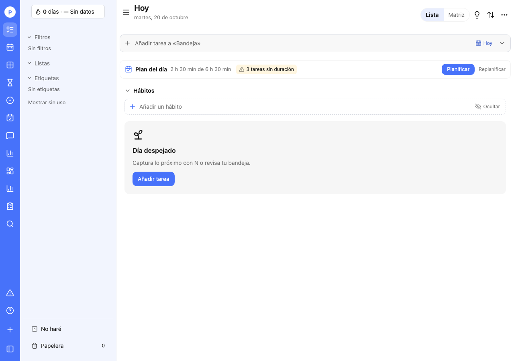
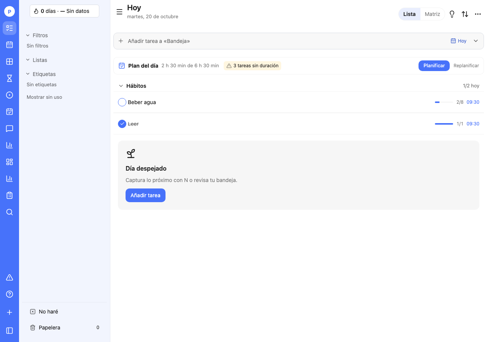
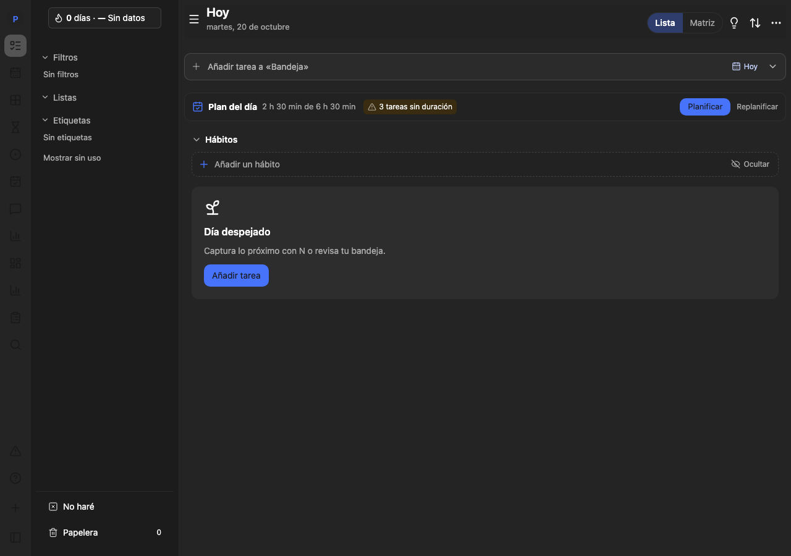
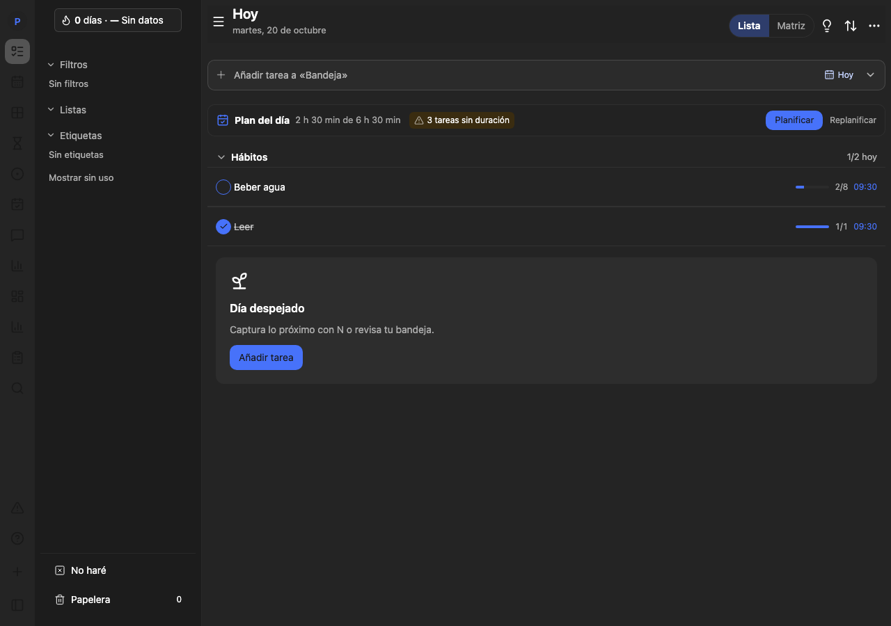

# Revisión de Hoy: Plan del día y Hábitos

## Resultado

Se aplica [el alcance revisado](../spec/hoy-plan-y-habitos-2026-10-20.md), incluida la retirada posterior del enlace Cerrar el día. El corte anterior de etiquetas queda publicado separadamente.

`TodayPlanStrip` sustituye la tarjeta tintada por una franja con Plan del día, carga y capacidad reales, aviso de estimaciones incompletas y Planificar como única acción destacada. Replanificar conserva `/replan`; en móvil aparece en un popover anclado con Escape y recuperación de foco. Planificar conserva `/plan/day`.

La carga y su recuento de tareas sin estimación proceden del endpoint que ya usaba Hoy (`GET /planning/load`): se conserva su cálculo y la capacidad devuelta, sin constantes ni sumas locales alternativas. Se verifican capacidades de 6 h 30 min y 4 h. Mientras carga o falla se evita mostrar estimación, capacidad o recuento ficticios. Si la capacidad no está configurada no se inventa ninguna.

`TodayHabits` diferencia falta de hábitos, hábitos no programados y hábitos programados. Usa los días activos y la fecha local que devuelve la API, y `today.met` para completitud. El registro conserva `count + 1` y la fecha actual del hábito. La ocultación mantiene `tick-tack-done.habits.dismissed` y `habitsDismissed`; se vuelve a comprobar al enfocar y cada minuto mientras está oculto para que expire incluso con Hoy abierto. El colapsado usa la misma clave y conjunto de grupos de Hoy.

Las filas usan check redondo, separadores y altura de fila, nombre truncado cuando procede y progreso/contador/hora alineados a la derecha. No se tocan filas de tareas, chips, sidebar, cabecera, quick-add ni pantallas de Hábitos o planificación. Los componentes antiguos compartidos de hábitos se conservan.

No hay cambios en dominio, API, OpenAPI, modelos ni catálogo de eventos. No hay migraciones.

## Validación

- Lint, typecheck y unitarias del monorepo en verde. El primer lint terminó por recursos (137) al ejecutarse varias comprobaciones; el reintento completo pasa.
- Seis pruebas nuevas Playwright: escritorio/móvil y claro/oscuro, capacidad real, ausencia de cierre, geometría, colapsado persistente, registros incrementales, caducidad de ocultación, hábitos no programados y carga pendiente/error.
- Cinco regresiones del compositor de tareas, incluidos metadatos y captura global.
- Sin overflow horizontal a 390 y 1280 px. Datos sintéticos de prueba; no se modifican hábitos personales.
- No se adjuntaron los bocetos citados dentro del documento. Se contrasta la implementación con su descripción y los criterios de aceptación, y se incluyen capturas reales del resultado.

## Capturas

| Escritorio                                                                     | Móvil                                                                               |
| ------------------------------------------------------------------------------ | ----------------------------------------------------------------------------------- |
|  |        |
|   |         |
|  |  |
|   |   |
