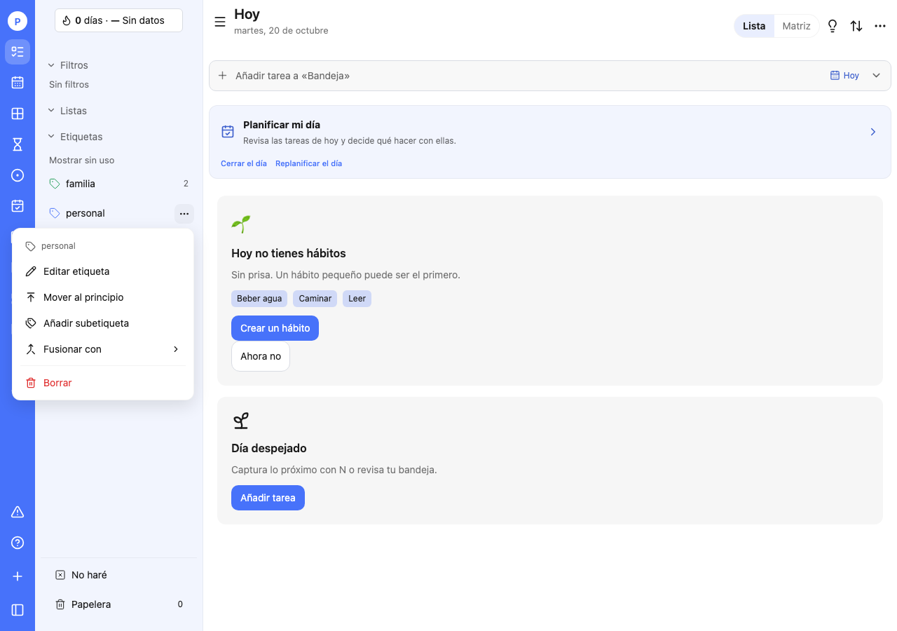
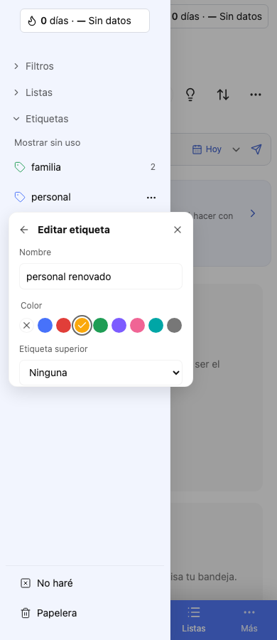
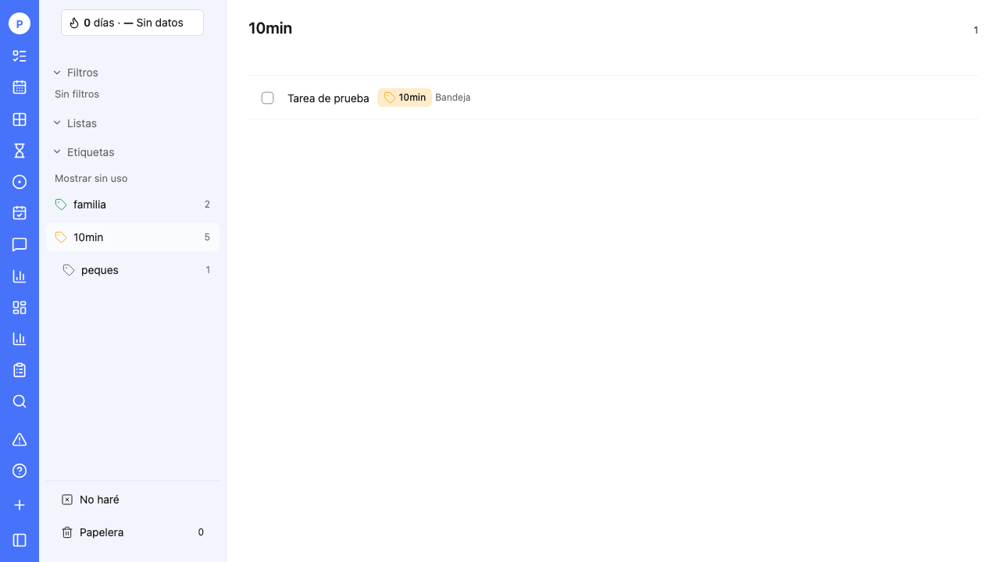

# Sidebar de etiquetas — 20 de octubre de 2026

Requisitos: RF-401 (color y jerarquía) y RF-403 (sidebar, contadores y renombrado por ID).

## Alcance solicitado

- Buscador cerrado por defecto, accesible mediante lupa en la cabecera de Etiquetas.
- Sustituir el formulario mezclado del menú de tres puntos por acciones separadas, con maquetación compacta y funcionalidad real.
- Ampliación del usuario: respetar el color elegido en todas las representaciones de una etiqueta. Caso de aceptación: «10min» amarilla, conservando el predeterminado para etiquetas sin color personalizado.

## Referencia e implementación

Se inspeccionó el sidebar de TickTick, su menú contextual y el formulario Edit Tag, sin guardar cambios en esa cuenta. La referencia separa Edit, Pin, Add Sub-tag, Merge Tags y Delete. En este producto se conectan editar, subetiqueta, fusión y borrado con los endpoints públicos existentes; el orden se gestiona con «Mover al principio» mediante `before_id`. No se presenta una opción de compartir etiquetas porque el producto no dispone de esa operación pública. Mover al principio cambia el orden persistido; no equivale a un estado de fijado independiente.

El menú usa un portal anclado, se ajusta al viewport y admite teclado, Escape y cierre exterior. Editar permite nombre, paleta de color, ausencia de color y etiqueta superior. Se excluyen descendientes para evitar ciclos. Fusión y borrado requieren un paso de confirmación, con cancelación explícita. Errores visibles mantienen el borrador; las peticiones en curso bloquean envíos duplicados. Se refrescan catálogo, filtros y superficies de tareas.

Se respeta el orden del servidor y se representa la jerarquía mediante sangrado. El contador no se superpone al botón de tres puntos. Escape en el buscador móvil cierra sólo la búsqueda y mantiene abierto el drawer.

Se encontró una pérdida de color en las vistas de tareas: la conversión de `tag_ids` a nombres producía colores `null`. TaskList consulta el catálogo compartido para resolver nombre y color vigentes por ID en lista y kanban. La captura muestra también el icono con su color. Sidebar, detalle y selectores conservan el color del catálogo; los chips aplican ese color a su fondo. No hay migraciones, endpoints ni eventos nuevos. El SDK admite los campos de orden ya documentados por la API.

## Validación

- `pnpm lint`, `pnpm typecheck` y `pnpm test`: correctos.
- OpenAPI regenerado: sin cambios propios de este corte (se conserva el diff previo del Jardín).
- Cinco pruebas Playwright: búsqueda/edición y geometría en 1280 y 390 px; alta de subetiqueta, orden, fusión y borrado; error/reintento/foco; color amarillo en chips después de navegar.
- API simulada con mutaciones verificadas; no se modifican etiquetas personales durante las pruebas.

## Capturas

