# tick-tack-done — Especificación única para Codex

- **Aplicación:** https://todo.reflexionia.com
- **Repositorio:** https://github.com/povedica/tick-tack-done (base del análisis: commit `b484fe8`, 21/10/2026 13:53 hora de Madrid)
- **Fecha:** 21/10/2026 (hora de Madrid)
- **Contenido:** consolida la especificación de auditoría (TTD-AUD-01 a 57), la adenda de Google y MCP, la revisión de la propuesta de Tokens y MCP, el análisis de código de la ronda de interfaz (TTD-AUD-58 a 65), el recorrido de navegador por ttd y la comparación con TickTick (TTD-AUD-66 a 73 y la sección 4).
- **Rutas de código:** `web/` = `apps/web/src/`, `api/` = `apps/api/src/`, `domain/` = `packages/domain/src/`.
- **Confianza de la causa:** _Alta_ = verificada leyendo el código; _Media_ = muy probable, sin reproducir en local; _Baja_ = hipótesis.
- **Severidades:** _Crítica_ = datos incorrectos o funcionalidad principal rota; _Alta_ = funcionalidad rota o muy visible; _Media_ = maquetación o comportamiento confuso; _Baja_ = pulido.

## 0. Instrucciones para Codex

> **Copia este bloque como instrucción inicial del agente.**

Eres el agente de desarrollo de **tick-tack-done (ttd)**: https://github.com/povedica/tick-tack-done, en producción en https://todo.reflexionia.com. Este documento es la **única fuente** de trabajo: contiene todos los hallazgos de la auditoría (TTD-AUD-01 a TTD-AUD-73), su causa en el código, la corrección propuesta y los criterios de aceptación, además de una especificación de paridad con TickTick.

**Stack**

- Monorepo **pnpm**:
  - `apps/web`: React 19, Vite, react-router 7, TanStack Query, zustand; estilos con tokens CSS en `apps/web/src/styles/tokens.css`; i18n en `apps/web/src/i18n/` (`es.ts`, `en.ts`, `extra.ts`).
  - `apps/api`: NestJS, Prisma (PostgreSQL), Redis; el MCP está en `apps/api/src/mcp/`.
  - `packages/domain`: lógica pura (parser de entrada rápida, fechas, filtros, matriz…).
  - `packages/sdk`: cliente tipado.
- Node ≥ 22.
- En este documento: `web/` = `apps/web/src/`, `api/` = `apps/api/src/`, `domain/` = `packages/domain/src/`. Las líneas citadas son del commit `b484fe8` y pueden haberse desplazado; localiza el código por el símbolo.

**Cómo usar el documento**

1. Trabaja **por fases** (sección 2) y, dentro de cada fase, en el orden indicado. Respeta la columna «Depende de» de la tabla de la sección 1.
2. Para cada hallazgo:
   - lee «Causa en el código» y verifícala antes de cambiar nada;
   - si la causa no coincide con el código actual, documenta lo que encuentres en `docs/audit/ESTADO.md` y propón otra corrección.
3. Los hallazgos con estado «Corregido en main, pendiente de verificar en producción» **no se reimplementan**. Verifica sus criterios de aceptación (tests y, si puedes, en producción) y marca el resultado en `ESTADO.md`.
4. La sección 4 (paridad con TickTick) es la especificación de los componentes de las fases 2 y 3. Cuando un hallazgo diga «ver 4.x», implementa según esa sección.
5. Las evidencias están en `evidencias/`:
   - `TTD-AUD-NN_x` son capturas de ttd;
   - `REF-TICKTICK_*` son capturas de referencia de TickTick.

**Prioridad**

- Fase 0: datos incorrectos y bugs críticos.
- Fase 1: paridad del MCP, en el orden de Ramón y con la **validación estricta primero** (TTD-AUD-54).
- Fase 2: paridad de UX con TickTick (shell con barra lateral por sección y panel de detalle fijo, opciones de vista, composer, matriz y Ticky).
- Fase 3: móvil.
- Fase 4: tokens, integraciones y Google.
- Fase 5: resto.

**Alcance**

- **Dentro:** todo ttd (web, API, dominio, SDK, MCP), incluido el **interruptor de Ticky** en Ajustes > Funcionalidades y la ocultación de Ticky en toda la interfaz cuando está inactivo (TTD-AUD-63, 07 y 08 en la parte de ttd).
- **Fuera:** el servicio de Ticky (repositorio y backend propio), la configuración de Google Cloud Console (TTD-AUD-47 punto 1 y 2: lo hace Pablo) y borrar datos de usuarios.

**Reglas de trabajo**

- Una rama y una PR **pequeña** por hallazgo (o por grupo pequeño que comparta causa): rama `fix/ttd-aud-NN-descripcion-corta` y título de PR y commit `fix(TTD-AUD-NN): …` (`feat(TTD-AUD-NN): …` para funcionalidades nuevas de paridad).
- **Tests primero:** cada corrección lleva al menos un test que **falla antes** del cambio y **pasa después** (unitario en `domain`, de componente en `web` o e2e en `api`). Indica en la PR cómo comprobaste que fallaba.
- Antes de pedir revisión: `pnpm typecheck`, `pnpm lint` y `pnpm test` en verde en todo el monorepo.
- **i18n:** ningún texto nuevo en el código; toda clave se añade en **es** y **en**.
- **Estilos:** solo tokens de `tokens.css` (colores, espaciados, radios, sombras). Nada de colores fijos ni valores mágicos nuevos; si falta un token, se crea.
- **Accesibilidad:** roles y foco correctos en menús y diálogos, y uso con teclado.
- **Nunca** hagas push a `main` ni fuerces el historial. Las PR se fusionan tras revisión.
- No toques datos de producción. Las migraciones de datos (por ejemplo TTD-AUD-65) deben ser idempotentes, por lotes y con copia previa.
- Mantén `docs/audit/ESTADO.md` (créalo si no existe) con una fila por hallazgo:

  ```
  | ID | Estado (pendiente / en curso / PR abierta / fusionado / verificado en prod / descartado) | PR | Notas |
  ```

  Actualízalo en cada PR.

- Si un criterio de aceptación no se puede cumplir tal cual, explica por qué en la PR y en `ESTADO.md`, y propone una alternativa. No lo omitas en silencio.

## 1. Resumen ejecutivo

- **73 hallazgos:** Crítica 2 · Alta 27 · Media 38 · Baja 6.
- **Corregidos en main y pendientes de verificar en producción (8):** TTD-AUD-01, TTD-AUD-02, TTD-AUD-11, TTD-AUD-28, TTD-AUD-35, TTD-AUD-37, TTD-AUD-42, TTD-AUD-43.
- **Datos en riesgo (Fase 0):**
  - el historial de actividad de las tareas crece de forma exponencial (65);
  - el MCP guarda fechas sin hora como 00:00 UTC y sustituye la duración (55, 56), y acepta campos desconocidos sin avisar (54);
  - las métricas no cuadran entre pantallas (09, 10).
- **El MCP no está a la par con la app:** faltan etiquetas, parser, comentarios, estados, borrado, descripción, adjuntos, subtareas y autoría (48–57). Se aborda en el orden de Ramón, con la validación estricta primero.
- **UX frente a TickTick:**
  - las opciones de vista existen, pero están escondidas y son incoherentes (59, 66–69);
  - falta el panel de detalle fijo (60) y la barra lateral por sección (61);
  - el modal de nueva tarea está roto (64);
  - la matriz reescribe o borra fechas (62);
  - Ticky no se puede desactivar (63).
- **Móvil:** cabeceras fijas con hueco (58) y varias pantallas mal adaptadas (33, 70–72). Comprobado con zoom del navegador, no en dispositivos.
- **Google:** el bloqueo «Acceso bloqueado» se debe al modo «Testing» de Google Cloud (47). Requiere acción de Pablo en la consola de Google, además de cambios de código.

**Tabla de hallazgos**

| ID         | Título                                                                                              | Severidad | Área                         | Estado                                             | Depende de         |
| ---------- | --------------------------------------------------------------------------------------------------- | --------- | ---------------------------- | -------------------------------------------------- | ------------------ |
| TTD-AUD-01 | La fecha «Cuándo» no aparece en las filas y «Mañana» sale vacía                                     | Crítica   | Tareas y fechas              | Corregido en main (PR #60), pendiente de verificar | —                  |
| TTD-AUD-02 | La entrada rápida no interpreta rangos horarios («09:00-09:30»)                                     | Alta      | Tareas y fechas              | Corregido en main (PR #61), pendiente de verificar | —                  |
| TTD-AUD-03 | Se añade 09:00 al elegir solo un día                                                                | Media     | Tareas y fechas              | Abierto                                            | 01                 |
| TTD-AUD-04 | El detalle no muestra bien «Cuándo», no hay hora de fin y la duración no se refleja                 | Media     | Tareas y fechas              | Abierto                                            | 01, 03             |
| TTD-AUD-05 | Menú «Más acciones» estrecho, con scroll horizontal y textos cortados                               | Alta      | Detalle de tarea             | Abierto                                            | 64 (Popover común) |
| TTD-AUD-06 | «Guardando…» durante segundos y «Creando…» al abrir una tarea                                       | Media     | Detalle de tarea             | Abierto                                            | —                  |
| TTD-AUD-07 | Ticky está enlazado, pero dice «no disponible»; página sin margen                                   | Alta      | Ticky (ttd)                  | Abierto                                            | 63                 |
| TTD-AUD-08 | No existe ninguna pantalla para activar o configurar Ticky                                          | Alta      | Ticky (ttd)                  | Abierto                                            | 63                 |
| TTD-AUD-09 | Completadas de la semana: 104 en Estadísticas frente a 314 en el Panel                              | Alta      | Datos y métricas             | Abierto                                            | —                  |
| TTD-AUD-10 | Tiempo de foco: «1,35 min» frente a 397 min                                                         | Alta      | Datos y métricas             | Abierto                                            | —                  |
| TTD-AUD-11 | El informe semanal sale vacío («Sin datos», «Fecha de cálculo no disponible»)                       | Alta      | Datos y métricas             | Corregido en main (PR #67), pendiente de verificar | —                  |
| TTD-AUD-12 | «15 Atrasado» parece un recuento, pero es una puntuación                                            | Media     | Datos y métricas             | Abierto                                            | —                  |
| TTD-AUD-13 | /filters usa controles nativos sin estilo y etiquetas erróneas                                      | Media     | Listas, filtros y navegación | Abierto                                            | —                  |
| TTD-AUD-14 | /matrix: «Ámbito» desalineado, una «i» suelta y un cuadrante cortado                                | Media     | Listas, filtros y navegación | Abierto                                            | 62                 |
| TTD-AUD-15 | Papelera: acciones a la izquierda del título y la barra de confirmación lo tapa                     | Media     | Listas, filtros y navegación | Abierto                                            | —                  |
| TTD-AUD-16 | Papelera: tras «Confirmar borrado» la fila y el contador no cambian                                 | Alta      | Listas, filtros y navegación | Abierto                                            | —                  |
| TTD-AUD-17 | El botón «Crear» de «Nueva lista» es nativo y no lleva estilo                                       | Media     | Listas, filtros y navegación | Abierto                                            | —                  |
| TTD-AUD-18 | Al borrar una lista se queda en /list/<id> y acaba en «No encontrado»                               | Media     | Listas, filtros y navegación | Abierto                                            | —                  |
| TTD-AUD-19 | Una URL desconocida redirige a /today sin ningún aviso de 404                                       | Media     | Listas, filtros y navegación | Abierto                                            | —                  |
| TTD-AUD-20 | /focus: sin anillo de temporizador y presets sin estado                                             | Media     | Foco y cuentas atrás         | Abierto                                            | —                  |
| TTD-AUD-21 | /countdowns: el título se parte («Cuenta / atrás») y el emoji se corta                              | Media     | Foco y cuentas atrás         | Abierto                                            | —                  |
| TTD-AUD-22 | Modo oscuro: las tarjetas de cuenta atrás son ilegibles                                             | Alta      | Foco y cuentas atrás         | Abierto                                            | —                  |
| TTD-AUD-23 | Modal «Nueva cuenta atrás» mal maquetado                                                            | Alta      | Foco y cuentas atrás         | Abierto                                            | —                  |
| TTD-AUD-24 | El menú «Nueva» de cuentas atrás no se cierra                                                       | Media     | Foco y cuentas atrás         | Abierto                                            | —                  |
| TTD-AUD-25 | Modo oscuro: contraste insuficiente en la barra de iconos, el elemento activo y el selector de tema | Media     | Tema y estilos               | Abierto                                            | —                  |
| TTD-AUD-26 | El botón de login usa un color fijo y no el acento                                                  | Baja      | Tema y estilos               | Abierto                                            | —                  |
| TTD-AUD-27 | Textos sin traducir en modo inglés                                                                  | Media     | Idioma (i18n)                | Abierto                                            | —                  |
| TTD-AUD-28 | ~70 acciones fallan en silencio                                                                     | Alta      | Robustez (código)            | Corregido en main (PR #66), pendiente de verificar | —                  |
| TTD-AUD-29 | No hay gestión de sesión caducada (401)                                                             | Alta      | Robustez (código)            | Abierto                                            | —                  |
| TTD-AUD-30 | Un único ErrorBoundary global y solo en español                                                     | Media     | Robustez (código)            | Abierto                                            | —                  |
| TTD-AUD-31 | Pantallas sin estado de carga o de error                                                            | Media     | Robustez (código)            | Abierto                                            | —                  |
| TTD-AUD-32 | Detalles: «1 tareas», confirm() nativo, «Comprobando la sesión…» sin estilo                         | Baja      | Pulido                       | Abierto                                            | —                  |
| TTD-AUD-33 | Menú «Más» móvil: cajón con scroll interno que corta entradas y muestra Ticky inactivo              | Media     | Móvil                        | Abierto                                            | 63                 |
| TTD-AUD-34 | 4 errores en la consola en el login (no analizados)                                                 | Baja      | Pulido                       | Abierto                                            | —                  |
| TTD-AUD-35 | La lista de tokens solo carga 50 filas y las renovaciones OAuth la llenan                           | Alta      | Tokens, MCP e integraciones  | Corregido en main (PR #63), pendiente de verificar | —                  |
| TTD-AUD-36 | Los tokens caducados aparecen como «Activo»                                                         | Media     | Tokens, MCP e integraciones  | Abierto                                            | 35                 |
| TTD-AUD-37 | Volver a autorizar una aplicación OAuth puede fallar por el nombre único del token                  | Alta      | Tokens, MCP e integraciones  | Corregido en main (PR #62), pendiente de verificar | —                  |
| TTD-AUD-38 | La actividad del token no se entiende y está incompleta                                             | Media     | Tokens, MCP e integraciones  | Abierto                                            | 35                 |
| TTD-AUD-39 | Los errores al revocar no se ven y los de crear son genéricos                                       | Media     | Tokens, MCP e integraciones  | Abierto                                            | 35                 |
| TTD-AUD-40 | El secreto recién creado: el lector de pantalla lo lee y se pierde sin aviso                        | Media     | Tokens, MCP e integraciones  | Abierto                                            | 35                 |
| TTD-AUD-41 | Permisos: «Gestionar» como «Escritura», falta «Cuenta atrás», sensibles sin marca                   | Media     | Tokens, MCP e integraciones  | Abierto                                            | 35                 |
| TTD-AUD-42 | Consentimiento OAuth: sensibles marcados por defecto, etiquetas en crudo, sin estilo                | Alta      | Tokens, MCP e integraciones  | Corregido en main (PR #64), pendiente de verificar | —                  |
| TTD-AUD-43 | Google: «Vuelve a conectar» sin botón de reconexión; Drive desconecta todo Google                   | Alta      | Tokens, MCP e integraciones  | Corregido en main (PR #65), pendiente de verificar | 47                 |
| TTD-AUD-44 | Telegram y Correo a tarea: estados provisionales y regenerar sin confirmación                       | Media     | Tokens, MCP e integraciones  | Abierto                                            | —                  |
| TTD-AUD-45 | Webhooks y feeds: rotar secreto sin confirmación y textos reutilizados                              | Baja      | Tokens, MCP e integraciones  | Abierto                                            | —                  |
| TTD-AUD-46 | «Revocados» sin estilo y sin el nombre de la aplicación                                             | Baja      | Tokens, MCP e integraciones  | Abierto                                            | 35                 |
| TTD-AUD-47 | Google bloquea la conexión a quien no es tester («Acceso bloqueado», 403 access_denied)             | Alta      | Tokens, MCP e integraciones  | Abierto                                            | —                  |
| TTD-AUD-48 | El MCP no permite etiquetar tareas al crear ni al editar                                            | Alta      | MCP: paridad con la app      | Abierto                                            | 54                 |
| TTD-AUD-49 | El MCP no aplica el parser de entrada rápida y no tiene herramienta de captura                      | Alta      | MCP: paridad con la app      | Abierto                                            | 54, 48             |
| TTD-AUD-50 | El MCP no puede borrar, enviar a la Papelera ni restaurar tareas                                    | Media     | MCP: paridad con la app      | Abierto                                            | 54                 |
| TTD-AUD-51 | El MCP no tiene comentarios, no escribe la descripción y no tiene adjuntos                          | Media     | MCP: paridad con la app      | Abierto                                            | 54                 |
| TTD-AUD-52 | Subtareas, checklist, mover entre listas y otras diferencias entre la app y el MCP                  | Media     | MCP: paridad con la app      | Abierto                                            | 54                 |
| TTD-AUD-53 | El MCP no puede reabrir ni cancelar; los estados de flujo no existen                                | Media     | MCP: paridad con la app      | Abierto                                            | 54                 |
| TTD-AUD-54 | El MCP ignora en silencio los campos desconocidos o mal formados (falsos positivos)                 | Alta      | MCP: paridad con la app      | Abierto                                            | —                  |
| TTD-AUD-55 | Una fecha sin hora por MCP se guarda como 00:00 UTC, no como el día local                           | Alta      | MCP: paridad con la app      | Abierto                                            | —                  |
| TTD-AUD-56 | La duración enviada se sustituye por inicio–fin (30 → 1200)                                         | Alta      | MCP: paridad con la app      | Abierto                                            | 55                 |
| TTD-AUD-57 | Autoría: mismo created_by en todo y sin registro del agente                                         | Media     | MCP: paridad con la app      | Abierto                                            | 54                 |
| TTD-AUD-58 | Móvil: la cabecera fija de Hoy flota con un hueco por el que se ve el contenido                     | Alta      | Móvil                        | Abierto                                            | —                  |
| TTD-AUD-59 | Opciones de vista: no se guardan, «Ocultar completadas» confunde e «Imprimir» sale cortado          | Media     | Vistas de tareas             | Abierto                                            | —                  |
| TTD-AUD-60 | Escritorio: no hay panel de detalle fijo; varias pantallas sacan al usuario al abrir una tarea      | Media     | Shell y navegación           | Abierto                                            | 61                 |
| TTD-AUD-61 | La barra lateral es siempre la de Tareas: falta barra secundaria por sección                        | Media     | Shell y navegación           | Abierto                                            | —                  |
| TTD-AUD-62 | /matrix: soltar reescribe o borra la fecha, ignora las reglas y faltan opciones                     | Alta      | Listas, filtros y navegación | Abierto                                            | 14                 |
| TTD-AUD-63 | Ticky no se puede desactivar y aparece en toda la interfaz aunque esté inactivo                     | Alta      | Ticky (ttd)                  | Abierto                                            | —                  |
| TTD-AUD-64 | Modal «Nueva tarea»: maquetación rota, estrecho y opciones escondidas                               | Alta      | Nueva tarea (composer)       | Abierto                                            | —                  |
| TTD-AUD-65 | El historial de actividad guarda copias anidadas de sí mismo (crece exponencialmente)               | Crítica   | Datos (historial)            | Abierto                                            | —                  |
| TTD-AUD-66 | Cambiar de vista (lista, kanban, timeline) es incoherente y casi imposible de encontrar             | Alta      | Vistas de tareas             | Abierto                                            | 59                 |
| TTD-AUD-67 | Bandeja sin menú de vista ni opciones para ordenar o agrupar                                        | Media     | Vistas de tareas             | Abierto                                            | 66                 |
| TTD-AUD-68 | Kanban en listas inteligentes: una sola columna «Sin sección»                                       | Media     | Vistas de tareas             | Abierto                                            | 66                 |
| TTD-AUD-69 | Timeline estrecho: zoom en inglés, columnas de unos 100 px y tarjetas cortadas                      | Media     | Vistas de tareas             | Abierto                                            | 66                 |
| TTD-AUD-70 | Móvil: la cabecera de las listas se parte en varias líneas                                          | Media     | Móvil                        | Abierto                                            | 58, 66             |
| TTD-AUD-71 | Móvil: calendario mensual con solo puntos, barra que se pierde y «Calendario» abre la agenda        | Media     | Móvil                        | Abierto                                            | 58, 61             |
| TTD-AUD-72 | Móvil: en /matrix los chips de cuadrante se cortan y no hay cabecera fija                           | Media     | Móvil                        | Abierto                                            | 58, 62             |
| TTD-AUD-73 | Destello de esqueleto al entrar en /matrix y /countdowns                                            | Baja      | Robustez (código)            | Abierto                                            | 31                 |

## 2. Hoja de ruta por fases

### Fase 0 — Datos incorrectos y bugs críticos

Primero lo que corrompe o pierde datos. 01, 02, 11 y 28 ya están en main: solo verificar. 54 va aquí porque es barata y evita falsos positivos en toda la Fase 1. 55 y 56 afectan a los datos que escriben los agentes.

- **TTD-AUD-65** (Crítica) — El historial de actividad guarda copias anidadas de sí mismo (crece exponencialmente)
- **TTD-AUD-55** (Alta) — Una fecha sin hora por MCP se guarda como 00:00 UTC, no como el día local
- **TTD-AUD-56** (Alta) — La duración enviada se sustituye por inicio–fin (30 → 1200)
- **TTD-AUD-54** (Alta) — El MCP ignora en silencio los campos desconocidos o mal formados (falsos positivos)
- **TTD-AUD-01** (Crítica) — La fecha «Cuándo» no aparece en las filas y «Mañana» sale vacía — _corregido en main, verificar_
- **TTD-AUD-02** (Alta) — La entrada rápida no interpreta rangos horarios («09:00-09:30») — _corregido en main, verificar_
- **TTD-AUD-11** (Alta) — El informe semanal sale vacío («Sin datos», «Fecha de cálculo no disponible») — _corregido en main, verificar_
- **TTD-AUD-09** (Alta) — Completadas de la semana: 104 en Estadísticas frente a 314 en el Panel
- **TTD-AUD-10** (Alta) — Tiempo de foco: «1,35 min» frente a 397 min
- **TTD-AUD-16** (Alta) — Papelera: tras «Confirmar borrado» la fila y el contador no cambian
- **TTD-AUD-28** (Alta) — ~70 acciones fallan en silencio — _corregido en main, verificar_
- **TTD-AUD-29** (Alta) — No hay gestión de sesión caducada (401)

### Fase 1 — Paridad del MCP (orden de Ramón)

Orden: etiquetas (48, 49) → comentarios (51, parte 1) → estados (53) → borrar y restaurar (50) → descripción y adjuntos (51, parte 2) → subtareas, checklist y mover (52) → autoría (57). La validación estricta (54) y las fechas y la duración (55, 56) ya se han hecho en la Fase 0. Ver el anexo A.

- **TTD-AUD-48** (Alta) — El MCP no permite etiquetar tareas al crear ni al editar
- **TTD-AUD-49** (Alta) — El MCP no aplica el parser de entrada rápida y no tiene herramienta de captura
- **TTD-AUD-51** (Media) — El MCP no tiene comentarios, no escribe la descripción y no tiene adjuntos
- **TTD-AUD-53** (Media) — El MCP no puede reabrir ni cancelar; los estados de flujo no existen
- **TTD-AUD-50** (Media) — El MCP no puede borrar, enviar a la Papelera ni restaurar tareas
- **TTD-AUD-52** (Media) — Subtareas, checklist, mover entre listas y otras diferencias entre la app y el MCP
- **TTD-AUD-57** (Media) — Autoría: mismo created_by en todo y sin registro del agente

### Fase 2 — Paridad de UX con TickTick

Orden: 1) shell (barra secundaria por sección 61 y panel de detalle fijo 60); 2) cabecera de vista común y opciones (66, 59, 67), kanban y timeline (68, 69); 3) composer y selector de fecha (64, 05, 03, 04); 4) matriz (62, 14); 5) Ticky en ttd (63, 08, 07); 6) estados de guardado del detalle (06). Especificación de componentes en la sección 4.

- **TTD-AUD-61** (Media) — La barra lateral es siempre la de Tareas: falta barra secundaria por sección
- **TTD-AUD-60** (Media) — Escritorio: no hay panel de detalle fijo; varias pantallas sacan al usuario al abrir una tarea
- **TTD-AUD-66** (Alta) — Cambiar de vista (lista, kanban, timeline) es incoherente y casi imposible de encontrar
- **TTD-AUD-59** (Media) — Opciones de vista: no se guardan, «Ocultar completadas» confunde e «Imprimir» sale cortado
- **TTD-AUD-67** (Media) — Bandeja sin menú de vista ni opciones para ordenar o agrupar
- **TTD-AUD-68** (Media) — Kanban en listas inteligentes: una sola columna «Sin sección»
- **TTD-AUD-69** (Media) — Timeline estrecho: zoom en inglés, columnas de unos 100 px y tarjetas cortadas
- **TTD-AUD-64** (Alta) — Modal «Nueva tarea»: maquetación rota, estrecho y opciones escondidas
- **TTD-AUD-05** (Alta) — Menú «Más acciones» estrecho, con scroll horizontal y textos cortados
- **TTD-AUD-03** (Media) — Se añade 09:00 al elegir solo un día
- **TTD-AUD-04** (Media) — El detalle no muestra bien «Cuándo», no hay hora de fin y la duración no se refleja
- **TTD-AUD-62** (Alta) — /matrix: soltar reescribe o borra la fecha, ignora las reglas y faltan opciones
- **TTD-AUD-14** (Media) — /matrix: «Ámbito» desalineado, una «i» suelta y un cuadrante cortado
- **TTD-AUD-63** (Alta) — Ticky no se puede desactivar y aparece en toda la interfaz aunque esté inactivo
- **TTD-AUD-08** (Alta) — No existe ninguna pantalla para activar o configurar Ticky
- **TTD-AUD-07** (Alta) — Ticky está enlazado, pero dice «no disponible»; página sin margen
- **TTD-AUD-06** (Media) — «Guardando…» durante segundos y «Creando…» al abrir una tarea

### Fase 3 — Móvil

Primero la regla de cabecera fija (58), que resuelve parte de 71 y 72. Verificar con emulación de dispositivo (Playwright con viewport 390×844) y, si es posible, en un iPhone o Android real.

- **TTD-AUD-58** (Alta) — Móvil: la cabecera fija de Hoy flota con un hueco por el que se ve el contenido
- **TTD-AUD-70** (Media) — Móvil: la cabecera de las listas se parte en varias líneas
- **TTD-AUD-71** (Media) — Móvil: calendario mensual con solo puntos, barra que se pierde y «Calendario» abre la agenda
- **TTD-AUD-72** (Media) — Móvil: en /matrix los chips de cuadrante se cortan y no hay cabecera fija
- **TTD-AUD-33** (Media) — Menú «Más» móvil: cajón con scroll interno que corta entradas y muestra Ticky inactivo
- **TTD-AUD-21** (Media) — /countdowns: el título se parte («Cuenta / atrás») y el emoji se corta

### Fase 4 — Tokens, integraciones y Google

35, 37, 42 y 43 ya están en main: solo verificar. 47 requiere acciones de Pablo en Google Cloud Console (anexo B) más los cambios de código (permisos mínimos, autorización incremental y error amable).

- **TTD-AUD-47** (Alta) — Google bloquea la conexión a quien no es tester («Acceso bloqueado», 403 access_denied)
- **TTD-AUD-43** (Alta) — Google: «Vuelve a conectar» sin botón de reconexión; Drive desconecta todo Google — _corregido en main, verificar_
- **TTD-AUD-35** (Alta) — La lista de tokens solo carga 50 filas y las renovaciones OAuth la llenan — _corregido en main, verificar_
- **TTD-AUD-36** (Media) — Los tokens caducados aparecen como «Activo»
- **TTD-AUD-37** (Alta) — Volver a autorizar una aplicación OAuth puede fallar por el nombre único del token — _corregido en main, verificar_
- **TTD-AUD-38** (Media) — La actividad del token no se entiende y está incompleta
- **TTD-AUD-39** (Media) — Los errores al revocar no se ven y los de crear son genéricos
- **TTD-AUD-40** (Media) — El secreto recién creado: el lector de pantalla lo lee y se pierde sin aviso
- **TTD-AUD-41** (Media) — Permisos: «Gestionar» como «Escritura», falta «Cuenta atrás», sensibles sin marca
- **TTD-AUD-42** (Alta) — Consentimiento OAuth: sensibles marcados por defecto, etiquetas en crudo, sin estilo — _corregido en main, verificar_
- **TTD-AUD-44** (Media) — Telegram y Correo a tarea: estados provisionales y regenerar sin confirmación
- **TTD-AUD-45** (Baja) — Webhooks y feeds: rotar secreto sin confirmación y textos reutilizados
- **TTD-AUD-46** (Baja) — «Revocados» sin estilo y sin el nombre de la aplicación

### Fase 5 — Resto

Pulido, estilos, i18n y robustez.

- **TTD-AUD-12** (Media) — «15 Atrasado» parece un recuento, pero es una puntuación
- **TTD-AUD-13** (Media) — /filters usa controles nativos sin estilo y etiquetas erróneas
- **TTD-AUD-15** (Media) — Papelera: acciones a la izquierda del título y la barra de confirmación lo tapa
- **TTD-AUD-17** (Media) — El botón «Crear» de «Nueva lista» es nativo y no lleva estilo
- **TTD-AUD-18** (Media) — Al borrar una lista se queda en /list/<id> y acaba en «No encontrado»
- **TTD-AUD-19** (Media) — Una URL desconocida redirige a /today sin ningún aviso de 404
- **TTD-AUD-20** (Media) — /focus: sin anillo de temporizador y presets sin estado
- **TTD-AUD-22** (Alta) — Modo oscuro: las tarjetas de cuenta atrás son ilegibles
- **TTD-AUD-23** (Alta) — Modal «Nueva cuenta atrás» mal maquetado
- **TTD-AUD-24** (Media) — El menú «Nueva» de cuentas atrás no se cierra
- **TTD-AUD-25** (Media) — Modo oscuro: contraste insuficiente en la barra de iconos, el elemento activo y el selector de tema
- **TTD-AUD-26** (Baja) — El botón de login usa un color fijo y no el acento
- **TTD-AUD-27** (Media) — Textos sin traducir en modo inglés
- **TTD-AUD-30** (Media) — Un único ErrorBoundary global y solo en español
- **TTD-AUD-31** (Media) — Pantallas sin estado de carga o de error
- **TTD-AUD-32** (Baja) — Detalles: «1 tareas», confirm() nativo, «Comprobando la sesión…» sin estilo
- **TTD-AUD-34** (Baja) — 4 errores en la consola en el login (no analizados)
- **TTD-AUD-73** (Baja) — Destello de esqueleto al entrar en /matrix y /countdowns

## 3. Hallazgos

Cada hallazgo incluye severidad, estado, dependencias, pasos, resultado esperado y actual, evidencia, causa en el código (con su confianza), propuesta y criterios de aceptación. Cuando aplica, se añade el comportamiento de referencia de TickTick.

### Área 1 — Tareas y fechas

#### TTD-AUD-01 — La fecha «Cuándo» no aparece en las filas y «Mañana» sale vacía

- **Severidad:** Crítica
- **Estado:** Corregido en main, pendiente de verificar en producción — [PR #60](https://github.com/povedica/tick-tack-done/pull/60) (`6d66f04`)
- **Depende de:** —
- **Pantalla/URL:** panel de detalle de tarea, `/inbox`, `/smart/all`, `/smart/tomorrow` y barra lateral («Mañana»)
- **Elemento:** chip de fecha de la fila (`task-date`), lista inteligente «Mañana» y su contador

**Pasos para reproducir**

1. Abre una tarea sin fecha.
2. En el detalle, pulsa «Cuándo» y luego «Mañana». Aplica.
3. Recarga la página. El detalle muestra «22 oct, 09:00».
4. Ve a `/inbox` y a `/smart/all`.
5. Abre «Mañana» (`/smart/tomorrow`).

**Resultado esperado (requisito del propietario)**

- La fila muestra la fecha.
- Si la tarea tiene hora, se muestra la hora.
- Si tiene inicio y fin (p. ej. 09:00–09:30), se muestra el rango incluyendo la fecha de inicio, por ejemplo «22 oct, 09:00–09:30».
- La tarea aparece en «Mañana» y cuenta en la barra lateral.

**Resultado actual**

- La fila solo muestra «Bandeja», sin fecha.
- `/smart/tomorrow` muestra «0 tareas» y la barra lateral no tiene contador.
- Otras tareas, como «Comer con María 23 oct, 14:00», sí muestran fecha porque tienen `due_date`.

**Evidencia**

- 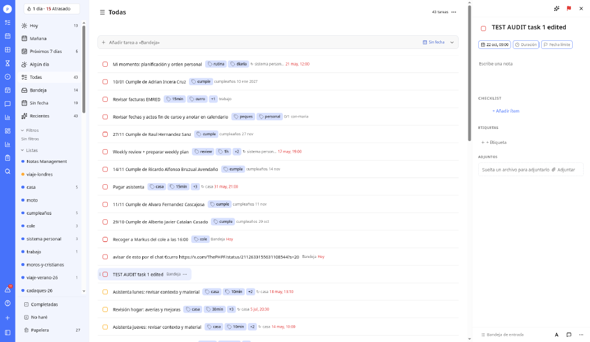
- 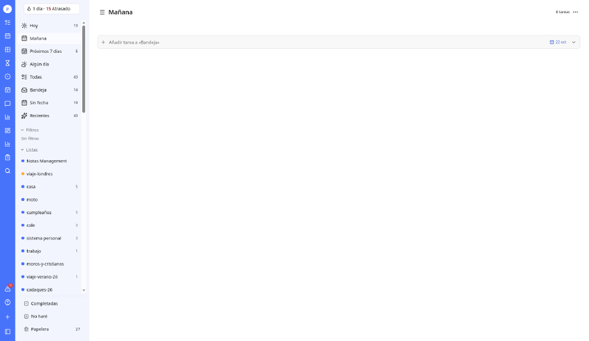

**Causa en el código (confianza Alta)**

- «Cuándo» guarda solo `start_date`: `web/features/tasks/TaskDetail.tsx:313-314`. El chip del detalle sí lee `start_date` (`:413-421`).
- El modelo de fila no tiene `startDate`, `durationMinutes` ni `isAllDay`: `web/features/tasks/model.ts:3-25`. Además mapea solo `due_date` (`:49`, `:72`) y `web/features/places/Places.tsx:1645` hace lo mismo.
- La fila pinta `row.dueDate`: `web/features/tasks/TaskList.tsx:244-248` y `:384-402`.
- `formatRowDate` (`TaskList.tsx:818-847`) tiene tres problemas:
  - usa la zona del navegador y no la de la tarea;
  - interpreta 00:00 como «sin hora»;
  - no admite hora de fin ni duración.
- Las listas «Mañana», «Próximos 7 días» y «Hoy» filtran con `due_range` solo sobre `dueDate`: `domain/filters/clause.ts:102-104` y `:239-249`. En la API se traduce a `dueDate` en `api/filters/where-from-clause.ts:38-39`, y el contador de la barra lateral usa el mismo cálculo.
- En cambio, «Hoy» (tablero) usa `startDate ?? dueDate` (`web/features/today/groups.ts:235`). Hay dos criterios distintos en la app.

**Propuesta de corrección**

1. Añadir `startDate`, `isAllDay` y `durationMinutes` a `RowModel` (`rowFromTask`, `rowFromView` y el mapper de `Places.tsx`).
2. Renderizar la fecha de la fila con un único formateador compartido basado en `taskWhen`/`formatDueChip` (`groups.ts`):
   - fecha efectiva = `start_date ?? due_date`;
   - hora solo si `!is_all_day`;
   - rango `HH:MM–HH:MM` si hay duración o fin;
   - siempre en la zona de la tarea.
3. Cambiar los filtros de fecha relativa (`today`, `tomorrow`, `next_7_days`, `no_date`, `between`) para usar `coalesce(start_date, due_date)`, tanto en `domain/filters/clause.ts` como en `api/filters/where-from-clause.ts`.

**Criterios de aceptación**

- Una tarea con solo `start_date` = mañana aparece en `/smart/tomorrow` y suma 1 al contador de «Mañana» de la barra lateral.
- La fila muestra «Mañana» o «22 oct» sin hora si la tarea es de día completo, «Mañana 09:00» si tiene hora y «Mañana 09:00–09:30» si tiene duración de 30 min.
- La fecha mostrada coincide con la zona de la tarea, aunque el navegador esté en otra zona.
- Hay tests unitarios del formateador y del filtro con los casos: solo inicio, solo vencimiento, ambos, día completo y rango.

> **Para Codex:** este hallazgo ya está corregido en `main`. No lo reimplementes: ejecuta sus tests, comprueba los criterios de aceptación (en producción, si es posible) y anota el resultado en `docs/audit/ESTADO.md`.

#### TTD-AUD-02 — La entrada rápida no interpreta rangos horarios

- **Severidad:** Alta
- **Estado:** Corregido en main, pendiente de verificar en producción — [PR #61](https://github.com/povedica/tick-tack-done/pull/61) (`ccec665`)
- **Depende de:** —
- **Pantalla/URL:** entrada rápida (barra «Añadir tarea a «Bandeja»») y `/inbox`
- **Elemento:** el parser de lenguaje natural

**Pasos para reproducir**

1. En la bandeja, escribe `TEST AUDIT time mañana 09:00-09:30` y pulsa Intro.

**Resultado esperado**

- Título «TEST AUDIT time».
- Inicio mañana a las 09:00, fin 09:30 (duración 30 min).
- La fila muestra «Mañana 09:00–09:30».

**Resultado actual**

- Título «TEST AUDIT time-09:30».
- Fecha 22 oct 09:00, sin rango.
- La fila muestra «Bandeja de ent… Mañana 09:00» (el nombre de la lista está truncado).
- En `/smart/tomorrow` aparece «Bandeja Mañana 09:00», con la cabecera «1 tareas».

**Evidencia**

- 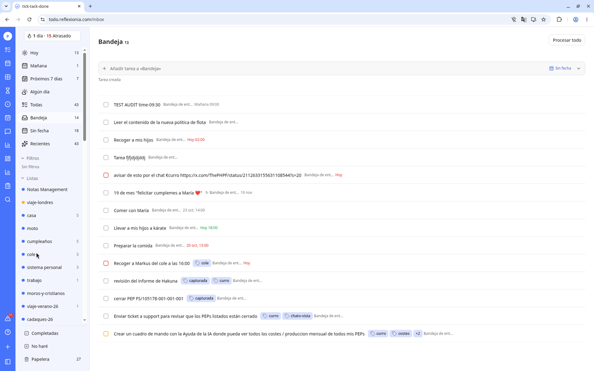
- 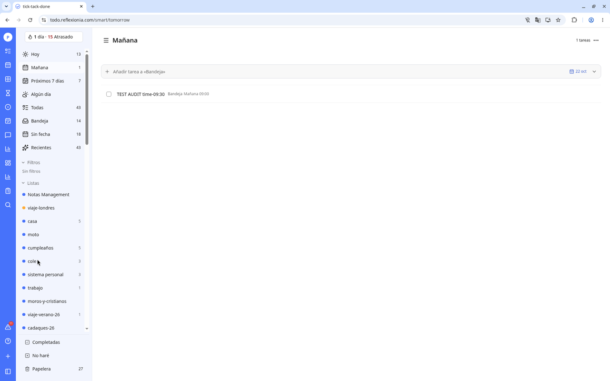

**Causa en el código (confianza Alta)**

- `extendWithTime` (`domain/nlp/parse.ts:971-990`) consume «09:00» y se detiene ante «-», porque solo corta si el siguiente carácter es una letra o un número.
- No existe ningún patrón de rango (`HH:MM-HH:MM`, «de 9 a 9:30», «9:00–9:30»). La duración solo se reconoce con la sintaxis `~30m` (`DURATION`, `parse.ts:342-343` y `:374-390`).
- `BARE_TIME` (`parse.ts:326`) exige empezar en un límite de palabra, así que «-09:30» se queda en el título.

**Propuesta de corrección**

- Añadir un patrón de rango tras la hora: `(\d{1,2})(?::(\d{2}))?\s*[-–a]\s*(\d{1,2})(?::(\d{2}))?`, y también «de X a Y».
- El patrón debe fijar la hora de inicio, calcular `durationMinutes = fin − inicio` (rechazar si es ≤ 0 o > 24 h) y consumir todo el span, incluido el separador.
- Al crear la tarea, enviar `duration_minutes`.

**Criterios de aceptación**

- `mañana 09:00-09:30`, `mañana 9:00–9:30` y `mañana de 9 a 9:30` producen el título sin restos, inicio 09:00 y duración 30.
- `tomorrow 9am-10am` funciona en inglés.
- `09:30-09:00` no genera duración negativa.
- Hay tests en `parse.spec.ts` para todos estos casos.

> **Para Codex:** este hallazgo ya está corregido en `main`. No lo reimplementes: ejecuta sus tests, comprueba los criterios de aceptación (en producción, si es posible) y anota el resultado en `docs/audit/ESTADO.md`.

#### TTD-AUD-03 — Se añade 09:00 al elegir solo un día

- **Severidad:** Media
- **Estado:** Abierto
- **Depende de:** 01
- **Pantalla/URL:** selector de fecha (detalle → «Cuándo»)

**Pasos para reproducir**

1. Abre el selector de fecha de una tarea sin fecha.
2. Pulsa «Mañana».
3. Aplica.

**Resultado esperado:** tarea de día completo, sin hora.

**Resultado actual:** la tarea queda con «22 oct, 09:00».

**Evidencia:** 

**Causa en el código (confianza Alta)**

- El selector recibe `allDay: task.is_all_day` (`TaskDetail.tsx:305`).
- `is_all_day` vale `false` por defecto (`apps/api/prisma/schema.prisma:443`).
- `setDay(key, false)` aplica la hora por defecto `'09:00'`: `web/components/DatePopover.tsx:73-75`, `:91-97` y `:219`.

**Propuesta de corrección:** si la tarea no tenía fecha, los atajos de día («Hoy», «Mañana», «+7 días», clic en el calendario) deben fijar `allDay: true`. La hora solo se añade si el usuario la elige.

**Criterios de aceptación**

- Si eliges solo un día, la tarea es de día completo y la fila no muestra hora.
- Si la tarea ya tenía hora, cambiar de día conserva esa hora.

**Referencia TickTick:** Selector con pestañas «Date» y «Duration»; elegir un día no añade hora. Ver la sección 4.6 y REF-TICKTICK_15, _16 y _17.

#### TTD-AUD-04 — El detalle no muestra bien «Cuándo», no hay hora de fin y la duración no se refleja

- **Severidad:** Media
- **Estado:** Abierto
- **Depende de:** 01, 03
- **Pantalla/URL:** panel de detalle de tarea
- **Elemento:** chip «Cuándo», selector de fecha y «Duración»

**Pasos para reproducir**

1. Abre la tarea creada en TTD-AUD-02.
2. Observa el chip «Cuándo» y el chip con bandera.
3. Abre el selector de fecha.
4. En «Duración», elige 30 min y pulsa «OK».
5. Recarga la página.

**Resultado esperado**

- «Cuándo» muestra la fecha y la hora de inicio.
- El selector permite indicar una hora de fin o una duración.
- Tras guardar, el chip y la fila muestran el rango.

**Resultado actual**

- «Cuándo» aparece vacío, mientras que la fecha aparece en el chip con bandera.
- El selector solo tiene un campo «Hora», sin fin.
- Tras «Duración 30 min» + «OK», ni el chip ni la fila cambian después de recargar (**no confirmado**: puede ser un retraso de la captura).
- El texto «90 min» se parte en dos líneas.

**Evidencia**

- 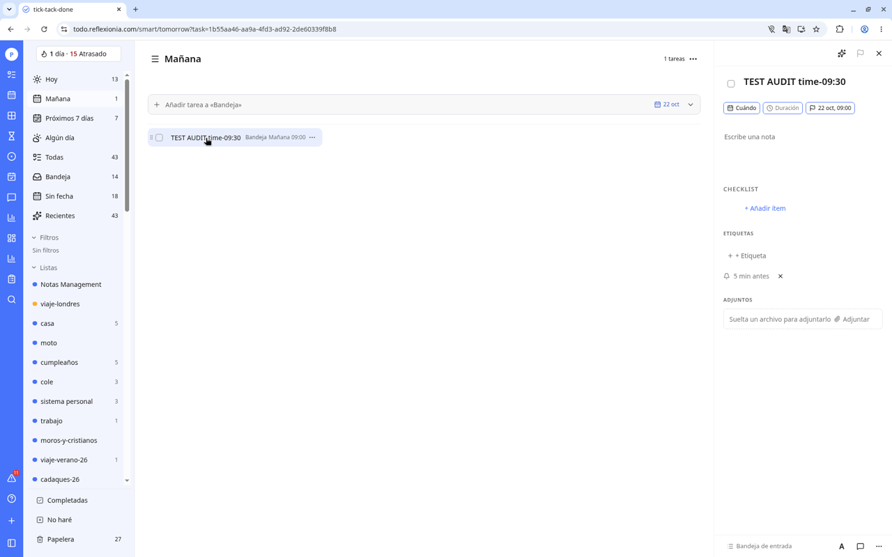
- 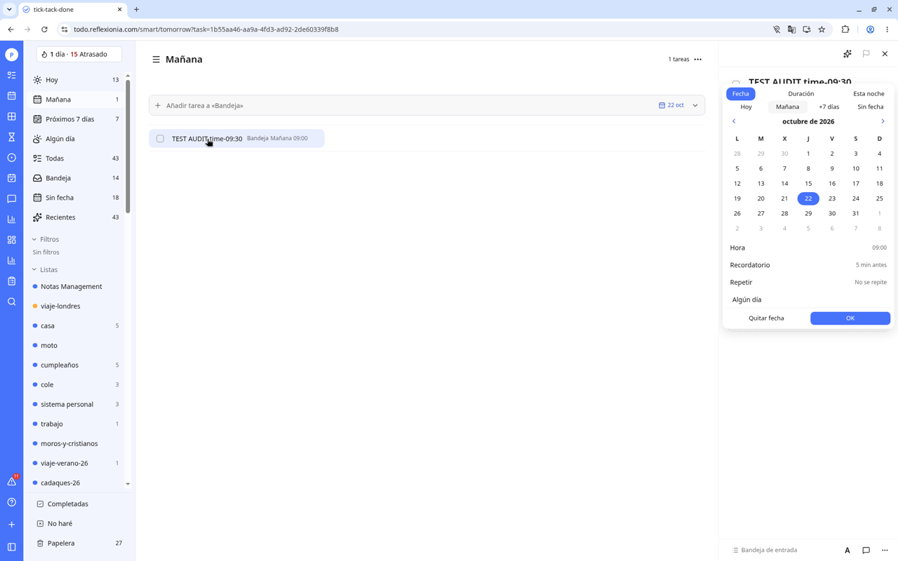
- 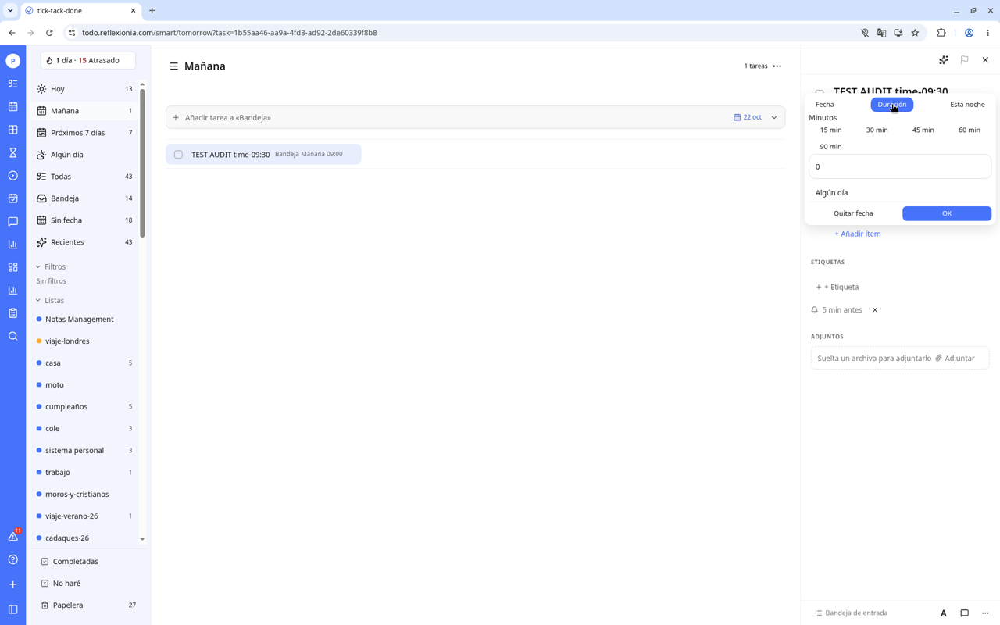

**Causa en el código**

- La entrada rápida guarda la fecha como `due_date`, no como `start_date`. Por eso «Cuándo» (que lee `start_date`, `TaskDetail.tsx:413-421`) aparece vacío. Confianza Media: el composer envía `request.dueDate` (`web/features/tasks/TaskComposer.tsx:101`).
- Las filas no muestran la duración porque `RowModel` no la incluye (`model.ts:3-25`). Confianza Alta.

**Propuesta de corrección**

- Unificar el modelo «Cuándo / Vencimiento»:
  - la entrada rápida y «Cuándo» escriben `start_date` (y `due_date` solo si hay una fecha límite explícita);
  - el chip del detalle muestra `start ?? due`.
- Añadir un campo «Hasta» o «Duración» en el selector.
- Hacer que el texto de duración no se parta (`white-space: nowrap`).

**Criterios de aceptación**

- Tras crear una tarea con «mañana 09:00-09:30», el chip «Cuándo» muestra «Mañana, 09:00–09:30».
- Cambiar la duración se refleja en el chip y en la fila sin recargar y también después de recargar.

---

**Referencia TickTick:** Pestaña «Duration» con inicio y fin, «All Day» y zona horaria. Ver la sección 4.6.

### Área 2 — Detalle de tarea

#### TTD-AUD-05 — Menú «Más acciones» estrecho, con scroll horizontal y textos cortados

- **Severidad:** Alta
- **Estado:** Abierto
- **Depende de:** 64 (Popover común)
- **Pantalla/URL:** panel de detalle → botón «⋯ Más acciones»

**Pasos para reproducir**

1. Abre cualquier tarea.
2. Pulsa «⋯».

**Resultado esperado:** un menú vertical con todas las acciones legibles, sin scroll horizontal.

**Resultado actual**

- Popover estrecho, con barra de scroll horizontal y una rejilla de dos columnas recortada.
- Etiquetas cortadas: «Añadir subtarea», «Copiar enlace», «Vincular tarea padre».
- Acciones que no se ven: «Convertir en nota», «Exportar», «Imprimir», «Actividad de la tarea», «Posponer una semana».

**Evidencia**

- 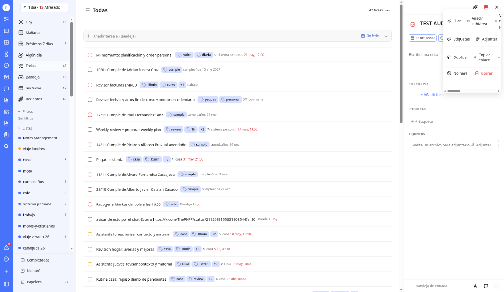
- 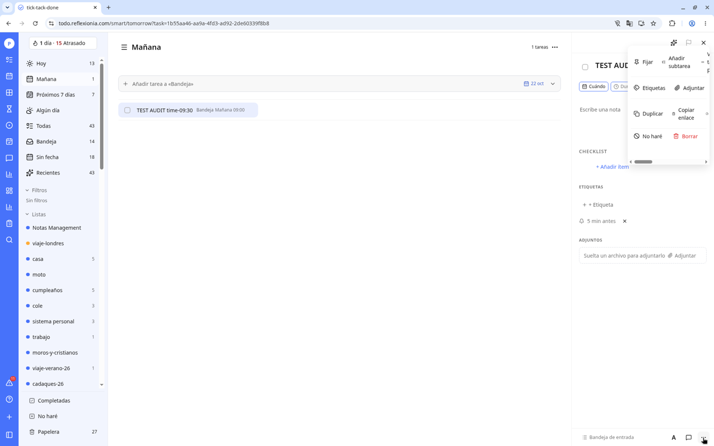

**Causa en el código (confianza Alta)**

- `.menu-group { display:flex; align-items:center }` coloca los botones en fila: `web/features/today/today.css:1284-1290`.
- El menú tiene un ancho fijo, `.popover-menu { width:220px }` (`today.css:613-616`).
- Además, `.popover { overflow:auto }` (`today.css:590-598`).
- El componente es `web/features/tasks/DetailMenu.tsx:158-208`.

**Propuesta de corrección**

- Añadir `.popover-menu .menu-group { flex-direction:column; align-items:stretch }`.
- Hacer que `.popover-row` ocupe el 100 % del ancho, con un `min-width` de unos 240 px y `max-width: calc(100vw - 24px)`.
- Quitar el scroll horizontal (`overflow-x:hidden`).

**Criterios de aceptación**

- Todas las acciones se ven en una sola columna, con icono y texto completos, en escritorio y en pantallas de 360 px.
- No hay barra de scroll horizontal.
- Se puede navegar con el teclado (flechas, Escape).

**Referencia TickTick:** Menú «···» del detalle con 15 acciones en una columna ancha, sin scroll horizontal. Ver la sección 4.1 y REF-TICKTICK_13.

#### TTD-AUD-06 — «Guardando…» durante segundos y «Creando…» al abrir una tarea

- **Severidad:** Media
- **Estado:** Abierto
- **Depende de:** —
- **Pantalla/URL:** panel de detalle

**Pasos para reproducir**

1. Edita cualquier campo de una tarea: el indicador muestra «Guardando…» durante varios segundos.
2. Abre una tarea: antes de que carguen los datos se ve «Creando…».

**Resultado esperado**

- «Guardando…» desaparece en cuanto el servidor confirma el cambio.
- Mientras carga el detalle se ve un estado de carga («Cargando…» o un esqueleto).

**Resultado actual:** «Guardando…» se queda varios segundos y al abrir una tarea aparece «Creando…».

**Evidencia**

- 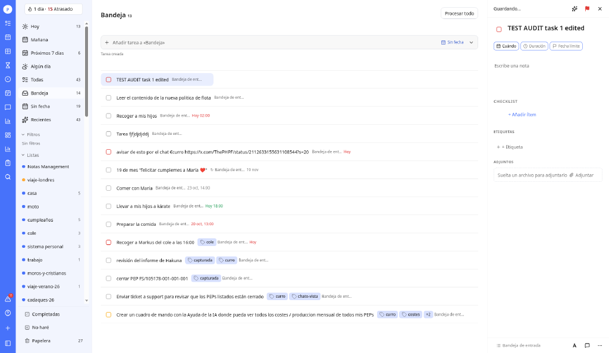
- 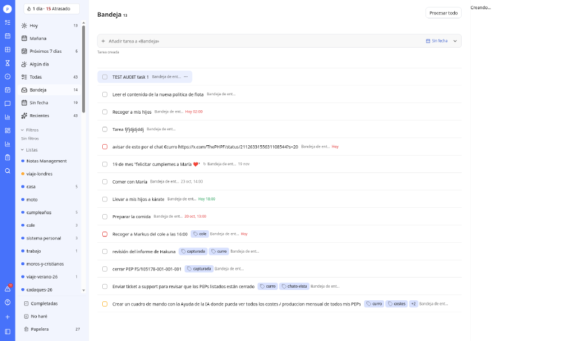

**Causa en el código (confianza Alta)**

- La mutación `save` espera (`await refresh()`) dentro de `onSuccess` (`TaskDetail.tsx:96-104`). `refresh()` invalida y vuelve a pedir unas 20 consultas (`web/features/tasks/refresh.ts:4-27`), y `saving={save.isPending}` (`TaskDetail.tsx:281`) sigue en verdadero mientras tanto.
- El estado de carga usa `messages.saving`, que vale «Creando…» (`TaskDetail.tsx:145-149` y `web/i18n/es.ts:20`).

**Propuesta de corrección**

- En `onSuccess`, lanzar `void refresh()` sin esperar.
- Usar una clave `loading` y un esqueleto con el estilo del panel.

**Criterios de aceptación**

- «Guardado» aparece menos de 500 ms después de la respuesta del PATCH.
- Al abrir una tarea nunca se ve «Creando…».

---

**Referencia TickTick:** El detalle guarda en segundo plano sin bloquear y sin estados visibles prolongados. Ver la sección 4.1.

### Área 3 — Ticky (lado ttd)

> Ticky es un módulo opcional, igual que Cuentas atrás o Foco: un asistente de IA conectado por API a un servicio externo de agentes. Este apartado cubre solo lo que corresponde a ttd. La parte de Ticky se tratará más adelante.

#### TTD-AUD-07 — Ticky está enlazado, pero dice «no disponible»; página sin margen

- **Severidad:** Alta
- **Estado:** Abierto
- **Depende de:** 63
- **Pantalla/URL:** `/ticky`, la barra de iconos y el detalle de tarea (botón «Ayúdame con esta tarea», que lleva a `/ticky?task=<id>`)

**Pasos para reproducir**

1. Pulsa el icono de Ticky en la barra de iconos, o el botón ✨ en el detalle de una tarea.

**Resultado esperado**

- Si Ticky no está activo, los accesos no aparecen o llevan a su pantalla de ajustes con un mensaje claro.
- La página respeta la maquetación común.

**Resultado actual**

- La página dice «Ticky todavía no está disponible en esta cuenta.».
- Los enlaces siguen visibles.
- La página no tiene el margen de las demás pantallas.

**Evidencia:** 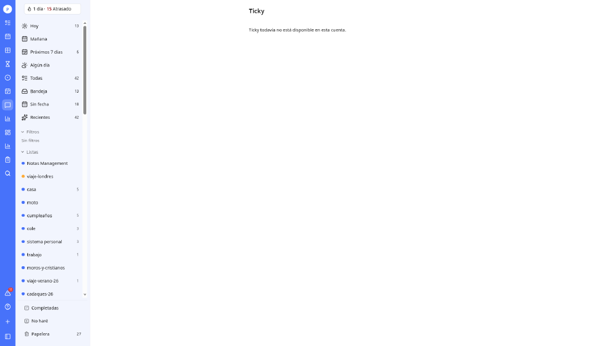

**Causa en el código (confianza Alta)**

- `moduleEnabled` devuelve `true` para todos los módulos salvo matrix, focus y countdowns, así que Ticky se muestra siempre: `web/shell/modules.ts:23` y `:31-33`.
- El enlace del detalle se pinta sin ninguna condición: `web/features/tasks/DetailHeader.tsx:55-62`.
- El mensaje aparece cuando `flags.ui` es falso: `web/features/ticky/TickyPage.tsx:144-151`. Ese valor viene de variables de entorno del servidor (`api/modules/ticky/ticky-flags.ts:11-27`, todas en `false` en `.env.example:83-88`).
- `.ticky-page` no usa `.screen-page`: `web/features/ticky/ticky.css:1-9` frente a `web/components/ui.css:168-175`.

**Propuesta de corrección:** ver la especificación funcional de más abajo (activación por usuario, ocultar los accesos y mostrar el estado del servidor). Usar `screen-page` en la página.

**Criterios de aceptación**

- Con Ticky desactivado no aparece ni en la barra de iconos ni en el detalle.
- `/ticky` lleva a los ajustes de Ticky con el motivo concreto.
- La página tiene los mismos márgenes que el resto.

> **Alcance:** la parte de ttd (no mostrar «no disponible» como destino, ocultar Ticky si está inactivo) se resuelve con TTD-AUD-63. El servicio de Ticky queda fuera de alcance.

#### TTD-AUD-08 — No existe ninguna pantalla para activar o configurar Ticky

- **Severidad:** Alta
- **Estado:** Abierto
- **Depende de:** 63
- **Pantalla/URL:** `/settings/*`

**Resultado actual**

- No hay ninguna entrada de Ticky en Ajustes (`web/app.tsx:183-201` y `web/features/places/Places.tsx:1833-1871`).
- En «Funciones» (`web/features/settings/FeaturesPage.tsx:11-19`) solo aparecen `countdowns, focus, matrix, when_deadline, day_load, day_closing, day_replan`.
- Los paneles `TickySettings.tsx` (permisos y preferencias) y `TickyRoutines.tsx` (rutinas) existen, pero solo se renderizan dentro de `TickyPage` _después_ del corte por «no disponible» (`TickyPage.tsx:157-158`). Por tanto, no se pueden usar.

**Causa en el código (confianza Alta):** los flags de usuario (`api/auth/feature-flags.ts:3-26` y `web/features/settings/feature-flags.ts:4-38`) no incluyen `ticky`. Los flags de Ticky son solo de entorno (`ticky-flags.ts`).

**Propuesta de corrección:** implementar la especificación funcional siguiente.

**Criterios de aceptación:** ver la especificación funcional.

#### Especificación funcional — Ajustes de Ticky en ttd

**Objetivo:** que Ticky se comporte como cualquier otro módulo opcional. El usuario debe poder activarlo o desactivarlo y configurar desde ttd todo lo que sea configurable, sin tocar variables de entorno.

**Ruta y navegación**

- Nueva ruta `/settings/ticky`, dentro del grupo de módulos de Ajustes en `Places.tsx` (cerca de la línea 1833).
- Enlace desde «Funciones».

##### F-1 — Activación por usuario

- Añadir el flag `ticky` en ambos `feature-flags.ts`, en `KEYS` de `FeaturesPage` y en `moduleEnabled`.
- Proteger `/ticky` con `FeatureRoute`.
- Valor por defecto: desactivado.
- **Criterio de aceptación:** al desactivarlo desaparecen el icono, el botón ✨ del detalle, la entrada de la paleta de comandos y las rutinas. Al activarlo vuelven a aparecer sin recargar.

##### F-2 — Mensajes sobre el estado del servidor

La pantalla distingue con mensajes propios entre:

- (a) el administrador no ha configurado el servicio (falta la URL o la clave de firma);
- (b) el administrador lo ha desactivado o hay un corte de emergencia (kill switch);
- (c) el servicio no responde (comprobación de salud fallida);
- (d) el usuario no lo ha activado.

`/api/v1/ticky/flags` debe devolver además `configured` y `reachable`.

**Criterio de aceptación:** cada caso muestra su texto y una acción, por ejemplo «Activar» o «Reintentar». El mensaje «no disponible en esta cuenta» desaparece.

##### F-3 — Conexión

Esta sección solo se muestra si el despliegue permite configurarla desde la app. Si no, se muestra solo el estado.

- **Campos:** URL del servicio y credencial.
- **Secretos:** se guardan solo en el servidor y se muestran enmascarados (`••••1234`). No se devuelven nunca en GET.
- **Botón «Probar conexión»:** hace una llamada de salud desde la API y muestra la latencia y la versión.
- **Criterio de aceptación:** un secreto nunca aparece completo en respuestas, registros ni en el DOM, y «Probar conexión» informa del éxito o del error con un mensaje claro.

##### F-4 — Modelo o agente por defecto

- Selector alimentado por `GET /api/v1/ticky/models` (existe: `api/modules/ticky/ticky.service.ts:567-582`), con «Sin IA» como opción.
- Se guarda como preferencia del usuario. Hoy solo existe un selector dentro del chat (`TickyPage.tsx:268`).
- **Criterio de aceptación:** el modelo elegido se usa por defecto en conversaciones nuevas y se puede cambiar en cada mensaje.

##### F-5 — Permisos y preferencias

Reutiliza `TickySettings` y añade los campos que ya existen en `TickyAuthority` (`apps/api/prisma/schema.prisma:1337-1358`) pero que la interfaz no muestra:

- `paused` (pausar);
- `revoked` (revocar el acceso);
- `readEnabled`;
- `estimateLearningEnabled`;
- `coachingSilence` y `reminderSilence`.

Se mantienen los campos actuales: autonomía A0–A2, listas permitidas (máximo 10), bandeja de captura, permisos explícitos y jornada.

**Criterio de aceptación:** cada cambio se guarda con `PATCH /ticky/authority` y muestra «Guardado». Si el guardado falla, se muestra el error y se restaura el valor anterior.

##### F-6 — Rutinas

- Mover `TickyRoutines` a los ajustes: plan diario y revisión semanal, hora, zona, modo de prueba, pausar y editar.
- **Criterio de aceptación:** las rutinas se pueden gestionar con Ticky activo aunque no se haya abierto nunca el chat.

##### F-7 — Memorias

- Lista de las memorias guardadas, con opción de borrar. Los endpoints ya existen (`api/modules/ticky/ticky.controller.ts:254-283`), pero no hay interfaz.
- **Criterio de aceptación:** el usuario puede ver y borrar cada memoria, con confirmación propia (no `confirm()`).

##### F-8 — Telegram

- Conmutador para usar Ticky desde Telegram, condicionado a que la integración de Telegram esté conectada y a que el servidor lo permita.
- **Criterio de aceptación:** el conmutador está deshabilitado y explica el motivo cuando falta alguna de las dos condiciones.

##### F-9 — Idioma

- Todos los textos de `TickyPage`, `TickySettings`, `TickyRoutines`, `ProposalReview` y `ticky/api.ts` pasan a `i18n` (ES/EN). Hoy están fijos en español: ver TTD-AUD-27.
- **Criterio de aceptación:** en modo inglés no queda ningún texto en español.

##### F-10 — Accesos

- Cuando Ticky está desactivado, el icono, el botón ✨ y los atajos se ocultan. Si se entra directamente a `/ticky`, se redirige a `/settings/ticky`.

---

> **Alcance:** para Codex, dentro de esta especificación entra el interruptor de Ticky y la ocultación (F-1 y TTD-AUD-63) y la pantalla `/settings/ticky` para los ajustes que ya expone la API de ttd. Todo lo que exija cambios en el servicio de Ticky queda fuera de alcance.

#### TTD-AUD-63 — Ticky no se puede desactivar y aparece en toda la interfaz aunque esté inactivo

- **Severidad:** Alta
- **Pantalla/URL:** barra de iconos, «Más» en móvil, `/settings/features`, cabecera del detalle de tarea, `/settings/tokens` y `/ticky`
- **Elemento:** registro de módulos y flags de funcionalidades
- **Estado:** Abierto
- **Depende de:** — (TTD-AUD-07 y TTD-AUD-08 dependen de este). El servicio de Ticky queda **fuera** de alcance; el interruptor y la ocultación en ttd están **dentro**.

**Pasos para reproducir**

1. Con Ticky inactivo en el servidor, recorre la barra de iconos, «Más» en móvil, el detalle de una tarea y Ajustes > Funcionalidades.

**Resultado esperado**

- En Ajustes > Funcionalidades hay un interruptor «Ticky».
- Si está apagado, o si el servidor lo tiene desactivado, Ticky no aparece en ningún sitio y `/ticky` redirige.

**Resultado actual**

- Ticky aparece en la barra de iconos, en «Más», en el orden de navegación, como botón ✨ en el detalle y en los permisos de token.
- No existe ningún interruptor para desactivarlo.

**Evidencia**

- 
- Ver también TTD-AUD-07_a.

**Causa en el código (confianza Alta)**

- `moduleEnabled` (`web/shell/modules.ts:31-33`) solo filtra matrix, focus y countdowns. Para ticky (y para habits) devuelve siempre `true`.
- `FeatureFlags` no tiene `ticky` (`web/features/settings/feature-flags.ts:4-37`) y `FeaturesPage` no lo lista (`FeaturesPage.tsx:12-20`).
- La ruta `/ticky` no está envuelta en `FeatureRoute` (`web/app.tsx:180`).
- El estado del servidor (`TICKY_UI_ENABLED` y el kill switch, `api/modules/ticky/ticky-flags.ts:16-26`) solo lo consulta `TickyPage` (`:39-41`, `:95` y `:145`).
- Dónde aparece Ticky:
  - barra de iconos (`IconRail.tsx:69-77`);
  - «Más» en móvil y sidebar (`Sidebar.tsx:221-232`);
  - orden de navegación (`FeaturesPage.tsx:143-175`);
  - botón ✨ «Ayuda de Ticky» (`web/features/tasks/DetailHeader.tsx:55-62`);
  - permisos `ticky:*` (`web/features/tokens/scopes.ts:163-166`);
  - la propia página.
- Además, `FeatureRoute` usa los flags por defecto (todo activado) hasta que carga `/me` (`app.tsx:212-224`). Con un módulo desactivado, una URL directa lo muestra un instante.

**Propuesta de corrección**

1. Añadir `ticky: boolean` a `FeatureFlags`, a `featureFlags()`, a la API de preferencias y a la lista de Funcionalidades. El valor por defecto es `false` mientras el servicio no esté disponible para el usuario.
2. Crear el hook `useTickyAvailable()`, igual a `flags.ticky && serverFlags.ui` (de `tickyApi.flags()`, con caché).
3. Usar ese hook en `moduleEnabled`, `DetailHeader`, el orden de navegación, `scopes.ts` (ocultar o marcar «no disponible») y `FeatureRoute flag="ticky"`.
4. Si el servidor lo tiene apagado, el interruptor aparece deshabilitado con el motivo («El administrador lo ha desactivado»).
5. Añadir `habits` a los flags, por coherencia.
6. `FeatureRoute`: esperar a `me` antes de decidir (esqueleto) en lugar de usar los valores por defecto.

**Criterios de aceptación**

- Con el interruptor apagado no hay ningún punto de entrada visible a Ticky y `/ticky` redirige a `/today`.
- Al encenderlo, Ticky aparece en la barra de iconos, en «Más» y en el detalle.
- Con `TICKY_UI_ENABLED=false`, el interruptor aparece bloqueado con explicación.
- Hay tests de `moduleEnabled` y de `useTickyAvailable`.

### Área 4 — Datos y métricas

#### TTD-AUD-09 — Completadas de la semana: 104 en Estadísticas frente a 314 en el Panel

- **Severidad:** Alta
- **Estado:** Abierto
- **Depende de:** —
- **Pantalla/URL:** `/statistics` (Semana) y `/dashboard`

**Pasos para reproducir**

1. Abre Estadísticas → Semana (19–25 oct).
2. Abre el Panel («Jardín digital»).

**Resultado esperado:** la misma métrica, con el mismo periodo y la misma etiqueta, da el mismo número.

**Resultado actual**

- Estadísticas: «Completadas 104 · Periodo anterior: 210».
- Panel: «Completadas hoy 0 · 314 en 7 días».

**Evidencia**

- 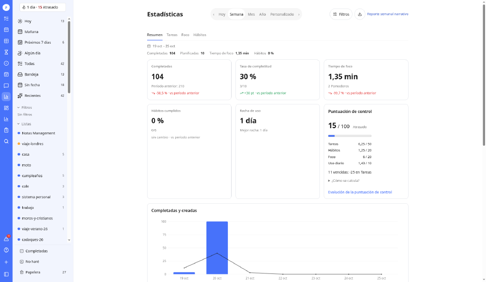
- 

**Causa en el código (confianza Media-Alta)**

- Estadísticas usa la semana de calendario de lunes a domingo (`web/features/statistics/range.ts:31-38` y `domain/stats/aggregate.ts:196-220`) y excluye las tareas canceladas.
- El Panel usa una ventana móvil de 7×24 h (`domain/dashboard/kpis.ts:97` y `:118-120`).
- 314 ≈ 104 + la mayor parte de las 210 de la semana anterior, lo que encaja con esa diferencia de ventanas.

**Propuesta de corrección:** usar una sola definición de la ventana (o etiquetar con claridad «últimos 7 días» frente a «esta semana») y la misma regla de exclusión en las dos pantallas.

**Criterio de aceptación:** con el mismo periodo, las dos pantallas muestran el mismo número, y un test compartido del dominio fija la regla.

#### TTD-AUD-10 — Tiempo de foco: «1,35 min» frente a 397 min

- **Severidad:** Alta
- **Estado:** Abierto
- **Depende de:** —
- **Pantalla/URL:** `/statistics` y `/focus`

**Resultado actual**

- Estadísticas: «Tiempo de foco 1,35 min · 2 Pomodoros».
- `/focus`: 397 minutos y «Pomodoros 3».

**Evidencia**

- 
- 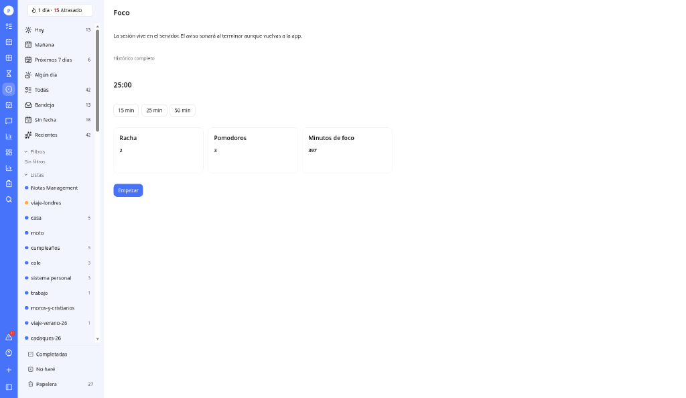

**Causa en el código (confianza Alta)**

- Estadísticas suma `actualSeconds/60` del rango (`aggregate.ts:459-467`) y lo formatea sin redondear (`web/features/statistics/text.ts:184-187`); de ahí salen los decimales.
- `/focus` muestra el total histórico, sin filtro de fechas (`api/modules/focus/focus.controller.ts:212-218` y `web/features/product/ProductPages.tsx:92`).
- Que 2 pomodoros completados sumen 1,35 min es sospechoso: puede que `actualSeconds` no se registre bien al completar un pomodoro. **No confirmado.**

**Propuesta de corrección**

- Redondear en `duration()`.
- Etiquetar `/focus` como «Total» o filtrarlo por el mismo periodo.
- Revisar cómo se calcula `actual` al terminar una sesión (`focus.controller.ts`, alrededor de la línea 328).

**Criterio de aceptación:** nunca se muestran minutos con decimales, y las cifras de ambas pantallas cuadran para el mismo periodo.

#### TTD-AUD-11 — El informe semanal sale vacío

- **Severidad:** Alta
- **Estado:** Corregido en main, pendiente de verificar en producción — [PR #67](https://github.com/povedica/tick-tack-done/pull/67) (`b484fe8`)
- **Depende de:** —
- **Pantalla/URL:** `/reports/weekly`

**Resultado actual:** «Sin detalle diario verificable para esta semana.», «Sin datos» en Completadas, Hábitos y Foco, y «Fecha de cálculo no disponible».

**Evidencia:** 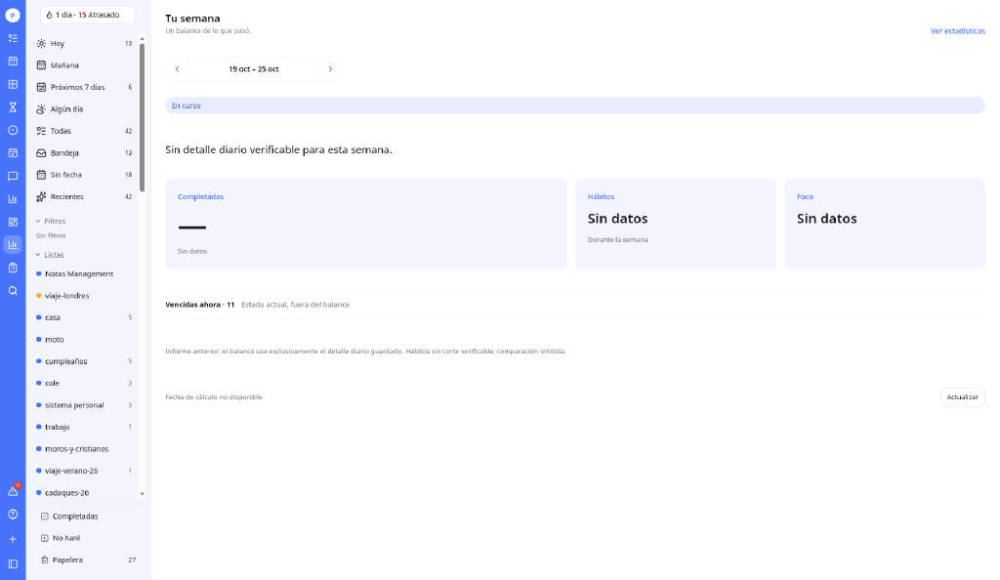

**Causa en el código (confianza Alta)**

- La automatización `writeReport` guarda solo `{summary, observations}`, sin `days`, `calculated_at` ni `metrics_version`: `api/modules/automations/automations.controller.ts:299-318`.
- Además, calcula la semana empezando en domingo y en UTC, mientras que el informe usa el lunes en hora local (`api/modules/reports/reports.controller.ts:122` y `:223-274`).
- La página necesita `days.length === 7` y `calculated_at` (`web/features/product/WeeklyPages.tsx:56-58`, `:127` y `:202-204`).

**Propuesta de corrección:** hacer que la automatización llame al mismo constructor que `POST /reports/weekly` y migrar o regenerar los informes antiguos.

**Criterio de aceptación:** el informe de la semana en curso muestra completadas, creadas, hábitos, foco y la fecha de cálculo.

> **Para Codex:** este hallazgo ya está corregido en `main`. No lo reimplementes: ejecuta sus tests, comprueba los criterios de aceptación (en producción, si es posible) y anota el resultado en `docs/audit/ESTADO.md`.

#### TTD-AUD-12 — «15 Atrasado» parece un recuento, pero es una puntuación

- **Severidad:** Media
- **Estado:** Abierto
- **Depende de:** —
- **Pantalla/URL:** chip superior de la barra lateral y del Panel, frente al aviso «Vencidas»

**Resultado actual:** el chip dice «1 día · 15 Atrasado» y el aviso de vencidas dice «11».

**Evidencia:** 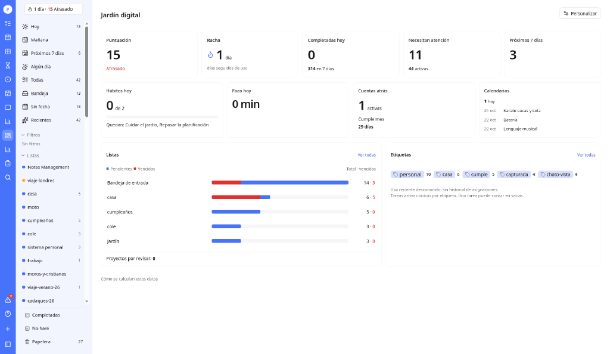

**Causa en el código (confianza Alta)**

- «15» es la puntuación de control sobre 100, y «Atrasado» significa que es menor que 50 (`web/features/statistics/ControlSummary.tsx:55` y `:102-111`, `text.ts:143`).
- «11» es el número de tareas vencidas (`api/reading/overdue.ts:16-34`).

**Propuesta de corrección:** mostrar «15/100 · Atrasado», o un icono de puntuación, en el chip.

**Criterio de aceptación:** el chip no se puede confundir con un número de tareas.

---

### Área 5 — Listas, filtros y navegación

#### TTD-AUD-13 — /filters usa controles nativos sin estilo y etiquetas erróneas

- **Severidad:** Media
- **Estado:** Abierto
- **Depende de:** —
- **Pantalla/URL:** `/filters`

**Resultado actual**

- Botones grises nativos («Añadir condición», «Añadir grupo», «Vista previa», «Guardar»).
- El selector del campo tiene la etiqueta «Palabra».
- El selector «Modo» es más ancho que los demás.

**Evidencia:** 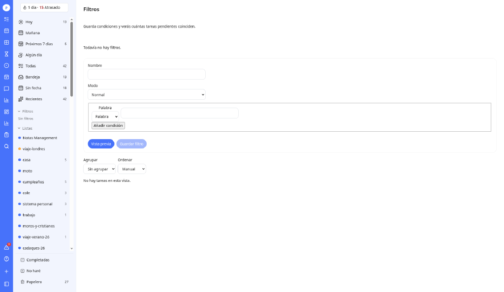

**Causa en el código (confianza Alta)**

- Se usan `<button>` nativos en lugar del componente `Button`: `web/features/views/components/FiltersPage.tsx:198`, `:214`, `:224` y `:232`.
- `.condition` no tiene CSS (`FiltersPage.tsx:266`).
- `.habit-form` estira los selects al 100 % (`web/styles.css:294-320`).
- Etiquetas incorrectas: `fieldKeyword` («Palabra») se usa como etiqueta del selector de campo (`:267-269`), y `combinatorAnd` («Y») como etiqueta de los combinadores (`:149-151` y `:166-168`).

**Propuesta de corrección**

- Usar `Button` y los estilos de select de `ui.css`.
- Añadir `.condition { display:flex; gap }`.
- Usar etiquetas específicas («Campo», «Combinar con»).

**Criterio de aceptación:** los controles tienen el mismo aspecto que en Ajustes, en tema claro y oscuro, y cada select tiene una etiqueta correcta.

#### TTD-AUD-14 — /matrix: «Ámbito» desalineado, una «i» suelta y un cuadrante cortado

- **Severidad:** Media
- **Estado:** Abierto
- **Depende de:** 62
- **Pantalla/URL:** `/matrix`

**Resultado actual**

- «Ámbito» aparece encima del select.
- Hay una «i» cortada en el borde derecho.
- El cuadrante inferior derecho está cortado.
- En modo oscuro el select es nativo y blanco.

**Evidencia**

- 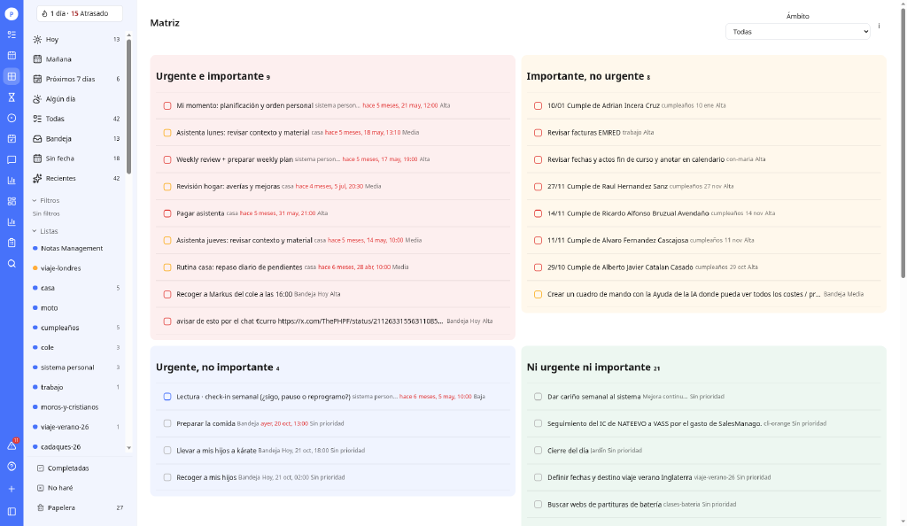
- 

**Causa en el código (confianza Alta, salvo el corte del cuadrante)**

- La regla `.screen-page label:not(.task-check-hit){flex-direction:column}` (`web/components/ui.css:1925-1931`) tiene más especificidad que `.matrix-scope` (`web/features/matrix/matrix.css:9-13`).
- El botón de información es la letra «i» literal: `web/features/matrix/MatrixBoard.tsx:177-187`.
- El corte del cuadrante probablemente viene de `.quad-grid > .quad { overflow:hidden }` (`ui.css:317-320`). Confianza Media.

**Propuesta de corrección**

- Añadir `.screen-page .matrix-scope { flex-direction:row }`.
- Usar el icono `<Info/>` de lucide.
- Quitar el `overflow:hidden` o hacer scroll interno por cuadrante.
- Dar estilo al select en modo oscuro.

**Criterio de aceptación:** la cabecera ocupa una sola línea, se ven los cuatro cuadrantes completos y el select se ve bien en ambos temas.

**Referencia TickTick:** Matriz 2×2 con colores, secciones plegables y menús «···». Ver TTD-AUD-62 y la sección 4.8.

#### TTD-AUD-62 — /matrix: soltar una tarjeta reescribe o borra la fecha, ignora las reglas del usuario y faltan opciones

- **Severidad:** Alta
- **Pantalla/URL:** `/matrix` y la matriz integrada en `/today` y en las listas
- **Elemento:** cuadrantes, arrastrar y soltar, menú de mover, cabecera
- **Estado:** Abierto
- **Depende de:** TTD-AUD-14 (hacerlos juntos)

**Pasos para reproducir**

1. Crea una tarea de día completo, prioridad baja, para mañana.
2. En `/matrix`, arrástrala a «Hacer».
3. Arrastra otra tarea al mismo cuadrante en el que ya está.
4. Arrastra una tarea con fecha a «Eliminar».
5. Guarda reglas propias de cuadrante (`PUT /api/v1/matrix/rules`) y recarga `/matrix`.

**Resultado esperado**

- Mover una tarea cambia solo lo necesario para que pertenezca al cuadrante: sube o baja la prioridad, y pone fecha solo si hace falta para que sea urgente. Conserva el tipo (día completo o con hora).
- Soltar en el mismo cuadrante no cambia nada, y «Eliminar» no borra la fecha.
- Hay opción de deshacer.
- El tablero respeta las reglas guardadas.
- Hay menú «···» (Ocultar completadas, gestionar vista) y, por cuadrante, agrupar y ordenar, como en TickTick.

**Resultado actual**

- La fecha pasa a ser ahora + 1 h («Hacer» y «Delegar») o ahora + 7 días («Planificar»), con hora, aunque la tarea fuera de día completo.
- En «Eliminar» se borra la fecha, sin deshacer.
- Soltar en el mismo cuadrante también reescribe la fecha.
- Las reglas guardadas se ignoran.
- Solo hay un selector «Ámbito» y un botón «i».

**Evidencia**

- 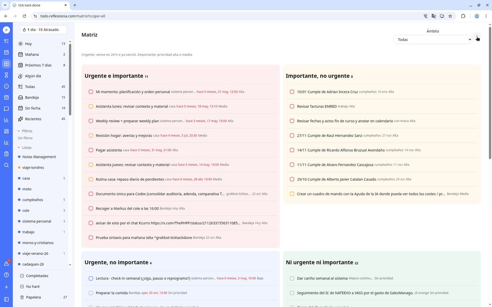

<div class="pair"><figure>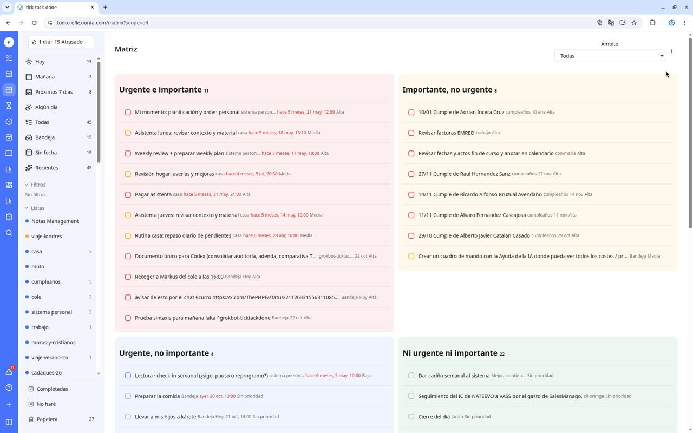<figcaption>ttd — /matrix</figcaption></figure><figure>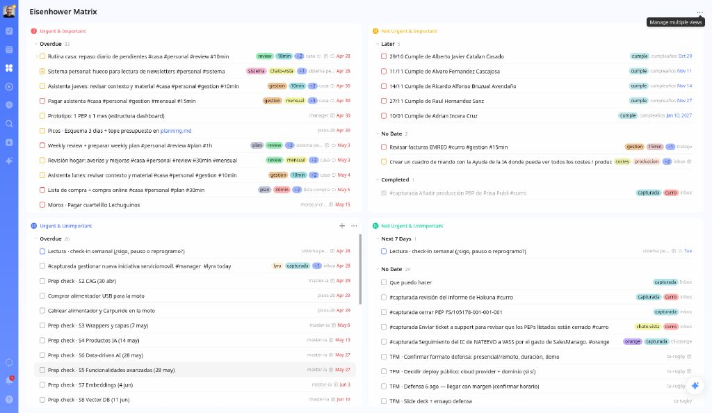<figcaption>TickTick — cuadrantes con colores y secciones plegables</figcaption></figure></div>

<div class="pair"><figure>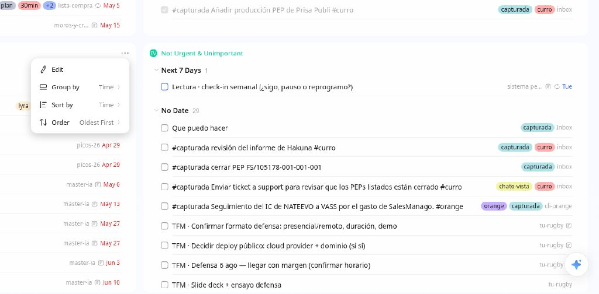<figcaption>TickTick — menú del cuadrante (Edit, Group by, Sort by, Order)</figcaption></figure><figure>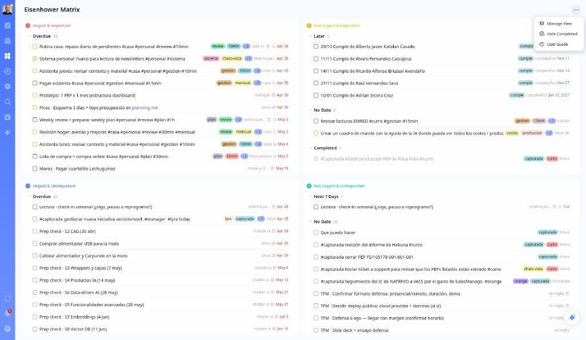<figcaption>TickTick — menú superior (Manage View, Hide Completed, User Guide)</figcaption></figure></div>

**Causa en el código (confianza Alta)**

1. `applyQuadrantDrop` (`domain/views/matrix.ts:109-117`) fija la fecha a ahora + 1 h o + 7 días, o la borra (`due: 'clear'`). Se llama sin la fecha previa ni `is_all_day` (`web/features/matrix/MatrixBoard.tsx:136-145`).
2. No se comprueba si el cuadrante de destino es el mismo (`MatrixBoard.tsx:222-230`).
3. El tablero usa un `quadrantOf` propio de la web (`web/features/tasks/model.ts:182-197`) y `DEFAULT_QUADRANT_EFFECTS`. Ignora las reglas y efectos personalizados que el API ya sirve (`GET/PUT /matrix/rules`, `api/modules/matrix/matrix.controller.ts:44-110`; SDK `resources.ts:560-561`), que la web nunca pide.
4. `now` se memoiza al montar (`MatrixBoard.tsx:127`), así que los cuadrantes no se recalculan con el tiempo.
5. En escritorio no hay alternativa de teclado para mover: el menú solo existe con 800 px o menos (`:295-323`).
6. El estado vacío es global (`:194-196`); no hay vacío por cuadrante ni secciones (Vencidas, Próximos 7 días, Más tarde, Sin fecha, Completadas).
7. El botón «i» es un literal (`:189`, ya en TTD-AUD-14).
8. El selector de ámbito incluye listas cerradas y de notas (`:172-176`).
9. El título navega fuera de la matriz (ver TTD-AUD-60).

**Propuesta de corrección**

1. Sustituir `applyQuadrantDrop` por `minimalQuadrantPatch(task, target, now, zone)`:
   - **Importancia:** si el destino es importante y la prioridad es baja o ninguna, pasa a media («Planificar») o alta («Hacer»); si el destino no es importante y la prioridad es alta o media, pasa a baja o ninguna.
   - **Urgencia:** si el destino es urgente y la tarea no lo es, fecha = hoy (día completo en la zona de la tarea); si el destino no es urgente y la tarea sí lo es, fecha = la más próxima no urgente, mañana + 1 (día completo), solo si el usuario lo confirma en el toast. «Eliminar» nunca borra la fecha.
   - Conservar `is_all_day` y la hora si ya cumple.
2. Ignorar las soltadas en el mismo cuadrante.
3. Mostrar un toast con «Deshacer» (patch inverso).
4. Cargar `api.matrixRules()` y usar el `quadrantOf` del dominio con reglas; eliminar el duplicado de la web.
5. Refrescar `now` cada minuto.
6. Ofrecer «Mover a…» en el menú contextual también en escritorio, accesible con teclado.
7. Añadir un menú «···» superior (Ocultar completadas, Gestionar vista con las reglas y Guía) y, por cuadrante, «···» (Editar regla, Agrupar por, Ordenar por, Orden), con secciones plegables.
8. Mostrar un estado vacío por cuadrante.
9. Filtrar las listas cerradas y de tipo NOTE del selector de ámbito.

**Criterios de aceptación**

- Una tarea de día completo para mañana con prioridad baja, arrastrada a «Hacer», queda en hoy, de día completo y con prioridad alta.
- Soltar en «Eliminar» conserva la fecha, y soltar en el mismo cuadrante no hace ninguna petición.
- «Deshacer» restaura la tarea exactamente.
- Con reglas guardadas, la clasificación las respeta.
- Se puede mover con el teclado en escritorio.
- Hay tests del dominio para `minimalQuadrantPatch` (8 combinaciones de origen y destino, más día completo y con hora).

**Referencia TickTick:** ver REF-TICKTICK_19, _20 y _21.

#### TTD-AUD-15 — Papelera: acciones a la izquierda del título y la barra de confirmación lo tapa

- **Severidad:** Media
- **Estado:** Abierto
- **Depende de:** —
- **Pantalla/URL:** `/smart/trash`

**Resultado actual**

- «Restaurar» y «Eliminar» aparecen a la izquierda del título.
- Al pulsar «Eliminar», la barra de confirmación tapa el título tachado.

**Evidencia**

- 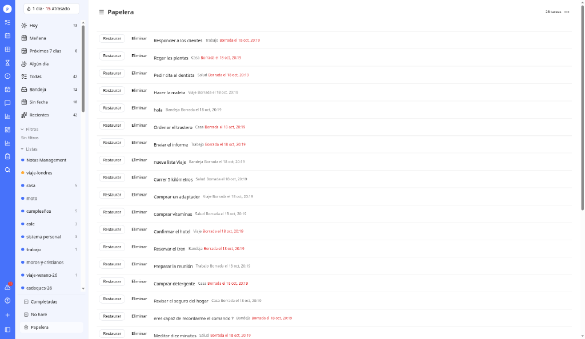
- 

**Causa en el código (confianza Alta)**

- `TrashActions` se renderiza en el hueco del checkbox: `web/features/tasks/TaskList.tsx:291-306`.
- La fila tiene altura fija (`today.css:134-143`) y los botones de confirmación son de tamaño completo (`TaskList.tsx:716-742`).

**Propuesta de corrección:** mover las acciones al final de la fila (zona de metadatos) y mostrar la confirmación como un popover o en una línea propia.

**Criterio de aceptación:** el título se lee siempre completo y las acciones están alineadas a la derecha.

#### TTD-AUD-16 — Papelera: tras «Confirmar borrado» la fila y el contador no cambian

- **Severidad:** Alta
- **Estado:** Abierto
- **Depende de:** —
- **Pantalla/URL:** `/smart/trash`

**Resultado actual:** después de «Confirmar borrado», la fila sigue ahí y el contador sigue en «28 tareas» hasta que recargas.

**Evidencia:** 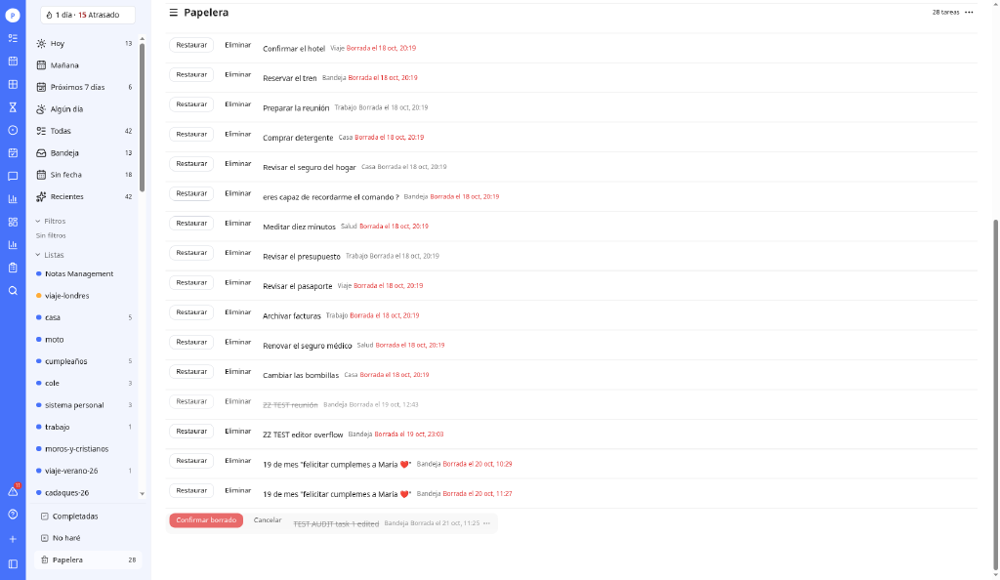

**Causa en el código (confianza Baja — no confirmada)**

- Las claves de caché sí coinciden: `['smart-list-tasks','trash',…]` y `['smart-lists']` se invalidan en `refresh.ts:13` y `:17`.
- Pero `api.purgeTask(...).then(...)` no gestiona el error (`TaskList.tsx:304`). Si la petición `DELETE /api/v1/tasks/trash/:id` falla, la fila se queda sin ningún aviso.
- Hay que comprobar la petición en la pestaña de red del navegador.

**Propuesta de corrección**

- Quitar la fila de la caché de forma optimista.
- Gestionar el error con un aviso y restaurar la fila.
- Invalidar `['smart-lists']`.

**Criterio de aceptación:** la fila desaparece y el contador baja de inmediato. Si la petición falla, aparece un aviso de error y la fila vuelve.

#### TTD-AUD-17 — El botón «Crear» de «Nueva lista» es nativo y no lleva estilo

- **Severidad:** Media
- **Estado:** Abierto
- **Depende de:** —
- **Pantalla/URL:** barra lateral → «+» en Listas o Etiquetas

**Resultado actual:** el botón «Crear» es gris, cuadrado y nativo.

**Evidencia:** 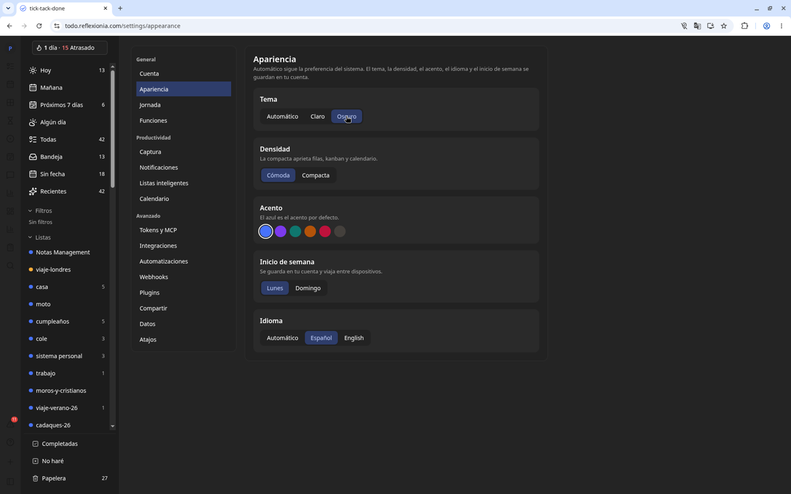

**Causa en el código (confianza Alta):** hay `<button type="submit">` sin clase en `web/shell/Sidebar.tsx:395` y `:584`, y no existe ninguna regla `.nav-create button` (`web/shell/shell.css:112-113` y `:816`, `ui.css:822-829`).

**Propuesta de corrección:** usar `<Button size="sm" variant="primary">`.

**Criterio de aceptación:** el botón usa el estilo de la app en ambos temas.

#### TTD-AUD-18 — Al borrar una lista se queda en /list/<id> y acaba en «No encontrado»

- **Severidad:** Media
- **Estado:** Abierto
- **Depende de:** —
- **Pantalla/URL:** `/list/<id>`

**Pasos para reproducir**

1. Abre una lista.
2. En su menú, elige borrarla y confirma.

**Resultado esperado:** la app redirige a la Bandeja o a «Hoy» y muestra un aviso.

**Resultado actual:** la URL sigue siendo `/list/<id>`, con la cabecera «0 tareas», y más tarde aparece «No encontrado / Esa página no existe o ya no está.».

**Evidencia:** 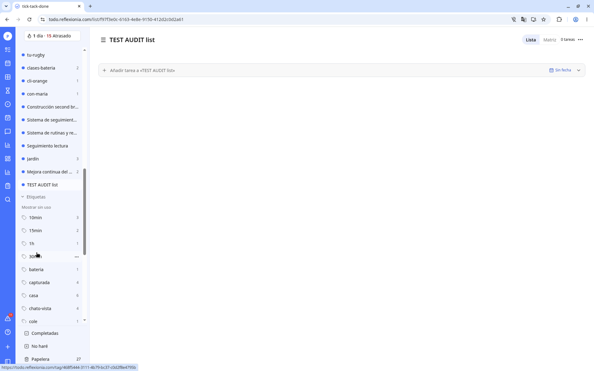

**Causa en el código (confianza Alta):** después de `deleteProject` no se navega a ninguna parte y no se gestiona el error (`web/shell/Sidebar.tsx:868-878`).

**Propuesta de corrección:** si la ruta actual es la de esa lista, `navigate('/inbox', {replace:true})` y mostrar un aviso con opción de deshacer, si existe.

**Criterio de aceptación:** después de borrar no se ve nunca la pantalla «No encontrado».

#### TTD-AUD-19 — Una URL desconocida redirige a /today sin ningún aviso de 404

- **Severidad:** Media
- **Estado:** Abierto
- **Depende de:** —
- **Pantalla/URL:** `/does-not-exist`

**Resultado actual:** redirige sin decir nada a `/today?group=priority`.

**Evidencia:** 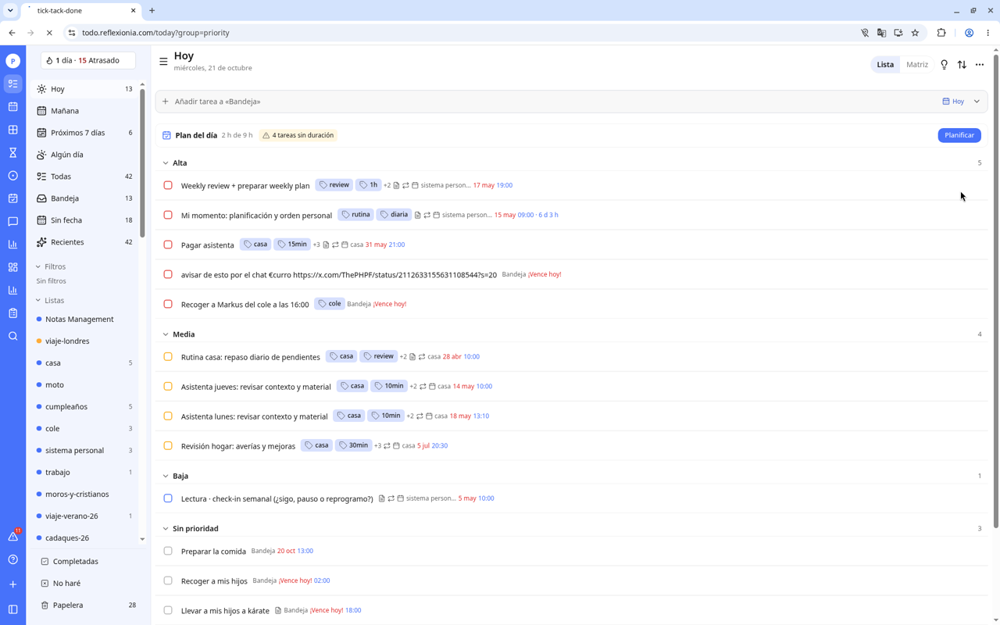

**Causa en el código (confianza Alta):** `<Route path="*" element={<Navigate to="/today" replace />}>` en `web/app.tsx:203`. El parámetro `group=priority` sale de la vista guardada de «Hoy».

**Propuesta de corrección:** crear una página 404 con estilo propio y un enlace a «Hoy».

**Criterio de aceptación:** una ruta inexistente muestra una 404 y la URL no cambia.

---

### Área 6 — Foco y cuentas atrás

#### TTD-AUD-20 — /focus: sin anillo de temporizador y presets sin estado

- **Severidad:** Media
- **Estado:** Abierto
- **Depende de:** —
- **Pantalla/URL:** `/focus`

**Resultado actual**

- Se ve «25:00» como texto plano, sin anillo de progreso.
- Los botones 15/25/50 no tienen estilo ni marcan cuál está seleccionado.

**Evidencia:** 

**Causa en el código (confianza Alta)**

- El temporizador es un `<p className="detail-title">` (`ProductPages.tsx:106`).
- `.focus-ring` existe en `web/shell/shell.css:677-693`, pero ningún componente lo usa.
- No hay estilo para `.ui-button[aria-pressed='true']` (los presets están en `ProductPages.tsx:107-121`).
- Las llamadas `.then` sin gestión de error están en `:114`, `:144`, `:156` y `:171`.

**Propuesta de corrección**

- Crear un componente de anillo SVG con los tokens de color.
- Añadir un estilo para el estado pulsado.
- Gestionar los errores.

**Criterio de aceptación:** el anillo muestra el progreso, el preset activo se distingue y todo funciona en ambos temas.

**Referencia TickTick:** Pomodoro con anillo grande, Pomo/Cronómetro y panel de estadísticas a la derecha. Ver REF-TICKTICK_29.

#### TTD-AUD-21 — /countdowns: el título se parte y el emoji se corta

- **Severidad:** Media
- **Estado:** Abierto
- **Depende de:** —
- **Pantalla/URL:** `/countdowns`

**Resultado actual**

- El título se parte en «Cuenta / atrás».
- El emoji ⏳ de las tarjetas aparece recortado.

**Evidencia**

- 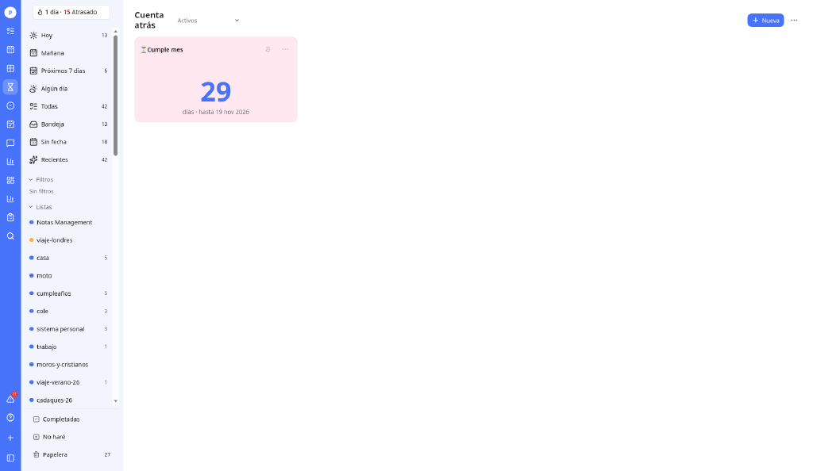
- 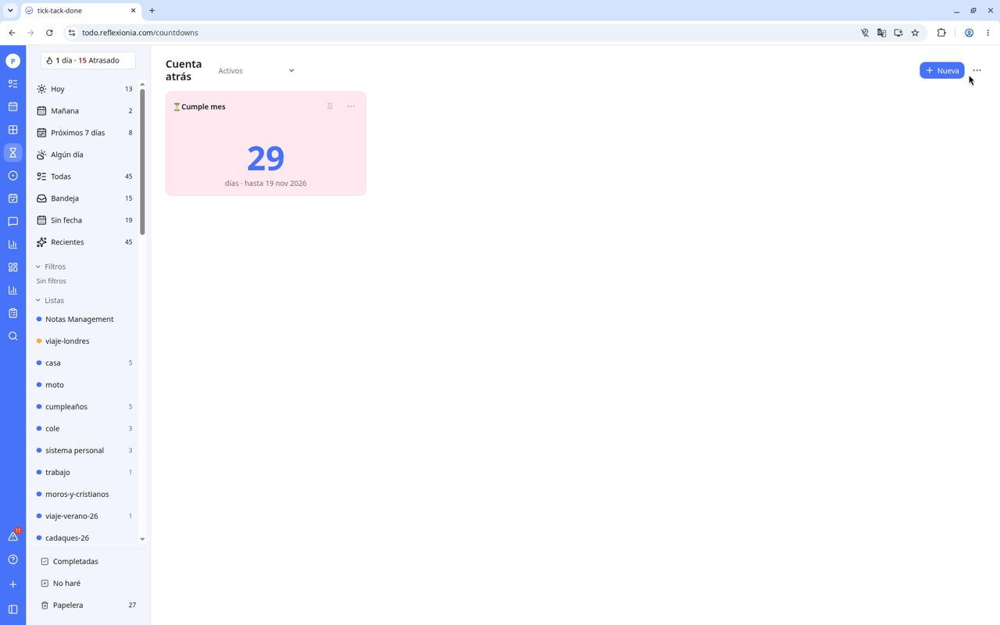 (recorrido del 21/10/2026, 13:30: el título «Cuenta atrás» sigue partido)

**Causa en el código**

- Título (confianza Alta): `<h1>` dentro de un flex sin `nowrap` ni `flex-shrink:0` (`web/features/countdowns/CountdownsPage.tsx:86-87` y `countdowns.css:1-17`).
- Emoji (confianza Media): está dentro de `.countdown-title`, que limita a 2 líneas con `overflow:hidden` (`CountdownCard.tsx:30-33` y `countdowns.css:139-146`).

**Propuesta de corrección:** añadir `white-space:nowrap` al h1 y sacar el emoji del bloque recortado.

**Criterio de aceptación:** el título ocupa una línea en escritorio y el emoji se ve completo.

**Referencia TickTick:** Cabecera de Cuenta atrás en una línea. Ver REF-TICKTICK_30.

#### TTD-AUD-22 — Modo oscuro: las tarjetas de cuenta atrás son ilegibles

- **Severidad:** Alta
- **Estado:** Abierto
- **Depende de:** —
- **Pantalla/URL:** `/countdowns` con el tema oscuro

**Resultado actual:** texto blanco sobre fondo rosa pastel. «Cumple mes» y «días · hasta 19 nov 2026» no se pueden leer.

**Evidencia:** 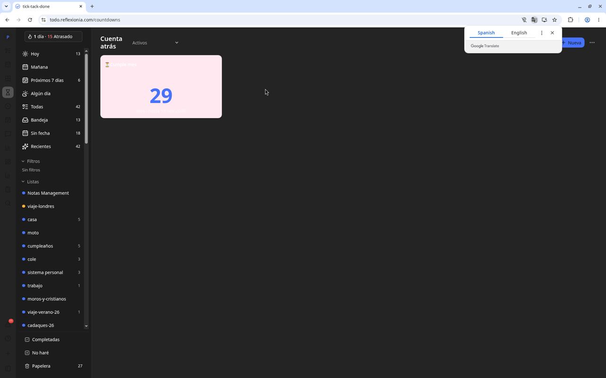

**Causa en el código (confianza Alta)**

- Los colores de las tarjetas son pasteles fijos, sin variante oscura: `web/features/countdowns/countdowns.css:99-134`.
- En el tema oscuro, `--ink` es `#fff` (`web/styles/tokens.css:114-115`).

**Propuesta de corrección:** definir tokens `--countdown-<color>-bg/-ink` en `tokens.css`, con variante `[data-theme='dark']`, o usar `color-mix` sobre `--surface`.

**Criterio de aceptación:** el contraste es de al menos 4,5:1 (WCAG AA) en todas las variantes de color y en ambos temas.

#### TTD-AUD-23 — Modal «Nueva cuenta atrás» mal maquetado

- **Severidad:** Alta
- **Estado:** Abierto
- **Depende de:** —
- **Pantalla/URL:** `/countdowns` → «Nueva» → tipo

**Resultado actual**

- Los checkboxes y radios aparecen centrados encima de su texto («Recordatorios», «Modo de cálculo», «Mostrar el día D en Hoy»).
- Los selects son nativos.
- El campo de fecha muestra «mm/dd/yyyy» aunque la interfaz esté en español.
- El modal es cuadrado.

**Evidencia**

- 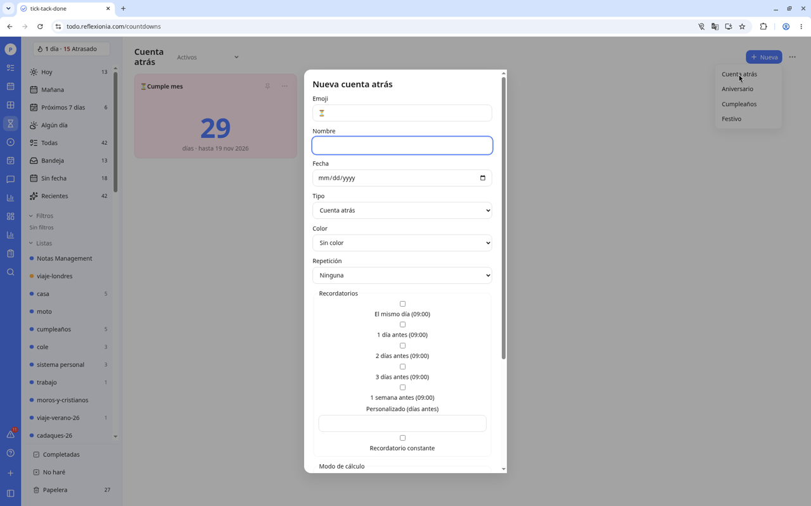
- 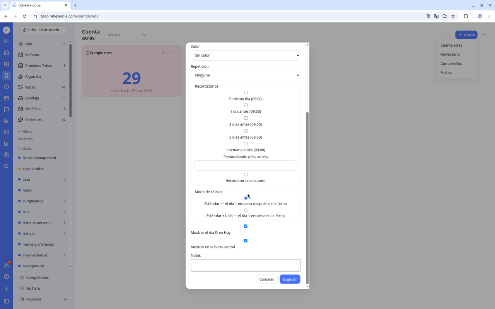

**Causa en el código**

- Maquetación (confianza Alta): `.countdown-dialog label { display:grid }` apila el input y el texto (`countdowns.css:178-182`). Los checkboxes sueltos de `CountdownDialog.tsx:240-260` no están dentro de un `fieldset`, así que no reciben el `display:flex` de `countdowns.css:186-189`.
- Formato de fecha (confianza Media): `<input type="date">` (`CountdownDialog.tsx:112`) muestra el formato del navegador, no el `lang="es"` de la página. En el navegador de la auditoría se vio «mm/dd/yyyy».
- Selects (confianza Alta): son nativos (`:122`, `:137`, `:158`).

**Propuesta de corrección**

- Añadir `.countdown-dialog label:has(input[type=checkbox], input[type=radio]) { display:flex; align-items:center; gap }`.
- Usar el `DatePopover` de la app o un campo con el formato del idioma.
- Usar los estilos de select de `ui.css`.

**Criterio de aceptación:** cada casilla queda alineada a la izquierda de su texto, la fecha sale en formato dd/mm/aaaa en español y el modal sigue el estilo de los demás.

#### TTD-AUD-24 — El menú «Nueva» de cuentas atrás no se cierra

- **Severidad:** Media
- **Estado:** Abierto
- **Depende de:** —
- **Pantalla/URL:** `/countdowns`

**Resultado actual**

- El desplegable «Nueva» sigue abierto después de guardar.
- No responde a Escape.
- Puede quedar abierto a la vez que el menú «…» de una tarjeta.

**Evidencia**

- 
- 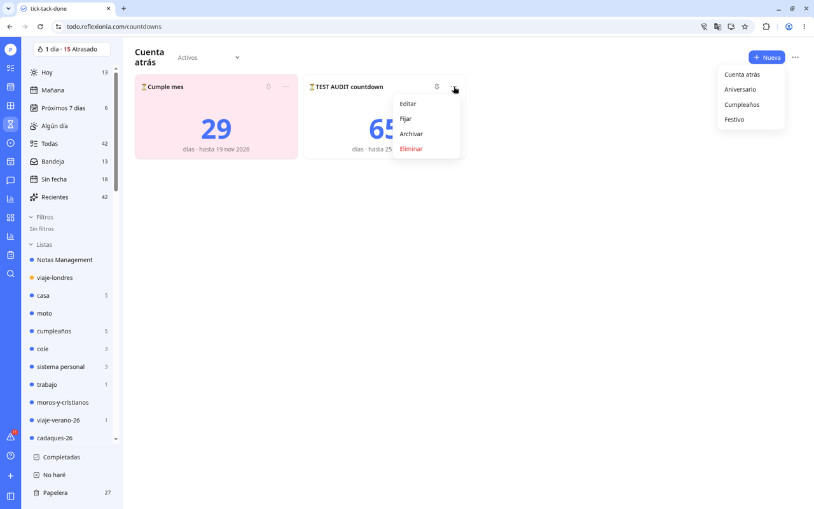

**Causa en el código (confianza Alta)**

- Es un `<details>` nativo que nadie cierra: `CountdownsPage.tsx:101-117`. Las tarjetas también usan `<details>` (`CountdownCard.tsx:44-45`).
- Además, el botón «Agrupar por tipo» usa el icono «…» (`MoreHorizontal`, `CountdownsPage.tsx:119-130`), lo que confunde.

**Propuesta de corrección:** usar el componente `Popover` de la app, que gestiona Escape, el clic fuera y el cierre al elegir. Cambiar el icono de agrupar.

**Criterio de aceptación:** el menú se cierra al elegir una opción, con Escape y al hacer clic fuera, y solo puede haber un menú abierto a la vez.

---

### Área 7 — Tema y estilos

#### TTD-AUD-25 — Modo oscuro: contraste insuficiente en la barra de iconos, el elemento activo y el selector de tema

- **Severidad:** Media
- **Estado:** Abierto
- **Depende de:** —
- **Pantalla/URL:** barra de iconos, barra lateral y `/settings/appearance` con el tema oscuro

**Resultado actual**

- Los iconos de la barra de iconos son gris oscuro sobre casi negro.
- El elemento activo («Hoy») es blanco sobre gris claro.
- El conmutador «Oscuro» es azul sobre azul.
- El select de la matriz es blanco y nativo.

**Evidencia**

- 
- 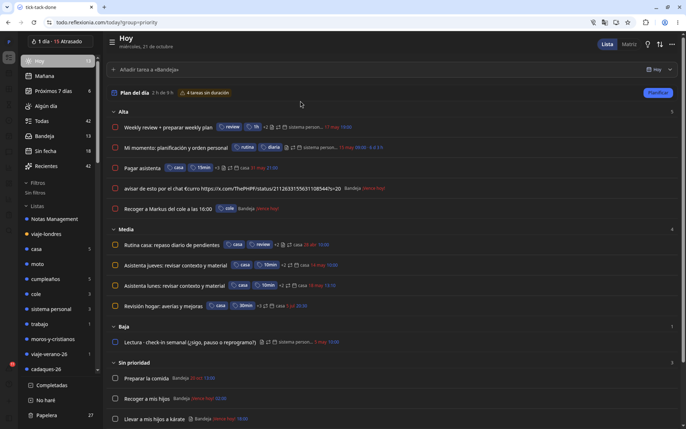
- 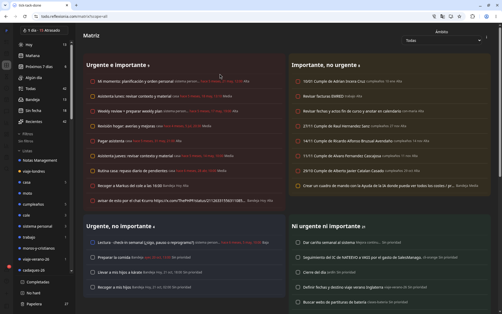

**Causa en el código**

- Elemento activo (confianza Alta): `.sidebar .nav-link.is-active { background: rgb(255 255 255 / 0.62); color: var(--ink) }`, con color fijo (`web/shell/shell.css:236-240`). También hay un hover fijo en `:232-234`. En oscuro, `--ink` es blanco.
- Barra de iconos (confianza Media): `--rail-bg` es igual que `--bg` (#242424) en el tema oscuro (`tokens.css:105-107`).
- Conmutador (confianza Media): usa `--accent-soft`/`--accent-ink` en `ui.css:1634-1639`.

**Propuesta de corrección:** pasar los colores fijos a tokens con variante oscura y revisar el contraste de `--accent-ink` sobre `--accent-soft`.

**Criterio de aceptación:** contraste AA en los elementos activos, al pasar el ratón y en los iconos, en ambos temas.

#### TTD-AUD-26 — El botón de login usa un color fijo y no el acento

- **Severidad:** Baja
- **Estado:** Abierto
- **Depende de:** —
- **Pantalla/URL:** `/login` y `/register`

**Causa en el código (confianza Alta):** `background: #4772fa` en lugar de `var(--accent)` (`web/features/auth/auth.css:72`), mientras que el hover sí usa `var(--accent-hover)`. Otros colores fijos que deberían salir de tokens:

- color por defecto de listas y etiquetas: `Sidebar.tsx:360` y `:548`, `TagPicker.tsx:100`;
- paletas duplicadas: `Sidebar.tsx:47`, `TagActions.tsx:31-38`, `Places.tsx:77-82`.

**Propuesta de corrección:** usar tokens en todos estos puntos.

**Criterio de aceptación:** con un acento distinto del índigo, el botón de login usa ese acento.

---

### Área 8 — Idioma (i18n)

#### TTD-AUD-27 — Textos sin traducir en modo inglés

- **Severidad:** Media
- **Estado:** Abierto
- **Depende de:** —
- **Pantalla/URL:** `/today`, `/countdowns`, `/ticky`, el Panel y la pantalla de error

**Resultado actual (EN)**

- En `/today` se ve «¡Vence hoy!».
- Todo `/countdowns` está en español: «Cuenta atrás», «Activos», «Archivados», «Nueva», «Agrupar por tipo», «Cargando cuentas atrás…».

**Evidencia:** 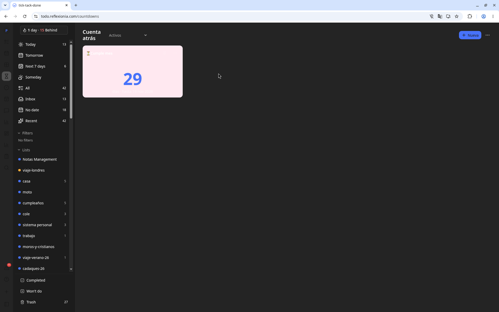

**Causa en el código (confianza Alta): textos fijos en el código**

- **Hoy:** `web/features/today/TaskGroup.tsx:280-286` («¡Vence hoy!», «Vence mañana», «Vence en N días») y `TodayPage.tsx:645` y `:742`.
- **Cuentas atrás:**
  - `CountdownsPage.tsx:87-158`;
  - `CountdownDialog.tsx` (13 líneas, entre ellas `:74`, `:214`, `:218`, `:248` y `:258`);
  - `CountdownCard.tsx:38`, `:45` y `:73`;
  - `presentation.ts:5-21`.
- **Ticky:**
  - `TickyPage.tsx:163-321`;
  - `ProposalReview.tsx:78-133`;
  - `TickySettings.tsx:32-194`;
  - `TickyRoutines.tsx:121-277`;
  - `ticky/api.ts:180-244`, con errores mostrados en español.
- **Otros:**
  - `dashboard/ProjectContext.tsx:14`;
  - `shell/ErrorBoundary.tsx:21` y `:28`.
- **Estadísticas:** `ControlSummary.tsx:193-206` traduce frases españolas de la API con expresiones regulares, que se rompen si cambia el texto del servidor.

**Propuesta de corrección**

- Mover todo a `i18n/` (o a los ficheros de textos de cada módulo).
- Hacer que la API devuelva códigos en vez de frases.
- Ampliar `i18n/keys.spec.ts` con una comprobación que impida textos visibles fijos en JSX (lint o test).

**Criterio de aceptación:** recorriendo la app en inglés no aparece ningún texto en español.

---

### Área 9 — Robustez (hallazgos del código)

#### TTD-AUD-28 — ~70 acciones fallan en silencio

- **Severidad:** Alta
- **Estado:** Corregido en main, pendiente de verificar en producción — [PR #66](https://github.com/povedica/tick-tack-done/pull/66) (`df481a9`)
- **Depende de:** —
- **Pantalla/URL:** transversal

**Descripción**

- Hay unas 70 llamadas del tipo `void api.x().then(fn)` sin gestión del error y sin `.catch`, y no existe un manejador global de `unhandledrejection`.
- Si la API falla, el usuario no recibe ningún aviso y la interfaz no cambia.

**Ejemplos (confianza Alta)**

- **Hoy:** `web/features/today/TodayPage.tsx:390` (editar), `:394` (mover a la papelera) y `:396` (deshacer).
- **Detalle de tarea:** `web/features/tasks/TaskDetail.tsx:521-540` (checklist y subtareas).
- **Lista de tareas:** `TaskList.tsx:195` (borrado en bloque) y `:304` (eliminar de la papelera).
- **Barra lateral:** `web/shell/Sidebar.tsx:443`, `:819`, `:843`, `:857` y `:872` (mover, renombrar, cambiar color, archivar y borrar listas).
- **Cerrar sesión:** `web/shell/AccountMenu.tsx:69` y `Sidebar.tsx:719`.
- **Foco, calendario e integraciones:** `ProductPages.tsx:114-532`. Por ejemplo, `connectGoogle` (`:403`) no hace nada si la URL no es de Google.
- **Ajustes:** `MoreSettings.tsx:103`, `:140`, `:270`, `:300` y `:338`; `InboundEmailCard.tsx:43` y `:84`; `FeaturesPage.tsx:123`.

**Propuesta de corrección**

- Crear un helper `runAction(promise, {success, error})` que muestre un aviso (`action-toast`) en caso de error, y usarlo en todas esas llamadas.
- Añadir una regla de ESLint que prohíba `.then` sin manejador de rechazo.

**Criterio de aceptación**

- Simulando un 500 en cada endpoint aparece un aviso de error y la interfaz vuelve a su estado anterior.
- Lint no admite llamadas nuevas sin gestión del error.

> **Para Codex:** este hallazgo ya está corregido en `main`. No lo reimplementes: ejecuta sus tests, comprueba los criterios de aceptación (en producción, si es posible) y anota el resultado en `docs/audit/ESTADO.md`.

#### TTD-AUD-29 — No hay gestión de sesión caducada (401)

- **Severidad:** Alta
- **Estado:** Abierto
- **Depende de:** —

**Descripción (confianza Alta)**

- Ni `web/api.ts` ni `packages/sdk/src` gestionan una respuesta 401.
- La sesión solo se comprueba al arrancar (`web/features/auth/RequireSession.tsx:20-27`). Además, cualquier error en esa comprobación, sea de red o un 5xx, marca la sesión como anónima (`:24-25`).
- Si la cookie caduca mientras se usa la app, todo falla sin aviso (ver TTD-AUD-28).

**Propuesta de corrección**

- Interceptar los 401 en el SDK y redirigir a `/login?next=<ruta>`.
- En el arranque, distinguir un 401 de un error de red y ofrecer reintentar.

**Criterio de aceptación**

- Al caducar la sesión, la siguiente acción lleva al login y, tras entrar, se vuelve a la misma ruta.
- Sin red, la app no te desconecta.

#### TTD-AUD-30 — Un único ErrorBoundary global y solo en español

- **Severidad:** Media
- **Estado:** Abierto
- **Depende de:** —

**Descripción (confianza Alta)**

- `ScreenBoundary` envuelve toda la app (`web/main.tsx:42-44`), aunque su comentario dice que «evita que una pantalla rota tumbe toda la app».
- Un error de render sustituye la app entera (sin barra lateral) por un texto solo en español (`web/shell/ErrorBoundary.tsx:21` y `:28`).
- No se reinicia al navegar.

**Propuesta de corrección:** colocar un boundary por ruta dentro de `AppShell`, reiniciarlo al cambiar de `location.pathname`, traducir los textos y registrar el error.

**Criterio de aceptación:** un error en una pantalla mantiene visibles la barra lateral y la navegación, y al cambiar de ruta la app se recupera.

#### TTD-AUD-31 — Pantallas sin estado de carga o de error

- **Severidad:** Media
- **Estado:** Abierto
- **Depende de:** —

**Descripción (confianza Alta)**

- `ProductPages.tsx` tiene 10 consultas sin estado de carga ni de error:
  - Foco: `:42-54`;
  - ajustes de Calendario: `:188-190`;
  - Integraciones: `:393-398`. Si falla la consulta, la píldora muestra «desconectado» igualmente (`:433-439`).
- Sin estado de error: `matrix/MatrixBoard.tsx:107-129` (un error parece una matriz vacía), `views/components/FiltersPage.tsx:29-30`, `settings/FeaturesPage.tsx`, `settings/WorkdaySettings.tsx:18`, `views/components/CommandPalette.tsx` y `shell/IconRail.tsx`.

**Propuesta de corrección:** usar en todas un patrón común: esqueleto mientras carga, `EmptyState` si no hay datos y alerta con «Reintentar» si hay error.

**Criterio de aceptación:** con la API caída, cada pantalla muestra un error y la opción de reintentar, y nunca datos falsos.

---

### Área 10 — Pulido

#### TTD-AUD-32 — Detalles: «1 tareas», confirm() nativo, «Comprobando la sesión…» sin estilo

- **Severidad:** Baja
- **Estado:** Abierto
- **Depende de:** —

**Resultado actual**

- La cabecera dice «1 tareas».
- Al borrar una cuenta atrás aparece el `confirm()` nativo del navegador («¿Eliminar «TEST AUDIT countdown»?»).
- Al cargar una URL directamente se ve «Comprobando la sesión…» sin estilo durante varios segundos.
- Las filas de la barra lateral muestran «0 días · — Sin datos» mientras cargan.

**Evidencia**

- 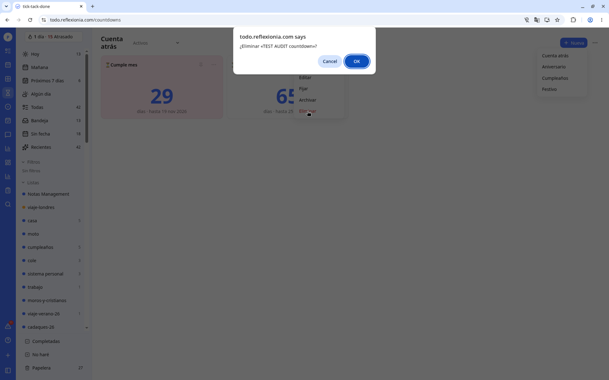
- 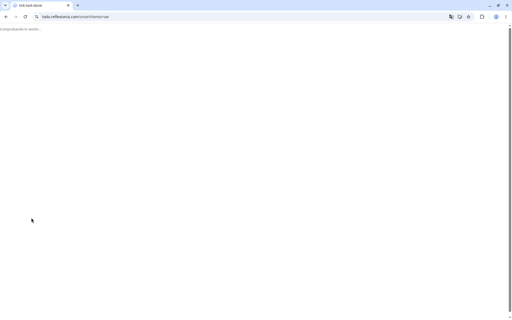

**Causa en el código (confianza Alta)**

- No se distingue el plural: `ViewPages.tsx:231` con `taskCount: '{count} tareas'` (`i18n/extra.ts:64`).
- `window.confirm` se usa en `CountdownsPage.tsx:71`, en hábitos (`HabitsPage.tsx:67`, `HabitDetailPage.tsx:121` y `:262`, `HabitCard.tsx:106`) y en planificación (`PlanDayPage.tsx:167`, `WeeklyPages.tsx:238`).
- El texto de carga de la sesión es un `<p className="ui-muted">` sin maquetación: `RequireSession.tsx` (alrededor de la línea 37) y `AuthPages.tsx:39`.

**Propuesta de corrección:** usar `Intl.PluralRules`, un diálogo de confirmación propio y una pantalla de carga con el logotipo.

**Criterio de aceptación:** dice «1 tarea», no se usa ningún `confirm()` nativo y la pantalla de carga está maquetada.

#### TTD-AUD-33 — Menú «Más» móvil: cajón con scroll interno que corta entradas y muestra Ticky inactivo

- **Severidad:** Media (antes Baja, «no confirmado»; ahora confirmado en el recorrido de navegador)
- **Estado:** Abierto
- **Depende de:** 63
- **Pantalla/URL:** cualquier pantalla en móvil → «Más» en la barra inferior
- **Elemento:** cajón lateral (`Sidebar` con `mobileSection='more'`)

**Pasos para reproducir**

1. En móvil, pulsa «Más» en la barra inferior.

**Resultado esperado**

- Una hoja inferior (o un cajón) con todos los módulos visibles sin scroll anidado, Ajustes y Cerrar sesión.
- Solo aparecen los módulos activos.

**Resultado actual**

- Se abre un cajón izquierdo de la mitad del ancho. El grupo «Más» tiene su propio scroll interno y corta «Cuenta atrás» por abajo.
- Aparece Ticky aunque está inactivo.
- La píldora «Atrasado» y la franja superior siguen visibles por encima del velo.
- En la primera pasada (solo DOM) se vieron destinos extraños («Funciones» → `/settings/automations`, «Tokens y MCP» → `/tag/…`). Probablemente eran listas o etiquetas del usuario con esos nombres; hay que comprobarlo en un dispositivo real.

**Evidencia** (zoom del navegador al 400 %, no emulación de dispositivo)

- 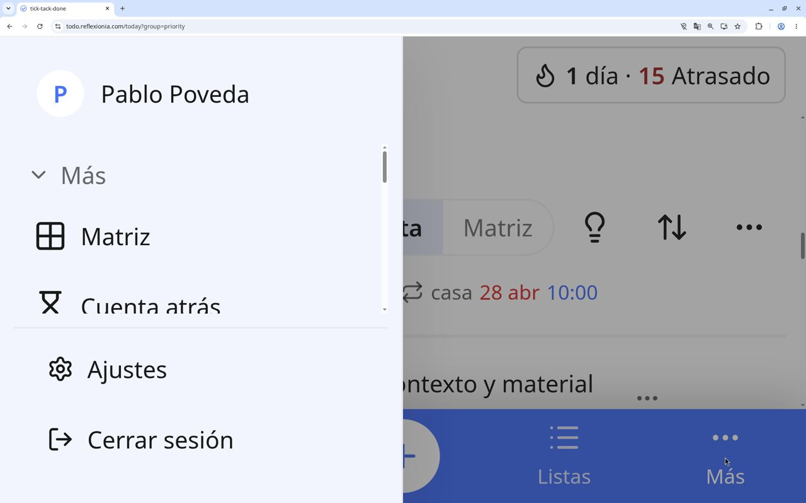

**Causa en el código (confianza Media)**

- La sección `mobile-more` está dentro de `<nav>`, con `overflow-y: auto` (`web/shell/shell.css:104-110`), y el `NavGroup` plegable añade otra altura limitada.
- Los módulos se filtran con `moduleEnabled`, que no filtra Ticky (TTD-AUD-63) (`web/shell/Sidebar.tsx:217-241`).
- El velo (`.scrim`, `z-index: 25`) queda por debajo de `.mobile-control-bar`.

**Propuesta de corrección**

1. En móvil, «Más» como hoja inferior con una rejilla de módulos (iconos y nombre), sin scroll anidado, más Ajustes y Cerrar sesión.
2. Filtrar con `moduleEnabled` corregido.
3. Poner el velo por encima de toda la interfaz salvo la hoja.

**Criterios de aceptación**

- A 390×844, «Más» muestra todos los módulos activos sin scroll interno.
- Ticky no aparece si está inactivo.
- Nada queda por encima del velo.

#### TTD-AUD-34 — 4 errores en la consola en el login (no analizados)

- **Severidad:** Baja
- **Estado:** Abierto
- **Depende de:** —
- **Pantalla/URL:** `/login`

**Resultado actual:** la consola del navegador mostró 4 errores. No se leyeron. **No confirmado.**

**Criterio de aceptación:** el login carga sin errores en la consola.

---

### Área 11 — Tokens, MCP e integraciones

Revisión de `/settings/tokens` («Tokens y MCP»), `/oauth/consent`, `/settings/integrations` y `/settings/webhooks`, hecha a partir de la propuesta de otro agente («Especificación funcional y de UI: Tokens, MCP e Integraciones», v2) y de sus tres bocetos. Todo se ha verificado leyendo el código en el commit `36f9209`. Lo que necesita navegador está en «Pendiente de comprobar en navegador», en el anexo C («Valoración de la propuesta»). El veredicto completo, propuesta por propuesta, está en `revision-propuesta-tokens-mcp.md`.

**Contexto técnico necesario para leer los hallazgos**

- Los tokens manuales y los _access tokens_ OAuth (ChatGPT, Claude…) se guardan en la misma tabla `PersonalAccessToken`. Los de OAuth se distinguen solo por `oauthClientId` (`schema.prisma:785-786`).
- Un _access token_ OAuth caduca a la hora (`api/auth/oauth.service.ts:49`). En cada renovación se revoca el anterior y se crea una fila nueva con el mismo nombre (`oauth.service.ts:369-390`). Un cliente activo genera, por tanto, hasta unas 24 filas revocadas al día.
- La revocación de una fila OAuth revoca en cascada toda su familia de _refresh_ (`api/auth/tokens.service.ts:128-158` y `api/auth/oauth-refresh.ts:43-65`), dentro de una transacción. Esto funciona bien.

#### TTD-AUD-35 — La lista de tokens solo carga 50 filas y las renovaciones OAuth la llenan: los tokens antiguos desaparecen

- **Severidad:** Alta
- **Estado:** Corregido en main, pendiente de verificar en producción — [PR #63](https://github.com/povedica/tick-tack-done/pull/63) (`5e445f9`)
- **Depende de:** —
- **Pantalla/URL:** `/settings/tokens` y `/tokens`
- **Elemento:** lista de tokens y plegable «Revocados (N)»

**Pasos para reproducir**

1. Conectar ChatGPT (u otro cliente OAuth) y usarlo durante uno o dos días.
2. Abrir «Tokens y MCP».

**Resultado esperado:** se ven todos los tokens activos y el número de revocados es el real.

**Resultado actual (deducido del código)**

- La pantalla pide una sola página: `tokensApi.listTokens()` sin cursor (`web/features/tokens/components/TokensPage.tsx:113`). El servidor devuelve 50 filas por defecto (`api/http/cursor.ts:15-18`), ordenadas por fecha de creación descendente (`tokens.service.ts:50-66`). `next_cursor` se ignora y no hay «Cargar más».
- Cada renovación OAuth crea una fila nueva y revoca la anterior (`oauth.service.ts:369-390`). En unas 48 horas de uso, las 50 primeras filas son casi todas renovaciones de ChatGPT.
- Consecuencias:
  - un token manual creado antes **deja de aparecer** aunque siga activo;
  - «Revocados (N)» (`TokensPage.tsx:448-453`) cuenta solo lo que hay en la página y mezcla rotaciones automáticas con revocaciones hechas por el usuario.
- La cifra «Revocados (24)» del boceto coincide con lo que produce un día de renovaciones horarias.

**Evidencia:** código (sin captura). El número real de filas en producción está pendiente de comprobar (ver la lista de pendientes).

**Causa en el código (confianza Alta en la lógica, Media en el impacto real):** `TokensPage.tsx:113`, `tokens.service.ts:43-67`, `http/cursor.ts:15-18` y `oauth.service.ts:369-390`.

**Propuesta de corrección**

- **API:**
  - añadir a `GET /me/tokens` un filtro `status=active|revoked`;
  - devolver un motivo de revocación (`revoked_reason: user | rotated | reuse`) o, como mínimo, excluir de «Revocados» las filas revocadas por rotación (las que tienen un _refresh_ con `rotatedAt`);
  - devolver el total de revocados calculado en el servidor.
- **UI:** paginar con `next_cursor` («Cargar más») en activos y revocados.

**Criterios de aceptación**

- Con más de 50 filas, todos los tokens activos siguen visibles.
- «Revocados» no incluye las rotaciones automáticas, o las agrupa en una línea («ChatGPT · 23 renovaciones»).
- El número entre paréntesis coincide con el de la base de datos.

> **Para Codex:** este hallazgo ya está corregido en `main`. No lo reimplementes: ejecuta sus tests, comprueba los criterios de aceptación (en producción, si es posible) y anota el resultado en `docs/audit/ESTADO.md`.

#### TTD-AUD-36 — Los tokens caducados aparecen como «Activo»

- **Severidad:** Media
- **Estado:** Abierto
- **Depende de:** 35
- **Pantalla/URL:** `/settings/tokens`
- **Elemento:** indicador de estado de la fila

**Resultado esperado:** un token caducado se marca como «Caducado» y no cuenta como activo.

**Resultado actual**

- El estado depende solo de `revoked_at` (`TokensPage.tsx:343-356`).
- `TokenDto` no incluye `expires_at` (`tokens.service.ts:280-291`), aunque la columna existe (`schema.prisma:784`) y la guarda ya rechaza los tokens caducados (`api/auth/api-auth.guard.ts:149-155`).
- Todo _access token_ OAuth caduca a la hora. Si el cliente deja de renovarlo (por ejemplo, porque se desconectó), la fila sigue saliendo como «Activo» para siempre.

**Causa en el código (confianza Alta):** `tokens.service.ts:280-291` y `TokensPage.tsx:345`.

**Propuesta de corrección:** exponer `expires_at` en `TokenDto` y mostrar «Caducado» (indicador neutro). Mantener «Revocar» en los caducados, porque pueden tener un _refresh_ vivo.

**Criterio de aceptación:** un _access token_ OAuth sin renovar se ve como «Caducado» a la hora de emitirse. Un token sin caducidad sigue «Activo».

#### TTD-AUD-37 — Volver a autorizar una aplicación OAuth puede fallar por el nombre único del token

- **Severidad:** Alta
- **Estado:** Corregido en main, pendiente de verificar en producción — [PR #62](https://github.com/povedica/tick-tack-done/pull/62) (`d7612c1`)
- **Depende de:** —
- **Pantalla/URL:** flujo OAuth (`/oauth/authorize` → `/oauth/consent` → `/oauth/token`)
- **Elemento:** emisión del _access token_

**Pasos para reproducir (no ejecutados; requieren un cliente real)**

1. Conectar ChatGPT.
2. Antes de que se revoque el _access token_ actual (o con uno caducado y sin revocar), volver a conectar ChatGPT desde la propia aplicación.

El mismo fallo debería darse si:

- existe un token manual llamado «ChatGPT»;
- o se conectan dos clientes que no declaran nombre y no redirigen a chatgpt.com, porque ambos reciben el nombre «OAuth».

**Resultado esperado:** la segunda autorización funciona.

**Resultado actual (deducido del código)**

- Hay un índice único parcial sobre `(owner_id, name)` para tokens no revocados. No tiene en cuenta la caducidad ni distingue los tokens OAuth (`prisma/migrations/20261018084502_personal_access_token_active_name/migration.sql:2-4`).
- `issueOauthAccess` intenta resolver el conflicto reintentando con «ChatGPT-1», «ChatGPT-2»… (`tokens.service.ts:180-217`). Lo hace **dentro de la misma transacción** que el canje del código (`oauth.service.ts:293-310` y `:430-436`).
- En PostgreSQL, después de un error de unicidad la transacción queda abortada, así que los reintentos no pueden funcionar. El usuario vería un error al conectar.
- El nombre lo pone el servidor cuando el cliente no lo declara: «ChatGPT» si la URL de vuelta es de chatgpt.com y «OAuth» en el resto de casos (`oauth.service.ts:659-665`).

**Causa en el código (confianza Media: la lógica es clara, pero no se ha reproducido):** el índice citado más `tokens.service.ts:180-217`.

**Propuesta de corrección**

- Excluir los tokens OAuth del índice único (`WHERE oauth_client_id IS NULL`). También valdría elegir el nombre libre antes del `INSERT` o usar un `SAVEPOINT` por intento.
- Al emitir un acceso nuevo para el mismo par usuario+cliente, revocar el anterior si ya ha caducado.

**Criterios de aceptación**

- Autorizar dos veces seguidas el mismo cliente funciona.
- Con un token manual llamado «ChatGPT», la conexión de ChatGPT funciona.
- Hay un test de integración que cubre ambos casos.

> **Para Codex:** este hallazgo ya está corregido en `main`. No lo reimplementes: ejecuta sus tests, comprueba los criterios de aceptación (en producción, si es posible) y anota el resultado en `docs/audit/ESTADO.md`.

#### TTD-AUD-38 — La actividad del token no se entiende y está incompleta

- **Severidad:** Media
- **Estado:** Abierto
- **Depende de:** 35
- **Pantalla/URL:** `/settings/tokens` → «Actividad»
- **Elemento:** lista `.token-activity`

**Resultado actual**

- **Peticiones:** cada entrada se pinta como «Acceso · Petición · hora» (`TokensPage.tsx:432-444`). Se descarta lo que la API ya devuelve en `changes`: método, ruta y resultado (`allowed`, `scope_missing` o `rate_limited`) (`api/auth/token-audit.ts:12-34`). Un 403 por falta de permiso o un 429 parecen idénticos a un acceso correcto.
- **Ciclo de vida OAuth:** se guarda con `entity_type = 'oauth_token'` y acciones `created`, `updated` o `deleted` (`token-audit.ts:37-58`). `entityLabel` no conoce `oauth_token` (`TokensPage.tsx:626-636`), así que se ve «Eliminado · oauth_token» en lugar de «Token revocado» o «Reutilización detectada».
- **Paginación y estados:** sin paginación (se ignora `next_cursor`, `tokens.service.ts:269-276`), sin estado de carga y sin estado de error. Solo existe el caso «vacío» (`TokensPage.tsx:428-431`).
- **Efecto de las renovaciones:** en las aplicaciones OAuth, la actividad de una fila cubre como mucho una hora, porque el _access token_ cambia cada hora. La historia queda repartida entre filas revocadas.

**Causa en el código (confianza Alta):** las líneas citadas.

**Propuesta de corrección**

- **Solo frontend:**
  - pintar «MÉTODO ruta» y el resultado («Permitida», «Sin permiso», «Límite»);
  - traducir las entradas del ciclo de vida («Token emitido», «renovado», «revocado», «Reutilización detectada» en color de peligro);
  - añadir esqueleto, error con «Reintentar» y «Cargar más».
- **Con cambio de API:** para ver la actividad de una aplicación entera, añadir un filtro por cliente, p. ej. `GET /me/activity?client_id=`.

**Criterios de aceptación**

- Una petición rechazada por permisos se ve como «Sin permiso» con su ruta.
- Ninguna entrada muestra identificadores internos (`oauth_token`, `http_request`).
- La lista pagina.

#### TTD-AUD-39 — Los errores al revocar no se ven y los de crear son genéricos

- **Severidad:** Media
- **Estado:** Abierto
- **Depende de:** 35
- **Pantalla/URL:** `/settings/tokens`

**Resultado actual**

- **Al revocar:** el error de `revoke` guarda «No se ha podido guardar el token.» (`TokensPage.tsx:147-156`, `i18n/es.ts:155`). Ese mensaje solo se pinta dentro del formulario de creación (`TokensPage.tsx:323`). Con el formulario cerrado, que es lo normal al revocar, **no aparece nada**: la banda de confirmación sigue abierta y el botón vuelve a su estado normal.
- **Al crear:** el 409 `token_name_taken` (`tokens.service.ts:117-123`) se muestra con el mismo texto genérico (`TokensPage.tsx:143-145`), sin decir que el nombre ya existe.
- La confirmación cita `token.name` (`TokensPage.tsx:401`), mientras que el título de la fila usa `client_name ?? name` (`:351`). En las filas OAuth pueden no coincidir (por ejemplo, «ChatGPT-1»).

**Relación:** distinto de TTD-AUD-28. Aquí sí hay gestión del error, pero el mensaje se pinta donde no se ve.

**Propuesta de corrección**

- Mostrar el error dentro de la banda de confirmación (`role="alert"`) con «No se ha podido revocar. Inténtalo de nuevo.».
- Mapear el 409 a «Ya tienes un token activo con ese nombre» junto al campo y llevar el foco a él.

**Criterio de aceptación:** simulando un 500 al revocar, aparece el error en la propia fila. Un nombre repetido muestra el mensaje específico.

#### TTD-AUD-40 — El secreto recién creado: el lector de pantalla lo lee en voz alta y se pierde sin aviso

- **Severidad:** Media
- **Estado:** Abierto
- **Depende de:** 35
- **Pantalla/URL:** `/settings/tokens` → crear token
- **Elemento:** banda `.token-secret`

**Resultado actual**

- La banda tiene `role="status"` e incluye el propio secreto (`TokensPage.tsx:238-240`). Un lector de pantalla lo anuncia en voz alta automáticamente.
- La banda desaparece sin aviso si se pulsa «Actividad» en cualquier fila (`setSecret(null)` en `:381`) o si se revoca cualquier token (`:151`). El secreto se pierde y no se puede volver a ver.

**Causa en el código (confianza Alta):** las líneas citadas.

**Propuesta de corrección**

- Anunciar solo «Token creado. Se muestra una sola vez.» en una región `aria-live` separada.
- Poner el secreto en un campo de solo lectura.
- Que la banda solo se cierre con una acción explícita, confirmando si no se ha copiado.

**Criterio de aceptación**

- Con un lector de pantalla no se lee el secreto.
- Abrir la actividad o revocar otro token no borra la banda.

#### TTD-AUD-41 — Permisos: «Gestionar» aparece como «Escritura», falta «Cuenta atrás» y los permisos sensibles no se marcan

- **Severidad:** Media
- **Estado:** Abierto
- **Depende de:** 35
- **Pantalla/URL:** `/settings/tokens` (formulario y tabla de permisos de cada fila)

**Resultado actual**

- **«Gestionar» como «Escritura»:** `groupedScopes` trata `manage` igual que `write` (`TokensPage.tsx:536`). `webhooks:manage` y `automations:manage` se muestran como «Escritura» en la tabla, aunque en el formulario se llaman «Gestionar» (`:83-89`).
- **Falta «Cuenta atrás»:** el formulario no ofrece el grupo, aunque `countdowns:read` y `countdowns:write` existen (`api/auth/scopes.ts:21-22`). Un token para un agente que gestione cuentas atrás no se puede crear desde la UI.
- **Permisos sensibles sin marca:** `webhooks:manage`, `automations:manage` y `profile:write` no se distinguen visualmente.

**Causa en el código (confianza Alta):** `TokensPage.tsx:22-107` y `:522-561`.

**Propuesta de corrección**

- Añadir un nivel «Gestionar» en `groupedScopes`.
- Añadir el grupo «Cuenta atrás» (lectura y escritura).
- Marcar los permisos sensibles con ⚠ y un texto alternativo.
- Sacar `groupedScopes` a una utilidad compartida con la pantalla de consentimiento.

**Criterios de aceptación**

- `webhooks:manage` se lee como «Gestionar».
- Se puede crear un token con `countdowns:write`.
- Los tres permisos sensibles llevan la marca.
- Hay un test unitario del agrupado.

#### TTD-AUD-42 — Consentimiento OAuth: permisos sensibles marcados por defecto, etiquetas en crudo y pantalla sin estilo

- **Severidad:** Alta
- **Estado:** Corregido en main, pendiente de verificar en producción — [PR #64](https://github.com/povedica/tick-tack-done/pull/64) (`da6a4e7`)
- **Depende de:** —
- **Pantalla/URL:** `/oauth/consent`

**Resultado actual**

- **Sensibles por defecto:** todos los permisos pedidos llegan ya marcados (`web/features/auth/ConsentPage.tsx:63-64`). Si el cliente no pide `scope`, el servidor le ofrece por defecto también `webhooks:manage` y `automations:manage` (`api/auth/scopes.ts:70-92`, `OAUTH_DEFAULT_SCOPES`). No hay ninguna advertencia de permiso sensible.
- **Etiquetas en crudo:** los permisos que no están en `SCOPE_LABEL` se muestran con su identificador (`ConsentPage.tsx:13-37` y `:121`). Por ejemplo `countdowns:write`, `tasks:create`, `ticky:proposals:write` o `notifications:self:write`.
- **Scopes internos anunciados:** el descubrimiento OAuth anuncia a cualquier cliente todos los `API_SCOPES`, incluidos los internos (`api/auth/oauth-discovery.controller.ts:66` y `:87`). Un cliente externo puede pedirlos y aparecen en el consentimiento.
- **Sin estilo de la app:** botones `<button>` nativos (`ConsentPage.tsx:126-142`), `main.today` y casillas sueltas (`:93-125`). La página va dentro del `AppShell` (`web/app.tsx:182`).
- **Sin estados:** no hay estado de carga, y «Permitir» y «Denegar» no se bloquean mientras se envía la decisión.
- **Idioma:** se toma de `navigator.language` (`ConsentPage.tsx:40`), no del idioma elegido por el usuario.

**Causa en el código (confianza Alta):** las líneas citadas.

**Propuesta de corrección**

- Desmarcar por defecto los permisos sensibles, o al menos marcarlos con ⚠.
- Quitar `webhooks:manage` y `automations:manage` de `OAUTH_DEFAULT_SCOPES`.
- Excluir `ticky:*` y `notifications:self:write` de `scopes_supported` y de lo que se puede conceder a clientes externos.
- Usar `Button` y la utilidad de permisos compartida; añadir estados de carga y de envío.
- Usar el idioma del usuario.
- Mantener intacto el techo de `grantApprovedScopes` (`api/auth/oauth-grants.ts:34-58`).

**Criterios de aceptación**

- Un cliente que no pide `scope` no recibe permisos sensibles sin que el usuario los marque a mano.
- Ningún permiso aparece con su identificador interno.
- La pantalla usa los componentes y tokens visuales de la app, en claro y oscuro.

> **Para Codex:** este hallazgo ya está corregido en `main`. No lo reimplementes: ejecuta sus tests, comprueba los criterios de aceptación (en producción, si es posible) y anota el resultado en `docs/audit/ESTADO.md`.

#### TTD-AUD-43 — Google: el aviso «Vuelve a conectar» lleva a una pantalla sin botón de reconexión, y «Desconectar» en Drive desconecta todo Google

- **Severidad:** Alta
- **Estado:** Corregido en main, pendiente de verificar en producción — [PR #65](https://github.com/povedica/tick-tack-done/pull/65) (`11a4138`)
- **Depende de:** 47
- **Pantalla/URL:** `/settings/calendar` (tarjeta de calendarios de Google) → `/settings/integrations`

**Pasos para reproducir**

1. Tener Google conectado sin el permiso de Calendar.
2. En Calendario aparece «Vuelve a conectar Google desde Ajustes > Integraciones».
3. Seguir el enlace.

**Resultado esperado:** en Integraciones hay un botón «Reconectar Google».

**Resultado actual**

- Google cuenta como «conectado» si hay un _refresh token_ (`api/modules/integrations/integrations.controller.ts:212`).
- Con Google conectado, la pantalla solo ofrece «Desconectar» (`ProductPages.tsx:442-460`). No hay reconexión: hay que desconectar y volver a conectar.
- El enlace sale de `GoogleCalendarsCard.tsx:79-83`.
- «Desconectar» en la fila Drive llama a `disconnectGoogle` (`ProductPages.tsx:486-496`). Desconecta también Calendar, sin confirmación y sin decirlo.
- La nota `?google=connected` o `?google=error` no se limpia de la URL (`ProductPages.tsx:392` y `:420-425`). Al recargar, se vuelve a mostrar.

**Relación:** los fallos silenciosos de estas llamadas ya están en TTD-AUD-28. La falta de estado de carga y error, en TTD-AUD-31. Aquí se añade el flujo que no se puede completar.

**Propuesta de corrección**

- Mostrar «Reconectar» (que llame a `googleConnect`) cuando Google está conectado. Si es posible, mostrar el estado «Necesita atención» cuando falte el permiso de Calendar.
- Pedir confirmación en «Desconectar» indicando la consecuencia: «También se desconectará Drive y el calendario».
- Limpiar el parámetro de la URL después de mostrar la nota.

**Criterios de aceptación**

- Desde el aviso de Calendario se puede reconectar Google en dos clics.
- Desconectar desde Drive avisa de que afecta a todo Google.

> **Para Codex:** este hallazgo ya está corregido en `main`. No lo reimplementes: ejecuta sus tests, comprueba los criterios de aceptación (en producción, si es posible) y anota el resultado en `docs/audit/ESTADO.md`.

#### TTD-AUD-44 — Telegram y Correo a tarea: estados provisionales y una regeneración sin confirmación que invalida la dirección

- **Severidad:** Media
- **Estado:** Abierto
- **Depende de:** —
- **Pantalla/URL:** `/settings/integrations`

**Resultado actual**

- **Telegram:** mientras carga, la descripción dice «Próximamente» y aparece un botón «Próximamente» desactivado (`ProductPages.tsx:506` y `:539-543`). Después cambia a «Conectada». El botón «Próximamente» se muestra también cuando Telegram está configurado pero no vinculado: no hay forma de vincularlo desde aquí.
- **Correo a tarea:**
  - mientras carga, aparece el texto de «sin dirección» (`InboundEmailCard.tsx:34-36`);
  - si la consulta falla, la píldora dice «Estado: Parada» (`:24-28`);
  - «Regenerar» sustituye la dirección al momento (`api/auth/me.service.ts:283-289`) **sin pedir confirmación** (`InboundEmailCard.tsx:39-49`). Solo «Revocar» la pide (`:65-95`). La dirección antigua deja de crear tareas sin aviso.

**Corrección a la propuesta:** la propuesta dice que «Regenerar dirección mantiene confirmación inline». No es así hoy.

**Propuesta de corrección**

- No pintar ningún texto de estado hasta que la consulta haya respondido; usar un esqueleto mientras tanto.
- Ofrecer «Vincular» en Telegram cuando esté configurado.
- Pedir confirmación al regenerar con el texto de `inboundRevokeBody`.

**Criterios de aceptación**

- Al recargar, no se ve «Próximamente» ni «Parada» antes del estado real.
- Regenerar la dirección pide confirmación.

#### TTD-AUD-45 — Webhooks y feeds de calendario: rotar el secreto sin confirmación y textos reutilizados

- **Severidad:** Baja
- **Estado:** Abierto
- **Depende de:** —
- **Pantalla/URL:** `/settings/webhooks` y `/settings/calendar`

**Resultado actual**

- **Rotar secreto:** «Rotar secreto» invalida el anterior sin confirmación (`MoreSettings.tsx:294-305`).
- **Banda compartida:** el secreto nuevo se muestra en la misma banda que el de creación, arriba del todo y lejos de la fila (`:214-234`).
- **Errores fuera de sitio:** el error de «Probar» se pinta en el formulario de creación (`:283-290`).
- **Sin estado de carga:** la lista no tiene estado de carga.
- **Etiqueta reutilizada:** en los feeds de calendario, el botón para copiar la URL dice «Copiar secreto» (`ProductPages.tsx:268`, reutiliza `webhookCopySecret`).

**Relación:** que pausar y rotar fallen en silencio ya está en TTD-AUD-28 (`MoreSettings.tsx:270` y `:300`).

**Propuesta de corrección**

- Confirmación inline al rotar el secreto.
- Mostrar el secreto y los errores en la fila afectada.
- Usar un texto propio, «Copiar URL», en los feeds.

**Criterio de aceptación:** rotar pide confirmación y el resultado aparece en la propia fila. El botón del feed dice «Copiar URL».

#### TTD-AUD-46 — «Revocados» se muestra como una lista sin estilo y sin el nombre de la aplicación

- **Severidad:** Baja
- **Estado:** Abierto
- **Depende de:** 35
- **Pantalla/URL:** `/settings/tokens` → «Revocados (N)»

**Resultado actual**

- `.token-revoked` no tiene ninguna regla CSS: es un `<details>` con viñetas nativas (`TokensPage.tsx:448-466`).
- Muestra `token.name`, no el cliente.
- No distingue «revocado por mí» de «renovado automáticamente» (ver TTD-AUD-35).

**Propuesta de corrección:** una tabla compacta con nombre, origen («Manual» u «OAuth · cliente») y fecha. Mostrar 10 filas y «Ver todos».

**Criterio de aceptación:** el bloque usa los estilos de lista de la app, en claro y oscuro.

#### TTD-AUD-47 — Google bloquea la conexión a cualquier usuario que no sea tester («Acceso bloqueado… Error 403: access_denied»)

- **Severidad:** Alta (bloquea Google para cualquier usuario nuevo)
- **Estado:** Abierto
- **Depende de:** —
- **Pantalla/URL:** `/settings/integrations` → «Conectar Google» → pantalla de Google
- **Elemento:** conexión OAuth con Google (Calendar y Drive). **ttd no tiene inicio de sesión con Google:** el acceso a la app es con correo y contraseña (`api/auth/auth.controller.ts:42` y `:59`). Lo que falla es la integración, no el acceso a la app.

**Pasos para reproducir**

1. Con una cuenta de Google que no sea la de Pablo (caso real: rmoya87@gmail.com), entrar en Ajustes → Integraciones.
2. Pulsar «Conectar Google».

**Resultado esperado:** Google muestra la pantalla de consentimiento con el nombre de la app y, al aceptar, se vuelve a ttd con Google conectado.

**Resultado actual**

- Google muestra: «Acceso bloqueado: reflexionia.com no ha completado el proceso de verificación de Google. En estos momentos, la app se está probando y solo pueden acceder a ella los testers aprobados por el desarrollador… Error 403: access_denied».
- A Pablo le funciona.

**Evidencia:** 

**Causa (confianza Alta en el código; Media en la configuración de Google Cloud, que no se ha visto)**

- **Permisos que pide la app:** `openid`, `email`, `https://www.googleapis.com/auth/calendar` y `https://www.googleapis.com/auth/drive.file`, todos de golpe en la misma petición (`api/modules/integrations/google-oauth.ts:18-23` y `:73-83`, con `access_type=offline` y `prompt=consent`). Se piden desde `GET /api/v1/integrations/google/start` (`integrations.controller.ts:240-261`), y es el mismo botón en Google y en Drive (`web/features/product/ProductPages.tsx:400-408`).
- **Clasificación según Google** (documentación consultada el 21/10/2026):
  - `openid` y `email` son básicos: no requieren verificación.
  - `drive.file` es **no sensible** (el recomendado para Drive).
  - `calendar` es **sensible**: acceso completo a todos los calendarios. Google pone como ejemplo de permiso sensible «leer eventos de Google Calendar».
  - Ninguno de los cuatro es **restringido**, así que hoy **no hace falta la evaluación de seguridad CASA**. Haría falta si se pasara a `drive` o `drive.readonly`.
- **Modo «Testing» del proyecto de Google Cloud:** el mensaje es el que muestra Google cuando la pantalla de consentimiento está publicada en modo «Testing» con tipo de usuario «External»:
  - solo pueden autorizar los usuarios añadidos como testers, con un máximo de 100;
  - la excepción de «solo `openid`/`email`/`profile`» no aplica, porque se pide Calendar;
  - además, en ese modo **las autorizaciones y los _refresh tokens_ caducan a los 7 días**. Por tanto, también la conexión de Pablo se cae cada semana y aparece como error de sincronización. Eso enlaza con el callejón sin salida de TTD-AUD-43.
- **Fuentes:** https://developers.google.com/identity/protocols/oauth2/production-readiness/overview · https://support.google.com/cloud/answer/10311615 · https://developers.google.com/identity/protocols/oauth2/production-readiness/sensitive-scope-verification · https://developers.google.com/workspace/guides/configure-oauth-consent
- **Gestión del rechazo:** cuando Google bloquea así, se queda en su propia pantalla y **no vuelve a ttd**. El usuario no tiene ninguna salida desde la app. Si el usuario cancela en la pantalla de consentimiento, Google sí vuelve con `?error=access_denied`. En ese caso:
  - el _callback_ ignora el parámetro `error` y redirige a `?google=error` solo porque falta `code` (`integrations.controller.ts:277-281`);
  - la app muestra un genérico «Google no ha completado la conexión.» (`i18n/extra.ts:245`) sin explicar el motivo ni ofrecer qué hacer.
- **Falta de página de privacidad:** `https://todo.reflexionia.com/privacy` devuelve la SPA (200, que acaba en `/today`), así que ttd no tiene política de privacidad publicada. Es un requisito de la verificación.

**Propuesta de corrección**

1. **Solución provisional (inmediata, en Google Cloud Console → Google Auth Platform → Audience):** añadir como _test users_ las cuentas que tengan que probar (por ejemplo rmoya87@gmail.com). Máximo 100. Hay que avisarles de que verán un aviso de app en pruebas y de que tendrán que reconectar cada 7 días.
2. **Pasar a producción:** cambiar el _publishing status_ a «In production» y solicitar la **verificación de marca y de permisos sensibles** (Calendar). Requisitos:
   - página de inicio pública de la app en un dominio verificado en Google Search Console (`reflexionia.com` / `todo.reflexionia.com`);
   - **política de privacidad** publicada en ese dominio, enlazada desde la página de inicio, que explique qué datos de Google se usan y para qué (cumpliendo la _Google API Services User Data Policy_, incluida la «Limited Use»); también términos de servicio;
   - nombre, logotipo y correo de soporte coherentes con la marca, y dominios autorizados;
   - justificación escrita de cada permiso sensible (por qué Calendar: leer la lista de calendarios y los eventos, y crear o modificar eventos de tareas en el calendario principal);
   - **vídeo de demostración** (YouTube, sin listar) con el flujo completo: consentimiento en inglés, mostrando el `client_id` en la URL, y el uso real de cada permiso dentro de la app;
   - plazo orientativo: 3-5 días laborables para permisos sensibles. **CASA no es necesaria** mientras no se pidan permisos restringidos.
   - Mientras no esté verificada pero ya publicada, cualquier usuario puede entrar, pero ve la advertencia de «app no verificada» y hay un límite de 100 usuarios.
3. **Mitigaciones en el código**
   - **Permisos mínimos:** sustituir `calendar` por los más estrechos que cubren el uso real:
     - `calendar.calendarlist.readonly` (lista de calendarios, `api/integrations/google-calendar.ts:44`);
     - `calendar.events` (leer y escribir eventos: `api/modules/calendar/calendar.service.ts:268-279` y `:579`).

     Siguen siendo sensibles, pero se justifican mejor. Hay que actualizar también la comprobación `tokenHasCalendarScope`, que exige exactamente `calendar` (`google-calendar.ts:15` y `:107-123`).

   - **Autorización incremental:** pedir solo `openid email` al conectar la cuenta, y Calendar o Drive cuando el usuario active cada función, con `include_granted_scopes=true`. Drive con `drive.file` no requiere verificación.
   - **Error amable:** leer `error` y `error_description` en el _callback_ y redirigir con `?google=denied` (o similar). Mostrar un texto claro, por ejemplo: «Google ha rechazado la conexión. Si ves "Acceso bloqueado", la app aún está en revisión por Google: pide al administrador que te añada como tester.». Ofrecer «Reintentar» y limpiar el parámetro de la URL (ver TTD-AUD-43).
   - **Caducidad semanal:** detectar `invalid_grant` al renovar y mostrar «Google desconectado: vuelve a conectar», con el botón de reconexión de TTD-AUD-43.

**Relación:** la reconexión y la desconexión de Drive son TTD-AUD-43. Aquí se trata el bloqueo de Google y la gestión del rechazo.

**Criterios de aceptación**

- Una cuenta de Google cualquiera (no tester) puede conectar Google sin «Acceso bloqueado». Con la app ya verificada, sin la advertencia de «app no verificada».
- La conexión de un usuario sigue funcionando más de 7 días.
- Si el usuario cancela o Google rechaza, ttd muestra un mensaje específico y la opción de reintentar.
- La pantalla de consentimiento de Google muestra el nombre y el logotipo de la app y solo los permisos necesarios.
- `https://todo.reflexionia.com` (o el dominio verificado) publica la política de privacidad.

### Área 12 — MCP: paridad con la app

Fuente: un usuario externo (Ramón, de VASS) que usa el MCP en `/api/v1/mcp`. Ha hecho dos tandas de reportes; la segunda viene con su orden de prioridad, que se usa como orden de implementación (ver «Hoja de ruta» al final del área).

- **Base de la verificación:** código en el commit `d7612c1` (`git pull` del 21/10/2026, 13:00 hora de Madrid), en solo lectura. Las herramientas están en `api/mcp/mcp.catalog.ts` y su ejecución en `api/mcp/mcp.service.ts`.
- **Lista en vivo:** las herramientas y esquemas del MCP de producción (43 herramientas, consultadas en solo lectura y sin escrituras) coinciden con el catálogo.
- **Tarea de prueba:** «Prueba parser #Instinct» no aparece en la cuenta de Pablo (búsqueda en solo lectura). **No se ha borrado; lo hará Pablo.**

**Corrección a una afirmación anterior.** En la primera versión de esta área se dijo que `additionalProperties: false` (`mcp.catalog.ts:15-23`) hacía que se rechazaran los campos desconocidos. **No es así.**

- Ese `false` solo se publica en `tools/list` como orientación para el cliente.
- El servidor no valida los argumentos contra el esquema: `call()` pasa `params.arguments` tal cual a `run()` (`mcp.service.ts:130-150`), y cada herramienta lee a mano solo los campos que conoce.
- Un campo desconocido (`tag_ids`, `status`, `content`, `parent_id`…) se ignora en silencio y la llamada devuelve éxito. Ver TTD-AUD-54.

**Veredicto de lo reportado, en el orden de prioridad de Ramón**

| #   | Afirmación                                                                                              | Veredicto                                                               | Causa                                                                                                                                                                                                                                                                                                                                                                                                                             | Hallazgo                |
| --- | ------------------------------------------------------------------------------------------------------- | ----------------------------------------------------------------------- | --------------------------------------------------------------------------------------------------------------------------------------------------------------------------------------------------------------------------------------------------------------------------------------------------------------------------------------------------------------------------------------------------------------------------------- | ----------------------- |
| 1   | No se pueden asignar etiquetas (ni campo ni parser de `#`)                                              | Confirmado                                                              | `create_task` y `update_task` no tienen campo de etiquetas (`mcp.catalog.ts:104-186`) y no se pasa `raw_text` (`mcp.service.ts:177-230`)                                                                                                                                                                                                                                                                                          | TTD-AUD-48 y TTD-AUD-49 |
| 2   | No hay comentarios de tarea; la «actividad» es de solo lectura                                          | Confirmado                                                              | La API tiene `GET` y `POST /tasks/:id/comments` (`collaboration.controller.ts:215-260`), pero el MCP no                                                                                                                                                                                                                                                                                                                           | TTD-AUD-51              |
| 3   | Todo está «activo»; solo se puede completar: no se puede reabrir ni hay pendiente, en curso o cancelada | Parcial                                                                 | Los estados existen en la base de datos (`active`, `completed`, `archived` y `cancelled`, `schema.prisma:23-28`) y la API tiene `uncomplete` y `cancel` (`tasks.controller.ts:400-426`), pero el MCP solo tiene `complete_task` y `list_tasks` fuerza `status: 'active'` (`mcp.service.ts:162`). «Pendiente» y «en curso» no existen como estados; las columnas de tablero (`Column`, `schema.prisma:387`) pueden hacer ese papel | TTD-AUD-53              |
| 4   | No se puede borrar, enviar a la Papelera ni restaurar                                                   | Confirmado                                                              | `DELETE /tasks/:id` y `POST /trash/:id/restore` existen en la API (`tasks.controller.ts:370-379` y `:132-134`), pero no en el MCP                                                                                                                                                                                                                                                                                                 | TTD-AUD-50              |
| 5   | `get_task` devuelve la descripción, pero no se puede escribir; no hay adjuntos                          | Confirmado                                                              | No hay `content` en `create_task` ni en `update_task`. La API y la app tienen adjuntos (`POST /tasks/:id/attachments`, multipart, `tasks.controller.ts:512-530`)                                                                                                                                                                                                                                                                  | TTD-AUD-51              |
| 6   | Subtareas y checklist se pueden leer, pero no crear ni editar; no se puede mover una tarea de lista     | Confirmado                                                              | No hay `parent_id` ni herramientas de checklist; `update_task` no acepta `project_id`. La API tiene `POST /tasks/:id/items` (`:457`) y `POST /tasks/:id/move` (`:428-436`)                                                                                                                                                                                                                                                        | TTD-AUD-52              |
| 7   | Los campos desconocidos devuelven 200 y se ignoran (falsos positivos)                                   | Confirmado                                                              | No hay validación en el servidor (`mcp.service.ts:130-150`). Corrige lo dicho antes sobre `additionalProperties`                                                                                                                                                                                                                                                                                                                  | TTD-AUD-54              |
| 8   | `due_date: "2026-10-22"` se guarda como 00:00 UTC (02:00 en Madrid)                                     | Confirmado                                                              | `new Date("2026-10-22")` es medianoche UTC (`tasks.service.ts:2451-2461`); `is_all_day` es `false` por defecto (`:1542`)                                                                                                                                                                                                                                                                                                          | TTD-AUD-55              |
| 9   | `duration_minutes: 30` se guardó como 1200                                                              | Confirmado (mecanismo); los datos exactos de la llamada no se han visto | La duración explícita se descarta si hay inicio y fin a menos de 24 h (`packages/domain/src/tasks/duration.ts:22-27`)                                                                                                                                                                                                                                                                                                             | TTD-AUD-56              |
| 10  | Todas las tareas tienen el mismo `created_by`                                                           | Confirmado (mecanismo)                                                  | `createdById = user.id`, el dueño del token (`tasks.service.ts:1572`). Todo indica que Ramón usa un token o una autorización de la cuenta de Pablo                                                                                                                                                                                                                                                                                | TTD-AUD-57              |

#### TTD-AUD-48 — El MCP no permite etiquetar tareas al crearlas ni al editarlas (prioridad 1 de Ramón)

- **Severidad:** Alta. Es la primera prioridad del usuario externo: bloquea su flujo de asignación.
- **Estado:** Abierto
- **Depende de:** 54
- **Pantalla/URL:** MCP `/api/v1/mcp`, herramientas `create_task` y `update_task`

**Pasos para reproducir:** desde un cliente MCP, crear o actualizar una tarea e intentar asignarle una etiqueta.

**Resultado esperado:** se puede pasar `tag_ids` (o nombres de etiqueta) igual que en la app.

**Resultado actual**

- El esquema no tiene ningún campo de etiquetas.
- Si se envía `tag_ids` de todas formas, **el servidor lo ignora en silencio y responde con éxito** (ver TTD-AUD-54).
- `create_tag` existe, pero no hay forma de aplicar la etiqueta a una tarea.

**Causa en el código (confianza Alta):** `mcp.catalog.ts:104-133` y `:154-186`; `mcp.service.ts:177-193` y `:213-230`. La API REST ya admite `tag_ids` al crear y al actualizar (`tasks.dto.ts:160` y `:270`; `tasks.service.ts:375-376` y `:419-421`).

**Propuesta de corrección**

- Añadir a `create_task` y `update_task`:
  - `tag_ids` (lista de UUID);
  - `tags` (lista de nombres; los que no existan se crean, como en la entrada rápida);
  - en `update_task`, `add_tag_ids` y `remove_tag_ids`.
- Documentarlo en la descripción de la herramienta.

**Criterios de aceptación**

- `create_task` con `tags:["Instinct"]` crea la tarea con esa etiqueta, y `get_task` devuelve su `tag_ids`.
- `update_task` puede añadir y quitar etiquetas.
- Hay un test del MCP.

#### TTD-AUD-49 — El MCP no aplica el parser de entrada rápida y no tiene herramienta de captura (prioridad 1 de Ramón)

- **Severidad:** Alta
- **Estado:** Abierto
- **Depende de:** 54, 48
- **Pantalla/URL:** MCP, `create_task` y `update_task`

**Pasos para reproducir:** `create_task` con `title: "Prueba parser #Instinct"`.

**Resultado esperado:** igual que en la caja de captura de la app: título «Prueba parser», etiqueta «Instinct» y fechas, horas, rangos, lista y prioridad interpretados.

**Resultado actual**

- El título se guarda literal y `tag_ids` queda vacío. Pasa al crear y al actualizar.
- Solo la caja de captura de la app interpreta el texto: envía `raw_text` y el servidor lo procesa (`web/features/tasks/TaskComposer.tsx:166`; `api/modules/tasks/tasks.service.ts:1470-1473`).

**Causa en el código (confianza Alta):**

- El MCP no pasa `raw_text` (`mcp.service.ts:177-193`).
- No existe ninguna herramienta de captura.
- `UpdateTaskDto` no tiene parser (`tasks.dto.ts:188-306`).

**Propuesta de corrección**

- **Nueva herramienta `quick_add`** (o `capture_task`) con `text` y `project_id` opcional. Llama a `tasks.create` con `raw_text`, reutilizando `resolveQuickAdd` y `parseQuickAdd` de `packages/domain` (`quick-add.ts:3-9` y `:45`).
- **Opción `parse: true` en `create_task`:** los campos explícitos tienen prioridad sobre lo interpretado, como ya documenta `raw_text` (`tasks.dto.ts:52-63`).
- **`parse: true` en `update_task`:** interpreta el nuevo `title` y aplica solo lo extraído.

**Criterios de aceptación**

- Con el mismo texto, `quick_add` y la caja de captura de la app producen la misma tarea.
- Test con «Prueba parser #Instinct mañana 09:00-09:30».
- `create_task` sin `parse` sigue guardando el título literal.

#### TTD-AUD-50 — El MCP no puede borrar tareas, enviarlas a la Papelera ni restaurarlas (prioridad 4 de Ramón)

- **Severidad:** Media
- **Estado:** Abierto
- **Depende de:** 54
- **Pantalla/URL:** MCP

**Resultado actual**

- No hay `delete_task`, ni `restore_task`, ni forma de listar la Papelera.
- Una tarea de prueba creada desde un cliente MCP se ha quedado activa. **No se ha borrado; lo hará Pablo.**

**Causa en el código (confianza Alta):**

- No está en el catálogo.
- La API tiene `DELETE /tasks/:id`, que es un borrado blando a la Papelera (`tasks.controller.ts:370-379`), y `POST /trash/:id/restore` (`:132-134`).
- Existe el scope fino `tasks:trash` (`api/auth/scopes.ts:13`).

**Propuesta de corrección**

- `delete_task`: mueve a la Papelera. Requiere `tasks:trash`, o `tasks:write` por compatibilidad.
- `restore_task`.
- Opcional: `list_trash`.
- No exponer el borrado definitivo.

**Criterios de aceptación**

- `delete_task` deja la tarea en la Papelera de la app y `restore_task` la devuelve.
- Un token sin el scope necesario no ve la herramienta.

#### TTD-AUD-51 — El MCP no tiene comentarios de tarea, no puede escribir la descripción y no tiene adjuntos (prioridades 2 y 5 de Ramón)

- **Severidad:** Media. Va en segundo lugar en la hoja de ruta.
- **Estado:** Abierto
- **Depende de:** 54
- **Pantalla/URL:** MCP

**Resultado actual**

- **Comentarios:** la app los muestra en el detalle de la tarea (`TaskDetail.tsx:82-85`) y la API los expone: `GET` y `POST /tasks/:id/comments`, con `tasks:read` y `tasks:write` (`collaboration.controller.ts:215-260`). El MCP no.
- **Actividad:** es de solo lectura y no sustituye a los comentarios.
- **Notas:** las del MCP (`list_notes`, `pin_sticky_note`) no están ligadas a ninguna tarea (`mcp.service.ts:411-425`).
- **Descripción:** `get_task` y `list_tasks` devuelven `content`, pero `create_task` y `update_task` no lo aceptan. Si se envía, se ignora en silencio (TTD-AUD-54).
- **Adjuntos:** la app y la API los soportan (`POST /tasks/:id/attachments`, multipart, `tasks.controller.ts:512-530`). El MCP no puede listarlos ni añadirlos.

**Causa en el código (confianza Alta):** las líneas citadas.

**Propuesta de corrección**

- `list_task_comments` (task_id, limit, cursor) y `add_task_comment` (task_id, body), reutilizando el servicio de colaboración.
- `content` en `create_task` y `update_task`.
- `list_task_attachments`. Para subir adjuntos, un `add_task_attachment` con URL o contenido en base64 limitado de tamaño, o un enlace de Drive (ya existe `POST /integrations/drive/attachments`, `integrations.controller.ts:340`).
- Explicar en las descripciones la diferencia entre comentario, descripción y nota.

**Criterios de aceptación**

- Un comentario añadido por MCP aparece en el detalle de la tarea en la app.
- `create_task` con `content` rellena la descripción.
- Los adjuntos de una tarea se pueden listar por MCP.

#### TTD-AUD-52 — Subtareas, checklist, mover entre listas y otras diferencias entre la app y el MCP (prioridad 6 de Ramón)

- **Severidad:** Media
- **Estado:** Abierto
- **Depende de:** 54
- **Pantalla/URL:** MCP (lista de herramientas en producción y `mcp.catalog.ts`)

**Diferencias detectadas (confianza Alta)**

- **Mover entre listas:** `update_task` no acepta `project_id`. La API tiene `POST /tasks/:id/move` (`tasks.controller.ts:428-436`).
- **Subtareas y checklist:** se pueden leer (`get_task` y `search` devuelven `checklist` y `checklist_progress`), pero no crear ni editar. `create_task` no acepta `parent_id` (la API sí, `tasks.dto.ts:35`). No hay herramientas de checklist (la API tiene `POST /tasks/:id/items` y `POST /tasks/:id/items/:itemId/complete`, `tasks.controller.ts:457` y `:499`).
- **Recordatorios:** no se pueden crear ni quitar. La API tiene `/tasks/:id/reminders` con el scope `reminders:write` (`tasks.controller.ts:304-352`).
- **Hora de fin y rango:** solo hay `start_date`, `due_date` y `duration_minutes`, y no se documenta cómo expresar «09:00-09:30». Ver TTD-AUD-55 y TTD-AUD-56.
- **Filtros:** `list_tasks` no filtra por etiqueta, fecha, prioridad ni estado, y fuerza `active` (`mcp.service.ts:162`).
- **`search` sin límite ni paginación:** una búsqueda de prueba devolvió todas las coincidencias, incluidas las completadas.
- **Listas y etiquetas:** no se pueden renombrar ni borrar.
- **Duplicar tarea:** la app puede (`tasks.controller.ts:442-456`); el MCP no.
- **Descripciones:** no explican formatos ni la semántica de fechas y duración.

**Propuesta de corrección**

- Añadir:
  1. `move_task`, o `project_id` en `update_task`;
  2. `parent_id` en `create_task`;
  3. `add_checklist_item`, `update_checklist_item` y `toggle_checklist_item`;
  4. filtros en `list_tasks` (`tag_id`, `from`, `to`, `status`);
  5. `limit` y `cursor` en `search`;
  6. recordatorios.
- Mantener una tabla de paridad entre la app y el MCP con un test que falle si un campo de `CreateTaskDto` o `UpdateTaskDto` no está en el MCP sin una exclusión explícita.

**Criterios de aceptación**

- Se puede crear una subtarea y un elemento de checklist, y mover una tarea a otra lista por MCP.
- Las descripciones explican cada campo.

#### TTD-AUD-53 — El MCP no puede reabrir ni cancelar tareas; los estados de flujo no existen (prioridad 3 de Ramón)

- **Severidad:** Media
- **Estado:** Abierto
- **Depende de:** 54
- **Pantalla/URL:** MCP; detalle de tarea en la app

**Resultado actual**

- **Estados existentes:** `active`, `completed`, `archived` y `cancelled` (`api/prisma/schema.prisma:23-28`; `packages/domain/src/review/propose.ts:13`).
- **En la app:** se puede reabrir (`web/features/tasks/TaskDetail.tsx:244` y `:538`) y cancelar (`:806`). La API tiene `POST /tasks/:id/uncomplete` y `POST /tasks/:id/cancel` (`tasks.controller.ts:400-426`).
- **En el MCP:** solo hay `complete_task`, y `list_tasks` siempre devuelve activas (`mcp.service.ts:162`). Un `status` en `update_task` se ignora en silencio (TTD-AUD-54).
- **«Pendiente» y «en curso»:** no existen como estados. Lo más parecido son las columnas de tablero por lista (`Column`, `schema.prisma:387`; `column_id` en la tarea).

**Causa en el código (confianza Alta):** el catálogo no expone `uncomplete`, `cancel` ni el filtro de estado.

**Propuesta de corrección**

- **Mínimo:** `reopen_task` (llama a `uncomplete`) y `cancel_task`; filtro `status` en `list_tasks` (`active`, `completed`, `cancelled`).
- **Flujo «en curso / pendiente»:** es una **decisión de producto**. Hay dos opciones:
  - (a) reutilizar las columnas de tablero y exponer `column_id` y `list_columns` en el MCP;
  - (b) añadir un campo `workflow_state` independiente de `status`, para no romper la lógica de completadas, estadísticas y recurrencia.

  Se recomienda (a) para empezar.

**Criterios de aceptación**

- Una tarea completada por MCP se puede reabrir por MCP.
- `list_tasks` con `status: "completed"` la devuelve.
- La decisión sobre los estados de flujo queda documentada.

#### TTD-AUD-54 — El MCP acepta campos desconocidos o mal formados, los ignora y responde con éxito

- **Severidad:** Alta (falsos positivos: el agente cree que ha guardado algo que no se ha guardado)
- **Estado:** Abierto
- **Depende de:** —
- **Pantalla/URL:** MCP, todas las herramientas

**Pasos para reproducir:** `update_task` con `{id, tag_ids:[…], status:"completed", content:"x", parent_id:"…"}`.

**Resultado esperado:** un error que liste los campos no admitidos.

**Resultado actual**

- La respuesta es de éxito (`isError: false`), con la tarea sin esos cambios.
- Los valores con tipo incorrecto también se descartan en silencio. Por ejemplo, `priority: "urgent"` o `duration_minutes: "30"`: `taskSchedule()` solo copia lo que reconoce (`mcp.service.ts:835-864`).

**Causa en el código (confianza Alta)**

- El esquema publicado declara `additionalProperties: false` (`mcp.catalog.ts:15-23`), pero el servidor no lo aplica.
- `call()` no valida `arguments` contra `inputSchema` (`mcp.service.ts:130-150`) y cada herramienta lee a mano solo sus campos.
- No hay ningún validador de esquemas (ajv, zod…) en el camino del MCP.

**Corrección a lo dicho antes:** la primera versión de este documento afirmaba que se rechazaban los campos extra. Era incorrecto.

**Propuesta de corrección**

- Validar `arguments` contra `tool.inputSchema` con un validador JSON Schema (por ejemplo, ajv con `allErrors` y sin eliminar campos) antes de `run()`.
- Ante un error, devolver un resultado de herramienta con `isError: true` y un mensaje claro: «Campos no admitidos: tag_ids, status. Campos válidos: …», más los errores de tipo y rango.
- Añadir un test por herramienta.

**Criterios de aceptación**

- Cualquier campo no declarado o con tipo incorrecto produce `isError: true`, con la lista de campos, y no modifica nada.
- Las llamadas válidas siguen funcionando.

#### TTD-AUD-55 — Por MCP, una fecha sin hora se guarda como 00:00 UTC (02:00 en Madrid) y no como el día local

- **Severidad:** Alta (datos incorrectos)
- **Estado:** Abierto
- **Depende de:** —
- **Pantalla/URL:** MCP, `create_task` y `update_task` (`due_date` y `start_date`)

**Pasos para reproducir:** `create_task` con `due_date: "2026-10-22"`, con la zona horaria del usuario en Europe/Madrid.

**Resultado esperado:** tarea de todo el día para el 22 de octubre en la zona del usuario (o un error claro si el formato no se admite).

**Resultado actual**

- Se guarda `2026-10-22T00:00:00Z`, que son las 02:00 del 22 en Madrid, con `is_all_day: false`. En la app aparece como una tarea con hora.
- Si además se envía `is_all_day: true`, la API **rechaza** la tarea con «an all-day task cannot include a clock time». En la zona del usuario esa medianoche UTC son las 02:00, no las 00:00.

**Causa en el código (confianza Alta)**

- El MCP pasa la cadena sin tocarla (`mcp.service.ts:845-850`).
- El servicio la convierte con `new Date(value)` (`tasks.service.ts:2451-2461`). En JavaScript, una fecha ISO sin hora se interpreta como medianoche **UTC**.
- `is_all_day` es `false` por defecto (`tasks.service.ts:1542`).
- `allDayClockConflict` exige las 00:00 en la zona de la tarea (`packages/domain/src/reminders/delivery.ts:93-106`, llamado desde `tasks.service.ts:2319-2327`).
- La zona horaria del usuario existe (`users.time_zone`, por defecto Europe/Madrid, `schema.prisma:227`) y se usa como zona de la tarea (`tasks.service.ts:1514`), pero no se aplica al interpretar la fecha.
- La app no tiene este problema: el parser y los selectores envían instantes con zona.

**Propuesta de corrección**

- En la API (para que también lo resuelvan REST y otros clientes): si `due_date` o `start_date` llegan como `YYYY-MM-DD`, interpretarlos como medianoche local en la `time_zone` de la tarea o del usuario y poner `is_all_day: true`, salvo que se indique lo contrario.
- Rechazar con un error claro las fechas con hora pero sin zona («2026-10-22T09:00»), o interpretarlas en la zona del usuario, pero documentándolo.
- En las descripciones del MCP, documentar: «`due_date`: `YYYY-MM-DD` = todo el día en tu zona; `YYYY-MM-DDTHH:mm±hh:mm` = con hora».

**Criterios de aceptación**

- `due_date: "2026-10-22"` produce una tarea de todo el día el 22/10 en Europe/Madrid (`2026-10-21T22:00:00Z`, `is_all_day: true`), que en la app se ve en «Mañana» o en el día correcto.
- `is_all_day: true` con una fecha sin hora no da error.
- Hay tests en Europe/Madrid y en UTC.

#### TTD-AUD-56 — La duración enviada se sustituye por la diferencia entre inicio y fin (`duration_minutes: 30` → 1200)

- **Severidad:** Alta (datos incorrectos)
- **Estado:** Abierto
- **Depende de:** 55
- **Pantalla/URL:** MCP y API: `create_task` y `update_task`

**Pasos para reproducir (deducidos):** crear o actualizar una tarea con `start_date` y `due_date` separados menos de 24 h y `duration_minutes: 30`.

**Resultado esperado:** la duración es 30, o la API rechaza la combinación si es incoherente.

**Resultado actual:** se guarda la diferencia en minutos entre inicio y fin, en el caso de Ramón 1200 (20 h). El valor enviado se pierde sin aviso.

**Causa en el código (confianza Alta en el mecanismo)**

- `deriveDurationMinutes` (`packages/domain/src/tasks/duration.ts:6-28`) devuelve `explicit` solo si falta el inicio o el fin, o si la diferencia supera las 24 h (`:11-13` y `:24-26`).
- En cualquier otro caso **devuelve la diferencia e ignora la duración explícita** (`:22-27`).
- Se llama desde `tasks.service.ts:1560-1564` (crear), `:361-365` (actualizar) y `:2477-2491`.
- **Hipótesis más probable sobre los datos de Ramón** (confianza Media: no se ha visto la llamada exacta, porque la tarea está en otra cuenta): un inicio en medianoche UTC por una fecha sin hora (TTD-AUD-55), p. ej. `start_date: "2026-10-22"` → `00:00Z`, y un fin a las 20:00 UTC (`due_date: "2026-10-22T22:00:00+02:00"` o `"…T20:00:00Z"`). 20:00 − 00:00 = 1200 min. Una actualización de solo `duration_minutes` sobre una tarea que ya tenga ese inicio y ese fin produce lo mismo, porque se recalcula con las fechas guardadas (`:361-365`).
- **Descartado:** una conversión de unidades. 1200 no es 30 × 60 = 1800 ni 30 / 60; en el MCP la duración se copia tal cual (`mcp.service.ts:852-854`).

**Propuesta de corrección**

- Regla explícita y documentada:
  - si llegan `duration_minutes` y `due_date` sin `start_date`, calcular el inicio como `due − duration` (o el fin como `start + duration`);
  - si llegan los tres y no cuadran, devolver `validation_failed` («duration_minutes no coincide con start_date/due_date»);
  - nunca descartar el valor explícito sin avisar.
- Corregir antes la interpretación de fechas (TTD-AUD-55).
- Pedir a Ramón la llamada exacta para añadirla como test de regresión.

**Criterios de aceptación**

- `create_task` con `due_date` y `duration_minutes: 30` guarda 30.
- Con los tres incoherentes, devuelve un error.
- La tarea de Ramón, reproducida, ya no da 1200.

#### TTD-AUD-57 — Autoría: todas las tareas tienen el mismo `created_by` y no se sabe quién ni qué agente las creó

- **Severidad:** Media
- **Estado:** Abierto
- **Depende de:** 54
- **Pantalla/URL:** MCP y app (tareas compartidas o asignadas)

**Resultado actual**

- Todas las tareas muestran el mismo `created_by`, el dueño de la cuenta. No se puede distinguir lo creado por Ramón de lo creado por Pablo.
- Las tareas creadas por MCP llevan `source: "manual"`, igual que las de la app.

**Causa en el código (confianza Alta en el mecanismo; Media en el escenario)**

- **Quién crea:** el MCP actúa como el usuario dueño del token o de la autorización OAuth (`actorOf`, `api/auth/auth-user.ts:23-30`). La tarea se crea con `ownerId` y `createdById = user.id` (`tasks.service.ts:1572`).
- **Origen:** `source` es `manual` por defecto (`:1468`); solo el correo a tarea usa `api` (`:278`).
- **Dónde queda el «vía»:** el registro de actividad sí guarda `tokenId` y `actorKind: "api"` (`schema.prisma:753-756`), pero la tarea no lo expone.
- **Escenario:** si Ramón ve el mismo `created_by` en todo y sus tareas aparecen junto a las de Pablo, **está usando un token o una autorización de la cuenta de Pablo**. Las tareas de Pablo tienen `created_by` `9ada8b49-e5dd-4e16-9afe-0239ef2afe88`; si las de Ramón también, se confirma.
- **Lo que ttd ya tiene:**
  - listas compartidas con miembros, que pueden ser usuarios o tokens (`ProjectMember`, `schema.prisma:1180-1198`; `POST /projects/:id/members`, `collaboration.controller.ts:97-145`);
  - asignación (`POST /tasks/:id/assignee`, `:277`, y `assignee_id` en la tarea);
  - comentarios con @menciones.

  Nada de esto se expone en el MCP.

**Propuesta de corrección (modelo recomendado para el flujo de asignación)**

1. **Una cuenta por persona:**
   - Ramón crea su propia cuenta de ttd y su propio token o conexión OAuth;
   - Pablo comparte con él las listas de trabajo (permiso de escritura);
   - nadie usa el token de otra persona.

   Con eso, `created_by` y la actividad ya identifican a la persona real. Hay que verificar que, al crear una tarea en una lista compartida ajena, `ownerId` sea el del dueño de la lista y `createdById` el del autor. Hoy ambos toman `user.id` (`tasks.service.ts:1548` y `:1572`), así que hay que revisarlo con un test.

2. **Registrar el «vía»:**
   - añadir a la tarea `created_via_token_id` (y el cliente OAuth) o, como mínimo, exponer en `get_task` el `actor_kind` y el `token_id` de la actividad de creación;
   - poner `source: "api"` (o `"mcp"`) en lo creado por el MCP.
3. **Asignación por MCP:**
   - `assign_task` (`assignee_id`) y `list_members`;
   - `assignee_id` en `create_task` y `update_task`;
   - filtro `assignee_id` en `list_tasks`.
4. **Auditoría:** en el detalle de la tarea, mostrar «Creada por {persona} vía {agente/cliente}».

**Criterios de aceptación**

- Con dos cuentas y una lista compartida, cada tarea muestra su autor real.
- Lo creado por MCP muestra «vía {token o cliente}».
- Se puede asignar una tarea a un miembro por MCP y filtrarla.

### Área 13 — Datos: historial de actividad

#### TTD-AUD-65 — El historial de actividad de una tarea guarda copias anidadas de sí mismo y crece de forma exponencial

- **Severidad:** Crítica
- **Pantalla/URL:** API `PATCH /api/v1/tasks/:id` (y cualquier operación que registre eventos de tarea), `GET /tasks/:id`, webhooks y MCP
- **Elemento:** `activity_log.changes` y `outbox_event.data/previous`
- **Estado:** Abierto
- **Depende de:** —

**Pasos para reproducir**

1. Crea una tarea y edítala dos veces (por ejemplo, por MCP: `update_task` con `priority`).
2. Lee la respuesta o `get_task`.

**Resultado esperado**

- Cada entrada de actividad guarda solo los campos cambiados (o una instantánea sin historial).

**Resultado actual**

- La entrada `updated` contiene `changes.data.task.activity` y `changes.previous.activity`, con la entrada `created` completa dentro.
- Cada edición incluye todas las anteriores, por duplicado.
- Observado el 21/10/2026 a las 13:59 (hora de Madrid) con la tarea de prueba `efb11814-…` en la lista `grokbot-ticktackdone`.

**Evidencia**

- Respuesta de `update_task` de la tarea `efb11814-5478-4131-a38c-810cd6accb76`: la entrada `6e621785-…` (`updated`) contiene dentro la entrada `7e3b5358-…` (`created`) dos veces.

**Causa en el código (confianza Alta)**

- `load()` (`api/modules/tasks/tasks.service.ts:2090-2130`) incluye las últimas 50 entradas de `activity` con sus `changes`.
- `update()`:
  - toma `previous = load()` (`:353`) y `detail = load()` (`:439`);
  - registra `data: { task: asJson(detail) }, previous: asJson(previous)` (`:440-447`).
- `EventRecorder.record` guarda los dos en `activityLog.changes` y en `outboxEvent` (`api/events/event-recorder.ts:17-40`).
- Cada entrada contiene todas las anteriores dos veces, así que su tamaño crece aproximadamente como 3ⁿ.
- Otras llamadas guardan `asJson(detail)` con historial (factor 2): `:484`, `:522`, `:582`, `:629`, `:727`, `:778`, `:841`, `:1002`, `:1599`, `:1722`, `:1903`, `:1996` y `:2085`.
- Consecuencias: crece la base de datos, se ralentizan `GET /tasks/:id` (50 entradas anidadas), los webhooks (`outbox_event`) y el MCP (`get_task`), y una tarea muy editada puede llegar a tumbar la respuesta.

**Propuesta de corrección**

1. Crear la función `taskSnapshot(detail)`, que excluya `activity` y reduzca `items` y `subtasks` a ids y contadores. Usarla en todos los `events.record` de tareas.
2. Mejor todavía: guardar `{ changed: { campo: [antes, después] } }` en `activity_log`, y la instantánea sin historial solo en `outbox_event`.
3. Escribir una migración de datos que recorra `activity_log` y `outbox_event` de tipo `task`/`note` y elimine recursivamente las claves `activity` de `changes`, `data` y `previous`. Por lotes, idempotente y con copia previa.
4. Limitar `GET /tasks/:id` a un resumen de actividad (acción, actor, fecha y campos cambiados), con paginación aparte.

**Criterios de aceptación**

- Tras 20 ediciones de una tarea, ninguna fila de `activity_log` ni de `outbox_event` supera unos pocos KB y no aparece la clave `activity` dentro de `changes`.
- Los payloads de webhook no incluyen `activity`.
- Hay un test e2e que edita una tarea 10 veces y comprueba el tamaño acotado (por ejemplo, `octet_length(changes::text) < 8 KB`).
- La migración se puede ejecutar dos veces sin error.

### Área 14 — Shell y navegación

Ver también la sección 4.1.

#### TTD-AUD-60 — Escritorio: no hay panel de detalle fijo y varias pantallas sacan al usuario de su vista al abrir una tarea

- **Severidad:** Media
- **Pantalla/URL:** todas las vistas de tareas en escritorio; `/matrix`, `/calendar/*`, `/plan/day`, `/reports/weekly`
- **Elemento:** columna de detalle (`.detail-slot`) y enlaces a tareas
- **Estado:** Abierto
- **Depende de:** TTD-AUD-61 (mismo cambio del shell)

**Pasos para reproducir**

1. Abre una lista sin ninguna tarea seleccionada.
2. Pulsa una tarea.
3. Desde `/matrix` o desde el calendario, pulsa el título de una tarea.

**Resultado esperado**

- En escritorio, la columna derecha de detalle está siempre visible. Sin selección muestra un estado vacío, y al seleccionar una tarea se rellena sin mover la lista.
- Abrir una tarea desde la matriz o el calendario no cambia de pantalla.

**Resultado actual**

- Sin selección, la lista ocupa todo el ancho. Al seleccionar, aparece un panel (unos 25 %) y la lista se reestrecha.
- La matriz y el calendario navegan a `/list/<id>?task=…`, sacando al usuario de su pantalla.

**Evidencia**

<div class="pair"><figure><figcaption>ttd — sin selección: no hay panel</figcaption></figure><figure>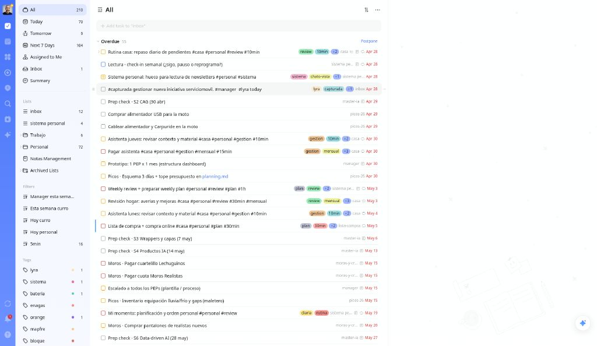<figcaption>TickTick — panel derecho con ilustración vacía</figcaption></figure></div>

<div class="pair"><figure>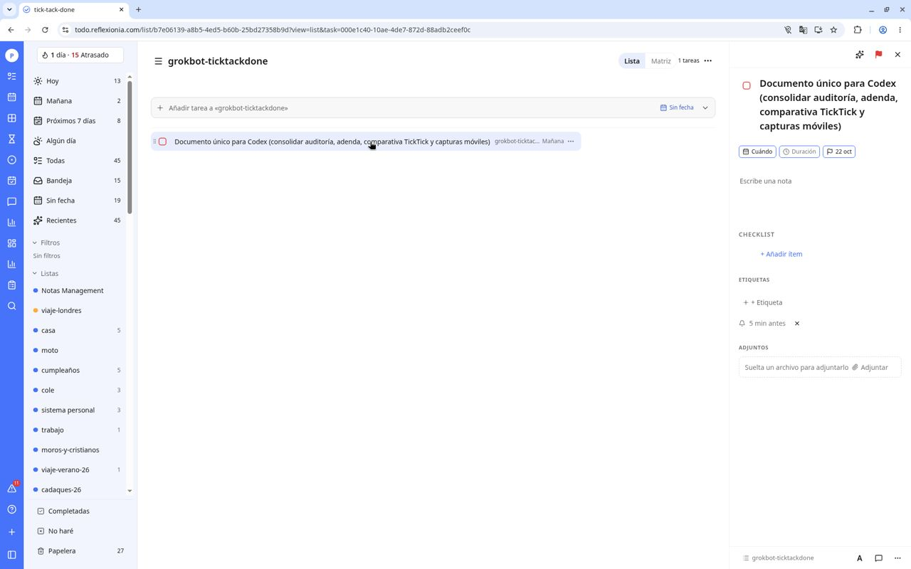<figcaption>ttd — panel abierto con ?task=</figcaption></figure><figure>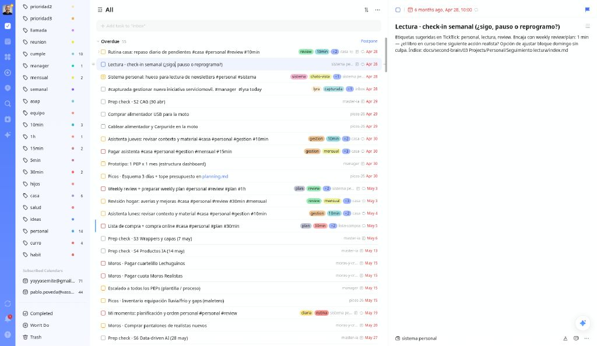<figcaption>TickTick — panel con tarea seleccionada</figcaption></figure></div>

**Causa en el código (confianza Alta)**

- El detalle depende de `?task=` (`web/shell/AppShell.tsx:131` y `:179-190`). Es la 4.ª columna del grid y vale 0 si no hay tarea (`web/shell/shell.css:18-24`); al abrirla, el centro se reestrecha.
- La anchura es redimensionable (`DetailResizer`, `--detail-w: clamp(340px, 30vw, 440px)`, `styles/tokens.css:96`).
- En menos de 1024 px es una capa fija (`shell.css:500-508`).
- Navegan a otra ruta en lugar de poner `?task=` en la actual:
  - `web/features/matrix/MatrixBoard.tsx:277`
  - `web/features/places/HourGrid.tsx:141` y `:245`
  - `web/features/places/Places.tsx:1008`, `:1344`, `:1791` y `:1809`
  - `web/features/planning/PlanDayPage.tsx:285`
  - `web/features/product/WeeklyPages.tsx:374`
  - `web/features/product/ProductPages.tsx:107`

**Propuesta de corrección**

1. Añadir el ajuste «Diseño del detalle: Panel lateral | Ventana emergente» (en TickTick, «Side peek» / «Pop-up»), dentro de `ViewPrefs` (TTD-AUD-59).
2. Con «Panel lateral» y 1280 px o más:
   - en las rutas de tareas (Hoy, listas, smart, etiquetas, filtros, matriz y búsqueda), la columna 4 siempre vale `var(--detail-w)`;
   - sin selección, renderiza `<DetailEmpty>` (ilustración, «Pulsa una tarea para ver los detalles» y atajo).
3. Entre 1024 y 1279 px se mantiene el comportamiento actual (el panel se abre al seleccionar).
4. Crear un helper `useOpenTask()` que haga `setParams({ task })` sobre la ruta actual, y sustituir con él todos los `Link` de la lista anterior.
5. Esc deselecciona (vuelve al estado vacío) sin cerrar la columna.
6. La lista resalta la fila seleccionada.

**Criterios de aceptación**

- A 1440 px, `/today` sin `?task` muestra el panel con el estado vacío.
- Al hacer clic en una fila, el detalle aparece sin que la lista cambie de ancho.
- Desde `/matrix` y `/calendar/week`, pulsar una tarea abre el detalle sin cambiar de ruta.
- Hay un test de componente del shell con y sin `?task` y con ambos ajustes de diseño.

**Referencia TickTick (REF-TICKTICK_01, \_12 y \_13):**

- Panel derecho con ilustración vacía cuando no hay selección.
- Cabecera con checkbox, chip de fecha (rojo si está vencida, con icono de repetición) y bandera de prioridad.
- Título y descripción editables, y modo checklist.
- Pie con nombre de la lista, formato de texto, comentario y menú «···»: Add Subtask, Link Parent Task, Pin, Won't Do, Tags, Upload Attachment, Start Focus, Task Activities, Save as Template, Duplicate, Copy Link, Convert to Note, Export, Print y Delete.

#### TTD-AUD-61 — La barra lateral es siempre la de Tareas: falta una barra secundaria por sección

- **Severidad:** Media
- **Pantalla/URL:** `/calendar/*`, `/matrix`, `/focus`, `/habits`, `/countdowns`, `/statistics` y `/search`
- **Elemento:** `Sidebar` y barra de iconos (`IconRail`)
- **Estado:** Abierto
- **Depende de:** —

**Pasos para reproducir**

1. Navega con la barra de iconos a Calendario, Matriz, Enfoque, Hábitos y Cuenta atrás.

**Resultado esperado**

- **Tareas:** su barra secundaria (Todas, Hoy, Mañana, Próximos 7 días, Asignadas a mí, Bandeja y Resumen; Listas con carpetas y Archivadas; Filtros; Etiquetas; Calendarios suscritos; y abajo Completadas, No haré y Papelera).
- **Calendario:** su propia barra, plegable: mini-mes con números de semana y filtros con casillas de listas, filtros, etiquetas y calendarios.
- **Matriz, Enfoque, Hábitos y Cuenta atrás:** sin barra secundaria, y el contenido usa todo el ancho.

**Resultado actual**

- Todas las secciones muestran la misma barra de Tareas.
- Las fuentes del calendario están escondidas en su menú «⋯».

**Evidencia**

- 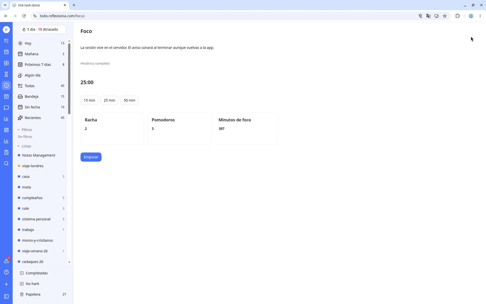
- 

<div class="pair"><figure><figcaption>ttd — Calendario con la barra de Tareas</figcaption></figure><figure>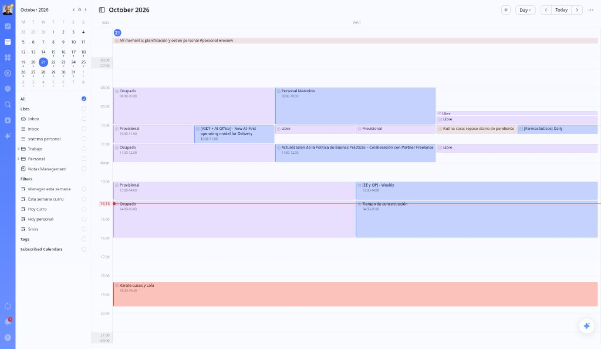<figcaption>TickTick — Calendario con su barra (mini-mes y filtros)</figcaption></figure></div>

<div class="pair"><figure>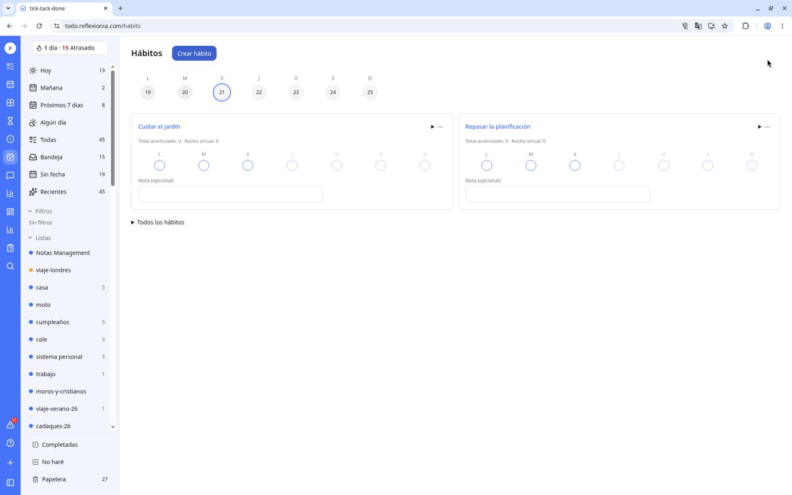<figcaption>ttd — Hábitos con la barra de Tareas</figcaption></figure><figure>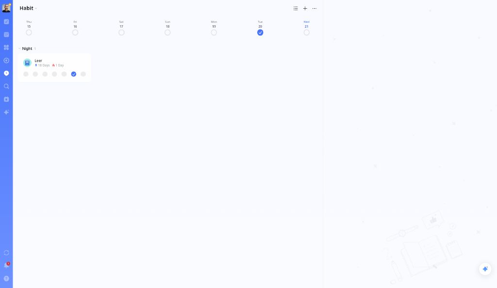<figcaption>TickTick — Hábitos sin barra secundaria</figcaption></figure></div>

**Causa en el código (confianza Alta)**

- Barra de iconos: `web/shell/IconRail.tsx:65-77` (Hoy más `MODULES` filtrados por `moduleEnabled`).
- `web/shell/Sidebar.tsx` (999 líneas) pinta siempre, sea cual sea la ruta:
  - listas inteligentes (`:244-285`);
  - Filtros (`:287-322`);
  - Listas y carpetas (`:323-505`);
  - Etiquetas (`:506-695`);
  - Completadas y Papelera (`:714-760`).
- En móvil, `mobileSection` ('lists' | 'more') llega desde `BottomBar`.
- Rutas: `web/app.tsx:118-204`.
- El calendario esconde sus fuentes en «⋯» (`web/features/places/Places.tsx:562-590`; `CalendarVisibility`, `:1499`).
- La barra de iconos no tiene una entrada «Tareas» propia: Hoy hace ese papel.

**Propuesta de corrección**

1. Crear `sectionOf(pathname)`, que devuelva `tasks | calendar | matrix | focus | habits | countdowns | stats | search | settings`.
2. Separar en `TasksSidebar` todo lo actual del `Sidebar`.
3. Crear `CalendarSidebar` con:
   - mini-mes con números de semana y puntos de días con tareas;
   - casillas «Todo», Listas, Filtros, Etiquetas y Calendarios suscritos (mover `CalendarVisibility`);
   - plegable con el botón de la cabecera.
4. Matriz, Enfoque, Hábitos, Cuenta atrás, Estadísticas y Búsqueda: sin sidebar (`grid-template-columns: rail 0 1fr detail`).
5. Ajustes: sin sidebar (ya usa `SettingsLayout`).
6. Añadir la entrada «Tareas» a la barra de iconos (ruta `/today` o la última vista de tareas usada).
7. Conservar el estado de plegado por sección.
8. En móvil, el cajón muestra la barra de la sección actual.

**Criterios de aceptación**

- En `/calendar/month` la barra muestra el mini-mes y las casillas, y desmarcar una lista oculta sus tareas en el calendario.
- En `/habits`, `/focus`, `/countdowns` y `/matrix` no hay barra secundaria y el contenido ocupa el ancho.
- En `/today` todo sigue como ahora.
- Hay un test de `sectionOf` y un test del shell por sección.

**Referencia TickTick:** ver REF-TICKTICK_02, _18, _22, _28, _29 y _30.

#### TTD-AUD-73 — Destello de esqueleto al entrar en /matrix y /countdowns

- **Severidad:** Baja
- **Pantalla/URL:** `/matrix` y `/countdowns`
- **Elemento:** estado de carga
- **Estado:** Abierto
- **Depende de:** TTD-AUD-31

**Pasos para reproducir**

1. Navega a `/matrix` o a `/countdowns` desde la barra de iconos.

**Resultado esperado**

- O no hay esqueleto, porque los datos están en caché, o el esqueleto tiene la forma final y no provoca saltos.

**Resultado actual**

- Aparece un esqueleto un instante y la página salta al cargar.

**Evidencia**

- Observado en el recorrido de navegador del 21/10/2026; sin captura (es transitorio).

**Causa en el código (confianza Baja)**

- `/matrix` usa la clave `['matrix-tasks', scope]`, aparte de las de las listas, y no reutiliza la caché.
- `FeatureRoute` decide con los flags por defecto antes de `/me` (`web/app.tsx:212-224`). Pendiente de confirmar con el perfilador.

**Propuesta de corrección**

1. `placeholderData` desde la caché de tareas.
2. Esqueletos con la forma final (4 cuadrantes y tarjetas).
3. Precargar al pasar el ratón por la barra de iconos.

**Criterios de aceptación**

- Con la caché caliente, la navegación a `/matrix` no muestra esqueleto.
- El layout no se desplaza (CLS ≈ 0).

### Área 15 — Vistas de tareas

Ver también las secciones 4.2 a 4.5.

#### TTD-AUD-66 — Cambiar de vista (lista, kanban, timeline) es incoherente y casi imposible de encontrar

- **Severidad:** Alta
- **Pantalla/URL:** `/today`, `/inbox`, `/smart/*` y `/list/:id`
- **Elemento:** selector de vista del menú «···» y píldora «Lista | Matriz»
- **Estado:** Abierto
- **Depende de:** TTD-AUD-59

**Pasos para reproducir**

1. En `/today`, busca cómo ver la vista kanban o timeline.
2. Abre `/smart/tomorrow` y una lista propia, y abre «···».
3. En una lista, elige «Kanban» en «···» y mira la píldora de la cabecera.

**Resultado esperado**

- Todas las vistas de tareas (Hoy, Bandeja, inteligentes, listas, etiquetas y filtros) ofrecen el mismo selector de vista (Lista, Kanban, Timeline), en el mismo sitio y sincronizado con cualquier otro control.

**Resultado actual**

- `/today` no tiene selector de vista; en su lugar tiene una píldora «Lista | Matriz».
- `/inbox` no tiene «···».
- Las listas inteligentes y propias tienen el selector de 3 iconos dentro de «···», pero las listas propias muestran además la píldora «Lista | Matriz».
- Al elegir Kanban en «···», la píldora sigue marcando «Lista».
- Pablo no encontró kanban ni timeline.

**Evidencia**

- 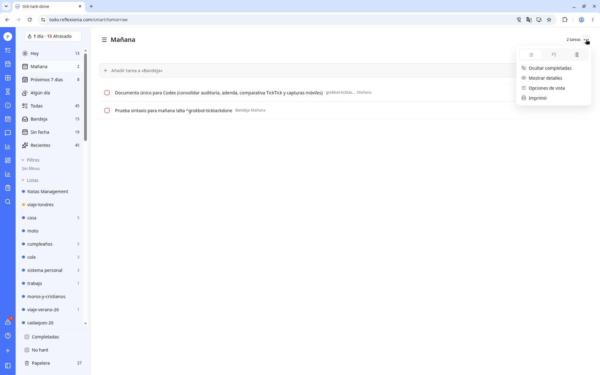
- 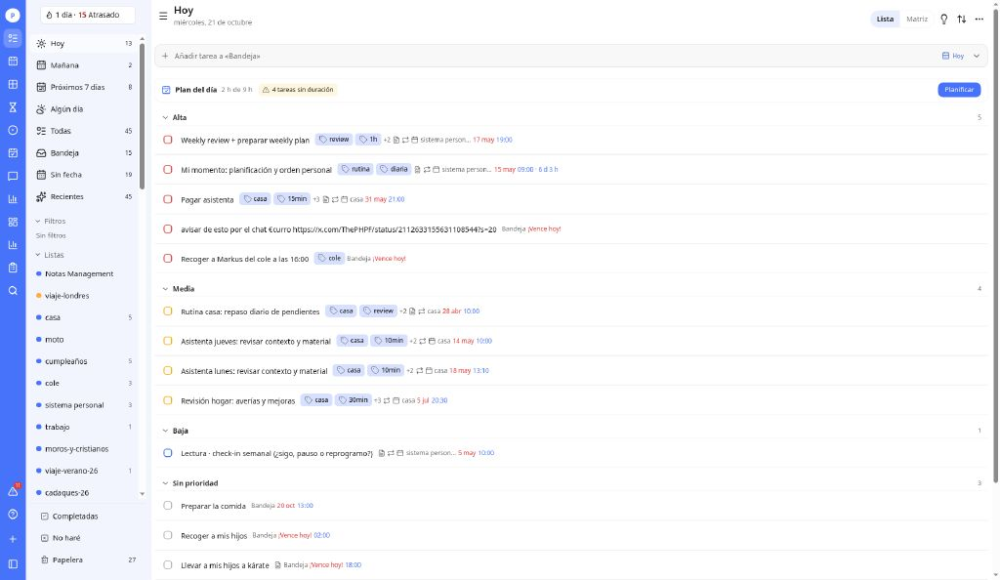
- 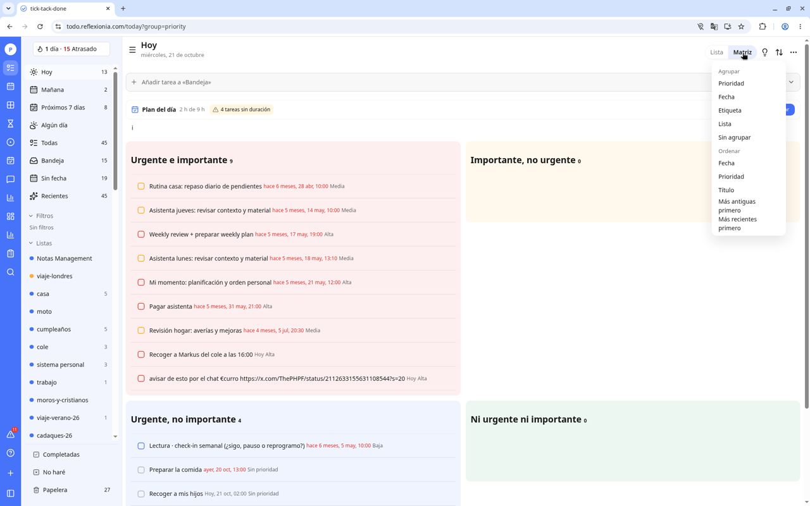
- 

<div class="pair"><figure><figcaption>ttd — lista: selector en ··· y píldora Lista | Matriz</figcaption></figure><figure><figcaption>TickTick — el mismo menú en todas las vistas</figcaption></figure></div>

**Causa en el código (confianza Alta)**

- `TodayPage` usa `ViewMenu` sin `onView` (`web/features/today/TodayPage.tsx:614-634`) y tiene su propio conmutador «Lista | Matriz».
- `InboxPage` no monta `ViewMenu` (solo «Procesar todo»).
- `ViewPages` monta a la vez `MatrixViewToggle` (`ViewPages.tsx:219-226`, estado en `readMatrixLayout`) y `ViewMenu` (`:234`, estado `view` en URL y localStorage). Son dos estados independientes, así que la píldora no se entera de que la vista es kanban.

**Propuesta de corrección**

1. Hacer la vista un único estado: `view ∈ {list, kanban, timeline, matrix}` en `ViewPrefs` (TTD-AUD-59). La matriz es una vista más, solo si `flags.matrix` está activo.
2. Quitar `MatrixViewToggle` de la cabecera, o convertirlo en un control segmentado visible con los 4 iconos y sincronizado con «···».
3. Montar el mismo `ViewHeader` (título, contador, ⇅ ordenar y ··· vista) en Hoy, Bandeja, inteligentes, listas, etiquetas y filtros.
4. Que el menú «···» muestre la fila «Vista» con iconos y texto («Lista», «Kanban», «Timeline», «Matriz»).

**Criterios de aceptación**

- En todas las rutas de tareas, «···» tiene la fila «Vista» con las mismas opciones, y el control de la cabecera (si se mantiene) refleja la vista activa.
- Cambiar la vista en una ruta no afecta a otras.
- Hay un test que recorre las rutas y comprueba la presencia del selector.

**Referencia TickTick:** ver REF-TICKTICK_03 y _08.

#### TTD-AUD-59 — Opciones de vista: no se guardan, «Ocultar completadas» confunde e «Imprimir» sale cortado

- **Severidad:** Media
- **Pantalla/URL:** menú «···» de `/today`, `/smart/*` y `/list/:id`
- **Elemento:** `ViewMenu` (Ocultar completadas, Mostrar detalles, Opciones de vista, Imprimir) y menú de orden y agrupación
- **Estado:** Abierto
- **Depende de:** — (se coordina con TTD-AUD-66 y TTD-AUD-67)

**Pasos para reproducir**

1. En una lista, abre «···» > «Opciones de vista» y cambia «Agrupar» y «Ordenar».
2. Navega a otra lista y vuelve.
3. Pulsa «Ocultar completadas» y fíjate en el texto y en la marca.
4. Pulsa «Imprimir».

**Resultado esperado**

- Agrupar, orden, dirección, detalles y ocultar completadas se guardan por vista. Igual que TickTick con «Sync view across devices», se sincronizan entre dispositivos.
- «Ocultar completadas» es una opción fija con marca ✓ que indica si está activa.
- Imprimir genera solo la lista, completa y sin la interfaz.

**Resultado actual**

- Al volver a la lista, agrupar y ordenar vuelven a sus valores por defecto.
- «Ocultar completadas» aparece marcada (`aria-checked=true`) aunque las completadas se ven, y el texto cambia entre «Ocultar» y «Mostrar».
- Imprimir saca la barra de iconos, la barra lateral y solo la parte visible de la lista.
- `/today` añade `?group=priority` a la URL al cargar.

**Evidencia**

- 
- 
- 

<div class="pair"><figure><figcaption>ttd — menú ··· de Hoy</figcaption></figure><figure><figcaption>TickTick — menú ··· (Vista, Hide Completed, Show Details, View Options, Print)</figcaption></figure></div>

**Causa en el código (confianza Alta)**

- `ViewMenu` (`web/components/ViewMenu.tsx:16-167`) ya tiene las mismas entradas que TickTick, pero:
  - Agrupar, orden, detalles y ocultar completadas son `useState` locales (`web/features/views/components/ViewPages.tsx:165-168`); se pierden al desmontar la página.
  - La vista (lista, kanban o timeline) se guarda en localStorage y en la URL (`web/features/views/view-prefs.ts`) e ignora `project.view_mode`, que el API sí guarda (`api/modules/lists/lists.dto.ts`, `lists.mapper.ts`). No se sincroniza entre dispositivos.
- `aria-checked={hideCompleted}` y el texto cambia según el estado (`ViewMenu.tsx:118-124`), así que la marca y la etiqueta dicen cosas distintas. En `/today` el estado inicial no coincide con lo que se ve (confianza Media).
- Imprimir llama a `window.print()` (`ViewPages.tsx:243`, `TodayPage.tsx:620`), pero no hay ninguna regla `@media print` en el CSS. `.shell` tiene `height: 100dvh; overflow: hidden` (`web/shell/shell.css:7-9`) y `.outlet` tiene `overflow: auto`, así que solo se imprime lo visible.
- El orden de las listas no tiene dirección (`ViewPages.tsx:258-266`); Hoy sí la tiene (`TodayPage.tsx:~590-611`).
- El menú no usa el `Popover` común: no tiene foco inicial, navegación con flechas ni devolución del foco.
- `/today` escribe el agrupamiento guardado en la URL al montar (`TodayPage.tsx:206-210`).

**Propuesta de corrección**

1. Crear el modelo `ViewPrefs { view, group, sort, order, showDetails, hideCompleted, showDateBy, detailLayout }` por `viewKey`.
2. Guardarlo en el servidor (por ejemplo en `user.preferences.views[viewKey]`, con `project.view_mode` para las listas), con una copia en localStorage para la carga inicial. Añadir la opción «Sincronizar vista entre dispositivos», como en TickTick.
3. Dejar «Ocultar completadas» con texto fijo y ✓.
4. Añadir una hoja `@media print`:
   - ocultar rail, sidebar, barra inferior, detalle y composer;
   - `.shell { display: block; height: auto; overflow: visible }`;
   - `.outlet { overflow: visible }`.
5. Pasar `ViewMenu` a `Popover` (menú con `role="menu"`, flechas, Esc y devolución del foco).
6. No reescribir la URL de `/today` si el agrupamiento coincide con el guardado.

**Criterios de aceptación**

- Cambiar agrupar y ordenar en una lista, salir y volver conserva la elección. Con la sincronización activa, también en otro navegador.
- La marca de «Ocultar completadas» coincide con lo que se ve.
- La vista previa de impresión muestra todas las tareas de la vista, sin interfaz, en una o varias páginas.
- Hay tests unitarios de `ViewPrefs` (lectura, escritura y valores por defecto) y un test de componente del menú.

**Referencia TickTick:** menú ··· con fila «View» (lista, kanban, timeline), «Hide Completed», «Show Details», «View Options» (Show Date by, Task detail layout Side peek/Pop-up, Sync view across devices) e «Print». El orden va en un icono ⇅ aparte («Group by»: List, Date, Created Time, Tag, Priority, None; «Sort by»; «Order»). Ver REF-TICKTICK_03, _04, _05 y _06.

#### TTD-AUD-67 — Bandeja no tiene menú de vista ni opciones para ordenar o agrupar

- **Severidad:** Media
- **Pantalla/URL:** `/inbox`
- **Elemento:** cabecera de la Bandeja
- **Estado:** Abierto
- **Depende de:** TTD-AUD-66

**Pasos para reproducir**

1. Abre `/inbox`.

**Resultado esperado**

- La misma cabecera que el resto de vistas: ⇅ (agrupar, ordenar, orden) y «···» (vista, ocultar completadas, detalles, opciones e imprimir), además de «Procesar todo».

**Resultado actual**

- Solo está el botón «Procesar todo». No se puede cambiar de vista, ni agrupar, ni ordenar.

**Evidencia**

- 

**Causa en el código (confianza Alta)**

- La Bandeja usa un componente propio (`InboxPage`, en `web/features/places/Places.tsx`) que no monta `ViewMenu` ni el selector de orden.

**Propuesta de corrección**

- Reutilizar `ViewHeader` (TTD-AUD-66) con `viewKey = 'inbox'` y mantener «Procesar todo» como acción adicional.

**Criterios de aceptación**

- `/inbox` permite kanban, timeline, agrupar y ordenar, y lo conserva al volver.

**Referencia TickTick:** la Bandeja («Inbox») tiene los mismos menús que cualquier lista.

#### TTD-AUD-68 — Kanban en listas inteligentes: una sola columna «Sin sección» en lugar de columnas por fecha

- **Severidad:** Media
- **Pantalla/URL:** `/smart/*?view=kanban`, `/today` (cuando tenga kanban), etiquetas y filtros
- **Elemento:** `Kanban` (`TaskList.tsx`)
- **Estado:** Abierto
- **Depende de:** TTD-AUD-66

**Pasos para reproducir**

1. Abre `/smart/tomorrow?view=kanban` o `/smart/all?view=kanban`.

**Resultado esperado**

- En vistas sin secciones, las columnas siguen el agrupamiento elegido. Por defecto, por fecha: Vencidas, Hoy, Mañana, Próximos 7 días, Más tarde y Sin fecha, cada una con «+» para añadir con esa fecha.
- Arrastrar entre columnas cambia la fecha (o la prioridad, la lista o la etiqueta, según el agrupamiento).

**Resultado actual**

- Hay una sola columna «Sin sección» con todas las tarjetas, más un campo «Nueva sección» que no tiene sentido en una lista inteligente.

**Evidencia**

<div class="pair"><figure><figcaption>ttd — kanban en Mañana</figcaption></figure><figure><figcaption>TickTick — columnas por fecha con «+»</figcaption></figure></div>

**Causa en el código (confianza Alta)**

- Las columnas salen solo de las secciones de la lista. Sin secciones se crea una sola columna «Sin sección» (`web/features/tasks/TaskList.tsx:453-455`).
- El campo «Nueva sección» se muestra siempre.

**Propuesta de corrección**

1. `Kanban` recibe `groups` del mismo agrupador que la vista de lista (`group`: fecha, prioridad, lista, etiqueta o sección). Usa las secciones solo en listas propias con agrupamiento «Sección».
2. Las columnas de fecha usan los mismos tramos que Hoy (`partitionToday`), en la zona de la tarea.
3. Al soltar se aplica el patch del grupo: fecha (día completo, conservando la hora si la tiene), prioridad, `project_id` o etiqueta.
4. Cada columna tiene un «+» que precarga el composer con ese valor.
5. Ocultar «Nueva sección» fuera de las listas propias.

**Criterios de aceptación**

- En `/smart/all?view=kanban` aparecen las 6 columnas de fecha con sus contadores.
- Arrastrar de «Hoy» a «Mañana» cambia la fecha a mañana.
- El «+» de «Próximos 7 días» crea la tarea con fecha dentro de ese tramo.
- Hay tests del agrupador y del patch.

**Referencia TickTick:** ver REF-TICKTICK_07.

#### TTD-AUD-69 — Timeline estrecho: zoom en inglés y apilado, columnas de unos 100 px y tarjetas cortadas

- **Severidad:** Media
- **Pantalla/URL:** `?view=timeline` en listas y listas inteligentes
- **Elemento:** `Timeline` (`TaskList.tsx`)
- **Estado:** Abierto
- **Depende de:** TTD-AUD-66

**Pasos para reproducir**

1. Abre `/smart/tomorrow?view=timeline`.

**Resultado esperado**

- Barra de herramientas en una fila («Día», «Semana», «Mes», traducidos).
- Panel «Sin planificar» a la izquierda.
- Diagrama de Gantt agrupado por lista a todo el ancho, con días legibles («mié 21») y barras con el título completo o con puntos suspensivos.

**Resultado actual**

- «Zoom» con los botones «day», «week» y «month» en inglés y apilados en una columna de 10 rem.
- «Sin planificar» aparece en la otra columna.
- Las columnas de días quedan en unos 100 px con scroll propio, «21 Wed» sale en inglés y las tarjetas se cortan («Do», «Pr»).

**Evidencia**

<div class="pair"><figure><figcaption>ttd — timeline</figcaption></figure><figure><figcaption>TickTick — Gantt por lista con zoom por día</figcaption></figure></div>

**Causa en el código (confianza Alta)**

- `.timeline` es un grid de `10rem minmax(0, 1fr)` (`web/components/ui.css:412-416`). Sus hijos son la barra de zoom, el `aside` y el eje, y ninguno ocupa las dos columnas, así que la barra cae en la columna de 10 rem, «Sin planificar» en la ancha y el eje en la estrecha.
- Los botones muestran `{item}` literal (`day`, `week`, `month`) (`TaskList.tsx:606-614`).
- El eje formatea los días sin el locale de la app.
- El zoom no se guarda.
- El timeline coloca las tareas por `dueDate` (`TaskList.tsx:600-601`). Comprobar que tras la PR #60 usa la fecha efectiva (`start_date ?? due_date`) y la duración.

**Propuesta de corrección**

1. `.timeline > .page-toolbar { grid-column: 1 / -1 }`, con el `aside` en la columna 1 y el eje y las barras en la 2.
2. Etiquetas traducidas (`timelineDay`, `timelineWeek`, `timelineMonth`) en un control segmentado.
3. Formatear el eje con `Intl.DateTimeFormat(locale, { weekday: 'short', day: 'numeric' })`.
4. Filas agrupadas por lista (o según el agrupamiento elegido).
5. Barras con inicio y fin desde `start_date`/`due_date`/`duration`.
6. Guardar el zoom en `ViewPrefs`.

**Criterios de aceptación**

- A 1280 px, la barra de herramientas ocupa una sola fila y en español.
- Se ven al menos 7 días a 120 px o más cada uno con zoom «Semana».
- Las barras muestran el título con puntos suspensivos.
- Arrastrar desde «Sin planificar» asigna la fecha.

**Referencia TickTick:** ver REF-TICKTICK_09 y _10.

### Área 16 — Nueva tarea (composer)

Ver también la sección 4.7.

#### TTD-AUD-64 — Modal «Nueva tarea»: maquetación rota, demasiado estrecho y con las opciones escondidas

- **Severidad:** Alta
- **Pantalla/URL:** `/calendar/*` (botón «+»), barra de iconos «+» y cualquier pantalla que abra la captura global; el menú del chevron también se ve en `/today`
- **Elemento:** `CaptureSheet`, `TaskComposer` y menú del chevron
- **Estado:** Abierto
- **Depende de:** — (arregla también el patrón de TTD-AUD-05, que usa el mismo `Popover`)

**Pasos para reproducir**

1. En `/calendar/month`, pulsa «+».
2. Pulsa el chevron del composer.

**Resultado esperado** (estilo TickTick)

- Una tarjeta única de unos 400–560 px, con el título dentro de la tarjeta.
- Campo de título amplio y descripción opcional.
- Fila de botones rápidos siempre visible: fecha, prioridad, lista, etiqueta y «···».
- Botón «Añadir».
- Los menús se abren junto al botón pulsado, sin barras de scroll internas.

**Resultado actual**

- «Nueva tarea» aparece como texto suelto sobre el calendario, sin tarjeta, superpuesto a los eventos. «Cancelar» flota unos 250 px más abajo.
- El placeholder «Añadir tarea a «Bandeja»» se corta.
- Al abrir el chevron, el composer se vuelve translúcido y el menú (Prioridad, Bandeja, Etiqueta, Adjuntos, Añadir desde plantilla, Convertir en nota, Abrir detalle y Dictar) se abre desplazado, con su propia barra de scroll y encima de «Cancelar».
- En `/today` el «+» solo enfoca el composer en línea, y ahí el menú se ve correctamente.

**Evidencia**

- 
- 
- 
- 

<div class="pair"><figure><figcaption>ttd — «+» en el calendario</figcaption></figure><figure><figcaption>TickTick — popup de unos 400 px en el calendario</figcaption></figure></div>

<div class="pair"><figure><figcaption>ttd (izquierda) frente a TickTick (derecha), captura de Pablo</figcaption></figure><figure><figcaption>TickTick — «···» del popup (Tags, Upload Attachment, Add from Template, Convert to Note, Convert to Event)</figcaption></figure></div>

**Causa en el código**

1. _(Alta)_ `.sheet` es `display: grid; place-items: center` a pantalla completa (`web/styles.css:47-55`) y tiene tres hijos sueltos: `h1`, composer y «Cancelar» (`web/features/capture/components/CaptureSheet.tsx:19-33`).
   - Las filas automáticas se estiran a un tercio de la altura cada una, así que el `h1` queda flotando sobre la cabecera del calendario y «Cancelar» abajo.
   - No hay tarjeta contenedora.
2. _(Media-Alta)_ El ítem centrado se ajusta a su contenido, y el `width: min(32rem, 100%)` de `.sheet form` (`styles.css:57-65`) se calcula contra ese ancho. Resultado: el composer queda estrecho y el placeholder se corta. Además, `.sheet form { overflow: auto }` puede añadir scroll.
3. _(Media)_ `Popover` impone en línea `width: 260` (`web/components/Popover.tsx:37-40`) y `maxHeight` igual a `scrollHeight` (`:41`, `:52`).
   - Con el borde de 1 px de `.composer-menu` (`web/features/tasks/composer.css:146-148`) y `box-sizing: border-box`, faltan 2 px y aparece la barra de scroll interna.
   - El menú se alinea al borde derecho del chevron (`box.right - width`), así que tapa el propio composer.
   - Los estilos base de `.popover` están en `today.css:590-604`, dentro de una funcionalidad concreta.
4. _(Media)_ El efecto «fantasma» viene de que `:focus-within` del formulario cambia el fondo a `--surface-3` al perder el foco (`composer.css:5-15`), sobre el fondo semitransparente de `.sheet`.
5. `.composer-submit` está oculto salvo con foco (`composer.css:91-97`).
6. «Abrir detalle» no abre el detalle: solo muestra un textarea (`TaskComposer.tsx:464-475`) y usa el mismo icono que «Convertir en nota».
7. Las plantillas solo están en localStorage (`tick-tack-done.templates`, `TaskComposer.tsx:607`; `TaskDetail.tsx:36`).
8. `.sheet` no tiene `role="dialog"`, ni `aria-modal`, ni trampa de foco.

**Propuesta de corrección** (rediseño; ver la sección 4.7)

1. `CaptureSheet` → `<div role="dialog" aria-modal="true" aria-labelledby>` con una tarjeta `.capture-card`:
   - `width: min(560px, 100vw - 32px)`, anclada arriba (`align-items: start; padding-top: 12vh`);
   - en el calendario, anclada a la celda o la hora pulsada, como popup de unos 400 px;
   - en móvil, hoja inferior.
2. Contenido de la tarjeta:
   - **Cabecera:** chip de fecha (abre `DatePopover`) y bandera de prioridad.
   - **Título:** grande, con el placeholder «¿Qué quieres hacer?».
   - **Descripción:** opcional (`/` para comandos en el futuro).
   - **Chips:** lo interpretado (`#`, `^`, `!`, fecha).
   - **Pie:** selector de lista, botones de etiqueta y «···» (Adjuntos, Añadir desde plantilla, Convertir en nota, Dictar), «Cancelar» como texto y «Añadir» como botón primario, siempre visible.
3. `Popover`:
   - prop `width` (por defecto `auto`, mínimo 220 y máximo 320);
   - sin `maxHeight` igual a `scrollHeight`; en su lugar, `max-height: min(70vh, espacio disponible)` por CSS;
   - posicionarlo bajo el botón pulsado, alineado a su borde izquierdo;
   - mover `.popover` a `components/ui.css`.
4. Quitar «Abrir detalle» del menú (o renombrarlo «Añadir descripción» con otro icono).
5. Composer en línea de Hoy y listas: barra completa con icono de fecha y chevron, igual que TickTick (REF-TICKTICK_14).
6. Plantillas: dejarlas como están (localStorage) y anotarlas como deuda; fuera de alcance de este hallazgo.

**Criterios de aceptación**

- A 1280×800, el «+» del calendario muestra una sola tarjeta. Nada se superpone a la cabecera del calendario ni queda flotando fuera de la tarjeta.
- El placeholder no se corta.
- Los botones de fecha, prioridad, lista, etiqueta, «···» y «Añadir» se ven sin abrir menús.
- El menú «···» con todas las opciones no muestra scroll interno a 800 px de alto.
- Tab no sale del diálogo y Esc lo cierra devolviendo el foco.
- Hay un test de componente de `CaptureSheet` (roles y foco) y un test de `Popover` (posición y altura).

**Referencia TickTick:** ver REF-TICKTICK_14, _15, _24 y _25.

### Área 17 — Móvil

**Limitación:** el móvil se ha comprobado con zoom del navegador al 400 % (unos 480 px CSS de ancho), no con emulación de dispositivo ni en dispositivos reales. Ver también TTD-AUD-33 (menú «Más»).

#### TTD-AUD-58 — Móvil: la cabecera fija de Hoy flota con un hueco por el que se ve el contenido

- **Severidad:** Alta
- **Pantalla/URL:** `/today` en móvil; mismo patrón en `/inbox`, `/smart/*`, `/list/:id`, `/tag/:id`, `/filter/:id` y `/statistics`
- **Elemento:** cabecera fija (`.today-header`, `.stats-header`), píldora de puntuación «Atrasado» (`.mobile-control-bar`), cabeceras de grupo
- **Estado:** Abierto
- **Depende de:** —

**Pasos para reproducir**

1. Abre `/today` con un ancho de unos 390–480 px.
2. Haz scroll hacia abajo en la lista.
3. Repite en `/statistics` y en cualquier lista.

**Resultado esperado**

- La cabecera («Hoy» y sus controles) queda pegada justo bajo la barra superior, sin hueco.
- Nada del contenido se ve por encima de ella.
- Las cabeceras de grupo («Atrasadas», «Hoy»…) se apilan debajo de la cabecera.

**Resultado actual**

- Entre la barra superior (píldora «Atrasado») y la cabecera queda una franja de unos 20–40 px por la que pasan las filas al hacer scroll. La píldora parece flotar en el vacío.
- En `/statistics`, la barra de pestañas se queda bastante por debajo del borde superior, el contenido se ve pasar por encima y aparece una mancha de desenfoque entre «Tareas» y «Foco».
- Las cabeceras de grupo quedan tapadas por la cabecera.

**Evidencia** (móvil simulado con zoom del navegador al 400 %, unos 480 px CSS; no es emulación de dispositivo)

- 
- 
- 
- 

**Causa en el código (confianza Alta)**

- `.outlet` es el contenedor con scroll (`web/shell/shell.css:116-127`). En móvil recibe `padding-top: var(--sp-5)` = 20 px (`shell.css:550-552`).
- `.today-header` es `position: sticky; top: 0` (`web/features/today/today.css:1336-1342`). Un elemento sticky se ancla al borde interior del padding del contenedor, así que se queda a 20 px del borde y el contenido se ve pasar por esa franja.
- Encima está `.mobile-control-bar` (`web/shell/AppShell.tsx:166-170`; `web/features/statistics/control.css:135-141`), que no hace scroll.
- El mismo patrón aparece en:
  - `ViewPages.tsx:207`, `:342` y `:395` (todas usan `today-header`);
  - `.stats-header` (`web/features/statistics/statistics.css:14-21`).
- `.task-group summary` es sticky con `top: 0` y `z-index: 1` (`today.css:60-64`), así que queda debajo de la cabecera (z 5) en lugar de apilarse bajo ella.
- No hay `viewport-fit=cover` (`apps/web/index.html:5`), por lo que `env(safe-area-inset-*)` vale 0 en iOS. No se usa `safe-area-inset-top` en ningún sitio.
- La reserva para la barra inferior está duplicada: `padding-bottom` en `.shell` (`shell.css:540-543`) y otra vez en `.outlet` (`:546-548`).
- La cabecera usa `--surface` y el outlet `--bg`; en modo oscuro son #222 y #242424 (`styles/tokens.css:105` y `:108`).

**Propuesta de corrección**

1. En móvil, `.outlet { padding-top: 0 }` y trasladar ese espacio al primer hijo de la página (`.screen-page > :first-child`, `.today > :first-child`).
2. Definir `--page-header-h` y usarlo como `top` de las cabeceras de grupo sticky.
3. Usar `var(--bg)` como fondo de la cabecera y añadir una sombra o borde cuando la página tenga scroll (`data-scrolled`).
4. Añadir `viewport-fit=cover` y `padding-top: env(safe-area-inset-top)` en `.mobile-control-bar`.
5. Quitar la reserva duplicada de la barra inferior.
6. Revisar `.stats-header` con la misma regla y quitar el `backdrop-filter` (o el pseudo-elemento) que causa la mancha.

**Criterios de aceptación**

- A 390×844 (emulación real), al hacer scroll en `/today`, `/inbox`, `/list/:id` y `/statistics` no se ve contenido entre la barra superior y la cabecera.
- Las cabeceras de grupo quedan visibles justo debajo de la cabecera.
- En un iPhone con la PWA instalada, nada queda bajo la barra de estado ni bajo el indicador de inicio.
- Hay un test visual (Playwright, viewport 390×844) de `/today` con scroll.

**Referencia TickTick:** en móvil, la cabecera de la vista queda pegada al borde superior, sin franjas, y la barra inferior respeta la zona segura.

#### TTD-AUD-70 — Móvil: la cabecera de las listas se parte (título en 4 líneas, «2 tareas» en 2)

- **Severidad:** Media
- **Pantalla/URL:** `/list/:id` y listas inteligentes en móvil
- **Elemento:** `.today-header .page-title` y `.page-actions`
- **Estado:** Abierto
- **Depende de:** TTD-AUD-58

**Pasos para reproducir**

1. En móvil, abre una lista con un nombre largo (por ejemplo, «Mejora continua…»).

**Resultado esperado**

- Título en una línea, con puntos suspensivos (o como mucho dos líneas), contador en una línea y acciones alineadas.
- El mismo sangrado que en `/today`.

**Resultado actual**

- El título ocupa 4 líneas, «2 tareas» se parte en 2 y el sangrado es distinto al de `/today`.
- La cabecera y la franja superior ocupan casi toda la pantalla.

**Evidencia**

- 

**Causa en el código (confianza Media)**

- `.page-title h1` no tiene `min-width: 0`, ni `overflow: hidden`, ni `text-overflow`.
- `.page-actions` no tiene `flex-shrink: 0`.
- La insignia del contador permite el salto de línea.
- El botón de menú (hamburguesa) de `ViewPages` (`:209-216`) añade un sangrado que `/today` no tiene.

**Propuesta de corrección**

1. `.page-title { min-width: 0; flex: 1 }`.
2. `.page-title h1 { overflow: hidden; text-overflow: ellipsis; white-space: nowrap }`, o `-webkit-line-clamp: 2`.
3. `.ui-badge { white-space: nowrap }`.
4. Mismo componente de cabecera para todas las vistas (TTD-AUD-66).

**Criterios de aceptación**

- A 390 px, una lista con un nombre de 60 caracteres muestra el título en 1–2 líneas y «N tareas» en una.

#### TTD-AUD-71 — Móvil: el calendario mensual solo muestra puntos, la barra se pierde al hacer scroll y «Calendario» abre la agenda

- **Severidad:** Media
- **Pantalla/URL:** `/calendar/month` en móvil y navegación inferior
- **Elemento:** `.cal-month`, barra de herramientas del calendario y `BottomBar`
- **Estado:** Abierto
- **Depende de:** TTD-AUD-58 y TTD-AUD-61

**Pasos para reproducir**

1. En móvil, pulsa «Calendario» en la barra inferior.
2. Cambia a «Mes» y haz scroll.

**Resultado esperado**

- «Calendario» abre la última vista usada (por defecto, mes).
- En el mes se ve al menos un indicador por día y, al tocar un día, la lista de ese día debajo, como en TickTick.
- La barra de vistas queda fija.

**Resultado actual**

- «Calendario» abre `/calendar/agenda`.
- En el mes, los títulos se convierten en puntos y no hay lista del día seleccionado.
- Al hacer scroll, la barra de herramientas desaparece y no se puede cambiar de vista. La rejilla pasa por la franja vacía de arriba (TTD-AUD-58).

**Evidencia**

- 

**Causa en el código (confianza Alta)**

- `BottomBar.tsx:24` enlaza fijo a `/calendar/agenda`.
- Con 639 px o menos se ocultan `.cal-pill` y los enlaces y se muestran `.cal-dots` (`web/components/ui.css:2146-2165`; `Places.tsx:895`).
- La barra de herramientas del calendario no es sticky.

**Propuesta de corrección**

1. `BottomBar`: enlazar a `/calendar/<última vista>` (localStorage) o a `/calendar/month`.
2. En móvil, al tocar un día, abrir debajo la agenda de ese día (reutilizar la vista Agenda filtrada).
3. Hacer sticky la barra del calendario con la misma regla que TTD-AUD-58.

**Criterios de aceptación**

- A 390 px, tocar un día muestra sus tareas y eventos.
- La barra de vistas sigue visible al hacer scroll.
- «Calendario» respeta la última vista usada.

**Referencia TickTick:** ver REF-TICKTICK_23, _26 y _27 (vistas Día, Semana, Mes, Año, Agenda, Varios días y Varias semanas).

#### TTD-AUD-72 — Móvil: en /matrix los chips de cuadrante se cortan y no hay cabecera fija

- **Severidad:** Media
- **Pantalla/URL:** `/matrix` en móvil
- **Elemento:** `.matrix-tabs` y cabecera de la matriz
- **Estado:** Abierto
- **Depende de:** TTD-AUD-58 y TTD-AUD-62

**Pasos para reproducir**

1. En móvil, abre `/matrix` y haz scroll.

**Resultado esperado**

- Los chips de cuadrante («Hacer 11», «Programar 8»…) quedan fijos arriba, enteros.

**Resultado actual**

- Los chips desaparecen cortados a media altura bajo la píldora flotante, y la información de las tarjetas se corta junto a la barra inferior.

**Evidencia**

- 

**Causa en el código (confianza Media)**

- `.matrix-tabs` no es sticky (`web/features/matrix/matrix.css:106-128`), así que el corte es el borde superior del contenedor con scroll bajo `.mobile-control-bar` (el mismo contexto que TTD-AUD-58).
- El `role="tablist"` no tiene `tabpanel` ni `aria-controls`.

**Propuesta de corrección**

1. Cabecera de la matriz más `.matrix-tabs` dentro de una cabecera sticky con la regla de TTD-AUD-58.
2. Añadir `aria-controls` y `role="tabpanel"`.
3. Margen inferior igual a la altura de la barra inferior.

**Criterios de aceptación**

- A 390 px, con scroll, los chips se ven enteros y fijos.
- Ninguna tarjeta queda tapada por la barra inferior.

## 4. Especificación de paridad con TickTick

Referencia: capturas `REF-TICKTICK_*` (TickTick web, 21/10/2026). Objetivo: **todas las vistas de tareas de ttd ofrecen las mismas opciones que TickTick**, con la identidad visual de ttd (solo tokens de `tokens.css`). Cada apartado indica los hallazgos que lo cubren.

### 4.1 Shell: barra de iconos, barra secundaria y panel de detalle (TTD-AUD-60, 61)

- **Barra de iconos:** Tareas, Calendario, Matriz, Enfoque (Pomodoro), Hábitos, Búsqueda, Cuenta atrás y Ticky (solo si está disponible, TTD-AUD-63). Abajo: sincronización, notificaciones y ayuda. Cada módulo se puede ocultar en Ajustes > Funcionalidades.
- **Layout de escritorio:** `rail | barra secundaria (opcional, plegable) | contenido | panel de detalle (rutas de tareas)`.
- **Barra secundaria por sección:**

| Sección                                | Barra secundaria                                                                                                                                                                                         |
| -------------------------------------- | -------------------------------------------------------------------------------------------------------------------------------------------------------------------------------------------------------- |
| Tareas                                 | Todas, Hoy, Mañana, Próximos 7 días, Asignadas a mí, Bandeja, Resumen · Listas (carpetas plegables) y «Archivadas» · Filtros · Etiquetas · Calendarios suscritos · abajo: Completadas, No haré, Papelera |
| Calendario                             | Propia y plegable: mini-mes con números de semana y puntos; casillas «Todo», Listas, Filtros, Etiquetas y Calendarios suscritos                                                                          |
| Matriz, Enfoque, Hábitos, Cuenta atrás | **Ninguna**; el contenido usa todo el ancho                                                                                                                                                              |
| Estadísticas, Búsqueda, Ajustes        | Ninguna (Ajustes mantiene su navegación interna)                                                                                                                                                         |

- **Panel de detalle:**
  - Con «Panel lateral» y 1280 px o más, la columna está siempre visible. Sin selección, ilustración y «Pulsa una tarea para ver los detalles».
  - **Cabecera:** checkbox; chip de fecha (rojo si está vencida, con icono de repetición si se repite; abre el selector de 4.6); bandera de prioridad.
  - **Cuerpo:** título editable, descripción (Markdown ligero) y modo checklist (convertir la descripción en elementos).
  - **Pie:** selector de lista, formato de texto, comentarios y menú «···» con: Añadir subtarea, Vincular tarea padre, Fijar, No haré, Etiquetas, Subir adjunto, Iniciar foco, Actividad de la tarea, Guardar como plantilla, Duplicar, Copiar enlace, Convertir en nota, Exportar, Imprimir y Eliminar (en este orden y agrupados con separadores). Este menú corrige además TTD-AUD-05.
- **Criterios de aceptación:** ver TTD-AUD-60 y TTD-AUD-61. Además, el menú «···» del detalle tiene las 15 acciones, cada una funcional o deshabilitada con un tooltip «Próximamente» si su backend no existe.

<div class="pair"><figure><figcaption>TickTick — barra de Tareas (parte inferior)</figcaption></figure><figure><figcaption>TickTick — menú ··· del detalle</figcaption></figure></div>

### 4.2 Cabecera de vista común (TTD-AUD-59, 66, 67, 70)

- **Componente único `ViewHeader`** en Hoy, Bandeja, inteligentes, listas, etiquetas y filtros. Contiene:
  - botón de barra lateral;
  - título (una línea con puntos suspensivos);
  - contador;
  - icono ⇅ (ordenar y agrupar);
  - icono «···» (vista y opciones);
  - acciones propias de la vista (por ejemplo «Procesar todo» en la Bandeja).
- **Menú «···»:**
  1. Fila **Vista** con iconos y texto: Lista · Kanban · Timeline · (Matriz si está activada).
  2. **Ocultar completadas** (✓).
  3. **Mostrar detalles** (✓): muestra u oculta la descripción y la checklist en las filas.
  4. **Opciones de vista** (diálogo):
     - «Mostrar fecha según» (fecha de vencimiento o de inicio);
     - «Diseño del detalle» (Panel lateral / Ventana emergente);
     - «Sincronizar vista entre dispositivos».
  5. **Imprimir** (con hoja de impresión, TTD-AUD-59).
- **Menú ⇅:**
  - **Agrupar por:** Lista, Fecha, Fecha de creación, Etiqueta, Prioridad, Ninguno (y Sección en listas propias).
  - **Ordenar por:** Fecha, Título, Etiqueta, Prioridad, Manual.
  - **Orden:** Ascendente o Descendente.
- **Persistencia:** `ViewPrefs` por `viewKey`, en el servidor si «Sincronizar» está activo y, si no, en localStorage.
- **Criterios de aceptación:**
  - las 6 familias de rutas muestran la misma cabecera;
  - las elecciones se conservan;
  - hay tests de componente.

<div class="pair"><figure><figcaption>TickTick — View Options</figcaption></figure><figure><figcaption>TickTick — menú de orden (Group by, Sort by, Order)</figcaption></figure></div>

### 4.3 Vista Lista

- Grupos plegables con contador (por ejemplo «Vencidas 55»), con la acción de grupo «Posponer» en Vencidas.
- **Fila:**
  - checkbox con el color de la prioridad;
  - título;
  - chips de etiqueta (los dos primeros y «+N»);
  - indicador de descripción o checklist;
  - nombre de la lista (en vistas multilista);
  - fecha a la derecha, en rojo si está vencida, con el formateador único de TTD-AUD-01.
- **Composer en línea:** barra a todo el ancho «+ Añadir tarea a "Bandeja"» con icono de fecha y chevron (4.7).

### 4.4 Vista Kanban (TTD-AUD-68)

- Las columnas siguen el agrupamiento:
  - **Fecha** (por defecto en vistas sin secciones): Vencidas, Hoy, Mañana, Próximos 7 días, Más tarde, Sin fecha;
  - **Sección** en listas propias;
  - **Prioridad, Lista o Etiqueta** según el agrupamiento elegido.
- Cada columna tiene un contador, un «+» que precarga el composer con el valor de la columna y un menú (renombrar o eliminar, solo en las secciones).
- Arrastrar entre columnas aplica el patch correspondiente. «Nueva sección» solo aparece en listas propias.

<div class="pair"><figure><figcaption>ttd — kanban</figcaption></figure><figure><figcaption>TickTick — kanban por fecha</figcaption></figure></div>

### 4.5 Vista Timeline (TTD-AUD-69)

- **Barra de herramientas** en una fila: Día · Semana · Mes, y «Hoy» con ‹ ›.
- **Panel izquierdo:** filas por lista (o por el agrupamiento elegido), plegables, y «Sin planificar» al final o en un panel lateral.
- **Área derecha:** eje con días localizados y barras desde el inicio hasta el fin (o la duración); las tareas sin hora ocupan el día entero.
- Arrastrar mueve la tarea y estirar el borde cambia la duración. Hacer clic abre el detalle (4.1).

### 4.6 Selector de fecha (TTD-AUD-03, 04)

- **Pestañas «Fecha» y «Duración».**
- **Pestaña Fecha:**
  - atajos con icono: Hoy, Mañana, Próxima semana, Más tarde;
  - mes con navegación;
  - «Hora» (desplegable en pasos de 30 min y escribible);
  - «Recordatorio»;
  - «Repetir»;
  - botones «Borrar» y «Aceptar».
  - Elegir solo un día no añade hora (TTD-AUD-03).
- **Pestaña Duración:**
  - inicio (fecha y hora) y fin (fecha y hora);
  - interruptor «Todo el día»;
  - zona horaria;
  - la duración calculada se muestra y se guarda en `duration_minutes`, coherente con TTD-AUD-56.
- **Criterios de aceptación:** elegir 09:00–09:30 en «Duración» guarda inicio, fin y 30 min, y la fila muestra «… 09:00–09:30».

<div class="pair"><figure><figcaption>TickTick — selector, pestaña Date</figcaption></figure><figure><figcaption>TickTick — pestaña Duration</figcaption></figure></div>

### 4.7 Composer y modal «Nueva tarea» (TTD-AUD-64)

- **En línea** (listas y Hoy): barra a todo el ancho con el placeholder «Añadir tarea a «{lista}»», icono de fecha (chip con la fecha interpretada) y chevron. Al enfocarlo se muestra la fila de botones rápidos.
- **Modal o popup:**
  - tarjeta de 400 px (popup anclado en el calendario) o de 560 px (captura global);
  - cabecera con chip de fecha y bandera de prioridad;
  - título «¿Qué quieres hacer?» y descripción;
  - chips de etiquetas e interpretación;
  - pie con selector de lista y «···»: Etiquetas, Subir adjunto, Añadir desde plantilla, Convertir en nota y Convertir en evento (si el calendario está conectado), más Dictar;
  - «Cancelar» y «Añadir».
- **Comportamiento:**
  - Enter crea la tarea; Mayús+Enter añade una línea a la descripción; Esc cierra.
  - En el calendario, la fecha y hora iniciales son las de la celda pulsada.
- **Accesibilidad:** `role="dialog"`, foco atrapado y devolución del foco.

<div class="pair"><figure><figcaption>TickTick — entrada rápida en línea</figcaption></figure><figure><figcaption>TickTick — popup del calendario</figcaption></figure></div>

### 4.8 Matriz de Eisenhower (TTD-AUD-14, 62, 72)

- **Rejilla 2×2** con los colores de cada cuadrante (tokens nuevos `--quad-do`, `--quad-schedule`, `--quad-delegate`, `--quad-drop`) y título con contador.
- **Dentro de cada cuadrante**, secciones plegables: Vencidas, Próximos 7 días, Más tarde, Sin fecha y Completadas (si no están ocultas).
- **Menú superior «···»:**
  - Gestionar vista: editar las reglas de los 4 cuadrantes con la gramática de filtros y el endpoint `/matrix/rules`;
  - Ocultar completadas;
  - Guía de uso (sustituye a la «i»).
- **Menú «···» de cada cuadrante:** Editar (regla), Agrupar por, Ordenar por, Orden.
- **Mover tareas:** arrastrar o usar «Mover a…» (con teclado) aplica el cambio mínimo de TTD-AUD-62, con «Deshacer».
- **Móvil:** chips de cuadrante fijos arriba; un cuadrante cada vez.

<div class="pair"><figure><figcaption>ttd — /matrix</figcaption></figure><figure><figcaption>TickTick — Matrix</figcaption></figure></div>

### 4.9 Calendario (TTD-AUD-61, 71)

- **Vistas:** Día, Semana, Mes, Año, Agenda, Varios días y Varias semanas (desplegable, como en TickTick). Hoy existen Día, Semana, Mes, Agenda y «Más»; faltan Año y Varias semanas.
- **Barra:** botón de barra lateral, título del mes, «+», selector de vista y «Hoy» con ‹ ›. En móvil queda fija.
- **Barra secundaria:** ver 4.1. El «+» y los clics en una celda abren el popup de 4.7.

<div class="pair"><figure><figcaption>TickTick — vistas del calendario</figcaption></figure><figure><figcaption>TickTick — mes</figcaption></figure></div>

### 4.10 Enfoque, Hábitos y Cuenta atrás (TTD-AUD-20 a 24)

- Sin barra secundaria; el contenido usa todo el ancho (REF-TICKTICK_28, _29 y _30).
- **Enfoque:** anillo de temporizador, Pomo/Cronómetro, presets con estado activo, y a la derecha las estadísticas del día y el registro (TTD-AUD-20).
- **Cuenta atrás:** cabecera en una línea (TTD-AUD-21) y tarjetas legibles en modo oscuro (TTD-AUD-22).

## 5. Anexos

### A. Hoja de ruta del MCP

1. **Etiquetas:** TTD-AUD-48 (campo `tag_ids`/`tags`) y TTD-AUD-49 (parser y `quick_add`). Hacer antes TTD-AUD-54 (validación estricta) o a la vez, para que los errores no pasen desapercibidos.
2. **Comentarios de tarea:** TTD-AUD-51 (`list_task_comments` y `add_task_comment`).
3. **Estados:** TTD-AUD-53 (`reopen_task`, `cancel_task`, filtro de estado; decidir los estados de flujo).
4. **Borrar y restaurar:** TTD-AUD-50 (`delete_task` a la Papelera y `restore_task`).
5. **Descripción y adjuntos:** TTD-AUD-51 (`content`, `list_task_attachments`).
6. **Subtareas, checklist y mover:** TTD-AUD-52.
7. **Validación estricta:** TTD-AUD-54. Se recomienda adelantarla al paso 1, porque es barata y evita falsos positivos en todo lo anterior.
8. **Fechas:** TTD-AUD-55.
9. **Duración:** TTD-AUD-56, que depende de TTD-AUD-55.
10. **Autoría:** TTD-AUD-57 (cuentas por persona, listas compartidas, «vía», asignación).

Ramón puso fechas y duración (8 y 9) en último lugar, pero **son datos incorrectos (Alta)** y conviene hacerlos justo después de los puntos 1 a 3.

---

> En esta especificación, 54, 55 y 56 se adelantan a la Fase 0.

### B. Google OAuth: pasos para salir del modo «Testing» (TTD-AUD-47)

**Acciones de Pablo (no de Codex), en Google Cloud Console → Google Auth Platform**

1. **Inmediato:** en «Audience», añadir como _test users_ las cuentas que tengan que probar (por ejemplo rmoya87@gmail.com), con un máximo de 100. Avisarles de que verán el aviso de app en pruebas y de que la conexión caduca cada 7 días.
2. **Preparar la verificación:**
   - verificar el dominio (`reflexionia.com` / `todo.reflexionia.com`) en Search Console;
   - publicar la **política de privacidad** y los términos, enlazados desde la página de inicio (cumpliendo la _Google API Services User Data Policy_ y su «Limited Use»);
   - configurar el nombre, el logotipo, el correo de soporte y los dominios autorizados.
3. **Pasar a «In production»** y solicitar la verificación de marca y de **permisos sensibles** (Calendar):
   - justificación escrita de cada permiso;
   - vídeo de demostración (YouTube, sin listar) con el consentimiento en inglés, el `client_id` visible y el uso real de cada permiso.
   - Plazo orientativo: 3–5 días laborables. **CASA no es necesaria** mientras no se pidan permisos restringidos.

**Cambios de código (Codex, TTD-AUD-47 punto 3)**

- Permisos mínimos: `calendar.calendarlist.readonly` y `calendar.events` en lugar de `calendar`, actualizando `tokenHasCalendarScope`.
- Autorización incremental con `include_granted_scopes=true`: primero `openid email`, y Calendar o Drive (`drive.file`) al activar cada función.
- En el _callback_, leer `error` y `error_description`; redirigir con `?google=denied`, mostrar un mensaje claro y ofrecer «Reintentar».
- Detectar `invalid_grant` al renovar y mostrar el aviso de reconexión (TTD-AUD-43, ya en main).

### C. Revisión de la propuesta «Tokens, MCP e Integraciones»

El documento completo está en `revision-propuesta-tokens-mcp.md` (incluido en el zip para consulta; no hay que implementarlo aparte, porque sus conclusiones están en TTD-AUD-35 a 46).

- **54 afirmaciones revisadas:** 40 confirmadas, 8 parciales, 2 no confirmadas y 4 incorrectas.
- **El diagnóstico de fondo es correcto:** los tokens OAuth y los manuales están mezclados, no hay una vista de aplicaciones conectadas, la actividad es pobre y el consentimiento no tiene estilo.
- **La propuesta no tiene en cuenta un hecho que lo condiciona todo:** el _access token_ OAuth caduca a la hora y cada renovación crea una fila nueva y revoca la anterior (`api/auth/oauth.service.ts:49` y `:369-390`). Eso explica los «Revocados (24)», deja fuera de la lista los tokens antiguos (solo se cargan 50 filas) y hace que la actividad por token de una aplicación dure como mucho una hora.
- **Incorporado a la especificación** como **TTD-AUD-35 a TTD-AUD-46** (4 Alta, 6 Media, 2 Baja), con una subsección de valoración de la propuesta y los bocetos.

**Lagunas de la propuesta**

1. **Renovaciones OAuth cada hora.** Cada renovación crea una fila y revoca la anterior, lo que llena la lista de 50 filas y la sección «Revocados». También hace que la actividad por token de una aplicación sea muy corta. → TTD-AUD-35 (Alta).
2. **Volver a autorizar una aplicación puede fallar.** El índice único del nombre ignora la caducidad, y los reintentos con otro nombre se hacen dentro de una transacción ya abortada en PostgreSQL. → TTD-AUD-37 (Alta, confianza Media).
3. **Tokens caducados que se ven «Activo»**, porque `expires_at` no está en el DTO. → TTD-AUD-36.
4. **Permisos sensibles por defecto en OAuth:** `webhooks:manage` y `automations:manage` están en `OAUTH_DEFAULT_SCOPES`, todo llega marcado y el descubrimiento anuncia los scopes internos (`ticky:*`, `notifications:self:write`). → TTD-AUD-42 (Alta).
5. **Errores al revocar invisibles** (el mensaje se pinta dentro del formulario de creación) y 409 con mensaje genérico. → TTD-AUD-39.
6. **El secreto se pierde** al pulsar «Actividad» o al revocar otro token. → TTD-AUD-40.
7. **Google: el aviso «Vuelve a conectar» lleva a un callejón sin salida.** No hay botón de reconexión con Google conectado, y Drive desconecta todo Google sin confirmar. → TTD-AUD-43 (Alta).
8. **Correo a tarea:** regenerar la dirección no pide confirmación. **Telegram:** no se puede vincular desde la UI. → TTD-AUD-44.
9. **Webhooks:** rotar el secreto no pide confirmación; el error de «Probar» sale en otro sitio; en los feeds, el botón para copiar la URL dice «Copiar secreto». → TTD-AUD-45.
10. **Idioma del consentimiento:** se toma del navegador, no del usuario. Los permisos sin etiqueta aparecen con su identificador. → TTD-AUD-42.
11. **Proxy y límite por IP (PR #59):** prácticamente resuelto. Producción solo muestra `via: 1.1 Caddy` y el Caddy de borde va directo a `todo-api`, así que `TRUST_PROXY_HOPS=1` es correcto. Queda un matiz: las IP compartidas de ChatGPT si hubiera muchos usuarios. Añadido a «Ya corregido».
12. **Enlace móvil «Tokens y MCP» → `/tag/…`:** el código enlaza bien a `/settings/tokens` (`Places.tsx:1839-1866`). Sigue como TTD-AUD-33 (no confirmado; probablemente es una etiqueta del usuario).
13. **Modo oscuro:** las bandas y las píldoras usan variables con variante oscura (`tokens.css:123` y `:132`). No se ha visto ningún color fijo en estas pantallas. Queda pendiente mirarlo en el navegador.
14. **Accesibilidad:** además del secreto, el `select` de cliente MCP es nativo y no tiene estilo; aparece igual en el boceto.

#### Valoración de la propuesta y de los bocetos

**Bocetos revisados** (datos de muestra; no son evidencias de producción):

- 
- 
- 

**Adoptar tal cual (solo frontend)**

- Lista con separadores finos y filas que se despliegan, en lugar de tarjetas; indicador de estado como punto + texto. Encaja con las listas de tareas y con `tokens.css`: `--content-max` (46rem) y `--tap` (2,75rem) existen (`tokens.css:97` y `:99`), y los cortes a 639, 699, 800 y 900 px y el de 1024 px (`min-width`) también.
- Actividad con método, ruta y resultado, y entradas de ciclo de vida traducidas (TTD-AUD-38).
- Instrucciones por modo de conexión: _bearer_ para Cursor, OAuth para ChatGPT y Claude.
- Reglas del secreto: no meterlo en `role="status"` y avisar antes de cerrar la banda (TTD-AUD-40).
- Errores en la propia fila y mensaje específico para el 409 (TTD-AUD-39).
- Consentimiento con los componentes de la app (TTD-AUD-42).
- Grupo «Cuenta atrás» en el formulario y marca ⚠ en los permisos sensibles (TTD-AUD-41).

**Necesita trabajo de backend antes de poder pintarse**

| Dato del boceto                                | Situación hoy                                                                                     | Qué hace falta                                                                                           |
| ---------------------------------------------- | ------------------------------------------------------------------------------------------------- | -------------------------------------------------------------------------------------------------------- |
| «Último uso» por token                         | Existe (`last_used_at`, con precisión de 1 min, `api-auth.guard.ts:37` y `:263-277`)              | Nada                                                                                                     |
| «Último uso» y «Autorizada el…» por aplicación | No existe                                                                                         | Agregar por `oauthClientId` en `GET /me/oauth/grants` (nuevo)                                            |
| «1 token activo», «1 renovación vigente»       | No existe; además los caducados se cuentan como activos                                           | `expires_at` en el DTO y recuento de familias de _refresh_ en el servidor                                |
| «Caduca / Caducado el…»                        | La columna existe; crear no la acepta y el DTO no la devuelve                                     | `expires_in_days` en `POST /me/tokens` y `expires_at` en `TokenDto`                                      |
| Alias editable («nota de ejemplo»)             | No existe                                                                                         | Columna nueva y `PATCH /me/tokens/{id}`. **Valor dudoso:** el nombre ya es texto libre; se puede aplazar |
| «Origen no disponible» / «Otros accesos»       | No existe                                                                                         | **No recomendado** (ver riesgos)                                                                         |
| «Revocados (24)»                               | El recuento es solo de la página cargada y mezcla rotaciones                                      | Recuento y motivo en el servidor (TTD-AUD-35)                                                            |
| Actividad por token con «×12» y «Sin permiso»  | Los datos existen en `changes`                                                                    | Solo frontend. Por aplicación, filtro por cliente en la API                                              |
| «Revocar acceso» de una aplicación entera      | Revocar una fila ya corta su familia de _refresh_, pero no otras autorizaciones del mismo cliente | `POST /me/oauth/grants/{clientId}/revoke` (nuevo, en transacción, verificando el propietario)            |

**Riesgos y correcciones a la propuesta**

- **«Otros accesos» resuelve un caso que prácticamente no se da.**
  - Un `OauthClient` solo se borra al eliminar la cuenta de su dueño (`api/auth/account.service.ts:157`). Los clientes de registro dinámico (`ownerId` nulo) no se borran nunca.
  - Por tanto, el origen se puede derivar con seguridad de `oauthClientId`: con cliente, es OAuth; sin cliente, es manual.
  - Recomendación: no añadir la columna `origin` ni la sección «Otros accesos», y quitar la fila «token_heredado» del boceto.
- **«Aplicación sin nombre declarado» nunca se dará.** `OauthClient.name` es obligatorio y, si el cliente no envía `client_name`, el servidor pone «ChatGPT» u «OAuth» (`oauth.service.ts:659-665`). Sí conviene indicar que el nombre es declarado por la aplicación, como propone el documento.
- **Las renovaciones horarias cambian el modelo de las filas de aplicación.** Mostrar los «tokens vigentes» de una aplicación enseñará siempre uno que cambia cada hora, y su actividad durará como mucho una hora. La vista por aplicación debería agregar por cliente desde el principio, no por token «con selector».
- **Secreto mostrado una sola vez:** de acuerdo. Además, no debe perderse por acciones ajenas (TTD-AUD-40).
- **Confirmación al revocar:** se mantiene. El texto que cita la propuesta («dejará de funcionar en cuanto lo revoques») no es el actual, que es «deja de funcionar al momento» (`i18n/extra.ts:459`). La confirmación ya existe, pero su error no se ve (TTD-AUD-39).
- **Choque de nombres entre tokens:** «Revocar aplicación» y «volver a autorizar» dependen de que el nombre único no bloquee la emisión (TTD-AUD-37). Hay que arreglarlo antes de la nueva sección.
- **Bloque JSON de MCP en móvil:** la propuesta da por hecho que hay scroll horizontal (F6). El CSS usa `white-space: pre-wrap` (`components/ui.css:1721-1731`), así que el bloque debería partirse en líneas. **No confirmado:** pendiente de mirar en un móvil.
- **Claude:** está en el selector y reutiliza el texto de ayuda de OAuth. No se puede verificar en el código si funciona con Claude; no se abre un hallazgo.
- **Restricción por listas** (`listRestricted`, `listIds`): existe en el modelo, pero no en la UI. Es una mejora, no un fallo.

**Pendiente de comprobar en navegador (para Pablo)**

1. Número de filas en «Tokens y MCP» y si falta algún token manual antiguo (TTD-AUD-35).
2. Volver a autorizar ChatGPT cuando ya hay una conexión activa (TTD-AUD-37). Es una acción real sobre la cuenta.
3. El bloque JSON de MCP en un móvil de unos 360 px de ancho.
4. Parpadeo de Telegram y Correo a tarea al recargar Integraciones.
5. Pantalla de consentimiento en modo oscuro y en inglés.
6. Lector de pantalla con la banda del secreto.
7. Menú móvil: el enlace «Tokens y MCP» → `/tag/…` (TTD-AUD-33). El menú de Ajustes enlaza bien a `/settings/tokens` (`features/places/Places.tsx:1839-1866`). Probablemente sea una etiqueta del propio usuario con ese nombre; sigue sin confirmar.

---

### D. Ya corregido antes de la auditoría: formato de error OAuth (PR #59)

- **Qué pasaba:** al conectar el conector MCP, el endpoint OAuth devolvía `429` con un cuerpo `{"error":{"code":"rate_limited",...}}`, que no cumple RFC 6749, porque `error` debe ser una cadena.
- **Corrección:** está en el commit `47a4245a` (PR #59, 21/10/2026 10:09 hora de Madrid).
  - `api/http/api-exception.filter.ts:182-184` devuelve `{error, error_description}` en `/oauth/token`, `/oauth/register` y `/oauth/revoke` (`api/auth/oauth-error.ts:35-83`).
  - El 429 pasa a ser `temporarily_unavailable`.
  - OAuth tiene ahora su propio límite por IP: 60 peticiones cada 15 min (`api/auth/attempt-limiter.ts:13`).
- **Pregunta abierta:**
  - La IP del cliente se toma de `req.ip` con `TRUST_PROXY_HOPS=1` (`api/security/runtime-config.ts:33-40`).
  - Si delante del Caddy de borde hay otro proxy o CDN, todos los clientes podrían compartir un mismo límite por IP.
  - Además, el registro dinámico cuenta también los registros correctos: 5 cada 15 min (`api/auth/oauth.service.ts:88-89`).
  - Conviene comprobarlo en producción.
- **Comprobación del 21/10/2026 (hora de Madrid):**
  - Las respuestas de producción solo llevan `via: 1.1 Caddy`, sin cabeceras de una CDN como Cloudflare.
  - `deploy/production/todo.caddy` envía `/api/*` y `/oauth/*` directamente a `todo-api:3000`.
  - Con un único Caddy de borde, `TRUST_PROXY_HOPS=1` es correcto. El riesgo de que todos los clientes compartan un mismo límite por IP es bajo, salvo que haya un balanceador por delante que no se vea en las cabeceras.
  - Matiz: ChatGPT y otros clientes alojados salen desde IP compartidas de su proveedor. Con una sola cuenta no es un problema; con muchos usuarios, el límite de 60 cada 15 min por IP podría quedarse corto.
  - Detalle menor: cada petición rechazada por el límite de un token escribe también una fila de actividad (`api/auth/api-auth.guard.ts:111-123`).

### E. Alcance y limitaciones

- **Código:** revisado en solo lectura, en los commits `36f9209` (auditoría inicial), `d7612c1` (MCP) y `b484fe8` (ronda de interfaz). Los tests de la API no se pudieron ejecutar en el entorno de auditoría (Node 20 en lugar de ≥22). Las líneas citadas pueden haberse desplazado.
- **Navegador:** recorridos en producción con la cuenta del propietario. Las capturas pueden ir unos segundos por detrás de la acción descrita.
- **Móvil:** **comprobado con zoom del navegador al 400 % (unos 480 px CSS)**, no con emulación de dispositivo ni en dispositivos reales. Los efectos de `safe-area` (iPhone con notch, PWA instalada) no se han podido ver; las causas se basan en el código.
- **Sin verificar en producción:** las correcciones ya fusionadas (01, 02, 11, 28, 35, 37, 42 y 43).
- **TickTick:** capturas de la versión web del 21/10/2026, con la cuenta de Pablo. Se usan como referencia de comportamiento, no como diseño a copiar píxel a píxel.
- **TTD-AUD-65:** observado en la respuesta del MCP con una tarea de prueba propia. No se ha medido el tamaño real de las filas en la base de datos de producción.
- **TTD-AUD-73:** transitorio y sin captura; causa no confirmada.
- **Datos de prueba creados durante la auditoría:**
  - la lista `grokbot-ticktackdone` (`b7e06139-…`) con las tareas de seguimiento;
  - la tarea de prueba de sintaxis «Prueba sintaxis #auditoria para mañana !alta ^grokbot-ticktackdone» en la Bandeja (`efb11814-…`), que se deja como evidencia de TTD-AUD-49 y 65.
  - La tarea de Ramón «Prueba parser #Instinct» no se ha tocado (la borrará Pablo).
- **Servicio de Ticky:** fuera de alcance; solo se trata la parte de ttd.
