# «Planifica tu día» (Plan del día): auditoría y rediseño

- **Fecha:** 25/10/2026 (Europe/Madrid).
- **Versión auditada:** producción v0.2.0, `318fbd9`. El `git pull` del 25/10 no trajo cambios.
- **Alcance:** solo lectura. No se ha tocado ninguna tarea de Pablo y no se ha abierto ninguna sesión de plan ni de replan en su cuenta.
- **Lecturas hechas por MCP/API:** `get_day_load`, `GET /plans` y `GET /me`.
- **Capturas:**
  - las anotadas son de r80 (23/10);
  - las del estado actual a 390 y 1280 px, en claro y oscuro, salen de la app del clon renderizada con datos simulados (`plan-del-dia/ttd/ANTES_*`);
  - **la propuesta aprobada** está en `plan-del-dia/ttd-simple/` (look real de ttd, datos inventados).
- **Qué no se ha probado:** aplicar un plan real.
- **v3 (25/10, noche) · PROPUESTA APROBADA por Pablo («Me gusta. Adelante con esta»):** versión **simplificada**. Sustituye a la v2 (3 paneles con tarjeta de capacidad, zona azul de sugerencia, acción «Bloque horario», pantalla de entrada con fuentes, 8 botones en 3 grupos, vista previa al pasar el ratón y onboarding).
  - Cambia §0, §4.1, §6, §7 (entero), §8 (M1, M3–M7, M12, M13, M19, M20), §9, §10 y §11. Añade §12 (puntos abiertos).
  - Los bocetos de la v2 (`plan-del-dia/ttd/NUEVO_*`) y de la versión «real» intermedia (`plan-del-dia/ttd-real/`) quedan **solo como histórico**; no son referencia.

---

## 0. Resumen en una frase

Hoy «Plan del día» es una pantalla de **triaje por lotes** que:
- no planifica: no tiene duración ni capacidad mientras decides, y no tiene horas;
- en la mitad de sus acciones no tiene efecto visible: «Hoy» y «Mañana» solo añaden la tarea a una lista interna que ninguna vista muestra.

Además, tras el primer «Confirmar» la sustituye otra pantalla («Ajustar») que tiene otra semántica.

**Propuesta aprobada (v3, simple):** un **triaje tarea a tarea**, con poco texto y mucho aire:
- **5 acciones:** Hoy, Mañana, Otro día (principales), Hecha y No lo haré (discretas). «Algún día» y «Eliminar» van en «…».
- **Duración en chips** (15 · 30 · 45 · 1 h · Otra, 30 por defecto) y **hora opcional** («Sin hora ▾»). No hay acción «Bloque horario».
- **Carrusel de días** con una barra fina de color y una sola frase («Va justo · 50 min libres»), y la **agenda** del día elegido, que es destino de arrastre.
- Todas las acciones **escriben la fecha de inicio** (y la hora y la duración si se eligen) con `TasksService`, nunca la fecha límite.
- **Deshacer** siempre a mano, **volver a la anterior** y un **resumen** final; nada cambia hasta «Confirmar plan».

---

## 1. Estado actual

### 1.1 Flujo (web)

| Paso | Pantalla | Código |
|---|---|---|
| Entrada | Tira «Plan del día» en **Hoy**, debajo del compositor. Muestra «Xh de Yh», «N tareas sin duración», «Guardado a las … · N ajustes» y el botón «Planificar» o «Plan del día». | `apps/web/src/features/today/TodayPlanStrip.tsx:1-81`; se pinta en `TodayPage.tsx:760` |
| Ruta | `/plan/day` → `DayPlanEntry`; `/replan` redirige a `/plan/day` | `apps/web/src/app.tsx:179-182` |
| Bifurcación | Si ya se aplicó un plan hoy (`initial_applied_at`) y `day_replan` está activo, se muestra **AdjustmentPage**; si no, **PlanDayPage**. | `DayPlanEntry.tsx:52-55` |
| Paso 0 | «Elige qué revisar»: Hoy, Vencidas, Bandeja, Sin fecha (n) → «Continuar». La elección se recuerda en `localStorage ttd.planDefaults.<id>`. | `PlanDayPage.tsx:292-326` |
| Lista | Casillas de selección y, **solo después de seleccionar**, la barra Listo / Hoy / Mañana / No haré. | `PlanDayPage.tsx:363-375, 488-528` |
| Vista previa | «Qué va a pasar» y luego «Confirmar plan». | `PlanDayPage.tsx:477-487` |
| Resultado | «Plan aplicado · N tareas actualizadas» | `PlanDayPage.tsx:280-287` |
| Ajustar (2.ª vez) | Fila por tarea: Conservar / Usar sugerencia / Hecha / Mañana / Algún día / Cancelar → «Aplicar». | `AdjustmentPage.tsx:122-189` |

### 1.2 Datos y API

- **Modelos** (`apps/api/prisma/schema.prisma:1314-1393`):
  - `DayPlan(owner, localDate, timeZone)` → `PlanMember(taskId, rank, source)`;
  - `PlanSession(kind plan|replan|shutdown, state, revision, snapshot, sources)`;
  - `PlanDecision(decision, targetDate, evening)`;
  - `PlanOperation(idempotencyKey, result)`.
- **Endpoints** (`planning.controller.ts`):
  - `POST /planning/sessions`, con valores por defecto today/overdue `true` e inbox/undated `false` (`:105-110`) y `limit` entre 0 y 100 (`:60-66`);
  - `GET /planning/sessions/:id`;
  - `PUT` y `DELETE …/decisions/:taskId`;
  - `POST …/apply`, que exige `Idempotency-Key`;
  - `GET /plans?date&time_zone` (`:193-223`);
  - replan y cierre en `day-closing.service.ts`.
- **MCP** (`apps/api/src/mcp/mcp.catalog.ts`):
  - `get_day_load` (`:555-563`);
  - `start_day_shutdown`, `record_shutdown_decision` y `apply_day_shutdown` (`:565-605`);
  - `discard_replan` (`:608-613`);
  - `replan_day` (`:615-625`), que «no coloca bloques».
  - **No hay herramientas para las sesiones de plan del día** ni para `GET /plans`: solo se llega a ellas con `api_request`.
- **Flags** (`packages/domain/src/planning/features.ts:1-9`): `day_load`, `day_closing` y `day_replan`. Las tres están activas para Pablo (`GET /me`).

### 1.3 Algoritmos

- **Cola** (`packages/domain/src/planning/day-plan.ts`):
  - secciones today_timed / today / overdue / inbox / undated (`:95-101`), ordenadas por sección, hora, prioridad y fecha (`compareCards :271-301`);
  - excluye notas, subtareas y «Algún día» (`:128-134`);
  - `limit` solo recorta vencidas y el resto, nunca «hoy» (`:154-157`);
  - **no usa duración, capacidad ni horas**.
- **Carga** (`day-load.ts:41-91`):
  - suma la duración de las tareas activas raíz (o la duración por defecto) y la parte de los eventos que cae dentro de la jornada;
  - el estado sale del ratio: ok ≤ 0,85, justo ≤ 1, sobrecarga > 1;
  - no hay margen, descansos ni bloques.
- **Sugerencia de replan** (`replan.ts:40-122`):
  - lo que vence hoy se queda;
  - lo que vence mañana pasa a mañana;
  - el resto va al primer día laborable de los próximos 7 que no quede sobrecargado.

### 1.4 Datos reales del 24/10 (solo lectura)

- `get_day_load(2026-10-24)` → `task_minutes 8910`, `available 540`, **ratio 16,5**, `overload`.
- 8820 de esos minutos son **una sola tarea**, «Mi momento: planificación y orden personal» (`ae99a65d`). Tiene `duration_minutes 8820` porque abarca del 20/10 10:00 al 26/10 13:00 (ver BUG-145).
- `GET /plans` → `initial_applied_at null` y `members []`: ese día no se planificó.
- **Perfil:** jornada 09:00–18:00, duración por defecto 30 min y tarde desde las 18:00.

### 1.5 Límites

- No hay bloques horarios ni sugerencias de hueco.
- No se puede arrastrar al calendario.
- La carga no se actualiza mientras decides y está **oculta en móvil** (`planning.css:150-158`).
- Las recurrentes y los hábitos no se pueden planificar (`PlanDayPage.tsx:367, 400-402`).
- «Mañana» siempre es mañana: no hay selector de fecha (`:191`).
- No hay deshacer.

---

## 2. Diagnóstico de comprensión (usuario nuevo)

Capturas anotadas:

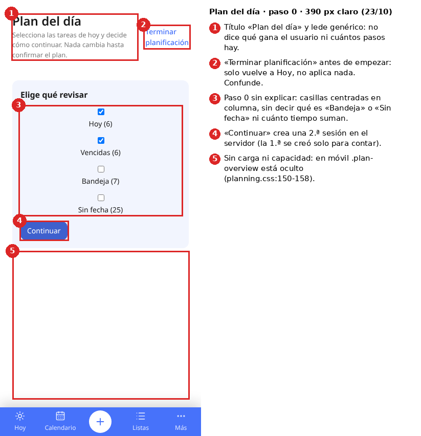
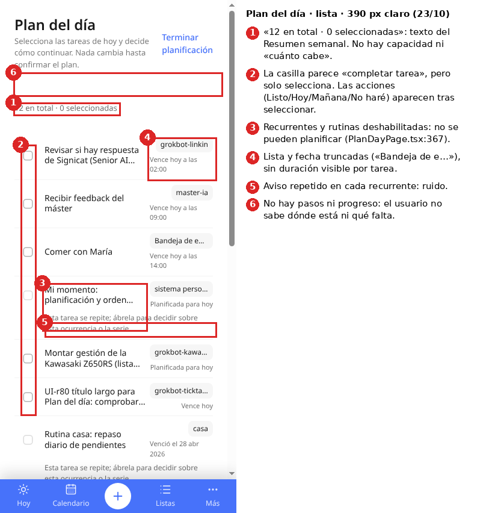
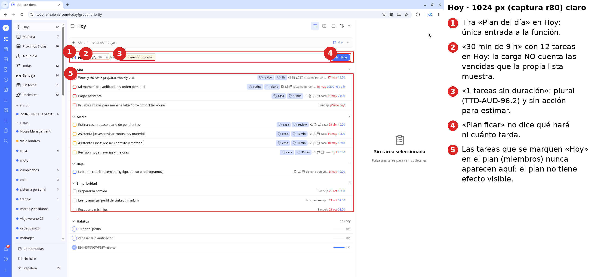

Estado actual, con la app real del clon renderizada con datos simulados (`plan-del-dia/ttd/ANTES_*.png`):

| | Claro | Oscuro |
|---|---|---|
| 1280 · paso 0 | 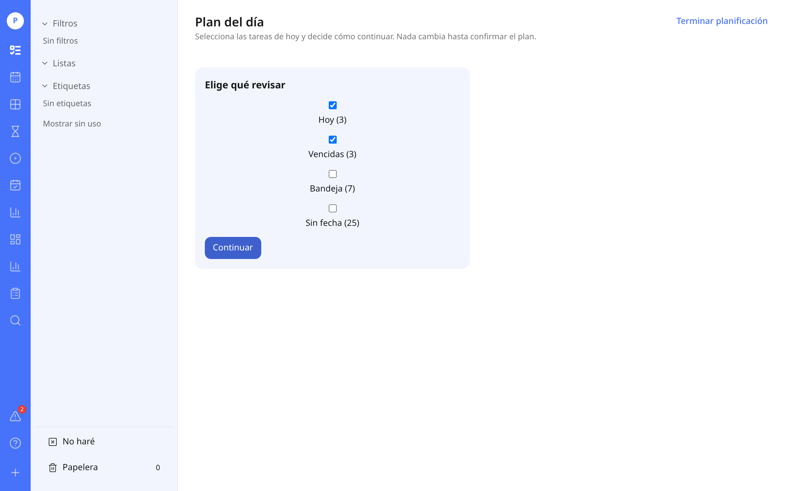 | 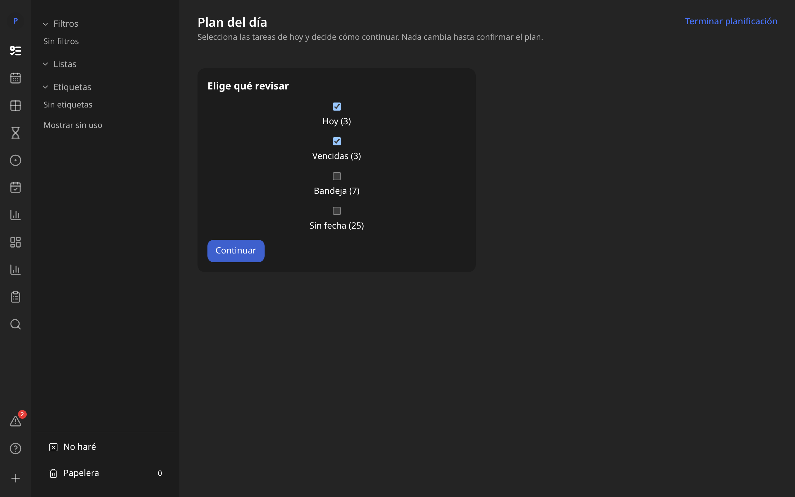 |
| 1280 · lista, 1 seleccionada | 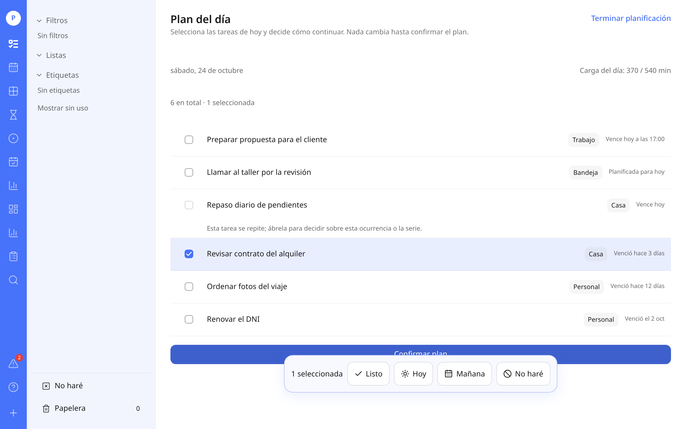 | 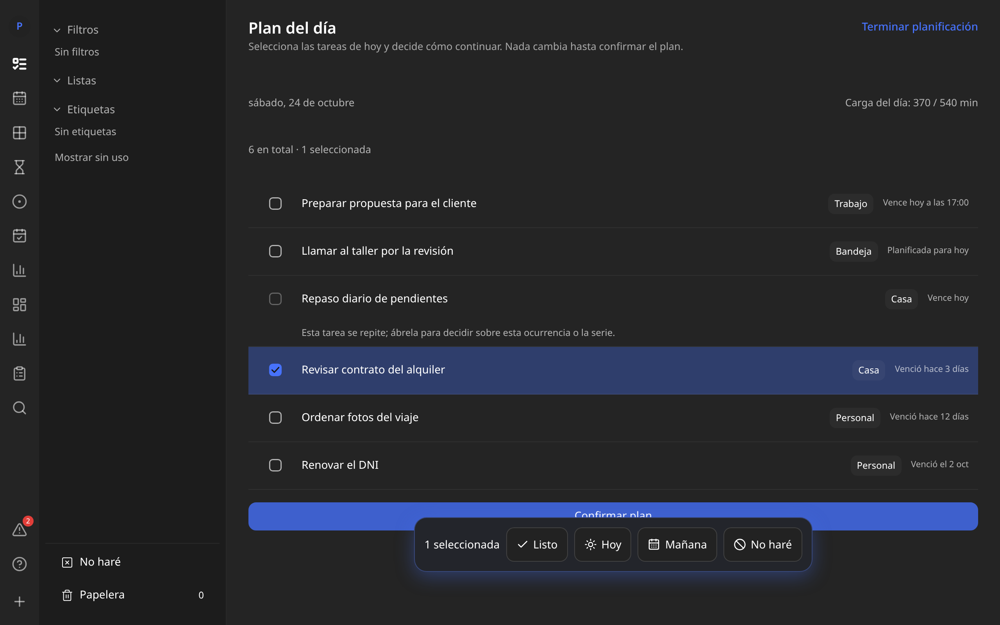 |
| 390 · paso 0 | 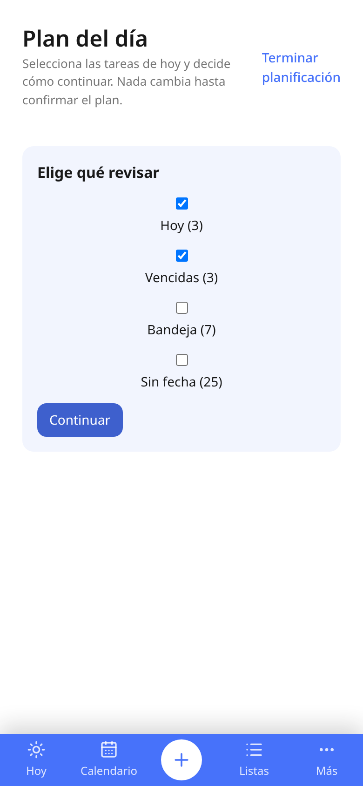 | 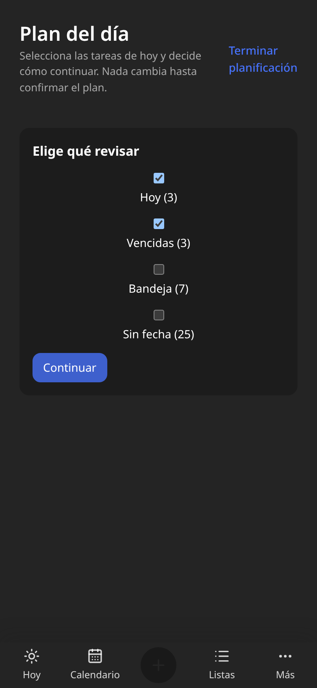 |
| 390 · lista, 1 seleccionada | 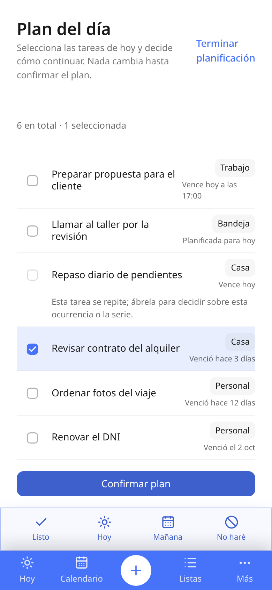 | 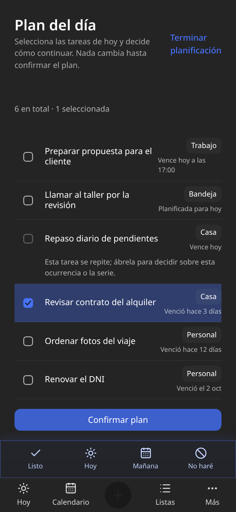 |

| # | Qué ve | Qué no entiende | Evidencia |
|---|---|---|---|
| C1 | «Plan del día» y «Planificar» | Qué gana, cuánto tarda y que es un proceso de varios pasos | `TodayPlanStrip.tsx:67-71`, `PlanDayPage.tsx:689-729` |
| C2 | «Terminar planificación» arriba a la derecha desde el paso 0 | Parece «guardar», pero solo vuelve a Hoy sin aplicar | `PlanDayPage.tsx:251` |
| C3 | Casillas Hoy / Vencidas / Bandeja / Sin fecha centradas en columna | Qué es «Bandeja» o «Sin fecha» y por qué elegirlas | captura 161, `:292-326` |
| C4 | Casilla cuadrada junto a cada tarea | Parece «completar»; en realidad selecciona. Las acciones no se ven hasta seleccionar. | `PriorityCheck :363-375` |
| C5 | «12 en total · 0 seleccionadas» | Copia del Resumen semanal; no dice si el día cabe | `weekly-text.ts:145-153` |
| C6 | Recurrentes grises con «Esta tarea se repite; ábrela…» | Por qué no puede planificar su rutina | `:400-402` |
| C7 | «Hoy» y «Mañana» | Tras confirmar, **nada cambia en Hoy ni en el calendario** | §3 BUG-146 |
| C8 | La 2.ª visita muestra otra pantalla («Ajustar») con «Conservar», «Usar sugerencia» y «Cancelar» | Por qué cambió la pantalla; «Cancelar» significa «No haré» | `DayPlanEntry.tsx:52-55`, `AdjustmentPage.tsx:122-189` |
| C9 | Términos que cambian | Hecho / Listo / Hecha; Cancelar / No haré; Confirmar plan / Aplicar / Guardado | `extra.ts:157-163, 953-963, 1091-1104` |
| C10 | «Carga: 8910 min / 540 min» (Ajustar), «148 h 30 de 9 h» (tira, derivado) | Números crudos, sin «cabe» o «no cabe» ni causa | `AdjustmentPage.tsx:104-109`, BUG-145 |
| C11 | «Creando…» mientras carga; «No se ha podido completar.» si falla | Textos genéricos y equivocados | `DayPlanEntry.tsx:37-51` |
| C12 | Móvil | No hay capacidad (oculta) y los nombres de lista salen truncados | `planning.css:150-158` |
| C13 | Barra flotante «1 seleccionada · Listo / Hoy / Mañana / No haré» | En escritorio **tapa «Confirmar plan»**; en móvil se apila sobre la barra inferior: dos barras de iconos seguidas | `ANTES_*_lista.png` |
| C14 | Paso 0 en escritorio | Media pantalla vacía y casillas centradas como un formulario | `ANTES_escritorio-1280_*_paso0.png` |

**Conclusión:** falta un modelo mental. No hay pasos, la acción recomendada no se ve, el resultado no se ve y el vocabulario es interno (replan, borrador, decisiones).

---

## 3. Errores con evidencia

Los IDs son **propuestos**, a partir del siguiente libre (145). Ninguno está registrado en «ttd · desarrollo».

| ID | P | Error | Evidencia / reproducción |
|---|---|---|---|
| **BUG-145** | P1 | **Las tareas que abarcan varios días suman su duración completa en cada día** → carga del 1650 %. | `day-load.ts:47-50` suma `durationMinutes` sin recortarlo al día; `day-closing.service.ts:533-560` (`onDay`) la incluye cada día del rango. Reproducción: `get_day_load 2026-10-24` → 8910/540 con `ae99a65d` (8820 min, del 20 al 26/10). |
| **BUG-146** | P1 | «Hoy» o «Mañana» en el plan **no tienen efecto visible**: solo crean un `PlanMember`; Hoy no lo muestra y la fecha no cambia. | `planning.service.ts:332-346, 355-379`; `board.ts:67-94` (Hoy = vencidas + ventana de fecha); en la web nadie lee `members`. Reproducción: tarea sin fecha → «Hoy» → Confirmar → no aparece en Hoy. |
| **BUG-147** | P1 | **La misma decisión significa cosas distintas**: en el plan, `plan_day`/`later` solo añaden la tarea a la lista interna; en replan/cierre, cambian `startDate`. | `planning.service.ts:332-379` frente a `day-closing.service.ts:502-527` |
| **BUG-148** | P1 | Confirmar con **0 decisiones** marca el día como planificado, y desde entonces solo se ve «Ajustar». Ajustar es un **replan de fin de día**: «Usar sugerencia» a media mañana manda a mañana todo lo que no vence hoy. | `PlanDayPage.tsx:477-487`; `DayPlanEntry.tsx:52-55`; `replan.ts:47-75` |
| **BUG-149** | P2 | Cada visita crea **2 sesiones** (una solo para contar) y cada montaje de Ajustar crea una sesión replan. Quedan borradores huérfanos. | `PlanDayPage.tsx:91-173`; `AdjustmentPage.tsx:20-47`; `planning.service.ts:100-116`. Relacionado con 85.4. |
| **BUG-150** | P2 | `someday` y `plan_day`/`later` de replan escriben con `prisma.task.update` **saltándose `TasksService`**: sin evento, versión ni actividad, así que sync y webhooks no se enteran. | `planning.service.ts:347-353`; `day-closing.service.ts:471-478, 502-509` |
| **BUG-151** | P2 | El replan reparte por **orden de UUID**, no por prioridad ni fecha límite. Los días laborables están fijos de lunes a viernes. El motivo muestra la fecha ISO cruda. | `replan.ts:64`, `day-load.ts:133-140`, `replan.ts:100` |
| **BUG-152** | P2 | **La carga de Hoy no cuenta las vencidas** que la propia lista Hoy muestra: «30 min de 9 h» con 12 tareas a la vista. | `day-closing.service.ts:533-560` (`includeOverdue` es false en la carga); captura TTD-R80_01 |
| **BUG-153** | P2 | Zona horaria incoherente: la carga de Hoy usa la zona del navegador y el plan, la del perfil. | `TodayPage.tsx:195-205` frente a `DayPlanEntry.tsx:15-31` |
| **BUG-154** | P3 | La API no devuelve `preview.someday`; `hidden_overdue` siempre vale 0 porque nunca se envía `limit`. | `planning.service.ts:568-583`; `PlanDayPage.tsx` |
| **BUG-155** | P3 | Textos equivocados o incoherentes y CSS muerto. | «Creando…» (`DayPlanEntry.tsx:37`, `es.ts:182`); `laterDate`/`hidden` sin uso; `.plan-choices` y `.plan-later` sin uso (`planning.css`); `PlanDayPage` importa `product/weekly.css` y `useWeeklyCopy` (`:10-11`); `planning.css` usa tokens que no existen, `var(--line,#d9d4cc)` y `var(--panel,#fff)` (`:13-15`), así que `.plan-card` (WontDoPage) sale blanca en oscuro |

**Cobertura TTD-AUD existente (no se repite):**
- 94: paso 0 con vencidas. Hecho en v0.2.0.
- 96.5: títulos largos.
- 85 y 85.4: robustez de replan y sesión vacía.
- 113: replan con fecha futura (paquete D).
- 32: `window.confirm` en planificación.
- 96.2: plural «1 tareas». Ya corregido con `pluralMessage` (`TodayPlanStrip.tsx:48`).

---

## 4. Comparación

### 4.1 TickTick

| Aspecto | TickTick | ttd hoy | Propuesta |
|---|---|---|---|
| Plan Your Day | Botón en Hoy; procesa vencidas y de hoy **de una en una**: Hecha / Hoy (con franja horaria) / Más tarde (mañana, próximo lunes, fecha) / No haré / Eliminar ([blog TickTick](https://blog.ticktick.com/2020/12/08/20-lesser-known-ticktick-features/), [MakeUseOf](https://www.makeuseof.com/ticktick-tricks-to-supercharge-productivity/)) | Por lotes, sin franja horaria y sin fecha personalizada | Tarea a tarea con 5 acciones (Hoy, Mañana, Otro día, Hecha, No lo haré; Algún día y Eliminar en «…») y **se puede volver atrás** (TickTick no deja) |
| Bloques | «Arrange Tasks»: arrastrar tareas sin fecha a huecos del calendario | No | Sin acción «Bloque»: hora opcional («Sin hora ▾») o arrastre a la agenda del día |
| Duración | Inicio y fin de la tarea; pomodoros estimados | Hay `duration_minutes`, pero no se ve en el plan | Chips pequeños 15 · 30 · 45 · 1 h · Otra, con 30 min por defecto |
| Capacidad | No muestra carga explícita | Sí, pero estática, cruda y oculta en móvil | **Carga en vivo por día, discreta:** barra fina verde/ámbar/roja en el carrusel y una frase («Va justo · 50 min libres»). Nuestro diferencial, sin ruido |

### 4.2 Buenas prácticas

Capacidad frente a carga, con un margen del 15 %. Fecha límite frente a fecha de inicio (no mover lo que vence). Prioridad. Las rutinas cuentan. Los eventos del calendario restan capacidad. Descansos y foco (P3). Revisión diaria corta (≤ 3 min). Deshacer.

---

## 5. Por qué merece la pena

**El problema real.** Cada mañana Hoy mezcla vencidas antiguas, lo previsto y las rutinas, y la jornada no da para todo. Pablo tiene hoy 12 tareas a la vista y ninguna indicación de si caben.

**Hacerlo a mano** supone abrir cada tarea, cambiar la fecha y calcular de cabeza. Son unos 20–40 toques para 12 tareas y no te dice si el día cabe.

**Con el triaje** basta **1 toque por tarea**: la siguiente llega sola, ves la capacidad en vivo y cierras con un resumen. El objetivo es menos de 2 minutos y que Hoy quede realista, con lo que sobra movido con criterio.

**Métricas** (eventos `plan.*` en la actividad, sin datos personales):

| Métrica | Definición | Objetivo a 4 semanas |
|---|---|---|
| Activación | % de días con Hoy abierto en los que se empieza «Planifica tu día» | ≥ 30 % |
| Finalización | Confirmados / empezados | ≥ 70 % |
| Tiempo | Mediana de inicio a confirmación | ≤ 120 s |
| Decisiones útiles | % no «Saltar» | ≥ 80 % |
| Realismo | Ratio de carga tras confirmar ≤ 1 | ≥ 75 % de los días |
| Cumplimiento | % de las tareas marcadas «Hoy» completadas ese día | ≥ 60 % (subiendo) |
| Vencidas | Nº de vencidas a 7 días | Bajando |
| Deshacer | % de confirmaciones deshechas | ≤ 10 % (si es más alto, la UI confunde) |

---

## 6. Qué recortar

1. **La lista interna `PlanMember` como efecto de «Hoy» o «Mañana».** Hoy no se ve. Todas las acciones deben **escribir la fecha de inicio** (y la hora y la duración si se eligen) con `TasksService`. `PlanMember` puede quedar como registro histórico de qué se decidió.
2. **AdjustmentPage como pantalla aparte.** Se sustituye por volver a entrar en el mismo triaje con lo que queda. El replan de fin de día sigue en Cierre del día (ShutdownPage).
3. **La pantalla de entrada (paso 0 de fuentes).** Se entra **directamente a la primera tarea**. Fuentes por defecto: Hoy + Vencidas. «Bandeja» y «Sin fecha» se añaden desde el menú «…» de la cabecera y se recuerdan.
4. **La selección múltiple** como interacción principal (queda como «modo lote» P3).
5. **La copia y el CSS del Resumen semanal** (`weekly.css`, `useWeeklyCopy`).
6. **La flag `day_replan`.** Queda `day_plan` (antes `day_load`) y `day_closing`.
7. **De la v2 (descartado tras el feedback de Pablo):**
   - la zona azul «Por qué te sugerimos…» y la acción marcada como «Sugerida»;
   - la zona amarilla «¿Cuánto te llevará?», su texto y el chip «Sin duración»;
   - la tarjeta de capacidad, los porcentajes por día, «Te sobran X», la franja de día sobrecargado y las líneas de efecto o vista previa al pasar el ratón;
   - los grupos «Hacerla / Moverla / Cerrarla» con 8 botones, la acción «Bloque horario» y la doble tecla (letra o número);
   - las secciones de la cola, los días de retraso por fila y el «≈ N min»;
   - el onboarding de 3 consejos;
   - la hoja de bloque horario en móvil y el «modo bloque» de teclado.

---

## 7. Rediseño UX/UI (v3, aprobado)

**Principios:** decidir rápido y sin miedo; poco texto; mucho espacio; ni amarillo ni azul de sugerencia; una sola señal de carga; todo se puede deshacer y se puede volver atrás.

**Bocetos aprobados** (`plan-del-dia/ttd-simple/`, 1280×800 y 390×844, claro, datos inventados; notas en `NOTAS.md`):

| Pantalla | Captura |
|---|---|
| Escritorio · tarea actual abierta (pantalla principal) | 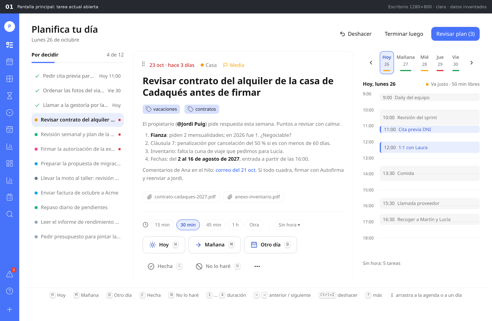 |
| Escritorio · carrusel en «Mañana» y tarea arrastrándose a las 9:30 | 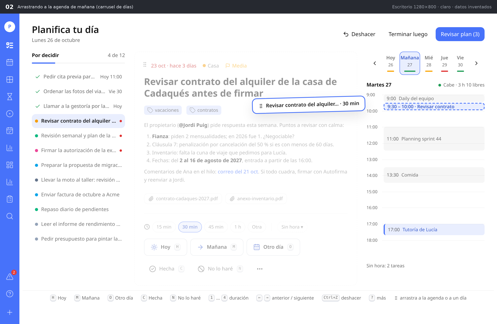 |
| Escritorio · resumen final | 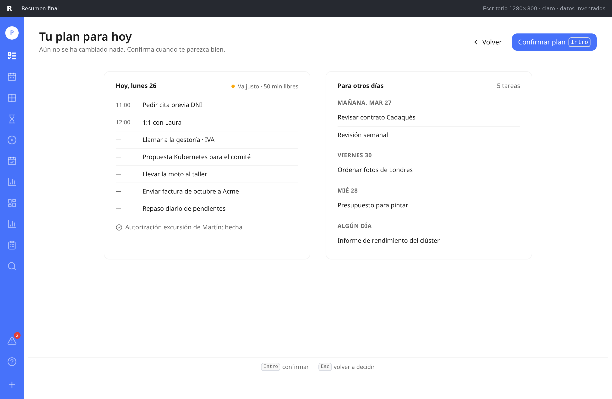 |
| Móvil · tarjeta, «Otro día», tras decidir (deshacer/volver) y resumen | 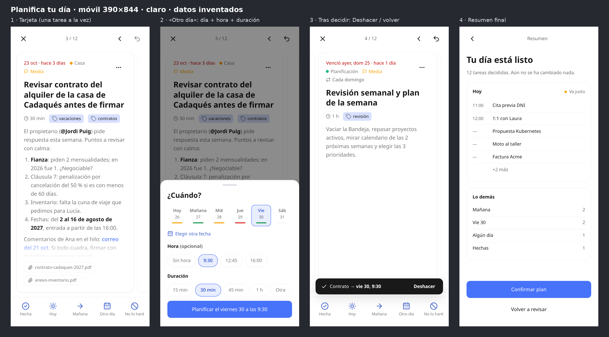 |

**Fuente del boceto:** `plan-del-dia/ttd-simple/fuente/` (`SimpleMock.tsx`, `simple-mock.css`, `realData.ts`, la spec y la config de Playwright, y el diff de la ruta `/plan/mock?simple=d1|d2|d3|m1..m4`). Usa solo tokens de `styles/tokens.css`, `Button`, `Kbd`, `TagChip`, `react-markdown` e iconos `lucide-react`, que ya están en el repo.

### 7.1 Modelo de acciones (común a escritorio, móvil y MCP)

| Peso | Acción | Atajo | Arrastre | Efecto al confirmar (con `TasksService`) |
|---|---|---|---|---|
| Principal | ☀ **Hoy** | H | A la agenda de hoy (con hora) o al chip «Hoy» | `startDate` = hoy (con la hora si se eligió). La fecha límite no cambia. |
| Principal | → **Mañana** | M | A la agenda de mañana o al chip «Mañana» | `startDate` = mañana (con la hora si se eligió) |
| Principal | 📅 **Otro día** | O | A cualquier chip del carrusel o a su agenda | Abre «¿Cuándo?» (día, hora opcional y duración) → `startDate` = día elegido |
| Discreta | ✓ **Hecha** | C (y Espacio, como en las listas) | — | `complete` |
| Discreta | ⊘ **No lo haré** | N | — | `cancel` (lista «No haré») |
| Menú «…» | ☁ **Algún día** | A (solo en la ayuda «?») | — | `isSomeday=true`, `startDate=null` |
| Menú «…» | 🗑 **Eliminar** | Supr (solo en la ayuda «?») | — | `remove` (papelera, se puede restaurar) |
| — | **Anterior / siguiente** | ← / → | — | Navega por la cola; → sin decidir = saltar (sin cambio) |
| — | **Deshacer** | Ctrl/Cmd+Z | — | Revierte la última decisión o el último arrastre y devuelve la tarjeta |

- **Duración:** chips 15 · 30 · 45 · 1 h · Otra (teclas 1–4 para los cuatro primeros; «Otra» abre un campo de minutos, de 5 a 480, paso 5). Se preselecciona la duración de la tarea si la tiene; si no, **30 min** (la por defecto del perfil). Sin texto explicativo.
  - Se escribe `duration_minutes` **solo** si el usuario cambia el chip o elige hora. Si no, la carga usa la duración por defecto, igual que hoy.
- **Hora opcional «Sin hora ▾»:** desplegable con los huecos libres del día destino (cada 15 min, dentro de la jornada, sin solapar eventos ni tareas con hora) y «Otra hora…». Con hora + duración la tarea queda **con hora en el calendario**: es el antiguo «bloque horario», sin acción propia.
- **Una sola decisión por tarea**, con este contrato (dominio, API y MCP): `{ action: today|tomorrow|move|done|wont_do|someday|delete|skip, date?, time?, duration? }`. El arrastre produce la misma decisión que los botones.
- **Recurrentes:** la acción afecta **solo a esta ocurrencia**. **Hábitos:** cuentan en la carga y se pueden saltar hoy.
- Las acciones destructivas no piden confirmación porque hay deshacer (resuelve TTD-AUD-32 en este flujo).
- **Atajos sin conflicto con los globales** (`shell/shortcuts.ts`): dentro del triaje, N = «No lo haré», ←/→ = cola, 1–4 = duración; G+letra, «/», Ctrl/Cmd+K y «[» siguen siendo globales; «?» abre la ayuda **del triaje**.

### 7.2 Escritorio (1280 px)

Disposición (ver `01_escritorio.png`):

```
┌ Planifica tu día · Lunes 26 de octubre ─────────────── [↶ Deshacer] [Terminar luego] [Revisar plan (3)] ┐
│ Por decidir   4 de 12 │ ⠿ 23 oct · hace 3 días  ● Casa  ⚑ Media            │ ‹ [Hoy 26▬] Mañana▬ Mié▬ Jue▬ Vie▬ › │
│ ▔▔▔▔▔                 │                                                      │ Hoy, lunes 26     ● Va justo · 50 min libres │
│ ✓ Pedir cita…  Hoy 11 │ Revisar contrato del alquiler de la casa de          │ 9:00  Daily del equipo         │
│ ✓ Ordenar…     Vie 30 │ Cadaqués antes de firmar                             │ 10:00 Revisión del sprint      │
│ ✓ Llamar…      Hoy    │ [vacaciones] [contratos]                             │ 11:00 Cita previa DNI          │
│ ● Revisar contrato… • │ Descripción entera en markdown…                      │ 12:00 1:1 con Laura            │
│   Revisión semanal… • │ [📎 contrato.pdf] [📎 anexo.pdf]                     │ 13:30 Comida                   │
│   …                   │ ⏱ 15 min [30 min] 45 min 1 h Otra   Sin hora ▾       │ …                              │
│                       │ [☀ Hoy H] [→ Mañana M] [📅 Otro día O]               │                                │
│                       │ ✓ Hecha C   ⊘ No lo haré N   …                       │ Sin hora: 5 tareas             │
├───────────────────────┴──────────────────────────────────────────────────────┴────────────────────────────────┤
│ H Hoy · M Mañana · O Otro día · C Hecha · N No lo haré · 1…4 duración · ←→ anterior/siguiente · Ctrl+Z deshacer · ? más · ⠿ arrastra a la agenda o a un día │
└──────────────────────────────────────────────────────────────────────────────────────────────────────────────┘
```

- **Cabecera:** título, fecha larga del día, **Deshacer**, «Terminar luego» (guarda el borrador y vuelve a Hoy) y «Revisar plan (n)» (primario, n = decisiones tomadas; deshabilitado con 0). El «…» de la cabecera añade fuentes (Bandeja, Sin fecha).
- **Izquierda, cola simple** (~240 px): «Por decidir · 4 de 12» con una barra fina de progreso. Una lista **sin secciones**: las decididas llevan ✓ y su destino («Hoy 11:00», «Vie 30»); las vencidas, un punto rojo; la actual, resaltada. Clic en una fila → abre esa tarea. Los títulos se truncan (la tarjeta muestra el completo).
- **Centro, la tarea con aire:** asa ⠿; fecha vencida en rojo («23 oct · hace 3 días»), lista con su color, prioridad, recurrencia; título grande completo; etiquetas (`TagChip`); **descripción entera renderizada** (markdown, menciones y enlaces); adjuntos. Debajo, separados por una línea: chips de duración + «Sin hora ▾»; fila de 3 acciones principales con su `Kbd`; fila discreta con Hecha, No lo haré y «…».
- **Derecha, sidebar** (~19 rem):
  - **carrusel de días** ‹ Hoy · Mañana · Mié · Jue · Vie › (5 visibles, hasta 14 días con las flechas). Cada día lleva **una barra fina**: verde = cabe (≤ 85 %), ámbar = va justo (≤ 100 %), roja = no cabe. **Sin porcentajes.** Los días sin jornada (fin de semana por defecto) salen en gris;
  - debajo, el día elegido y **una sola frase**: «Cabe · 3 h 10 libres», «Va justo · 50 min libres» o «No cabe · sobran 40 min»;
  - la **agenda** del día elegido (eventos de Google + tareas con hora + lo decidido en esta sesión), de la jornada (09:00–18:00 en el perfil de Pablo), y al pie «Sin hora: N tareas».
  - Elegir otro día en el carrusel (clic o ⇧←/⇧→) **solo cambia la agenda que ves**; la cola no cambia. Es la forma de mirar «¿cabe el jueves?» antes de decidir.
- **Pie:** la leyenda de atajos, **pegada al footer**, en gris y en una sola línea; incluye la pista de arrastre (⠿).
- **Arrastre** (`02_escritorio-extra.png`): la tarjeta (asa ⠿) o una fila de la cola se arrastran:
  - a la **agenda**: un fantasma con la hora y la duración elegida («9:30 – 10:00 · Revisar contrato»), ajustado cada 15 min. Al soltar → decisión con fecha y hora;
  - a un **chip del carrusel**: el chip se resalta. Al soltar → decisión sin hora para ese día;
  - mientras arrastras, la tarjeta se atenúa; al soltar se pasa a la siguiente;
  - sobre un evento no se puede soltar (fantasma con `--danger` y «Se solapa con …»);
  - usa los tokens `--calendar-drag-ghost-*` y `--calendar-drag-lift-shadow` que ya existen.
- **Siguiente automático:** tras decidir, la fila se marca con ✓ y entra la siguiente con una transición de 160 ms (sin animación con `prefers-reduced-motion`). El foco va al título.
- **«Otro día» (O) en escritorio:** abre un popover anclado al botón con lo mismo que la hoja móvil: días con su barra, «Elegir otra fecha» (`DatePopover`), hora opcional y duración. Si el carrusel está en otro día, ese día viene preseleccionado.

### 7.3 Móvil (390 px)

Ver `03_movil.png`.

- **Una tarea por pantalla**, en tarjeta, con **la siguiente asomando** a la derecha (y la anterior asomando a la izquierda tras decidir).
- **Arriba:** ✕ (cierra y guarda el borrador), contador «3 / 12», «‹ Anterior» y ↶ Deshacer.
- **Tarjeta:** fecha vencida en rojo, lista, prioridad, recurrencia, «…» (Algún día, Eliminar), título completo, duración como dato («⏱ 30 min», al tocarlo se elige otra), etiquetas, descripción renderizada (si es larga, se corta con un degradado y «Ver más» la abre en el sitio) y adjuntos.
- **Barra fija inferior** con 5 acciones (icono + etiqueta, ≥ 44 px de alto): **Hecha · Hoy · Mañana · Otro día · No lo haré**. La barra inferior de la app se oculta mientras planificas.
- **«Hoy» y «Mañana» deciden al momento** con la duración que haya.
- **Hoja «¿Cuándo?»** (Otro día): carrusel de días con su barra fina, «Elegir otra fecha» (`DatePopover`), **Hora (opcional)**: «Sin hora» + huecos libres, **Duración**: 15 · 30 · 45 · 1 h · Otra, y un botón con el resultado en palabras: «Planificar el viernes 30 a las 9:30». Sin calendario mensual.
- **Tras decidir:** toast «Contrato → vie 30, 9:30 · Deshacer» (5 s). **Se puede volver atrás** con «‹ Anterior» o deslizando a la derecha: la tarea anterior vuelve con su decisión visible y se puede cambiar.
- **Gestos:** solo deslizar para navegar (anterior/siguiente); nunca deciden solos.
- **Resumen:** «Tu día está listo · 12 tareas decididas. Aún no se ha cambiado nada.» Bloque Hoy con su estado («Va justo») y la lista con hora o «—» (+N más), bloque «Lo demás» con recuentos (Mañana, Vie 30, Algún día, Hechas), **Confirmar plan** y «Volver a revisar».

### 7.4 Resumen final (escritorio)

Ver `02b_escritorio-resumen.png`.
- Título «Tu plan para hoy» y «Aún no se ha cambiado nada. Confirma cuando te parezca bien.»
- Izquierda, **Hoy** con su frase de estado: primero lo que tiene hora (en orden), luego lo que no («—»), y las hechas en gris («… : hecha»).
- Derecha, **Para otros días**, agrupado por día (Mañana, Mié 28, Viernes 30…) y «Algún día».
- «‹ Volver» (Esc) y **Confirmar plan** (Intro). Tras confirmar: toast «Día planificado · 11 cambios · Deshacer» y vuelta a Hoy.

### 7.5 Estados

- **Cargando:** `SkeletonRows` con la misma disposición («Preparando tu día…», nunca «Creando…»).
- **Vacío:** `EmptyState` «Hoy no tienes nada pendiente» · «Planificar mañana».
- **Error al confirmar:** `ErrorState` «No hemos podido guardar tu día · Tus decisiones siguen aquí; no se ha cambiado nada.» · Reintentar.
- **Conflicto:** «“Llamar al taller” cambió en otro dispositivo. La hemos quitado del resumen.»
- Con el mismo look en claro y oscuro (los bocetos son en claro; el oscuro sale de los tokens).

### 7.6 Microcopy (es)

| Clave | Texto |
|---|---|
| Cabecera | **Planifica tu día** · «Lunes 26 de octubre» · «Deshacer» · «Terminar luego» · «Revisar plan (3)» |
| Cola | «Por decidir» · «4 de 12» |
| Acciones | «Hoy» · «Mañana» · «Otro día» · «Hecha» · «No lo haré» · «…» → «Algún día», «Eliminar» |
| Duración | «15 min» · «30 min» · «45 min» · «1 h» · «Otra» |
| Hora | «Sin hora ▾» · «Otra hora…» |
| Estado del día | «Cabe · 3 h 10 libres» · «Va justo · 50 min libres» · «No cabe · sobran 40 min» · aria: «Martes 27: va justo, 50 minutos libres» |
| Agenda | «Hoy, lunes 26» · «Sin hora: 5 tareas» |
| Atajos (pie) | «H Hoy · M Mañana · O Otro día · C Hecha · N No lo haré · 1…4 duración · ← → anterior / siguiente · Ctrl+Z deshacer · ? más · ⠿ arrastra a la agenda o a un día» |
| Arrastre | fantasma «9:30 – 10:00 · Revisar contrato» · solape «Se solapa con Comida» |
| Hoja móvil | «¿Cuándo?» · «Elegir otra fecha» · «Hora (opcional)» · «Sin hora» · «Duración» · «Planificar el viernes 30 a las 9:30» |
| Toast | «Contrato → vie 30, 9:30 · Deshacer» · «Día planificado · 11 cambios · Deshacer» |
| Resumen escritorio | «Tu plan para hoy» · «Aún no se ha cambiado nada. Confirma cuando te parezca bien.» · «Para otros días» · «Algún día» · «Volver» · **«Confirmar plan»** |
| Resumen móvil | «Tu día está listo» · «12 tareas decididas. Aún no se ha cambiado nada.» · «Lo demás» · «Hechas» · **«Confirmar plan»** · «Volver a revisar» |
| Estados | «Preparando tu día…» · «Hoy no tienes nada pendiente» · «No hemos podido guardar tu día» · «Reintentar» |
| Ayuda «?» | «Atajos de Planifica tu día» · «Mientras planificas, N es “No lo haré” y ←/→ recorren la cola.» |

**Vocabulario único:** «Hecha» (nunca «Listo» ni «Completar»), «No lo haré» (nunca «Cancelar»), «Confirmar plan» (nunca «Aplicar» ni «Guardado»). En la UI no aparecen «replan», «borrador», «decisiones», «bloque horario» ni «sugerida».

### 7.7 Accesibilidad

- **Tarjeta:** `role="group"` con `aria-labelledby`; foco al título al cambiar de tarea; `aria-live="polite"`: «Tarea 4 de 12: …» y «Movida al viernes 30 a las 9:30. Deshacer con Ctrl+Z».
- **Acciones:** `<button>` con `aria-keyshortcuts`, ≥ 44 px (`--tap`) en móvil. Chips de duración: `role="radiogroup"`.
- **Carrusel:** `role="tablist"`, `aria-selected` y un `aria-label` con el estado en texto (el color nunca es la única señal).
- **Agenda:** lista textual equivalente para lectores de pantalla.
- **Arrastre:** siempre tiene alternativa: **O** (popover/hoja con día, hora y duración) consigue lo mismo con teclado; en táctil, pulsación larga de 300 ms.
- **Hojas y popovers:** `role="dialog"`, trampa de foco y Esc.
- **Atajos:** desactivados mientras escribes (`isTypingTarget`). Con `prefers-reduced-motion`, sin animación.

---

## 8. Mejoras priorizadas

Formato de cada mejora: descripción · motivación · cambio (UI / API / dominio / MCP / tests) · criterios de aceptación (CA) · esfuerzo · dependencias · cobertura TTD-AUD.

### P1

**M1 · Acciones que escriben fechas reales (modelo único)**
- **Descripción:** `today`, `tomorrow` y `move` escriben `startDate` (con hora si la hay) y, si se eligió, `duration_minutes`, con `TasksService`, en el plan, el replan y el cierre. `someday`, `done`, `wont_do` y `delete` también pasan por `TasksService`.
- **Motivación:** BUG-146, 147 y 150.
- **Cambio:**
  - dominio: `planning/actions.ts` con el contrato de §7.1 y `effectOf(decision)`;
  - API: `planning.service.applyOne` y `day-closing.service.applyOne` usan `TasksService`;
  - `PlanMember` solo como registro histórico.
- **CA:**
  - una tarea sin fecha → «Hoy» → confirmar → aparece en Hoy y en el calendario del día;
  - «Mañana» con «9:30» y 30 min → aparece en el calendario de mañana de 9:30 a 10:00;
  - la actividad registra `task.updated` con `source:'plan'`; `version` +1;
  - `due_date` sin cambios;
  - un grep de `prisma.task.update` en `modules/planning` da 0.
- **Esfuerzo:** M. **Dependencias:** después del paquete D (113). **TTD-AUD:** nuevo (BUG-146/147/150).

**M2 · Carga correcta**
- **Descripción:**
  - una tarea de varios días cuenta solo su parte dentro de la jornada de ese día, o su duración por defecto si no tiene hora;
  - las vencidas cuentan si están en Hoy;
  - se aplica la zona del perfil;
  - días laborables configurables (lunes a viernes por defecto).
- **Motivación:** BUG-145, 151, 152 y 153.
- **Cambio:**
  - dominio: `day-load.ts`, con `perDayMinutes` y `workDays`;
  - API: `queue` con `includeOverdue` coherente con Hoy; `GET /planning/load?from&days` (carga por día, para el carrusel);
  - web: `TodayPage` usa `me.time_zone` (si B está fusionado; si no, se anota).
- **CA:**
  - `ae99a65d` el 24/10 aporta ≤ 540 min;
  - `get_day_load` del 24/10 da un ratio < 2;
  - tests de dominio para un rango de 7 días.
- **Esfuerzo:** M. **Dependencias:** ninguna. **TTD-AUD:** nuevo.

**M3 · Triaje móvil simple** (v3)
- **Descripción:** §7.3: una tarea por pantalla con la siguiente asomando; X, «3 / 12», «‹ Anterior» y Deshacer arriba; barra fija con 5 acciones; hoja «¿Cuándo?»; volver atrás; resumen.
- **Motivación:** C1–C14; Pablo quiere decidir rápido y poder volver.
- **Cambio:**
  - web: `features/planning/triage/*` (`TriageFlow`, `TaskCard`, `MobileActionBar`, `WhenSheet`, `DurationChips`, `TimeSelect`, `SummaryView`, `useTriageSession`);
  - API: una sola sesión por visita (recuento sin crear sesión con `GET /planning/candidates?sources…`; luego `POST /planning/sessions` y `PUT` de decisión por tarjeta);
  - e2e: `wt-f-triage-mobile.spec.ts`.
- **CA:**
  - 12 tareas → 12 decisiones → resumen;
  - «‹ Anterior» y deslizar a la derecha devuelven la tarea anterior con su decisión, que se puede cambiar;
  - Deshacer revierte la última decisión;
  - «Hoy» decide en 1 toque; «Otro día» → hoja → «Planificar el viernes 30 a las 9:30»;
  - sin sesiones huérfanas (≤ 1 borrador por usuario y día).
- **Esfuerzo:** L. **Dependencias:** M1 y M2. **TTD-AUD:** sustituye a 94 y 96.5; resuelve 32 en el plan.

**M4 · Entrada directa y sin AdjustmentPage** (v3)
- **Descripción:**
  - `/plan/day` abre **directamente la primera tarea** (sin pantalla de entrada ni paso de fuentes);
  - fuentes por defecto Hoy + Vencidas; Bandeja y Sin fecha desde «…» de la cabecera, recordadas en `localStorage ttd.planDefaults.<id>`;
  - si el día ya se planificó: el mismo triaje con lo que queda pendiente hoy;
  - no se puede confirmar con 0 cambios.
- **Motivación:** BUG-148 y 149, C3, C8 y C14.
- **Cambio:** web: `DayPlanEntry` y eliminar `AdjustmentPage`; API: `apply` con 0 decisiones devuelve 422 `nothing_to_apply`.
- **CA:** una 2.ª visita muestra el triaje; no hay texto «Conservar» ni «Usar sugerencia»; «Revisar plan» deshabilitado con 0 decisiones.
- **Esfuerzo:** S. **Dependencias:** M3. **TTD-AUD:** 85.4.

**M5 · Microcopy y vocabulario único**
- **Descripción:** §7.6. Las claves van en `features/planning/i18n-wt-f.ts` (es y en; la convención de los paquetes A–E prohíbe tocar `i18n/extra.ts`), con el plural con `pluralMessage`.
- **Motivación:** C9 y C11, BUG-155.
- **Cambio:** web: `i18n-wt-f.ts` y `useWtFMessages()`; quitar `useWeeklyCopy` y `weekly.css`; las claves `plan*` antiguas de `extra.ts` se quedan sin uso (las borra Pablo al consolidar).
- **CA:** un grep de «Listo», «Creando…», «Aplicar», «Usar sugerencia», «Bloque horario», «Sugerida» y «Cancelar» (en el sentido de «No lo haré») en `features/planning` da 0; existen las versiones en inglés.
- **Esfuerzo:** S. **Dependencias:** M3. **TTD-AUD:** 96.2 ya hecho.

### P2

**M6 · Escritorio simple: cola · tarea · sidebar de días** (v3)
- **Descripción:** §7.2. Cola simple a la izquierda, tarea con aire en el centro (duración + hora + 3 acciones principales + 2 discretas + «…»), sidebar con carrusel y agenda, atajos pegados al footer, Deshacer en la cabecera y Ctrl+Z, ayuda «?».
- **Cambio:**
  - web: `triage/TriageDesktop.tsx`, `QueueList.tsx`, `DayRail.tsx`, `DayAgenda.tsx`, `ShortcutFooter.tsx`, `TriageHelp.tsx` y `WhenPopover.tsx`, que reutilizan `TaskCard`, `DurationChips` y `TimeSelect`;
  - un listener de teclado **propio del triaje**, en fase de captura y con `stopPropagation`, que respeta `isTypingTarget`. No se toca `shell/GlobalKeys.tsx`.
- **CA:**
  - triaje completo solo con teclado (H, M, O, C, N, 1–4, ←/→, Ctrl+Z, Intro);
  - la leyenda del pie está siempre visible en una línea a 1280 px;
  - no hay zona azul, amarilla ni tarjeta de capacidad; no hay porcentajes;
  - la agenda muestra los eventos de Google del día elegido;
  - axe sin violaciones serias.
- **Esfuerzo:** L. **Dependencias:** M3. **TTD-AUD:** 60, sin conflicto.

**M7 · Duración y hora opcional** (v3; sustituye a «Bloque horario»)
- **Descripción:** chips 15 · 30 · 45 · 1 h · Otra (30 por defecto, o la de la tarea) y «Sin hora ▾» con los huecos libres del día destino cada 15 min.
- **Cambio:** dominio: `planning/slots.ts` (`freeSlots`, `snap15`); API: huecos en `GET /planning/load` o `GET /planning/slots?date`; decisión con `time` y `duration`.
- **CA:**
  - con la daily de 9:00 a 9:30, el primer hueco de 30 min es 9:30;
  - nunca ofrece una hora que se solape con un evento;
  - respeta la jornada y `evening_start`;
  - sin elegir nada, la tarea se planifica sin hora y sin escribir `duration_minutes`.
- **Esfuerzo:** M. **Dependencias:** M1. **TTD-AUD:** nuevo.

**M8 · Orden de la cola y replan priorizado**
- **Descripción:** la cola y `proposeReplan` ordenan por prioridad y vencimiento (no por UUID); el motivo usa fecha humana («lunes 26»). En la UI **no** se muestra ninguna sugerencia.
- **Cambio:** dominio: `replan.ts` y `day-plan.ts`, con tests.
- **CA:** con la capacidad llena, la prioridad alta queda antes que la baja.
- **Esfuerzo:** S. **Dependencias:** ninguna. **TTD-AUD:** BUG-151.

**M9 · Recurrentes y hábitos en el plan**
- **Descripción:** acciones sobre la ocurrencia: «Hoy», saltar hoy y «Otro día» solo esta vez.
- **Cambio:** API: usar el `detach` o `skip` de la ocurrencia existente; web: ↻ con la regla en la tarjeta.
- **CA:** mover una diaria a otro día → solo cambia esa ocurrencia y la serie sigue.
- **Esfuerzo:** M. **Dependencias:** M1. **TTD-AUD:** relacionado con el bug de recurrencia de r80.

**M10 · Deshacer después de confirmar**
- **Descripción:** `POST /planning/operations/:id/revert`, que restaura los valores previos guardados en `PlanOperation.result` (antes y después).
- **CA:** «Deshacer» en la toast antes de 10 s revierte todas las tareas; idempotente; un 409 si una tarea cambió después.
- **Esfuerzo:** M. **Dependencias:** M1. **TTD-AUD:** nuevo.

**M11 · MCP para el plan del día**
- **Descripción:** herramientas con el mismo contrato de §7.1:
  - `get_day_plan`, `start_day_plan` (con `date` para cualquier día de los próximos 14);
  - `record_plan_decision` (`action`, `date?`, `time?`, `duration?`);
  - `apply_day_plan` (con `auto_apply:false` por defecto);
  - `revert_day_plan`;
  - `get_day_load` acepta `days` para varios días; `replan_day` pasa a ser un alias de volver a planificar lo que queda.
- **CA:** el flujo completo por MCP en un e2e, y `docs/mcp/CHANGELOG.md` actualizado.
- **Esfuerzo:** M. **Dependencias:** M1 y el paquete D (MCP). **TTD-AUD:** 85 y 113.

**M12 · Entrada en Hoy con valor**
- **Descripción:** la tira de Hoy muestra la misma frase de estado («Va justo · 50 min libres») y «Planifica tu día»; después de planificar, «Planificado a las 9:12» y «Volver a planificar». Visible en móvil.
- **Cambio:** `TodayPlanStrip.tsx` y `today-support.css`.
- **CA:** el texto de estado cambia según el ratio; no hay «X min / Y min» en crudo ni porcentajes.
- **Esfuerzo:** S. **Dependencias:** M2 y el paquete B. **TTD-AUD:** coordinar con B.

**M13 · Arrastrar a la agenda o a otro día** (v3)
- **Descripción:**
  - la tarjeta (asa ⠿) y las filas de la cola se arrastran;
  - **a la agenda** del día del carrusel: fantasma con hora y duración elegida, ajuste cada 15 min → decisión con fecha y hora;
  - **a un chip del carrusel:** resaltado → decisión sin hora para ese día;
  - en táctil, pulsación larga de 300 ms; con teclado, la alternativa es «O».
- **Cambio:** web: `triage/useTriageDrag.ts`, con Pointer Events, sin dependencias nuevas, con los tokens `--calendar-drag-*` en solo lectura; el resultado pasa por el mismo `decide()` que los botones.
- **CA:**
  - arrastrar la tarjeta a las 9:30 de mañana (30 min) deja «9:30 – 10:00» y pasa a la siguiente;
  - arrastrar una fila de la cola a «Vie» la mueve y cambia la barra de ese día si cambia de estado;
  - soltar sobre un evento no se permite;
  - Ctrl+Z deshace el arrastre.
- **Esfuerzo:** M. **Dependencias:** M6, M7 y M19. **TTD-AUD:** nuevo.

**M19 · Carrusel de días en la sidebar** (v3)
- **Descripción:** ‹ Hoy · Mañana · Mié · Jue · Vie › (5 visibles, 14 en total), barra fina verde/ámbar/roja por día, sin porcentajes; una frase de estado del día elegido; la agenda de ese día. Elegir día no cambia la cola. En móvil, el mismo carrusel dentro de la hoja «¿Cuándo?».
- **Cambio:** API: `GET /planning/load?from&days=14`; dominio: `dayLoad` por día con la corrección de M2; web: `triage/DayRail.tsx`.
- **CA:**
  - el color del día cambia en vivo (< 100 ms) al decidir;
  - los valores coinciden con `GET /planning/load` tras confirmar (±1 min);
  - ⇧←/⇧→ cambian el día del carrusel;
  - sin calendario mensual (salvo «Elegir otra fecha», que abre el `DatePopover`).
- **Esfuerzo:** M. **Dependencias:** M2 y M3. **TTD-AUD:** nuevo.

**M20 · Poco texto y sin onboarding** (v3; sustituye a «Claridad y onboarding»)
- **Descripción:** sin consejos iniciales ni líneas de efecto: la claridad sale de las etiquetas cortas, los `Kbd`, la leyenda del pie, el resumen («Aún no se ha cambiado nada») y la toast con deshacer.
- **CA:** no hay textos de ayuda en la tarjeta; el único texto de estado es la frase del día; test de copia en es y en.
- **Esfuerzo:** S. **Dependencias:** M3. **TTD-AUD:** C1–C14.

### P3

| ID | Mejora | Esfuerzo | Dependencias |
|---|---|---|---|
| M14 | Margen configurable (15 % por defecto) y bloques de foco o descanso (con Pomodoro, paquete E) | M | M2 |
| M15 | Delegar en listas compartidas (`assignee_id`) | S | M1 |
| M16 | Modo lote en escritorio (seleccionar varias → acción) | S | M6 |
| M17 | Métricas `plan.started`, `plan.decided`, `plan.applied` y `plan.reverted` (incluye `via: button`, `key` o `drag`) y panel en Estadísticas | S | M3 |
| M18 | Aviso de planificación diaria (Telegram/push) a la hora configurada | S | Paquete C |

---

## 9. Orden recomendado

1. **M2 + M8** (dominio, sin UI): carga correcta y orden por prioridad.
2. **M1:** el modelo único que escribe fechas. Después de D.
3. **M7:** duración y hora opcional (dominio y API).
4. **M3 + M4 + M5 + M20:** triaje móvil simple, entrada directa y textos. **Primera entrega visible (v0.3.1).**
5. **M6 + M19:** escritorio simple con carrusel y agenda.
6. **M13:** arrastre.
7. **M10 + M9 + M11:** deshacer tras confirmar, recurrentes y MCP.
8. **M12:** tira de Hoy (después de B).
9. **P3.**

---

## 10. Paquete worktree `ttd-wt-f-plan-del-dia`

El documento autónomo del paquete y su prompt están en:
- `worktrees/ttd-wt-f-plan-del-dia.md`: objetivo, reglas, puntos en orden de commits, ficheros que puede y no puede tocar, tests, criterios **F-AC-1…F-AC-30**, checklist y prompt;
- `worktrees/ttd-wt-f-plan-del-dia-prompt.txt`;
- `worktrees/ttd-wt-f-assets/`: las 4 capturas aprobadas, `NOTAS.md` y la fuente del boceto.

Siguen el mismo formato que los paquetes A–E y el caso `f` de `check-ownership.sh` (sección 12 de `ORQUESTADOR-prompt.md`).

**Resumen:**
- **Rama:** `codex/wt-f-plan-del-dia`, desde `main` **con A–E ya fusionados** (v0.3.0). Sale como v0.3.1.
- **Dueño de:** `apps/web/src/features/planning/**`, `packages/domain/src/planning/**`, `apps/api/src/modules/planning/**`, `apps/api/src/mcp/tools/planning-tools.ts`, migraciones `*_plan_*`, `playwright.wt-f.config.ts` y `e2e/wt-f-*`, `docs/audit/ttd-wt-f-*` (incluidas las capturas en `docs/audit/ttd-wt-f-assets/`).
- **Revisión a mano:** `app.tsx` (rutas), `mcp.catalog.ts` (registro), `schema.prisma` (modelos `Plan*`), `ShutdownPage.tsx`, `TodayPlanStrip.tsx` y `today-support.css` (M12) y las specs e2e de planificación que ya existen.
- **Prohibido:** `i18n/es|en|extra.ts`, `styles/tokens.css`, `components/ui.css|ui.tsx`, `shell/**`, `features/calendar|places|product|tasks/**`, `api.ts`, `modules/tasks/**`, `package.json` y el lockfile.

---

## 11. Archivos de este informe

- `plan-del-dia/ttd-simple/`: **propuesta aprobada (v3)**: `01_escritorio.png`, `02_escritorio-extra.png`, `02b_escritorio-resumen.png`, `03_movil.png`, `NOTAS.md`, `raw/` (sin pie) y `fuente/` (boceto reutilizable).
- `plan-del-dia/ANOT_*.png`: capturas reales anotadas (r80).
- `plan-del-dia/ttd/ANTES_*.png`: el estado actual real, renderizado con datos simulados.
- Histórico, **no es referencia**: `plan-del-dia/ttd/NUEVO_*.png` y `plan-del-dia/ttd/fuente/` (v2, 3 paneles), `plan-del-dia/ttd-real/` (versión intermedia) y `plan-del-dia/v1-genericos/` (v1).

---

## 12. Puntos abiertos (autocrítica del boceto aprobado)

Se implementa la propuesta tal cual; estos puntos se revisan con Pablo sobre la preview. La columna «Por defecto» es lo que hace F si nadie dice otra cosa.

| # | Duda | Por defecto en F | Alternativa a valorar |
|---|---|---|---|
| A1 | **Sin hora, sin aviso:** con «Sin hora: 5 tareas» al pie, el día puede ir justo sin que se note; la barra ámbar y «50 min libres» son la única alarma. | La frase y la barra cambian de color; «Sin hora: 5 tareas» suma sus minutos en gris («· 2 h 30»). | Un aviso discreto en la cabecera cuando el día pasa a rojo. |
| A2 | **«Sin hora ▾»** no deja claro que es un selector. | Icono de reloj + borde de chip, con el mismo alto que los chips de duración. | Etiqueta «Hora» encima. |
| A3 | **Títulos truncados en la cola.** | Se aceptan (la tarjeta muestra el completo; `title` con el texto entero). | — |
| A4 | **Hecha y No lo haré** quedan en segunda línea a 1280 px, algo lejos. | Se mantienen en segunda línea (pesan menos a propósito). | Misma línea, alineadas a la derecha. |
| A5 | **Móvil: 5 acciones abajo** obligan a etiquetas de 11 px; «Otro día» añade un toque frente a TickTick. | 5 acciones con icono + etiqueta de 11 px (≥ 44 px de área táctil). | 4 acciones + «…» o solo iconos con etiqueta al mantener pulsado. |
| A6 | **Descripción larga en móvil:** se corta con degradado. | «Ver más» la abre en el sitio. | Abrir el detalle de la tarea en una hoja. |
| A7 | **Carrusel de 5 días** a 19 rem; el fin de semana queda tras la flecha y en gris si no hay jornada. | Tal cual, con flechas y ⇧←/⇧→. | Mostrar 7 días más estrechos. |
